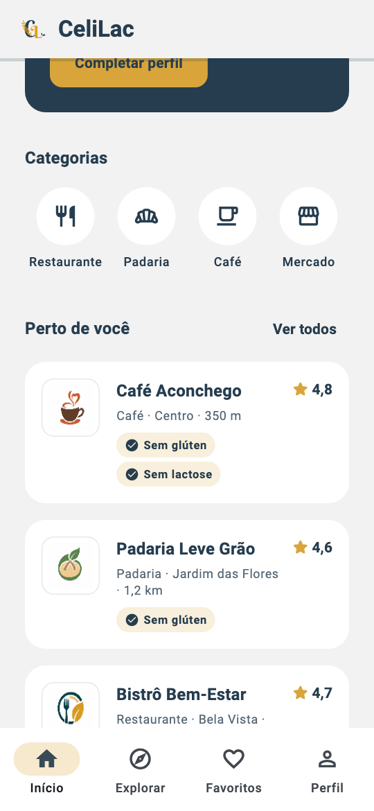
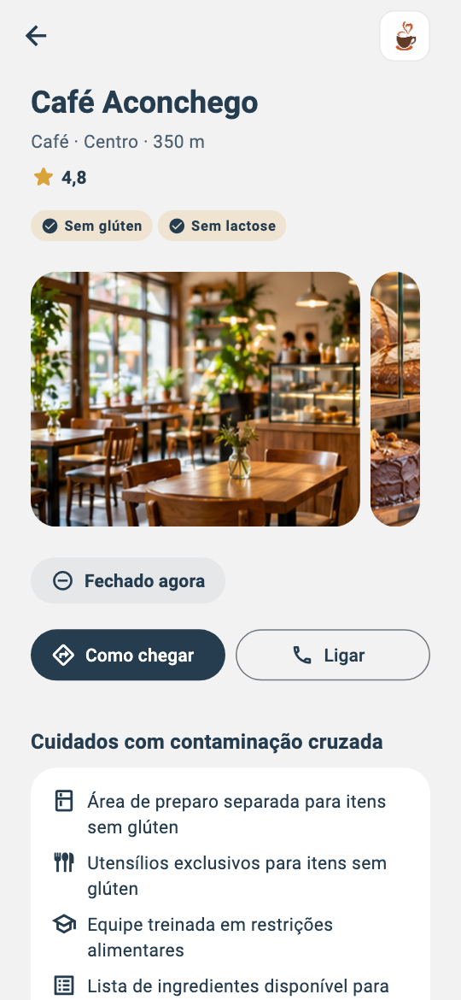
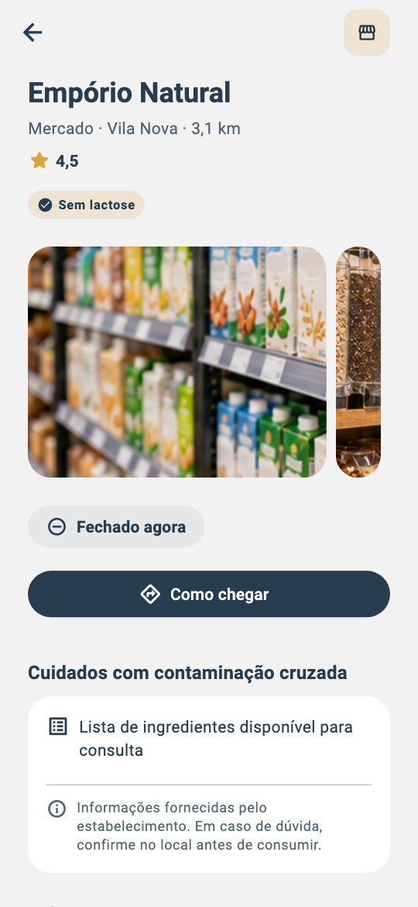
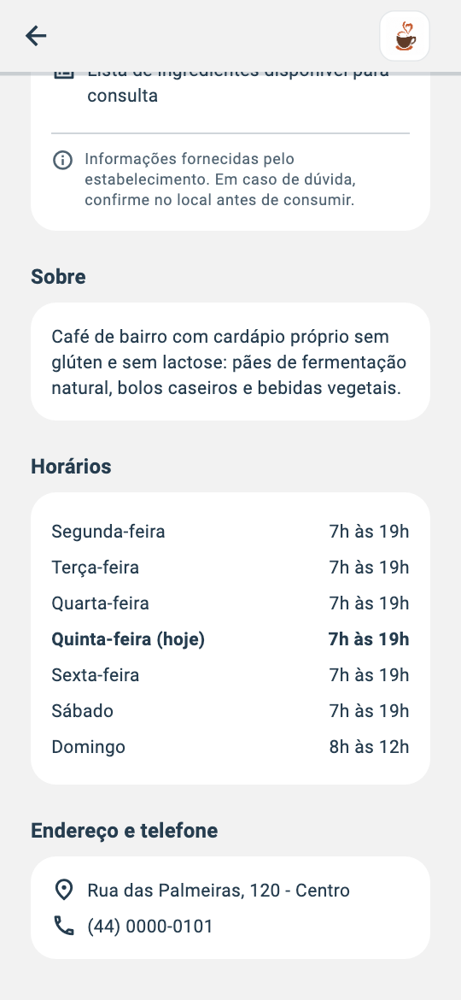

# CeliLac: Detalhe do Estabelecimento
## Navegação com dados, Hero, domínio maior, ações externas e testes, passo a passo

---

# Como usar este material

Este material continua o **CeliLac: Homepage Profissional**. Lá, todo cartão da lista "Perto de você" respondia ao toque com a mesma mensagem: "O detalhe do estabelecimento estará disponível em breve". Aqui, esse toque passa a abrir a **tela de detalhe**:

```text
AppShell (barra de navegação inferior)
  └── Início (HomePage)
        │
        │  toque no cartão ──push──►  EstablishmentDetailsPage (este material)
        │                                      │
        ◄────────────── voltar (pop) ──────────┘
```

Como no material anterior, cada parte alterna a ideia por trás do código (que vale para qualquer projeto) com o código implementado no CeliLac, e alguns trechos são marcados por um rótulo em negrito:

- **Atenção**: armadilhas comuns.
- **No seu projeto**: o que adaptar para o seu app.
- **Execute**: o momento de rodar o app e verificar o resultado.

Os testes automatizados continuam como conteúdo complementar (Parte 8).

> O CeliLac mostra o detalhe de um estabelecimento. O seu app pode mostrar o detalhe de um livro, de um treino, de um evento ou de um pedido: a estrutura é a mesma. Uma lista para **escolher**, um detalhe para **decidir**.

> Todo o código deste material foi compilado com `flutter analyze` (sem avisos) e validado com 31 testes automatizados (Parte 8), no Flutter 3.47 / Dart 3.13.

## Resultado esperado

| Home com as logomarcas | Topo do detalhe, com a galeria |
|---|---|
|  |  |

| Sem logomarca: o ícone da categoria | Horários e endereço |
|---|---|
|  |  |

---

# Parte 0: Antes do código

## 0.1 Conceito: o papel do detalhe

A Home e a tela de detalhe têm trabalhos diferentes:

| | Lista (Home) | Detalhe |
|---|---|---|
| a pergunta do usuário | "quais são as opções?" | "**esta** opção serve para mim?" |
| o que ele faz | compara, percorre, escolhe | lê com atenção e **decide** |
| quanto mostrar de cada item | o mínimo para comparar (nome, distância, nota, selos) | tudo o que ajuda a decidir |

Por isso o cartão da Home é **curto** e o detalhe é **completo**. Se o cartão mostrasse tudo, a lista ficaria impossível de percorrer; se o detalhe mostrasse pouco, o usuário não teria como decidir.

Para quem tem doença celíaca ou intolerância à lactose, decidir onde comer passa por três perguntas, nesta ordem:

1. **É seguro para mim?** Não basta o cardápio ter um prato "sem glúten": importa **como** ele é preparado.
2. **Está aberto?** Não adianta descobrir o lugar ideal e chegar com a porta fechada.
3. **Como eu chego, ou falo com eles?** Endereço e telefone, de preferência a um toque.

A tela de detalhe existe para responder a essas três perguntas.

## 0.2 A promessa "Informação" chega ao fim

O onboarding prometeu: "**Entenda antes de escolher**". A Home começou a cumprir a promessa com os selos "Sem glúten" e "Sem lactose" nos cartões. O detalhe a cumpre de vez:

| Pergunta | Onde o detalhe responde |
|---|---|
| É seguro para mim? | seção "Cuidados com contaminação cruzada" |
| Está aberto? | selo "Aberto agora · fecha às 19h" e a tabela de horários, com o dia de hoje destacado |
| Como chego, ou falo com eles? | botões "Como chegar" e "Ligar", e a seção "Endereço e telefone" |

E há uma promessa da própria Home: o toque no cartão dizia "em breve". Neste material, esse "em breve" deixa de existir.

**No seu projeto:** liste as **perguntas** que o usuário faz antes de decidir sobre um item do seu app (comprar o livro? fazer o treino? ir ao evento?). Cada pergunta vira uma seção do detalhe. Se uma seção não responde a nenhuma pergunta, ela não precisa existir.

## 0.3 Estrutura e hierarquia

```text
┌─────────────────────────────────┐
│ ←                        [logo] │ ← AppBar: "voltar" e a logomarca, que
├─────────────────────────────────┤   "voa" do cartão até aqui (Hero)
│ Bistrô Bem-Estar                │ ← 1. Resumo: aparece NA HORA
│ Restaurante · Bela Vista · 2,4 km│   (são os dados que o cartão já tinha)
│ ★ 4,7                           │
│ [✓ Sem glúten] [✓ Sem lactose]  │
│                                 │
│ ┌────────────────────────┐ ┌──┐ │ ← 2. Galeria de fotos: carregada
│ │         foto 1         │ │f2│ │   do repositório, com um pedaço
│ └────────────────────────┘ └──┘ │   da próxima foto
│ (⊖ Fechado agora)               │ ← 3. Status e ações
│ [ Como chegar ] [  Ligar  ]     │
│                                 │
│ Cuidados com contaminação cruzada│ ← 4. A pergunta mais importante
│ ┌─────────────────────────────┐ │
│ │ 🎓 Equipe treinada...        │ │
│ │ ⓘ Informações fornecidas... │ │
│ └─────────────────────────────┘ │
│ Sobre                           │ ← 5. Contexto
│ Horários                        │ ← 6. Tabela da semana (hoje em negrito)
│ Endereço e telefone             │ ← 7. Referência
└─────────────────────────────────┘
```

**Por que essa ordem?**

- **A logomarca fica na barra, e não no conteúdo.** Ela identifica o lugar, mas não precisa de destaque: o nome, logo abaixo, faz isso melhor. Na barra, ela ocupa uma linha que já existia (a da seta de voltar), libera espaço para o resumo e **continua visível** enquanto o usuário rola a página.
- **O resumo vem primeiro, e aparece na hora.** O usuário acabou de tocar em um cartão; ele precisa reconhecer imediatamente que chegou ao lugar certo. Os dados do resumo são os mesmos do cartão, então não precisam esperar nenhuma busca (Parte 4.1).
- **As fotos logo abaixo do resumo.** Elas respondem a "que lugar é esse?", a primeira curiosidade de quem acabou de abrir o detalhe, e mostram o ambiente melhor do que qualquer texto (Parte 5).
- **Status e ações em seguida.** "Está aberto?" e "como chego?" são as perguntas mais rápidas de responder, e as ações são o **próximo passo** de quem já decidiu.
- **Cuidados antes de "Sobre".** O texto de apresentação é o que todo lugar escreve sobre si; os cuidados com contaminação cruzada são o que o público do CeliLac **veio procurar**.
- **Horários e endereço por último.** São informações de **consulta**: quem precisa delas sabe procurá-las, e quem já decidiu usa os botões lá em cima.

## 0.4 O que fica de fora (e por quê)

| Tentação | Por que não agora |
|---|---|
| Carrossel que passa sozinho | A Home já recusou o carrossel automático de banners (material anterior, Parte 0.4). A galeria do detalhe só se move quando o usuário desliza (Parte 5.7). |
| Abrir a foto em tela cheia, com zoom | Exige uma segunda tela e gestos de pinça. Fica como desafio (Parte 10). |
| Avaliações e comentários de usuários | Exigem contas de usuário, moderação e um servidor. A nota (★ 4,7) basta por enquanto. |
| Botão de favoritar | Favoritos aparecem em **duas** telas (Home e aba Favoritos) e precisam ficar sincronizados: isso pede gerência de estado, assunto de um próximo material. Um coração que não salva nada seria um botão "morto". |
| Mapa embutido na tela | `google_maps_flutter` exige chave de API, configuração por plataforma e tem custo. O botão "Como chegar" **delega** o mapa ao app que o usuário já usa (Parte 6). |
| Horários que passam da meia-noite (ex.: 18h às 2h) | Nenhum estabelecimento dos dados atuais funciona assim. O modelo da Parte 2.2 não trata esse caso, e isso fica registrado como pendência (Parte 9). |

> **E o "Ver todos", a busca e as categorias, que continuam "em breve"?** Eles pertencem à aba Explorar, assunto de outro material. Este material resolve **um** "em breve": o do cartão.

## 0.5 Antes da feature, preparar o terreno

Ao planejar a tela de detalhe, percebemos que ela precisa de várias peças que **já existem**, mas estão no lugar errado:

| A tela de detalhe precisa de... | Que hoje está em... | Problema |
|---|---|---|
| a mesma largura máxima de leitura da Home | `HomePage.maxContentWidth` | o detalhe teria de importar a Home só para ler um número |
| a mesma mensagem de erro com "Tentar novamente" | `NearbyMessage`, em `home/` | o nome fala de "perto de você", e o arquivo é da Home |
| o mesmo título de seção | `SectionHeader`, em `home/` | idem |
| o mesmo ícone de categoria do cartão, maior | dentro do `EstablishmentCard` | o desenho ficaria duplicado, e o `Hero` (Parte 3.5) precisa dos dois iguais |

E o domínio de `establishments` vai crescer de 4 para 7 arquivos. No material anterior (Parte 0.5), combinamos que esse seria o momento de organizá-lo em subpastas.

Uma frase atribuída ao programador Kent Beck resume a estratégia: **"primeiro, torne a mudança fácil; depois, faça a mudança fácil"**. A Parte 1 só reorganiza (o app continua igual), e as Partes 2 a 5 constroem a tela nova sobre uma base arrumada.

## 0.6 Estrutura de pastas

```text
lib/
├── app/
│   ├── celilac_app.dart                         ← (alterado) app em português
│   ├── common/
│   │   ├── external_links.dart                  ← novo: ligar e abrir o mapa
│   │   ├── formatters.dart                      ← (alterado) horas e dias da semana
│   │   └── widgets/
│   │       ├── section_header.dart              ← movido de home/
│   │       ├── source_image.dart                ← novo: asset ou rede, com plano B
│   │       └── status_message.dart              ← novo (era o NearbyMessage)
│   └── theme/
│       └── app_layout.dart                      ← novo: largura máxima de leitura
└── features/
    ├── establishments/
    │   ├── data/
    │   │   └── fake_establishment_repository.dart  ← (alterado) detalhes falsos
    │   ├── domain/
    │   │   ├── entities/                        ← nova subpasta
    │   │   │   ├── dietary_option.dart          ← movido
    │   │   │   ├── establishment.dart           ← movido e alterado (logomarca)
    │   │   │   ├── establishment_category.dart  ← movido
    │   │   │   ├── establishment_details.dart   ← novo
    │   │   │   ├── establishment_photo.dart     ← novo
    │   │   │   ├── opening_hours.dart           ← novo
    │   │   │   └── safety_practice.dart         ← novo
    │   │   └── repositories/                    ← nova subpasta
    │   │       └── establishment_repository.dart  ← movido e alterado
    │   └── presentation/
    │       ├── establishment_category_icon.dart
    │       ├── establishment_hero_tag.dart      ← novo
    │       ├── safety_practice_icon.dart        ← novo
    │       ├── pages/
    │       │   └── establishment_details_page.dart  ← novo: a tela
    │       └── widgets/
    │           ├── category_icon_tile.dart      ← novo (extraído do cartão)
    │           ├── contact_actions.dart         ← novo
    │           ├── details_loading.dart         ← novo
    │           ├── details_section.dart         ← novo
    │           ├── dietary_badge.dart
    │           ├── establishment_card.dart      ← (alterado) Hero e logomarca
    │           ├── establishment_logo.dart      ← novo
    │           ├── establishment_summary.dart   ← novo
    │           ├── open_status.dart             ← novo
    │           ├── opening_hours_table.dart     ← novo
    │           ├── photo_carousel.dart          ← novo
    │           └── safety_practices_list.dart   ← novo
    └── home/
        └── presentation/
            ├── pages/
            │   └── home_page.dart               ← (alterado) abre o detalhe
            └── widgets/
                └── nearby_loading.dart          ← renomeado (era nearby_states.dart)

assets/images/establishments/                    ← novo: uma pasta por estabelecimento

test/
├── support/
│   └── stub_establishment_repository.dart       ← novo: stub compartilhado
├── app/
│   ├── external_links_test.dart                 ← novo
│   └── formatters_test.dart                     ← (alterado)
└── features/
    ├── establishments/
    │   ├── establishment_details_page_test.dart ← novo
    │   ├── establishment_details_test.dart      ← novo
    │   └── establishment_logo_test.dart         ← novo
    └── home/
        └── home_page_test.dart                  ← (alterado)
```

**Por que a tela de detalhe fica em `establishments/`, e não em uma feature `details/`?** Pela mesma regra da Parte 0.5 do material anterior: o detalhe é uma tela **sobre um assunto** (estabelecimento), e será aberta de vários lugares (Home, Explorar, Favoritos, busca). Quem abre o detalhe importa de `establishments/`, que é o dono do assunto. A Home, ao contrário, é uma tela que **reúne** assuntos, e por isso continua sendo uma feature própria.

**`pages/` dentro de `establishments/presentation/`.** Até aqui, `establishments/` só tinha widgets usados por outras telas. Agora ela tem uma **tela inteira**, e a separação `pages/` × `widgets/` é a mesma da Home.

## 0.7 Roteiro

```text
Parte 1  Preparando o terreno  subpastas do domínio, AppLayout, StatusMessage, SectionHeader, CategoryIconTile
Parte 2  Domínio               resumo × detalhe, horários sem Flutter, contrato com null, fake
Parte 3  Navegação             pilha de rotas, push/pop, passar dados, Hero, app em português
Parte 4  A tela de detalhe     o que já se tem na hora, estados, seções, status, horários
Parte 5  Imagens               assets, ImageProvider, memória, logomarca com plano B, carrossel
Parte 6  Ações externas        url_launcher: ligar e abrir o mapa
Parte 7  Qualidade             responsividade, fonte ampliada, leitor de tela, movimento
Parte 8  Testes                stub compartilhado, unidade, widget, navegação (complementar)
Parte 9  Revisão               decisões, alternativas e próximos passos
Parte 10 No seu projeto        roteiro, checklist e desafios
```

---

# Parte 1: Preparando o terreno

## 1.1 Conceito: refatorar

**Refatorar** é mudar a **estrutura** do código sem mudar o seu **comportamento**. Depois de uma refatoração, o app faz exatamente o que fazia antes: as mesmas telas, os mesmos textos, os mesmos toques. O que muda é onde as coisas estão e como se chamam.

Refatorações pequenas e frequentes mantêm o projeto fácil de mudar. A pergunta que dispara a maioria delas é: **"o segundo uso chegou?"**

- Com **um** uso, código específico de uma tela fica na tela. Generalizar antes da hora cria abstrações para necessidades imaginárias.
- Com o **segundo** uso, o código passa a ser compartilhado e deve ir para um lugar compartilhado. Foi o que fizemos com o `fadeRoute` no material anterior (Parte 3.2), quando ele passou a ser usado pela Splash **e** pelo onboarding.

Neste material, o "segundo uso" é a tela de detalhe, e ele chega para quatro peças de uma vez (Parte 0.5).

> **Atenção: refatore com rede de segurança.** Rode `flutter test` **antes** de começar e **depois** de cada passo. Se os testes da Home passavam antes e passam depois, você tem uma boa evidência de que o comportamento não mudou. Se você não fez a Parte 7 do material anterior, rode o app e confira a Home à mão.

## 1.2 O domínio em subpastas

No material anterior (Parte 0.5), deixamos combinado: quando o domínio passasse de 4 arquivos para algo como 8 a 10, valeria dividir `domain/` pelo **papel** de cada arquivo. Este material acrescenta três entidades (`EstablishmentDetails`, `OpeningHours`, `SafetyPractice`), e o domínio chega a 7 arquivos, com a próxima feature (favoritos) prestes a trazer mais. É a hora:

```text
domain/                                   domain/
├── dietary_option.dart                   ├── entities/
├── establishment.dart            ──►     │   ├── dietary_option.dart
├── establishment_category.dart           │   ├── establishment.dart
└── establishment_repository.dart         │   └── establishment_category.dart
                                          └── repositories/
                                              └── establishment_repository.dart
```

**Como mover os arquivos.** Duas formas:

- **Pelo editor (recomendado).** No VS Code, arraste os arquivos para as novas pastas no painel *Explorer*. O editor pergunta *"Update imports for 'establishment.dart'?"*: responda **Yes** (ou *Always*). O Android Studio faz o mesmo com *Refactor → Move*. O editor corrige todos os `import` do projeto, inclusive os dos testes.
- **Pelo terminal**, com `git mv` (o Git registra a mudança como **movimentação**, e não como "arquivo apagado + arquivo novo", o que preserva o histórico):

```bash
cd lib/features/establishments/domain
mkdir entities repositories
git mv establishment.dart establishment_category.dart dietary_option.dart entities/
git mv establishment_repository.dart repositories/
```

Pelo terminal, os `import` precisam ser corrigidos à mão. Os padrões são:

```dart
// antes                                        // depois
import '.../domain/establishment.dart';         import '.../domain/entities/establishment.dart';
import '.../domain/establishment_category.dart'; import '.../domain/entities/establishment_category.dart';
import '.../domain/dietary_option.dart';        import '.../domain/entities/dietary_option.dart';
import '.../domain/establishment_repository.dart';
                               // ──► import '.../domain/repositories/establishment_repository.dart';
```

E o próprio contrato, que agora está em outra pasta, passa a importar o modelo assim:

```dart
import '../entities/establishment.dart';
```

**Execute:** rode `flutter analyze`. Cada `import` esquecido aparece como `Target of URI doesn't exist`, com o arquivo e a linha. Corrija até aparecer `No issues found!`.

## 1.3 `AppLayout`: a largura máxima de leitura

No material anterior (Parte 6.1), a Home limitou o conteúdo a 600 dp, com a margem calculada no `build`. A tela de detalhe precisa **da mesma regra**. Em vez de copiar o cálculo, ele vai para o tema, ao lado dos outros *tokens*:

`lib/app/theme/app_layout.dart`

```dart
import 'dart:math' as math;

import 'app_spacing.dart';

abstract final class AppLayout {
  static const double maxContentWidth = 600;

  static double horizontalPadding(double screenWidth) {
    return math.max(AppSpacing.lg, (screenWidth - maxContentWidth) / 2);
  }
}
```

Na `HomePage`, apague a constante `static const double maxContentWidth = 600;` e o `import 'dart:math' as math;`, importe o `AppLayout` e troque o cálculo no `build`:

```dart
// antes
final screenWidth = MediaQuery.sizeOf(context).width;
final horizontalPadding = math.max(
  AppSpacing.lg,
  (screenWidth - HomePage.maxContentWidth) / 2,
);

// depois
final horizontalPadding = AppLayout.horizontalPadding(
  MediaQuery.sizeOf(context).width,
);
```

### Conceitos

- **Uma função, e não só a constante.** Mover apenas o `600` deixaria a **regra** (o máximo entre 24 e a sobra dividida por dois) copiada nas duas telas. Se um dia a margem mínima mudar, ela mudaria em uma tela e não na outra. A função guarda a regra em um lugar só.
- **Por que em `theme/`?** `AppLayout` é um *token* de layout, como `AppSpacing` e `AppRadius`: uma decisão visual que vale para o app inteiro.

## 1.4 `StatusMessage`: a mensagem de estado compartilhada

O `NearbyMessage` da Home (ícone, mensagem e um botão opcional) é exatamente o que o detalhe precisa para os estados de erro e de "não encontrado". Só o nome e o lugar estão errados: "Nearby" é "perto de você", e o arquivo está em `home/`.

1. Crie `lib/app/common/widgets/status_message.dart` com o código do `NearbyMessage`, trocando o nome da classe para `StatusMessage` e corrigindo os `import` (agora o arquivo está mais perto de `theme/`):

```dart
import 'package:flutter/material.dart';

import '../../theme/app_colors.dart';
import '../../theme/app_radius.dart';
import '../../theme/app_spacing.dart';

class StatusMessage extends StatelessWidget {
  const StatusMessage({
    super.key,
    required this.icon,
    required this.message,
    this.actionLabel,
    this.onAction,
  });

  final IconData icon;
  final String message;
  final String? actionLabel;
  final VoidCallback? onAction;

  @override
  Widget build(BuildContext context) {
    final label = actionLabel;

    return Container(
      width: double.infinity,
      padding: const EdgeInsets.all(AppSpacing.lg),
      decoration: BoxDecoration(
        color: Colors.white,
        borderRadius: BorderRadius.circular(AppRadius.md),
      ),
      child: Column(
        children: [
          Icon(icon, size: 40, color: AppColors.navy),
          const SizedBox(height: AppSpacing.sm),
          Text(
            message,
            style: Theme.of(context).textTheme.bodyMedium
                ?.copyWith(color: AppColors.navy.withValues(alpha: 0.8)),
            textAlign: TextAlign.center,
          ),
          if (label != null) ...[
            const SizedBox(height: AppSpacing.sm),
            TextButton(onPressed: onAction, child: Text(label)),
          ],
        ],
      ),
    );
  }
}
```

2. Em `home/presentation/widgets/`, renomeie `nearby_states.dart` para `nearby_loading.dart` e apague dele a classe `NearbyMessage`. Fica só o `NearbyLoading`.
3. Na `HomePage`, troque `NearbyMessage(` por `StatusMessage(` (duas ocorrências), e os `import`:

```dart
// remova:
import '../widgets/nearby_states.dart';

// adicione:
import '../../../../app/common/widgets/status_message.dart';
import '../widgets/nearby_loading.dart';
```

### Conceitos

**Por que o esqueleto (`NearbyLoading`) fica na Home?** Porque ele **não** é genérico: os três blocos de 96 dp imitam o formato dos cartões da lista. O detalhe terá o seu próprio esqueleto, com o formato das suas seções (Parte 4.5). O que é igual vai para o lugar comum; o que só **parece** igual fica onde está.

**Renomear junto com mover.** O nome de uma classe compartilhada deve descrever **o que ela é**, e não **onde ela foi usada primeiro**. `StatusMessage` serve para qualquer estado (erro, vazio, não encontrado) de qualquer tela.

## 1.5 `SectionHeader` também vai para o lugar comum

O título de seção da Home ("Categorias", "Perto de você") será usado pelas seções do detalhe ("Horários", "Sobre"...). Mova `home/presentation/widgets/section_header.dart` para `lib/app/common/widgets/section_header.dart` e corrija o `import` de cores **dentro** dele:

```dart
import '../../theme/app_colors.dart';
```

Na `HomePage`:

```dart
// remova:
import '../widgets/section_header.dart';

// adicione:
import '../../../../app/common/widgets/section_header.dart';
```

O código da classe não muda.

## 1.6 `CategoryIconTile`: o ícone do cartão, reutilizável

O quadrado dourado com o ícone da categoria aparece no cartão (56 dp) e vai aparecer na barra superior do detalhe (40 dp). Extraímos o desenho para um widget com o tamanho como parâmetro:

`lib/features/establishments/presentation/widgets/category_icon_tile.dart`

```dart
import 'package:flutter/material.dart';

import '../../../../app/theme/app_colors.dart';
import '../../../../app/theme/app_radius.dart';
import '../../domain/entities/establishment_category.dart';
import '../establishment_category_icon.dart';

class CategoryIconTile extends StatelessWidget {
  const CategoryIconTile({super.key, required this.category, this.size = 56});

  final EstablishmentCategory category;
  final double size;

  @override
  Widget build(BuildContext context) {
    return Container(
      width: size,
      height: size,
      decoration: BoxDecoration(
        color: AppColors.gold.withValues(alpha: 0.18),
        borderRadius: BorderRadius.circular(AppRadius.sm),
      ),
      child: Icon(category.icon, color: AppColors.navy, size: size * 3 / 7),
    );
  }
}
```

No `EstablishmentCard`, troque o `Container` do ícone por:

```dart
CategoryIconTile(category: establishment.category),
```

E ajuste os `import` do cartão: saem `app_radius.dart` e `establishment_category_icon.dart` (que agora só o `CategoryIconTile` usa), entra `category_icon_tile.dart`. O `flutter analyze` avisa (`Unused import`) se algum ficar sobrando.

### Conceitos

- **`size * 3 / 7`.** No cartão original, o ícone tinha o tamanho padrão (24) dentro de um quadrado de 56. A proporção 24 / 56 é exatamente 3 / 7. Calculando o ícone a partir do quadrado, o widget mantém a **proporção** em qualquer tamanho: 24 no cartão, cerca de 31 no detalhe.
- **Parâmetro com valor padrão (`this.size = 56`).** Quem não informa o tamanho recebe o do cartão. O cartão continua escrito como antes, e só o detalhe precisa dizer `size: 40`.

**Execute:** rode o app e o `flutter test`. **Nada** deve ter mudado visualmente, e os testes da Home devem passar. Se algo mudou, a refatoração mudou comportamento: volte e compare.

---

# Parte 2: Domínio: o que o detalhe precisa saber

## 2.1 Conceito: resumo × detalhe

O `Establishment` tem o que o **cartão** mostra: nome, categoria, bairro, distância, nota e opções alimentares. O detalhe precisa de mais: descrição, endereço, telefone, horários e cuidados com contaminação cruzada.

A primeira ideia é acrescentar esses campos ao próprio `Establishment`. O problema aparece quando pensamos na API que o app vai usar um dia. Em quase todo serviço real, há **duas** consultas:

| Consulta | Exemplo de endereço na API | Devolve |
|---|---|---|
| lista | `GET /establishments?near=...` | **muitos** itens, cada um com **poucos** campos (o resumo) |
| detalhe | `GET /establishments/3/details` | **um** item, com **todos** os campos |

A lista é leve porque traz dezenas de itens; o detalhe pode ser pesado porque traz um. Se o `Establishment` carregasse tudo, a lista teria de baixar horários e descrições de dezenas de lugares que o usuário talvez nunca abra.

Por isso o domínio passa a ter **dois** objetos:

```text
Establishment (resumo)                EstablishmentDetails (o que falta)
├── id  ◄──────────────────────────── establishmentId
├── name                              ├── description
├── category                          ├── address
├── neighborhood                      ├── phone (opcional)
├── distanceInKm                      ├── openingHours: List<OpeningHours>
├── rating                            └── safetyPractices: Set<SafetyPractice>
└── dietaryOptions
```

O `establishmentId` liga os dois. Agora o `id` que o material anterior criou "mesmo sem uso hoje" (Parte 2.3) ganha o seu primeiro uso.

## 2.2 Horários sem Flutter: `OpeningHours`

Um horário de funcionamento é "**em tal dia da semana**, abre **a tal hora** e fecha **a tal hora**". A tentação é usar o `TimeOfDay`, a classe do Flutter que representa uma hora do dia. Mas ela vem de `package:flutter/material.dart`, e **a camada `domain` não depende do Flutter** (é a regra do checklist do material anterior, a mesma que manteve o `IconData` fora do enum de categorias).

Usamos então só tipos do próprio Dart:

`lib/features/establishments/domain/entities/opening_hours.dart`

```dart
class OpeningHours {
  const OpeningHours({
    required this.weekday,
    required this.opensAt,
    required this.closesAt,
  });

  final int weekday;
  final Duration opensAt;
  final Duration closesAt;

  bool contains(DateTime moment) {
    if (moment.weekday != weekday) {
      return false;
    }
    final time = Duration(hours: moment.hour, minutes: moment.minute);
    return time >= opensAt && time < closesAt;
  }
}
```

### Conceitos

**`Duration` como "hora do dia".** Uma `Duration` é uma quantidade de tempo. "7h30" vira "7 horas e 30 minutos **desde a meia-noite**": `Duration(hours: 7, minutes: 30)`. Por que não `DateTime`? Porque um `DateTime` é um **instante** (dia, mês, ano, hora), e o horário de funcionamento vale para **toda** segunda-feira, e não para uma data específica.

**`weekday` segue o `DateTime`.** No Dart, `DateTime.weekday` vai de **1 (segunda)** a **7 (domingo)**, e existem constantes com esses nomes: `DateTime.monday`, ..., `DateTime.sunday`. Usar a mesma numeração permite comparar direto com `moment.weekday`, sem conversões.

> **Atenção:** outras linguagens numeram diferente. No JavaScript, `getDay()` vai de **0 (domingo)** a 6 (sábado). Ao receber horários de uma API, confira a convenção dela.

**Comparação de `Duration`.** `Duration` tem os operadores `<`, `<=`, `>` e `>=`. Por isso `time >= opensAt && time < closesAt` funciona como comparação de horários.

**Intervalo semiaberto: `>=` na abertura, `<` no fechamento.** Um lugar que "funciona das 11h30 às 15h" está **aberto** às 11h30 em ponto e **fechado** às 15h em ponto. Em notação de matemática, o intervalo é `[11h30, 15h)`. Essa escolha evita que dois turnos encostados ("11h às 15h" e "15h às 18h") se sobreponham às 15h.

**Lógica no domínio, e não na tela.** Decidir se um horário está aberto é **regra de negócio**, e não desenho. Fica no domínio, é uma função pura (o resultado depende só dos dados e do `moment` recebido) e é fácil de testar (Parte 8.2), como a `greetingFor` do material anterior.

**O que este modelo não resolve:** um bar que funciona das 18h às 2h. O fechamento (2h) seria **menor** que a abertura (18h), e `contains` nunca daria `true`. Esse caso ficou fora de propósito (Parte 0.4) e é um dos desafios da Parte 10.

## 2.3 Cuidados com contaminação cruzada: `SafetyPractice`

Para quem tem doença celíaca, um prato feito com ingredientes sem glúten **pode não ser seguro**. Se ele for preparado na mesma bancada em que se sova pão comum, cortado com a mesma faca ou frito no mesmo óleo, pode receber traços de glúten. Isso é a **contaminação cruzada**. Por isso a pergunta "é seguro para mim?" (Parte 0.1) não se responde só com o selo "Sem glúten": é preciso saber **como** o lugar trabalha.

Os cuidados formam um conjunto fechado de opções. É o caso de uso de um enum com campos, como os da Parte 2.2 do material anterior:

`lib/features/establishments/domain/entities/safety_practice.dart`

```dart
enum SafetyPractice {
  separateKitchen('Área de preparo separada para itens sem glúten'),
  exclusiveUtensils('Utensílios exclusivos para itens sem glúten'),
  trainedStaff('Equipe treinada em restrições alimentares'),
  ingredientList('Lista de ingredientes disponível para consulta');

  const SafetyPractice(this.label);

  final String label;
}
```

### Conceitos

- **Os rótulos descrevem fatos, e não garantias.** "Utensílios exclusivos" é algo que o estabelecimento **faz**. Evitamos frases como "100% seguro para celíacos", que o app não tem como verificar. A responsabilidade sobre a informação aparece na própria tela (Parte 4.8).
- **O ícone de cada cuidado não fica aqui**, pelo mesmo motivo do `TimeOfDay`: `IconData` é do Flutter. Ele fica em uma extensão na camada de apresentação (Parte 4.8).

## 2.4 O modelo `EstablishmentDetails`

`lib/features/establishments/domain/entities/establishment_details.dart`

```dart
import 'opening_hours.dart';
import 'safety_practice.dart';

class EstablishmentDetails {
  const EstablishmentDetails({
    required this.establishmentId,
    required this.description,
    required this.address,
    this.phone,
    required this.openingHours,
    required this.safetyPractices,
  });

  final String establishmentId;
  final String description;
  final String address;
  final String? phone;
  final List<OpeningHours> openingHours;
  final Set<SafetyPractice> safetyPractices;

  OpeningHours? openPeriodAt(DateTime moment) {
    for (final hours in openingHours) {
      if (hours.contains(moment)) {
        return hours;
      }
    }
    return null;
  }

  List<OpeningHours> hoursOn(int weekday) {
    return [
      for (final hours in openingHours)
        if (hours.weekday == weekday) hours,
    ];
  }
}
```

### Conceitos

**`String? phone` e `this.phone` sem `required`.** Nem todo lugar tem telefone (um mercado pode atender só no balcão). O `?` diz que o campo **pode ser nulo**, e um parâmetro nomeado sem `required` pode ser omitido; quando omitido, vale `null`. A tela vai **esconder** o botão "Ligar" nesse caso (Parte 6.6), em vez de mostrar um botão que não funciona.

**`List<OpeningHours>`, e não um horário por dia.** Um restaurante pode abrir **duas vezes** no mesmo dia (almoço e jantar). Com uma lista de períodos, cada turno é um item, e um dia pode ter zero (fechado), um ou dois períodos.

**`openPeriodAt` devolve o período, e não só `true`/`false`.** A pergunta da tela não é só "está aberto?", mas "está aberto **até quando**?" ("fecha às 15h"). Devolvendo o próprio `OpeningHours` em que o momento cai (ou `null` se estiver fechado), a tela tem as duas respostas de uma vez.

**Por que um `for` e não o `firstWhere`?** O `firstWhere` **lança um erro** quando nenhum item atende à condição. O parâmetro `orElse` poderia devolver um valor padrão, mas não `null`: a lista é de `OpeningHours` (não nulo), e o compilador recusa `orElse: () => null` com *"A value of type 'Null' can't be returned..."*. O `for` com `return` deixa a intenção explícita. Desde o Dart 3.0, há também uma alternativa curta, que você pode encontrar em outros projetos:

```dart
OpeningHours? openPeriodAt(DateTime moment) =>
    openingHours.where((hours) => hours.contains(moment)).firstOrNull;
```

**`hoursOn` com *collection for / if*.** É o mesmo recurso usado na lista de selos do cartão (material anterior, Parte 4.6): uma lista construída com `for` e `if` dentro dos colchetes. O resultado são os períodos de um dia, em ordem, ou uma lista vazia se o lugar não abre naquele dia.

## 2.5 O contrato: buscar os detalhes de um estabelecimento

`lib/features/establishments/domain/repositories/establishment_repository.dart`

```dart
import '../entities/establishment.dart';
import '../entities/establishment_details.dart';

abstract interface class EstablishmentRepository {
  Future<List<Establishment>> fetchNearby();

  Future<EstablishmentDetails?> fetchDetails(String establishmentId);
}
```

### Conceitos

**`Future<EstablishmentDetails?>`: o `?` está dentro do `Future`.** O `Future` sempre termina; o que ele entrega é **um detalhe ou `null`**. E por que `null` seria uma resposta possível? Porque o estabelecimento pode ter deixado de existir entre o momento em que a lista foi carregada e o toque no cartão (fechou, foi removido do app).

**`null` × erro: duas situações diferentes.**

| Situação | Exemplo | Como o contrato informa | O que a tela mostra |
|---|---|---|---|
| a busca **funcionou**, e o item **não existe** | a API respondeu "404 Not Found" | devolve `null` | "As informações deste lugar não estão mais disponíveis." + **Voltar** |
| a busca **falhou** | sem internet, servidor fora do ar | lança uma exceção | "Não foi possível carregar..." + **Tentar novamente** |

A diferença importa para o usuário: tentar de novo **resolve** uma falha de rede, mas **não** faz aparecer um lugar que não existe. Se o contrato tratasse as duas situações do mesmo jeito, a tela não teria como oferecer a saída certa.

**Execute:** rode `flutter analyze` **agora**, antes de mexer no *fake*:

```text
error • Missing concrete implementation of 'EstablishmentRepository.fetchDetails' •
        lib/features/establishments/data/fake_establishment_repository.dart
error • Missing concrete implementation of 'EstablishmentRepository.fetchDetails' •
        test/features/home/home_page_test.dart
```

Esse erro é **bom sinal**. É exatamente o que a Parte 2.5 do material anterior prometeu: "se o contrato mudar, o *fake* deixa de compilar, e você é avisado". Toda implementação do contrato (inclusive o substituto dos testes) agora precisa saber buscar detalhes. A seguir, corrigimos o *fake*; o dos testes, na Parte 8.1.

## 2.6 O *fake* ganha detalhes

`lib/features/establishments/data/fake_establishment_repository.dart`. Acrescente os `import`:

```dart
import '../domain/entities/establishment_details.dart';
import '../domain/entities/opening_hours.dart';
import '../domain/entities/safety_practice.dart';
```

E, depois da lista `_establishments`, os detalhes, o método auxiliar e a implementação de `fetchDetails`:

```dart
  static final Map<String, EstablishmentDetails> _details = {
    '1': EstablishmentDetails(
      establishmentId: '1',
      description:
          'Café de bairro com cardápio próprio sem glúten e sem lactose: '
          'pães de fermentação natural, bolos caseiros e bebidas vegetais.',
      address: 'Rua das Palmeiras, 120 - Centro',
      phone: '(44) 0000-0101',
      openingHours: [
        ..._hoursFor(
          [1, 2, 3, 4, 5, 6],
          opensAt: const Duration(hours: 7),
          closesAt: const Duration(hours: 19),
        ),
        ..._hoursFor(
          [7],
          opensAt: const Duration(hours: 8),
          closesAt: const Duration(hours: 12),
        ),
      ],
      safetyPractices: SafetyPractice.values.toSet(),
    ),
    '2': EstablishmentDetails(
      establishmentId: '2',
      description:
          'Padaria com linha completa sem glúten, produzida em área '
          'separada, com pães, salgados e encomendas de bolos.',
      address: 'Avenida das Hortênsias, 455 - Jardim das Flores',
      phone: '(44) 0000-0202',
      openingHours: _hoursFor(
        [2, 3, 4, 5, 6, 7],
        opensAt: const Duration(hours: 6, minutes: 30),
        closesAt: const Duration(hours: 13),
      ),
      safetyPractices: {
        SafetyPractice.separateKitchen,
        SafetyPractice.exclusiveUtensils,
        SafetyPractice.ingredientList,
      },
    ),
    '3': EstablishmentDetails(
      establishmentId: '3',
      description:
          'Restaurante com pratos do dia adaptáveis no almoço e jantar às '
          'sextas e sábados. Avise a equipe sobre a sua restrição ao pedir.',
      address: 'Rua Coronel Silva, 980 - Bela Vista',
      phone: '(44) 0000-0303',
      openingHours: [
        ..._hoursFor(
          [2, 3, 4, 5, 6],
          opensAt: const Duration(hours: 11, minutes: 30),
          closesAt: const Duration(hours: 15),
        ),
        ..._hoursFor(
          [5, 6],
          opensAt: const Duration(hours: 19),
          closesAt: const Duration(hours: 23),
        ),
      ],
      safetyPractices: {
        SafetyPractice.trainedStaff,
        SafetyPractice.ingredientList,
      },
    ),
    '4': EstablishmentDetails(
      establishmentId: '4',
      description:
          'Mercado de produtos naturais com um corredor dedicado a itens '
          'sem lactose e bebidas vegetais.',
      address: 'Rua Marechal Deodoro, 31 - Vila Nova',
      openingHours: _hoursFor(
        [1, 2, 3, 4, 5, 6],
        opensAt: const Duration(hours: 9),
        closesAt: const Duration(hours: 20),
      ),
      safetyPractices: {SafetyPractice.ingredientList},
    ),
  };

  static List<OpeningHours> _hoursFor(
    List<int> weekdays, {
    required Duration opensAt,
    required Duration closesAt,
  }) {
    return [
      for (final weekday in weekdays)
        OpeningHours(weekday: weekday, opensAt: opensAt, closesAt: closesAt),
    ];
  }

  @override
  Future<EstablishmentDetails?> fetchDetails(String establishmentId) async {
    await Future<void>.delayed(delay);
    return _details[establishmentId];
  }
```

### Conceitos

**`static final`, e não `static const`.** A lista `_establishments` é `const` porque só usa construtores `const`. Os detalhes chamam **métodos** (`_hoursFor(...)`, `SafetyPractice.values.toSet()`), e o resultado de um método só é conhecido quando o programa roda. Com `const`, o compilador recusaria: *"Methods can't be invoked in constant expressions"*. Com `final`, o mapa é criado uma vez, na primeira vez em que é usado, e nunca mais muda.

**`Map<String, EstablishmentDetails>`: buscar pela chave.** Um mapa associa **chaves** a **valores**. `_details['3']` devolve os detalhes do Bistrô, e `_details['99']` devolve `null`, porque a chave não existe. É exatamente o comportamento que o contrato pede para "não encontrado", sem nenhum `if`.

**`_hoursFor` e o *spread* (`...`).** Escrever `OpeningHours(...)` seis vezes para "segunda a sábado, 7h às 19h" seria longo e fácil de errar. O método auxiliar cria um período para cada dia da lista. Quando um lugar tem horários diferentes em dias diferentes (o Café abre mais tarde no domingo; o Bistrô tem jantar na sexta e no sábado), os `...` "despejam" várias listas em uma só (o mesmo *spread* do material anterior, Parte 4.6).

**Dados variados de propósito**, como recomendou o material anterior:

| Estabelecimento | O que ele exercita na tela |
|---|---|
| Café Aconchego | todos os cuidados; horário diferente no domingo |
| Padaria Leve Grão | fechado às segundas; horário com minutos (6h30) |
| Bistrô Bem-Estar | **dois turnos** na sexta e no sábado; poucos cuidados |
| Empório Natural | **sem telefone** (o botão "Ligar" deve sumir) |

**Telefones fictícios.** Os números começam com `0` depois do DDD (`(44) 0000-...`). No Brasil, nenhum número fixo ou celular começa assim, então um toque acidental em "Ligar" durante os testes não liga para ninguém. Os endereços também são inventados.

**Para ver os outros estados** (Parte 4.5), troque temporariamente o corpo de `fetchDetails`:

```dart
// erro:
await Future<void>.delayed(delay);
throw Exception('Falha simulada');

// não encontrado:
await Future<void>.delayed(delay);
return null;
```

**Desfaça** depois de testar.

**No seu projeto:** separe o seu modelo em **resumo** (o que a lista mostra) e **detalhe** (o que só a tela do item mostra). Crie o *fake* do detalhe com pelo menos um item em que cada campo opcional está ausente.

---

# Parte 3: Navegação: da lista ao detalhe

## 3.1 Conceito: a pilha de rotas

No Flutter, cada tela aberta com o `Navigator` é uma **rota** (*route*). O `Navigator` guarda as rotas em uma **pilha**, como uma pilha de pratos: a rota de cima é a que aparece, e só ela recebe toques.

```text
 abrir o detalhe (push)              voltar (pop)

┌──────────────────┐
│ Detalhe          │ ◄── topo
├──────────────────┤             ┌──────────────────┐
│ AppShell (Home)  │             │ AppShell (Home)  │ ◄── topo de novo
└──────────────────┘             └──────────────────┘
```

| Operação | O que faz | Onde o CeliLac usa |
|---|---|---|
| `push` | coloca uma rota **por cima** da atual; a de baixo continua viva | Home → detalhe |
| `pop` | tira a rota do topo; a de baixo reaparece **como estava** | detalhe → Home (seta, gesto ou botão "voltar") |
| `pushReplacement` | **troca** a rota do topo por outra; a antiga é destruída | Splash → onboarding → `AppShell` |

**Por que `push` aqui, e `pushReplacement` na Splash?** Porque a pergunta é: **o usuário deve conseguir voltar?** Da Home, voltar para a Splash não faz sentido, e por isso ela é **substituída**. Do detalhe, voltar para a lista é exatamente o que o usuário espera, e por isso o detalhe é **empilhado**.

**"Como estava" é literal.** Com `push`, a Home não é destruída: a rolagem, a lista carregada e o estado continuam lá embaixo. Ao voltar, o usuário reencontra a lista **na mesma posição**, sem novo carregamento. O teste da Parte 8.4 comprova isso.

## 3.2 O detalhe cobre a barra de navegação

Há dois `Navigator` possíveis para empilhar o detalhe:

```text
Opção A: Navigator do MaterialApp (escolhida)    Opção B: um Navigator dentro de cada aba

┌──────────────────────┐                         ┌──────────────────────┐
│ Detalhe (tela toda)  │                         │ Detalhe              │
├──────────────────────┤                         │                      │
│ AppShell             │                         ├──────────────────────┤
│  └ barra de navegação│                         │ Início Explorar ...  │ ← a barra continua
└──────────────────────┘                         └──────────────────────┘
```

O `Navigator.of(context)` encontra o `Navigator` **mais próximo acima** na árvore. Na `HomePage`, o mais próximo é o do `MaterialApp`, o mesmo que tem o `AppShell` como rota. Por isso o detalhe é empilhado **sobre o shell inteiro**, e a barra de navegação some enquanto ele está aberto.

**Por que essa é a escolha certa agora?** O detalhe é uma tarefa **focada**: o usuário está decidindo sobre um lugar. Esconder a barra dá a tela toda para a decisão, e o "voltar" tem um destino só (a lista). Apps de entrega e de mapas costumam fazer assim.

**Quando a opção B seria melhor?** Quando cada aba tem uma navegação **longa e independente**, e o usuário alterna entre abas no meio do caminho (abrir um detalhe em Explorar, ir para Favoritos e voltar a Explorar **ainda no detalhe**). Isso exige um `Navigator` por aba e costuma ser feito com o pacote `go_router` (`StatefulShellRoute`). É mais complexo, e fica como alternativa na Parte 9.

**E o `PopScope` do `AppShell`?** Ele só age quando o `AppShell` é a rota do **topo**. Com o detalhe aberto, o "voltar" fecha o detalhe normalmente; de volta ao shell, a regra "voltar em outra aba leva ao Início" continua valendo.

## 3.3 `MaterialPageRoute` × `fadeRoute`

Para a Splash e o onboarding, criamos o `fadeRoute`: a tela nova surge com um esmaecimento. Para o detalhe, usamos a rota padrão do Material, o `MaterialPageRoute`:

| | `fadeRoute` (nosso) | `MaterialPageRoute` |
|---|---|---|
| transição | esmaecimento, igual em todo lugar | a do sistema: no Android, acompanha o gesto de "voltar preditivo"; no iOS, a tela desliza da direita |
| gesto de voltar no iOS (arrastar da borda esquerda) | não | **sim** |
| significado | "mudou de **lugar**" (Splash → app) | "**entrou** em um item" e pode sair |

O usuário aprende o "idioma" de navegação do sistema dele. Uma tela que entra deslizando "diz" que dá para voltar; um esmaecimento diz que algo foi **substituído**. Para navegação **hierárquica** (lista → item), use a rota do sistema. Ganhos de brinde: o gesto de voltar do iOS e a animação preditiva do Android 14+, sem nenhuma linha extra.

## 3.4 Passando dados para a tela

O detalhe precisa saber **qual** estabelecimento mostrar e **de onde** buscar os detalhes. As duas coisas chegam pelo **construtor**, como a Home recebe o repositório:

```dart
EstablishmentDetailsPage(
  establishment: establishment,       // o resumo que o cartão já tinha
  repository: widget.repository,      // o mesmo contrato que a Home usa
)
```

**Passar o objeto inteiro ou só o `id`?**

| Passar... | Vantagem | Desvantagem |
|---|---|---|
| o objeto (`Establishment`) | o resumo aparece **na hora**, sem esperar nada (Parte 4.1) | só funciona quando quem abre já tem o objeto |
| só o `id` | funciona de qualquer origem: um link externo, uma notificação | a tela começa vazia e precisa buscar até o nome |

Hoje o detalhe só é aberto a partir de cartões, que já têm o objeto. Passar o objeto dá a melhor experiência. Se um dia o app receber links do tipo "abra o estabelecimento 3" (*deep links*), a tela precisará aceitar só o `id`; esse é um dos desafios da Parte 10.

**O repositório "atravessa" a Home.** A Home não cria repositório: ela recebeu o seu do `AppShell` (a raiz de composição, material anterior, Parte 3.4) e **repassa o mesmo** ao detalhe. Quando o *fake* virar uma API, a troca continua sendo **uma linha** no `AppShell`, e o detalhe passa a usar a API junto com a Home.

Na `HomePage`, acrescente o `import` e o método que abre o detalhe:

```dart
import '../../../establishments/presentation/pages/establishment_details_page.dart';
```

```dart
void _openDetails(Establishment establishment) {
  Navigator.of(context).push(
    MaterialPageRoute<void>(
      builder: (_) => EstablishmentDetailsPage(
        establishment: establishment,
        repository: widget.repository,
      ),
    ),
  );
}
```

E, no `_buildNearby`, troque o "em breve" do cartão:

```dart
// antes
onTap: () => _showComingSoon('O detalhe do estabelecimento'),

// depois
onTap: () => _openDetails(establishment),
```

### Conceitos

- **`builder: (_) => ...`.** A rota recebe uma **função** que constrói a tela, e não a tela pronta. O Flutter chama essa função quando precisa, com o `BuildContext` da rota nova (que aqui não usamos, daí o `_`).
- **`MaterialPageRoute<void>`.** O tipo entre `< >` é o tipo do valor que a tela pode **devolver** ao fechar (`Navigator.pop(context, valor)`). O detalhe não devolve nada, então `void`.
- **`widget.repository`.** Dentro do `State`, os campos do widget são acessados por `widget.` (material anterior, Parte 5.6).

> **Alternativa que você vai encontrar: rotas nomeadas.** `Navigator.pushNamed(context, '/detalhe', arguments: establishment)` e uma tabela de rotas no `MaterialApp`. Os `arguments` são do tipo `Object?`, e a tela precisa convertê-los de volta (`as Establishment`); um erro de digitação só aparece quando o app roda. A própria documentação do Flutter não recomenda mais rotas nomeadas para a maioria dos apps. Quando o CeliLac precisar de rotas por endereço (links externos), o caminho é o pacote `go_router`.

## 3.5 `Hero`: o ícone que voa

Ao tocar no cartão, o quadrado dourado com o ícone da categoria **voa** da posição dele na lista até a barra superior do detalhe, ao lado direito da seta de voltar, encolhendo de 56 para 40 dp. Ao voltar, ele faz o caminho inverso.

Esse efeito é o `Hero`: dois widgets, um em cada tela, marcados com a **mesma etiqueta** (*tag*). Durante a transição de rota, o Flutter encontra os dois e anima um no lugar do outro.

**Por que isso não é enfeite?** A animação mostra ao usuário **de onde** veio a tela nova: "você abriu **este** cartão". Isso se chama **continuidade visual**. Sem ela, a tela nova simplesmente aparece, e o usuário confere o nome para ter certeza de que tocou no lugar certo.

A etiqueta precisa ser **igual** nas duas telas e **diferente** para cada estabelecimento. Uma função pequena garante que as duas telas montem a etiqueta do mesmo jeito:

`lib/features/establishments/presentation/establishment_hero_tag.dart`

```dart
String establishmentHeroTag(String establishmentId) {
  return 'establishment-icon-$establishmentId';
}
```

No `EstablishmentCard`, envolva o ícone:

```dart
Hero(
  tag: establishmentHeroTag(establishment.id),
  child: CategoryIconTile(category: establishment.category),
),
```

E acrescente o `import`:

```dart
import '../establishment_hero_tag.dart';
```

O par desse `Hero` fica na `AppBar` do detalhe (Parte 4.3).

### Conceitos

- **Uma função, e não uma *string* escrita nos dois lugares.** Se o cartão escrevesse `'icon-$id'` e o detalhe `'icon_$id'`, as etiquetas não bateriam e a animação simplesmente **não aconteceria**, sem nenhum erro. Com a função, as duas telas usam a mesma regra.
- **O `Hero` interpola posição e tamanho.** Os filhos dos dois `Hero` não precisam ter o mesmo tamanho, mas devem ter a **mesma aparência**. Por isso extraímos o `CategoryIconTile` (Parte 1.6): os dois lados desenham exatamente o mesmo quadrado.

> **Atenção: etiquetas repetidas na mesma rota.** O `AppShell` mantém **todas** as abas vivas no `IndexedStack`, e todas estão na **mesma rota**. Se um dia a aba Explorar mostrar o cartão do Café Aconchego com a mesma etiqueta da Home, o Flutter encontrará dois `Hero` iguais na mesma rota, mesmo com a aba escondida, e o app quebrará na transição com *"There are multiple heroes that share the same tag within a subtree"*. A solução, quando chegar a hora, é incluir a **origem** na etiqueta (por exemplo, `'home-establishment-icon-1'` e `'explore-establishment-icon-1'`) e passá-la ao detalhe.

## 3.6 O app em português

A tela de detalhe é a primeira do CeliLac com uma `AppBar` e, portanto, com o botão de voltar automático (a seta). Esse botão tem uma **dica** (*tooltip*) que aparece ao segurar o dedo nele, e que é **lida pelo leitor de tela**. Sem configuração, ela diz **"Back"**, em inglês.

Os textos internos do Material (a dica do "voltar", os botões "Copiar" e "Colar" de um campo de texto, os nomes dos meses do seletor de datas) vêm de um objeto de traduções chamado `MaterialLocalizations`. Por padrão, o Flutter só traz o inglês. As outras línguas estão no pacote `flutter_localizations`, que faz parte do próprio SDK do Flutter.

No terminal:

```bash
flutter pub add flutter_localizations --sdk=flutter
```

No `pubspec.yaml`, ele aparece junto do `flutter` (o `pub add` pode colocá-lo no fim da lista; a posição não importa, mas agrupar os pacotes do SDK facilita a leitura):

```yaml
dependencies:
  flutter:
    sdk: flutter
  flutter_localizations:
    sdk: flutter
```

`lib/app/celilac_app.dart`

```dart
import 'package:flutter/material.dart';
import 'package:flutter_localizations/flutter_localizations.dart';

import '../features/startup/presentation/splash_page.dart';
import 'theme/app_theme.dart';

class CeliLacApp extends StatelessWidget {
  const CeliLacApp({super.key});

  @override
  Widget build(BuildContext context) {
    return MaterialApp(
      title: 'CeliLac',
      debugShowCheckedModeBanner: false,
      theme: AppTheme.light,
      locale: const Locale('pt', 'BR'),
      supportedLocales: const [Locale('pt', 'BR')],
      localizationsDelegates: GlobalMaterialLocalizations.delegates,
      home: const SplashPage(),
    );
  }
}
```

### Conceitos

| Propriedade | O que faz |
|---|---|
| `locale` | a língua e a região **usadas** pelo app: português (`pt`) do Brasil (`BR`) |
| `supportedLocales` | as línguas que o app **oferece**; hoje, só uma |
| `localizationsDelegates` | **quem carrega** as traduções. `GlobalMaterialLocalizations.delegates` traz as do Material, do Cupertino e dos widgets básicos |

**Por que a língua fixa, e não a do aparelho?** Todos os textos do CeliLac (os que nós escrevemos) estão em português. Se o app seguisse a língua do aparelho, um celular configurado em inglês mostraria "Back" na seta e "Bom dia!" na Home, uma mistura. Fixar o português mantém o app coerente. Traduzir o app inteiro é outro trabalho (arquivos `.arb` e o pacote `intl`), registrado na Parte 9.

**Execute:** toque em um cartão da Home. Confira:

- o ícone do cartão **voa** até a barra superior do detalhe, à direita;
- a barra de navegação **some** enquanto o detalhe está aberto;
- voltar pela seta, pelo gesto do Android ou arrastando da borda esquerda no iOS leva à Home **na mesma posição de rolagem**, sem o esqueleto de carregamento;
- segurando o dedo na seta, a dica diz **"Voltar"**.

---

# Parte 4: A tela de detalhe

## 4.1 Conceito: mostre já o que você tem

Quando o usuário toca no cartão, o app **já sabe** o nome, a categoria, o bairro, a distância, a nota e os selos: são os dados do próprio cartão. Só a descrição, os horários, os cuidados e o contato precisam ser buscados.

Uma tela que esconde **tudo** atrás de um carregamento joga fora o que já sabe:

```text
Tudo espera                              Resumo na hora, resto depois

0 ms   [ esqueleto da tela inteira ]     0 ms   Bistrô Bem-Estar ★ 4,7   ← já visível
                                                [ esqueleto das seções ]
800 ms Bistrô Bem-Estar ...              800 ms Bistrô Bem-Estar ★ 4,7
       Cuidados, Horários...                    Cuidados, Horários...
```

Na versão da direita, o usuário confirma em **0 ms** que abriu o lugar certo (e o `Hero` acabou de mostrar isso). Enquanto ele lê o nome, o resto chega. A espera é a mesma, mas a tela **parece** mais rápida, e de fato ele começa a ler mais cedo.

Por isso a página tem duas partes:

```text
EstablishmentDetailsPage
├── EstablishmentSummary   ← widget.establishment (síncrono, na hora)
└── FutureBuilder          ← repository.fetchDetails(id) (assíncrono)
     ├── carregando → DetailsLoading
     ├── erro       → StatusMessage + "Tentar novamente"
     ├── null       → StatusMessage + "Voltar"
     └── dados      → status, ações e seções
```

## 4.2 Sem slivers desta vez

A Home usou `CustomScrollView` com slivers porque tinha uma lista que **pode crescer** e é construída sob demanda (material anterior, Parte 4.1). O detalhe é diferente: é **um** item, com um número fixo de seções. Para conteúdo assim, o widget mais simples resolve:

| | `SingleChildScrollView` + `Column` | `CustomScrollView` + slivers |
|---|---|---|
| constrói | **tudo** de uma vez | só o que está (quase) visível |
| bom para | conteúdo de tamanho **conhecido** e moderado | listas longas ou que crescem |
| barra superior | `AppBar` comum, no `Scaffold` | `SliverAppBar` que reage à rolagem |
| no CeliLac | detalhe | Home |

Escolha a ferramenta pelo conteúdo, e não pelo costume. Slivers aqui seriam complexidade sem benefício.

> **E a `SliverAppBar.large`, aquela barra com título grande que encolhe ao rolar?** Ela foi considerada, e descartada por acessibilidade. Para manter a hierarquia visual, o Flutter limita a escala de fonte do título a 1,5×, mesmo quando o usuário escolheu 2×, e recorta títulos que precisam de duas linhas (um nome de restaurante longo). O nome do lugar é a informação mais importante da tela. Ele fica no **conteúdo**, onde pode crescer e quebrar linha (Parte 4.4).

## 4.3 Passo 1: o esqueleto da página

`lib/features/establishments/presentation/pages/establishment_details_page.dart`. Os `import` já incluem o que os próximos passos usam:

```dart
import 'package:flutter/material.dart';

import '../../../../app/common/external_links.dart';
import '../../../../app/common/widgets/status_message.dart';
import '../../../../app/theme/app_colors.dart';
import '../../../../app/theme/app_layout.dart';
import '../../../../app/theme/app_spacing.dart';
import '../../domain/entities/establishment.dart';
import '../../domain/entities/establishment_details.dart';
import '../../domain/repositories/establishment_repository.dart';
import '../establishment_hero_tag.dart';
import '../widgets/category_icon_tile.dart';
import '../widgets/contact_actions.dart';
import '../widgets/details_loading.dart';
import '../widgets/details_section.dart';
import '../widgets/establishment_summary.dart';
import '../widgets/open_status.dart';
import '../widgets/opening_hours_table.dart';
import '../widgets/safety_practices_list.dart';

class EstablishmentDetailsPage extends StatefulWidget {
  const EstablishmentDetailsPage({
    super.key,
    required this.establishment,
    required this.repository,
  });

  final Establishment establishment;
  final EstablishmentRepository repository;

  @override
  State<EstablishmentDetailsPage> createState() =>
      _EstablishmentDetailsPageState();
}

class _EstablishmentDetailsPageState extends State<EstablishmentDetailsPage> {
  late Future<EstablishmentDetails?> _detailsFuture;

  @override
  void initState() {
    super.initState();
    _detailsFuture = widget.repository.fetchDetails(widget.establishment.id);
  }

  void _reload() {
    setState(() {
      _detailsFuture = widget.repository.fetchDetails(widget.establishment.id);
    });
  }

  @override
  Widget build(BuildContext context) {
    final horizontalPadding = AppLayout.horizontalPadding(
      MediaQuery.sizeOf(context).width,
    );

    return Scaffold(
      appBar: AppBar(
        actions: [
          Padding(
            padding: EdgeInsets.only(right: horizontalPadding),
            child: Hero(
              tag: establishmentHeroTag(widget.establishment.id),
              child: CategoryIconTile(
                category: widget.establishment.category,
                size: 40,
              ),
            ),
          ),
        ],
      ),
      body: SingleChildScrollView(
        padding: EdgeInsets.fromLTRB(
          horizontalPadding,
          AppSpacing.sm,
          horizontalPadding,
          AppSpacing.xl,
        ),
        child: Column(
          crossAxisAlignment: CrossAxisAlignment.stretch,
          children: [
            EstablishmentSummary(establishment: widget.establishment),
            const SizedBox(height: AppSpacing.lg),
            _buildDetails(),
          ],
        ),
      ),
    );
  }
}
```

### Conceitos

**O mesmo padrão da Home: `Future` no `initState`.** A regra mais importante do material anterior (Parte 5.6) vale igual aqui: o `Future` é criado **uma vez**, no `initState`, e recriado só quando o usuário pede (`_reload`). Se ele fosse criado no `build`, cada reconstrução da tela (girar o aparelho, abrir o teclado, uma `SnackBar`) faria uma nova busca.

**Um `Scaffold` próprio.** A Home não tem `Scaffold`: ela vive dentro do `Scaffold` do `AppShell`. O detalhe é uma **rota** separada, empilhada por cima de tudo, então precisa do seu (é ele que desenha o fundo, a `AppBar` e as `SnackBar`).

**A `AppBar`: a seta à esquerda, o ícone à direita.** A seta de voltar o Flutter acrescenta sozinho, porque há uma rota embaixo para onde voltar. O que vai em `actions` aparece no lado direito; aqui, o par do `Hero` do cartão (Parte 3.5), em um quadrado de 40 dp que cabe na altura da barra (56 dp). Não há `title`: o nome do lugar fica no conteúdo (Parte 4.2). O tema (`appBarTheme`, material anterior) já dá a cor de fundo igual à da página, e uma linha de sombra aparece quando o conteúdo rola por baixo dela.

**`padding: EdgeInsets.only(right: horizontalPadding)`.** A mesma margem do conteúdo. Assim, a borda direita do ícone fica **alinhada** com a borda direita dos cartões e botões abaixo dela, no celular (24 dp) e no tablet (margem maior, Parte 1.3). Por isso o `horizontalPadding` é calculado **antes** do `Scaffold`: a barra e o conteúdo usam o mesmo valor.

**Sempre visível.** A `AppBar` do `Scaffold` não rola com o conteúdo. Mesmo com o usuário lá embaixo, nos horários, o ícone continua dizendo **de qual lugar** é aquela tabela.

**`AppLayout` como *padding* do `SingleChildScrollView`.** A mesma largura máxima da Home, agora com uma linha (Parte 1.3). A área de rolagem continua ocupando a tela toda.

**`crossAxisAlignment: CrossAxisAlignment.stretch`.** Faz cada filho da `Column` ocupar **toda** a largura disponível. É o que permite aos cartões de seção (Parte 4.6) terem a mesma largura, qualquer que seja o texto dentro deles.

O `_buildDetails` vem no Passo 3. Até lá, o `flutter analyze` acusa `The method '_buildDetails' isn't defined`, e os `import` dos widgets que ainda não existem aparecem como `Target of URI doesn't exist`. É esperado: cada passo a seguir resolve uma parte, e no fim da Parte 6 o analyze volta a `No issues found!`.

## 4.4 Passo 2: o resumo, que aparece na hora

`lib/features/establishments/presentation/widgets/establishment_summary.dart`

```dart
import 'package:flutter/material.dart';

import '../../../../app/common/formatters.dart';
import '../../../../app/theme/app_colors.dart';
import '../../../../app/theme/app_spacing.dart';
import '../../domain/entities/establishment.dart';
import 'dietary_badge.dart';

class EstablishmentSummary extends StatelessWidget {
  const EstablishmentSummary({super.key, required this.establishment});

  final Establishment establishment;

  @override
  Widget build(BuildContext context) {
    final textTheme = Theme.of(context).textTheme;
    final details = [
      establishment.category.label,
      establishment.neighborhood,
      formatDistance(establishment.distanceInKm),
    ].join(' · ');

    return Column(
      crossAxisAlignment: CrossAxisAlignment.start,
      children: [
        Semantics(
          header: true,
          child: Text(
            establishment.name,
            style: textTheme.headlineSmall?.copyWith(
              color: AppColors.navy,
              fontWeight: FontWeight.bold,
            ),
          ),
        ),
        const SizedBox(height: AppSpacing.xs),
        Text(
          details,
          style: textTheme.bodyMedium?.copyWith(
            color: AppColors.navy.withValues(alpha: 0.8),
          ),
        ),
        const SizedBox(height: AppSpacing.sm),
        MergeSemantics(
          child: Row(
            children: [
              const Icon(
                Icons.star_rounded,
                size: 20,
                color: AppColors.gold,
                semanticLabel: 'Nota',
              ),
              const SizedBox(width: AppSpacing.xs),
              Text(
                formatDecimal(establishment.rating),
                style: textTheme.titleSmall?.copyWith(
                  color: AppColors.navy,
                  fontWeight: FontWeight.bold,
                ),
              ),
            ],
          ),
        ),
        const SizedBox(height: AppSpacing.md),
        Wrap(
          spacing: AppSpacing.xs,
          runSpacing: AppSpacing.xs,
          children: [
            for (final option in establishment.dietaryOptions)
              DietaryBadge(option: option),
          ],
        ),
      ],
    );
  }
}
```

### Conceitos

- **Sem o ícone.** Ele está na barra, logo acima (Parte 4.3). O resumo começa direto pelo nome, que é o que o usuário procura com os olhos ao abrir a tela.
- **Reaproveitamento, e não cópia.** A linha "categoria · bairro · distância", o `formatDistance`, o `formatDecimal` e o `DietaryBadge` são os mesmos do cartão. O usuário reconhece no detalhe as mesmas informações que acabou de ver na lista, no mesmo formato.
- **O nome é o título da tela**: `headlineSmall`, o maior texto do detalhe, e `Semantics(header: true)`, para o leitor de tela anunciá-lo como cabeçalho. Sem `maxLines`: um nome longo quebra a linha, e nada é cortado.
- **`MergeSemantics` na nota.** Junta a estrela (`semanticLabel: 'Nota'`) e o número em **um** item para o leitor de tela: "Nota, 4,7". No cartão, o `MergeSemantics` envolvia o cartão inteiro; aqui, cada informação é um item separado, porque o usuário percorre a tela com calma.

**Execute:** com o `_buildDetails` comentado temporariamente (troque a linha por `// _buildDetails(),`), toque em um cartão. O ícone voa até a barra, e o resumo aparece **imediatamente**. Descomente antes do próximo passo.

## 4.5 Passo 3: os estados dos detalhes

Na Home, a lista tinha quatro estados (material anterior, Parte 5.1). O detalhe tem quatro também, com uma troca: em vez de "vazio", há "**não encontrado**".

| Estado | Quando | O que mostrar | Saída oferecida |
|---|---|---|---|
| carregando | `fetchDetails` ainda não terminou | esqueleto com o formato das seções | (esperar) |
| erro | `fetchDetails` lançou uma exceção | o que houve | **Tentar novamente** |
| não encontrado | `fetchDetails` devolveu `null` | o que houve | **Voltar** |
| dados | `fetchDetails` devolveu os detalhes | status, ações e seções | — |

Repare na última coluna: **todo estado que não é de sucesso oferece uma saída**. Tentar de novo não faz sentido para algo que não existe (Parte 2.5), e por isso "não encontrado" oferece "Voltar".

O esqueleto:

`lib/features/establishments/presentation/widgets/details_loading.dart`

```dart
import 'package:flutter/material.dart';

import '../../../../app/theme/app_colors.dart';
import '../../../../app/theme/app_radius.dart';
import '../../../../app/theme/app_spacing.dart';

class DetailsLoading extends StatelessWidget {
  const DetailsLoading({super.key});

  @override
  Widget build(BuildContext context) {
    return Semantics(
      label: 'Carregando informações do estabelecimento',
      child: Column(
        crossAxisAlignment: CrossAxisAlignment.stretch,
        children: [
          for (final height in const [48.0, 140.0, 96.0, 180.0]) ...[
            Container(
              height: height,
              decoration: BoxDecoration(
                color: AppColors.navy.withValues(alpha: 0.06),
                borderRadius: BorderRadius.circular(AppRadius.md),
              ),
            ),
            const SizedBox(height: AppSpacing.lg),
          ],
        ],
      ),
    );
  }
}
```

As alturas imitam o que vai chegar: a linha de botões (48), os cuidados, o "Sobre" e os horários. Quando os dados chegam, o conteúdo ocupa mais ou menos o mesmo espaço, e a tela não "pula". Na Parte 5.8, o esqueleto ganha um bloco para a galeria de fotos.

O `_buildDetails`, dentro do `_EstablishmentDetailsPageState`:

```dart
Widget _buildDetails() {
  return FutureBuilder<EstablishmentDetails?>(
    future: _detailsFuture,
    builder: (context, snapshot) {
      if (snapshot.connectionState != ConnectionState.done) {
        return const DetailsLoading();
      }

      if (snapshot.hasError) {
        return StatusMessage(
          icon: Icons.cloud_off_outlined,
          message: 'Não foi possível carregar as informações deste lugar.',
          actionLabel: 'Tentar novamente',
          onAction: _reload,
        );
      }

      final details = snapshot.data;

      if (details == null) {
        return StatusMessage(
          icon: Icons.storefront_outlined,
          message: 'As informações deste lugar não estão mais disponíveis.',
          actionLabel: 'Voltar',
          onAction: () => Navigator.of(context).pop(),
        );
      }

      return _buildContent(details);
    },
  );
}
```

### Conceitos

**A condição de carregamento é mais simples que a da Home.** Lá, a condição era `connectionState != done && !snapshot.hasData`, para manter a lista antiga visível durante o "puxar para atualizar" (material anterior, Parte 5.8). O detalhe não tem "puxar para atualizar": a única recarga é o "Tentar novamente", que só aparece quando **não** há dados. Então basta "ainda não terminou".

**A ordem dos `if` importa.** Primeiro "terminou?", depois "deu erro?", e só então "veio `null`?". Se o teste de `null` viesse antes do de erro, uma falha de rede (que também deixa `snapshot.data` nulo) seria mostrada como "não está mais disponível", com a saída errada.

**`final details = snapshot.data;` e a promoção de tipo.** `snapshot.data` é do tipo `EstablishmentDetails?`. Depois de `if (details == null) return ...;`, o Dart **sabe** que, nas linhas seguintes, `details` não é nulo, e permite passá-lo para `_buildContent(EstablishmentDetails details)` sem `!`. Esse recurso se chama **promoção de tipo** (*type promotion*) e só funciona com **variáveis locais**: com `snapshot.data` direto, não funcionaria. É o mesmo motivo do `final label = actionLabel;` no `StatusMessage`.

**`Navigator.of(context).pop()`.** O mesmo `pop` da seta de voltar, agora acionado por um botão.

## 4.6 Passo 4: uma seção do detalhe

Todas as seções têm a mesma forma: um título e um cartão branco com o conteúdo. Um widget garante que sejam todas iguais:

`lib/features/establishments/presentation/widgets/details_section.dart`

```dart
import 'package:flutter/material.dart';

import '../../../../app/common/widgets/section_header.dart';
import '../../../../app/theme/app_spacing.dart';

class DetailsSection extends StatelessWidget {
  const DetailsSection({super.key, required this.title, required this.child});

  final String title;
  final Widget child;

  @override
  Widget build(BuildContext context) {
    return Column(
      crossAxisAlignment: CrossAxisAlignment.stretch,
      children: [
        SectionHeader(title: title),
        const SizedBox(height: AppSpacing.sm),
        Card(
          child: Padding(
            padding: const EdgeInsets.all(AppSpacing.md),
            child: child,
          ),
        ),
      ],
    );
  }
}
```

### Conceitos

- **`child` como parâmetro: composição.** A seção não sabe **o que** mostra; ela recebe um widget pronto e o coloca no lugar certo. É o mesmo padrão do `Card`, do `Padding` e de quase todo widget de layout do Flutter.
- **O `SectionHeader` que veio da Home** (Parte 1.5), com o `Semantics(header: true)` já embutido: o leitor de tela pode pular de seção em seção.
- **O `Card` sem estilo local.** Cor branca, cantos de 20 e nenhuma sombra vêm do `cardTheme` do material anterior (Parte 1.3).

## 4.7 Passo 5: "está aberto?"

Primeiro, a formatação das horas. Em `lib/app/common/formatters.dart`, acrescente:

```dart
String formatHour(Duration timeOfDay) {
  final hours = timeOfDay.inHours;
  final minutes = timeOfDay.inMinutes % 60;
  if (minutes == 0) {
    return '${hours}h';
  }
  return '${hours}h${minutes.toString().padLeft(2, '0')}';
}
```

| Entrada | Saída |
|---|---|
| `Duration(hours: 7)` | `7h` |
| `Duration(hours: 6, minutes: 30)` | `6h30` |
| `Duration(hours: 9, minutes: 5)` | `9h05` |

- **`inHours` e `inMinutes % 60`.** `inMinutes` é o total de minutos (6h30 = 390); o resto da divisão por 60 (`%`) são os minutos que sobram depois das horas cheias (30).
- **`padLeft(2, '0')`** completa com zeros à esquerda até ter 2 caracteres: `5` vira `05`. Sem ele, 9h05 viraria "9h5".
- **"7h" e "6h30"**, e não "07:00". É a forma mais comum em placas e cardápios no Brasil, e mais curta.

Agora o selo de status:

`lib/features/establishments/presentation/widgets/open_status.dart`

```dart
import 'package:flutter/material.dart';

import '../../../../app/common/formatters.dart';
import '../../../../app/theme/app_colors.dart';
import '../../../../app/theme/app_radius.dart';
import '../../../../app/theme/app_spacing.dart';
import '../../domain/entities/establishment_details.dart';

class OpenStatus extends StatelessWidget {
  const OpenStatus({super.key, required this.details, required this.now});

  final EstablishmentDetails details;
  final DateTime now;

  @override
  Widget build(BuildContext context) {
    final openPeriod = details.openPeriodAt(now);
    final isOpen = openPeriod != null;
    final label = isOpen
        ? 'Aberto agora · fecha às ${formatHour(openPeriod.closesAt)}'
        : 'Fechado agora';

    return Align(
      alignment: AlignmentDirectional.centerStart,
      child: Container(
        padding: const EdgeInsets.symmetric(
          horizontal: AppSpacing.md,
          vertical: AppSpacing.sm,
        ),
        decoration: BoxDecoration(
          color: isOpen
              ? AppColors.gold.withValues(alpha: 0.18)
              : AppColors.navy.withValues(alpha: 0.06),
          borderRadius: BorderRadius.circular(AppRadius.pill),
        ),
        child: Row(
          mainAxisSize: MainAxisSize.min,
          children: [
            Icon(
              isOpen ? Icons.schedule : Icons.do_not_disturb_on_outlined,
              size: 18,
              color: AppColors.navy,
            ),
            const SizedBox(width: AppSpacing.sm),
            Flexible(
              child: Text(
                label,
                style: Theme.of(context).textTheme.labelLarge?.copyWith(
                  color: AppColors.navy,
                  fontWeight: FontWeight.w600,
                ),
              ),
            ),
          ],
        ),
      ),
    );
  }
}
```

### Conceitos

**O widget recebe o `now`, em vez de chamar `DateTime.now()`.** É a mesma ideia da saudação no material anterior (Parte 4.3): a lógica depende do horário, e quem decide **qual** horário é quem usa o widget. A página captura `DateTime.now()` **uma vez** e o entrega ao status e à tabela de horários (Parte 4.10). Assim, os dois sempre concordam: não existe o caso de o status dizer "fechado" porque o relógio virou 15h00 entre um e outro.

**`openPeriod.closesAt` sem `!`.** `isOpen` é `openPeriod != null`, e no lado `?` do operador ternário o Dart já sabe que `openPeriod` não é nulo (promoção de tipo, Parte 4.5).

**O estado não depende só da cor.** Aberto e fechado têm fundos diferentes, mas também **ícones** diferentes e, principalmente, **textos** diferentes. Quem não distingue o dourado claro do cinza claro (daltonismo, sol forte na tela) lê a informação do mesmo jeito.

**`Align` + `mainAxisSize: MainAxisSize.min`.** O selo tem a largura do texto, e não a da tela. Como o pai é uma `Column` com `stretch` (Parte 4.3), sem o `Align` o selo seria esticado de ponta a ponta.

**`Flexible` no texto.** Com fonte ampliada, "Aberto agora · fecha às 19h" pode não caber em uma linha. O `Flexible` deixa o texto quebrar dentro do selo, em vez de transbordar (Parte 7.2).

## 4.8 Passo 6: cuidados com contaminação cruzada

O ícone de cada cuidado, na camada de apresentação, como o ícone das categorias:

`lib/features/establishments/presentation/safety_practice_icon.dart`

```dart
import 'package:flutter/material.dart';

import '../domain/entities/safety_practice.dart';

extension SafetyPracticeIcon on SafetyPractice {
  IconData get icon => switch (this) {
    SafetyPractice.separateKitchen => Icons.kitchen_outlined,
    SafetyPractice.exclusiveUtensils => Icons.flatware_outlined,
    SafetyPractice.trainedStaff => Icons.school_outlined,
    SafetyPractice.ingredientList => Icons.list_alt_outlined,
  };
}
```

E a lista:

`lib/features/establishments/presentation/widgets/safety_practices_list.dart`

```dart
import 'package:flutter/material.dart';

import '../../../../app/theme/app_colors.dart';
import '../../../../app/theme/app_spacing.dart';
import '../../domain/entities/safety_practice.dart';
import '../safety_practice_icon.dart';

class SafetyPracticesList extends StatelessWidget {
  const SafetyPracticesList({super.key, required this.practices});

  final Set<SafetyPractice> practices;

  @override
  Widget build(BuildContext context) {
    final textTheme = Theme.of(context).textTheme;
    final bodyStyle = textTheme.bodyMedium?.copyWith(color: AppColors.navy);

    return Column(
      crossAxisAlignment: CrossAxisAlignment.start,
      children: [
        if (practices.isEmpty)
          Text(
            'O estabelecimento ainda não informou os seus cuidados.',
            style: bodyStyle,
          ),
        for (final practice in SafetyPractice.values)
          if (practices.contains(practice))
            Padding(
              padding: const EdgeInsets.only(bottom: AppSpacing.sm),
              child: Row(
                crossAxisAlignment: CrossAxisAlignment.start,
                children: [
                  Icon(practice.icon, size: 20, color: AppColors.navy),
                  const SizedBox(width: AppSpacing.sm),
                  Expanded(child: Text(practice.label, style: bodyStyle)),
                ],
              ),
            ),
        const Divider(height: AppSpacing.lg),
        Row(
          crossAxisAlignment: CrossAxisAlignment.start,
          children: [
            Icon(
              Icons.info_outline,
              size: 18,
              color: AppColors.navy.withValues(alpha: 0.8),
            ),
            const SizedBox(width: AppSpacing.sm),
            Expanded(
              child: Text(
                'Informações fornecidas pelo estabelecimento. Em caso de '
                'dúvida, confirme no local antes de consumir.',
                style: textTheme.bodySmall?.copyWith(
                  color: AppColors.navy.withValues(alpha: 0.8),
                ),
              ),
            ),
          ],
        ),
      ],
    );
  }
}
```

### Conceitos

**O `switch` exaustivo protege a extensão.** Se alguém acrescentar um quinto cuidado ao enum e esquecer o ícone, o código **não compila** (material anterior, Parte 4.6). A tela nunca mostra um cuidado sem ícone.

**Percorrer `SafetyPractice.values`, e não o `Set`.** O `Set` recebido guarda os cuidados **na ordem em que foram inseridos**, que depende de quem montou os dados (o *fake* hoje, a API amanhã). Percorrendo os valores do enum e filtrando com `contains`, a ordem na tela é **sempre a mesma**, a da declaração do enum, para todos os estabelecimentos. Quem compara dois lugares encontra cada cuidado no mesmo lugar.

**Um estado vazio dentro da seção.** Se o conjunto vier vazio, a seção diz isso com palavras, em vez de mostrar um cartão em branco (que pareceria um erro).

**O aviso de responsabilidade.** Um app sobre restrições alimentares lida com **saúde**. O CeliLac não inspeciona cozinhas: ele repassa o que o estabelecimento declarou. O aviso deixa isso claro e orienta o usuário a confirmar no local. É *microcopy* (material anterior) com uma função importante: não prometer o que o app não pode garantir.

**`crossAxisAlignment: CrossAxisAlignment.start` nas linhas.** Com textos que quebram em duas linhas ("Equipe treinada em restrições / alimentares"), o ícone fica alinhado com a **primeira** linha, e não centralizado entre as duas.

## 4.9 Passo 7: a tabela de horários

Os nomes dos dias, em `lib/app/common/formatters.dart`:

```dart
const List<String> _weekdayNames = [
  'Segunda-feira',
  'Terça-feira',
  'Quarta-feira',
  'Quinta-feira',
  'Sexta-feira',
  'Sábado',
  'Domingo',
];

String formatWeekday(int weekday) => _weekdayNames[weekday - 1];
```

O `weekday - 1` converte a numeração do `DateTime` (1 a 7) para os índices da lista (0 a 6).

`lib/features/establishments/presentation/widgets/opening_hours_table.dart`

```dart
import 'package:flutter/material.dart';

import '../../../../app/common/formatters.dart';
import '../../../../app/theme/app_colors.dart';
import '../../../../app/theme/app_spacing.dart';
import '../../domain/entities/establishment_details.dart';

class OpeningHoursTable extends StatelessWidget {
  const OpeningHoursTable({
    super.key,
    required this.details,
    required this.today,
  });

  final EstablishmentDetails details;
  final int today;

  @override
  Widget build(BuildContext context) {
    return Column(
      children: [
        for (
          var weekday = DateTime.monday;
          weekday <= DateTime.sunday;
          weekday++
        )
          _buildRow(context, weekday),
      ],
    );
  }

  Widget _buildRow(BuildContext context, int weekday) {
    final periods = details.hoursOn(weekday);
    final hoursText = periods.isEmpty
        ? 'Fechado'
        : periods
              .map(
                (p) => '${formatHour(p.opensAt)} às ${formatHour(p.closesAt)}',
              )
              .join('\n');
    final isToday = weekday == today;
    final dayText = isToday
        ? '${formatWeekday(weekday)} (hoje)'
        : formatWeekday(weekday);
    final style = Theme.of(context).textTheme.bodyMedium?.copyWith(
      color: AppColors.navy,
      fontWeight: isToday ? FontWeight.bold : FontWeight.normal,
    );

    return MergeSemantics(
      child: Padding(
        padding: const EdgeInsets.symmetric(vertical: AppSpacing.xs),
        child: Row(
          crossAxisAlignment: CrossAxisAlignment.start,
          children: [
            Expanded(child: Text(dayText, style: style)),
            const SizedBox(width: AppSpacing.md),
            Expanded(
              child: Text(hoursText, style: style, textAlign: TextAlign.end),
            ),
          ],
        ),
      ),
    );
  }
}
```

### Conceitos

**A semana inteira, inclusive os dias fechados.** O laço vai de `DateTime.monday` a `DateTime.sunday`, e não só pelos dias que têm horário. "Segunda-feira: Fechado" é uma **informação**. Se a linha não existisse, o usuário ficaria na dúvida: fechado, ou o app não sabe?

**`map` + `join`.** `map` transforma cada período em um texto ("11h30 às 15h"); `join` junta os textos com um separador.

**Um turno por linha (`'\n'`).** A primeira versão desta tabela juntava os turnos com vírgula: "11h30 às 15h, 19h às 23h". Na captura de tela para este material, o texto não coube e quebrou **no meio** de um turno ("11h30 às 15h, 19h" / "às 23h"). Com `'\n'`, cada turno ocupa a sua linha. Rever a tela com **dados reais**, e não só com o caso simples, encontra esse tipo de problema.

**Dois `Expanded`.** O dia e os horários dividem a largura. Com fonte ampliada, os dois podem quebrar linha, e nada transborda. Na Parte 8.3, removemos de propósito o `Expanded` dos horários, e o teste com fonte a 200% falhou com *"A RenderFlex overflowed by 30 pixels on the right"*.

**"Hoje" em negrito e por escrito.** O dia atual se destaca pelo peso da fonte e pelo texto "(hoje)". O leitor de tela não "vê" negrito, mas lê "(hoje)".

**`MergeSemantics` em cada linha.** O leitor de tela lê "Sexta-feira, 11h30 às 15h, 19h às 23h" como um item, e não o dia e o horário soltos.

## 4.10 Passo 8: o conteúdo completo

Falta o `_buildContent`, que monta tudo o que chegou do repositório. Ele usa as ações da Parte 6 (`ContactActions` e o método `_open`); se você está seguindo em ordem, escreva-o agora e faça a Parte 6 em seguida. O `flutter analyze` acusará os nomes que ainda não existem.

```dart
Widget _buildContent(EstablishmentDetails details) {
  final now = DateTime.now();
  final phone = details.phone;
  final textStyle = Theme.of(context).textTheme.bodyMedium
      ?.copyWith(color: AppColors.navy, height: 1.4);

  return Column(
    crossAxisAlignment: CrossAxisAlignment.stretch,
    children: [
      OpenStatus(details: details, now: now),
      const SizedBox(height: AppSpacing.md),
      ContactActions(
        onDirections: () =>
            _open(mapsUri(details.address), 'Não foi possível abrir o mapa.'),
        onCall: phone == null
            ? null
            : () => _open(
                phoneUri(phone),
                'Não foi possível iniciar a ligação.',
              ),
      ),
      const SizedBox(height: AppSpacing.xl),
      DetailsSection(
        title: 'Cuidados com contaminação cruzada',
        child: SafetyPracticesList(practices: details.safetyPractices),
      ),
      const SizedBox(height: AppSpacing.lg),
      DetailsSection(
        title: 'Sobre',
        child: Text(details.description, style: textStyle),
      ),
      const SizedBox(height: AppSpacing.lg),
      DetailsSection(
        title: 'Horários',
        child: OpeningHoursTable(details: details, today: now.weekday),
      ),
      const SizedBox(height: AppSpacing.lg),
      DetailsSection(
        title: 'Endereço e telefone',
        child: Column(
          crossAxisAlignment: CrossAxisAlignment.start,
          children: [
            _InfoLine(icon: Icons.place_outlined, text: details.address),
            if (phone != null) ...[
              const SizedBox(height: AppSpacing.sm),
              _InfoLine(icon: Icons.call_outlined, text: phone),
            ],
          ],
        ),
      ),
    ],
  );
}
```

E, no fim do arquivo, **fora** da classe do `State`, um widget privado para as linhas de endereço e telefone:

```dart
class _InfoLine extends StatelessWidget {
  const _InfoLine({required this.icon, required this.text});

  final IconData icon;
  final String text;

  @override
  Widget build(BuildContext context) {
    return Row(
      crossAxisAlignment: CrossAxisAlignment.start,
      children: [
        Icon(icon, size: 20, color: AppColors.navy),
        const SizedBox(width: AppSpacing.sm),
        Expanded(
          child: Text(
            text,
            style: Theme.of(context).textTheme.bodyMedium
                ?.copyWith(color: AppColors.navy),
          ),
        ),
      ],
    );
  }
}
```

### Conceitos

**`final now = DateTime.now();` uma vez só.** O mesmo instante vai para o `OpenStatus` e para a tabela (`today: now.weekday`), como explicado na Parte 4.7.

**`final phone = details.phone;`: promoção de tipo de novo.** `details.phone` é `String?`. Copiado para a variável local `phone`, ele pode ser promovido: depois de `phone == null ? null : ...`, o lado `:` sabe que `phone` é `String`, e `phoneUri(phone)` compila. Com `details.phone` direto, o compilador recusaria: *"The argument type 'String?' can't be assigned to the parameter type 'String'"*.

**`onCall: phone == null ? null : () => ...`.** Sem telefone, o botão recebe `null` e **não é desenhado** (Parte 6.6).

**`_InfoLine` privado, no mesmo arquivo.** O `_` no começo do nome torna a classe visível **só** dentro deste arquivo. Ela é pequena e só faz sentido aqui. Se outra tela precisar dela, aí sim ela ganha um arquivo em `widgets/` (de novo, o segundo uso).

**A ordem das seções** segue a hierarquia da Parte 0.3: cuidados, sobre, horários, endereço.

---

# Parte 5: Imagens: logomarca e galeria

Até aqui, cada estabelecimento era representado pelo ícone da sua categoria: um café era uma xícara, um mercado era uma vitrine. Isso funciona, mas todos os cafés ficam iguais. Nesta parte, cada lugar ganha a sua **logomarca** (no cartão e na barra do detalhe) e uma **galeria de fotos** no detalhe, para o usuário conhecer o ambiente antes de ir.

## 5.1 Conceito: uma imagem é um dado que demora e pode faltar

Um texto como "Café Aconchego" está pronto assim que o objeto existe. Uma imagem, não: ela precisa ser **lida** (do pacote do app ou da internet) e **decodificada** (transformada de JPG ou PNG em pixels). Isso leva tempo, e pode dar errado. Por isso uma imagem tem os seus próprios estados, como a lista da Home:

| Estado | Quando | O que mostrar |
|---|---|---|
| sem imagem | o lugar não tem logo ou não tem fotos | um substituto: o ícone da categoria; nenhum carrossel |
| carregando | a imagem ainda está sendo lida ou decodificada | um fundo neutro, do tamanho final |
| erro | o arquivo não existe, a rede caiu, o arquivo está corrompido | o mesmo substituto do "sem imagem" |
| imagem | tudo certo | a imagem |

**O ícone de categoria não vai embora.** Ele vira o **plano B**: aparece para lugares sem logo (o Empório Natural, de propósito, não tem) e quando a logo não carrega. Um app real sempre terá lugares sem logo, e um quadrado vazio parece erro.

> **Sobre as imagens deste material.** Os estabelecimentos são fictícios, então as logos e as fotos foram **geradas por inteligência artificial**, a partir de descrições escritas para cada lugar. Em um produto real, as fotos precisam ser **do próprio estabelecimento** e usadas com autorização: uma foto bonita de outro lugar promete algo que o lugar não é. Para o CeliLac, que lida com confiança e saúde, isso é ainda mais importante.

## 5.2 Preparando e organizando os arquivos

**Confira as imagens antes de usar.** Imagens geradas (ou baixadas) costumam vir com defeitos. As que recebemos para este material tinham uma **faixa branca** na base e, em várias, um pedaço de **outra imagem** embaixo da faixa (sobras de uma colagem). Uma das fotos do Empório tinha um terço da largura em branco. Todas foram **recortadas** antes de entrar no app, mantendo a proporção 4:3. No macOS, o `sips` (já instalado) recorta pelo terminal:

```bash
# altura largura, deslocamento a partir do topo e da esquerda
sips -c 840 1120 --cropOffset 0 40 photo_1.jpg
```

Qualquer editor de imagens faz o mesmo. O importante é o hábito: **abrir cada imagem** antes de colocá-la no projeto.

**Os formatos.**

| | Logos | Fotos |
|---|---|---|
| formato | PNG | JPG |
| por quê | poucas cores e bordas nítidas, que o JPG borraria | muitas cores e degradês, que o JPG comprime bem |
| tamanho | 512 × 512 | 4:3, cerca de 1100 × 825 |
| peso | ~120 KB | até ~250 KB |

**Uma pasta por estabelecimento**, com nomes previsíveis:

```text
assets/images/establishments/
├── bistro_bem_estar/     logo.png, photo_1.jpg, photo_2.jpg, photo_3.jpg
├── cafe_aconchego/       logo.png, photo_1.jpg, photo_2.jpg, photo_3.jpg
├── emporio_natural/      photo_1.jpg, photo_2.jpg   ← sem logo, de propósito
└── padaria_leve_grao/    logo.png, photo_1.jpg, photo_2.jpg, photo_3.jpg
```

E, no `pubspec.yaml`, **cada** pasta:

```yaml
flutter:
  assets:
    - assets/images/brand/logo_celilac.png
    - assets/images/onboarding/
    - assets/images/establishments/cafe_aconchego/
    - assets/images/establishments/padaria_leve_grao/
    - assets/images/establishments/bistro_bem_estar/
    - assets/images/establishments/emporio_natural/
```

> **Atenção: pastas de assets não são recursivas.** Declarar `assets/images/establishments/` inclui só os arquivos **diretamente** dentro dela, e **não** os das subpastas. Sem as quatro linhas, o app compila, mas cada imagem falha com *"Unable to load asset"*, e você só vê o ícone de plano B. Depois de mudar o `pubspec.yaml`, pare o app e rode de novo.

## 5.3 No domínio: o endereço da imagem, e não a imagem

O domínio guarda **onde a imagem está**, como texto. Nada de `AssetImage`, `NetworkImage` ou `ImageProvider`: são classes do Flutter, e a regra do domínio é a mesma que manteve fora o `IconData` e o `TimeOfDay`.

Hoje o texto é um caminho de asset (`assets/images/...`). Quando houver uma API, será uma URL (`https://...`). O domínio não precisa saber a diferença; quem decide **como** carregar é a apresentação (Parte 5.5).

**A logo vai no resumo**, porque o **cartão** a mostra. Em `establishment.dart`, acrescente o campo opcional:

```dart
class Establishment {
  const Establishment({
    required this.id,
    required this.name,
    required this.category,
    required this.neighborhood,
    required this.distanceInKm,
    required this.rating,
    required this.dietaryOptions,
    this.logoSource,
  });

  final String id;
  final String name;
  final EstablishmentCategory category;
  final String neighborhood;
  final double distanceInKm;
  final double rating;
  final Set<DietaryOption> dietaryOptions;
  final String? logoSource;
}
```

**As fotos vão no detalhe**, porque só o detalhe as mostra, e elas são pesadas (o mesmo raciocínio de resumo × detalhe da Parte 2.1). Cada foto tem o endereço **e uma descrição**:

`lib/features/establishments/domain/entities/establishment_photo.dart`

```dart
class EstablishmentPhoto {
  const EstablishmentPhoto({required this.source, required this.description});

  final String source;
  final String description;
}
```

Em `establishment_details.dart`, importe o novo arquivo e acrescente o campo:

```dart
import 'establishment_photo.dart';
```

```dart
  const EstablishmentDetails({
    required this.establishmentId,
    required this.description,
    required this.address,
    this.phone,
    required this.openingHours,
    required this.safetyPractices,
    this.photos = const [],
  });

  // ...
  final List<EstablishmentPhoto> photos;
```

### Conceitos

**`description` é obrigatória.** Uma pessoa cega não vê a foto; o leitor de tela lê a descrição ("Vitrine com pães de fermentação natural e bolos caseiros"). Tornando o campo `required`, é **impossível** cadastrar uma foto sem descrição. Na web, esse texto é o famoso atributo `alt` das imagens.

**`String? logoSource`, mas `photos = const []`.** Por que um é nulo e o outro é lista vazia? Porque "não ter logo" é **ausência de um valor**, e o `null` expressa isso. Já "não ter fotos" é uma lista **com zero itens**. Se o campo fosse `List<EstablishmentPhoto>?`, haveria **dois** jeitos de dizer "nenhuma foto" (`null` e `[]`), e toda tela teria de tratar os dois. Com o valor padrão `const []`, só existe um.

**O valor padrão também protege o código existente.** Com `this.photos = const []`, todos os `EstablishmentDetails(...)` que já existiam (inclusive os dos testes) continuam compilando sem mudança. Se o campo fosse `required`, cada um deles quebraria.

## 5.4 O *fake* com logos e fotos

Em `fake_establishment_repository.dart`, acrescente o `import` de `establishment_photo.dart` e uma constante com a pasta comum:

```dart
static const String _images = 'assets/images/establishments';
```

Nos estabelecimentos 1, 2 e 3 da lista `_establishments`, acrescente a logo (o 4, o Empório, fica sem):

```dart
Establishment(
  id: '1',
  name: 'Café Aconchego',
  // ...
  dietaryOptions: {DietaryOption.glutenFree, DietaryOption.lactoseFree},
  logoSource: '$_images/cafe_aconchego/logo.png',
),
```

E, em cada item do mapa `_details`, as fotos. Por exemplo, no Café:

```dart
photos: [
  EstablishmentPhoto(
    source: '$_images/cafe_aconchego/photo_1.jpg',
    description: 'Salão do café com mesas de madeira e luz natural',
  ),
  EstablishmentPhoto(
    source: '$_images/cafe_aconchego/photo_2.jpg',
    description:
        'Vitrine com pães de fermentação natural e bolos caseiros',
  ),
  EstablishmentPhoto(
    source: '$_images/cafe_aconchego/photo_3.jpg',
    description: 'Café com bebida vegetal e uma fatia de bolo',
  ),
],
```

As descrições das outras fotos:

| Pasta | `photo_1` | `photo_2` | `photo_3` |
|---|---|---|---|
| `padaria_leve_grao` | Prateleiras com pães variados | Área de preparo separada com utensílios exclusivos | Bandeja de salgados assados |
| `bistro_bem_estar` | Salão do bistrô arrumado para o almoço | Prato do dia com frango grelhado, arroz, feijão e salada | Ambiente do jantar, à meia-luz |
| `emporio_natural` | Corredor de bebidas vegetais | Grãos e castanhas a granel | — |

### Conceitos

**Interpolação dentro de `const`.** A lista `_establishments` é `const`, e mesmo assim aceita `'$_images/cafe_aconchego/logo.png'`. Isso funciona porque `_images` também é `const`: juntar duas *strings* constantes dá uma *string* constante, conhecida já na compilação.

**A foto da área de preparo separada** (Padaria) **mostra** o que a seção "Cuidados com contaminação cruzada" **diz**. Fotos e texto contando a mesma história reforçam a confiança.

## 5.5 Um widget para qualquer imagem: `SourceImage`

A logo e as fotos têm as mesmas necessidades: escolher entre asset e rede, mostrar um fundo enquanto carrega, cair no plano B se der erro e economizar memória. Em vez de repetir isso em dois widgets, criamos um:

`lib/app/common/widgets/source_image.dart`

```dart
import 'package:flutter/material.dart';

import '../../theme/app_colors.dart';

class SourceImage extends StatelessWidget {
  const SourceImage({
    super.key,
    required this.source,
    required this.displayWidth,
    required this.fallback,
    this.fit = BoxFit.cover,
    this.semanticLabel,
  });

  final String source;
  final double displayWidth;
  final Widget fallback;
  final BoxFit fit;
  final String? semanticLabel;

  ImageProvider _providerFor(String source) {
    if (source.startsWith('http://') || source.startsWith('https://')) {
      return NetworkImage(source);
    }
    return AssetImage(source);
  }

  @override
  Widget build(BuildContext context) {
    final pixelRatio = MediaQuery.devicePixelRatioOf(context);
    final decodeWidth = (displayWidth * pixelRatio).round();

    return Image(
      image: ResizeImage(_providerFor(source), width: decodeWidth),
      fit: fit,
      semanticLabel: semanticLabel,
      excludeFromSemantics: semanticLabel == null,
      frameBuilder: (context, child, frame, wasSynchronouslyLoaded) {
        if (frame != null || wasSynchronouslyLoaded) {
          return child;
        }
        return ColoredBox(color: AppColors.navy.withValues(alpha: 0.06));
      },
      errorBuilder: (_, _, _) => fallback,
    );
  }
}
```

### Conceitos

**`ImageProvider`: de onde vêm os bytes.** O widget `Image` desenha; quem **busca** a imagem é um `ImageProvider`. `AssetImage` lê do pacote do app; `NetworkImage` baixa da internet. `_providerFor` escolhe pelo começo do texto. Quando a API existir e as fontes virarem URLs, **nenhuma tela muda**: o `SourceImage` passa a usar o `NetworkImage` sozinho.

**`ResizeImage`: decodificar só o necessário.** Uma imagem decodificada ocupa **4 bytes por pixel** na memória (vermelho, verde, azul e transparência), qualquer que seja o tamanho do arquivo JPG ou PNG. As contas, em um celular com densidade 3:

| Imagem | Decodificada inteira | Decodificada no tamanho exibido |
|---|---|---|
| logo de 512 × 512 em um quadrado de ~45 dp (135 px) | 512 × 512 × 4 ≈ **1 MB** | 135 × 135 × 4 ≈ **73 KB** |
| foto de 1120 × 840 em ~265 dp (795 px) | 1120 × 840 × 4 ≈ **3,8 MB** | 795 × 596 × 4 ≈ **1,9 MB** |

Com uma lista de cartões, a diferença se multiplica. `ResizeImage(..., width: decodeWidth)` pede ao Flutter que decodifique a imagem **já na largura em que ela vai aparecer**, mantendo a proporção. Se a imagem for menor que isso, ela **não** é ampliada.

**`displayWidth * pixelRatio`.** O layout trabalha em **dp**; a imagem, em **pixels** de verdade. `MediaQuery.devicePixelRatioOf(context)` diz quantos pixels há em cada dp (3 em muitos celulares). Uma logo exibida com 45 dp precisa de cerca de 135 pixels para ficar nítida.

**`frameBuilder`: o estado "carregando".** Ele é chamado a cada quadro da imagem. Enquanto `frame` é `null`, nenhum quadro foi decodificado ainda, e mostramos um fundo neutro do mesmo tamanho (sem "pulos" quando a imagem aparece). `wasSynchronouslyLoaded` é `true` quando a imagem já estava em memória (por exemplo, ao voltar para uma tela): aí não há por que mostrar o fundo nem por um quadro.

**`errorBuilder`: o estado "erro".** Se a imagem não carregar, por qualquer motivo, o widget mostra o `fallback` recebido. O `SourceImage` não sabe **qual** é o plano B certo: quem usa decide (o ícone da categoria para a logo, um ícone de "imagem indisponível" para as fotos).

**`semanticLabel` e `excludeFromSemantics`.** Com descrição, a imagem é anunciada pelo leitor de tela. Sem descrição, ela é **excluída** da árvore de semântica, em vez de ser anunciada como "imagem" sem nenhuma informação.

**Por que em `app/common/`?** Nada nele é específico de estabelecimentos. Um futuro avatar no Perfil ou uma foto de produto usariam o mesmo widget.

## 5.6 A logomarca: `EstablishmentLogo`

`lib/features/establishments/presentation/widgets/establishment_logo.dart`

```dart
import 'package:flutter/material.dart';

import '../../../../app/common/widgets/source_image.dart';
import '../../../../app/theme/app_colors.dart';
import '../../../../app/theme/app_radius.dart';
import '../../domain/entities/establishment.dart';
import '../establishment_category_icon.dart';
import 'category_icon_tile.dart';

class EstablishmentLogo extends StatelessWidget {
  const EstablishmentLogo({
    super.key,
    required this.establishment,
    this.size = 56,
  });

  final Establishment establishment;
  final double size;

  @override
  Widget build(BuildContext context) {
    final logo = establishment.logoSource;
    if (logo == null) {
      return CategoryIconTile(category: establishment.category, size: size);
    }

    final padding = size * 0.1;

    return Container(
      width: size,
      height: size,
      padding: EdgeInsets.all(padding),
      decoration: BoxDecoration(
        color: Colors.white,
        borderRadius: BorderRadius.circular(AppRadius.sm),
        border: Border.all(color: AppColors.navy.withValues(alpha: 0.12)),
      ),
      child: SourceImage(
        source: logo,
        displayWidth: size - padding * 2,
        fit: BoxFit.contain,
        fallback: Icon(
          establishment.category.icon,
          color: AppColors.navy,
          size: size * 3 / 7,
        ),
      ),
    );
  }
}
```

No `EstablishmentCard` e na `AppBar` da página de detalhe, troque o filho do `Hero`:

```dart
// cartão
child: EstablishmentLogo(establishment: establishment),

// AppBar da página de detalhe
child: EstablishmentLogo(
  establishment: widget.establishment,
  size: 40,
),
```

E os `import` dos dois arquivos: sai `category_icon_tile.dart`, entra `establishment_logo.dart`.

### Conceitos

**Dois planos B, para dois problemas.** Sem `logoSource`, o widget nem tenta carregar nada e devolve o `CategoryIconTile` de sempre. Com `logoSource`, mas com erro ao carregar, o `errorBuilder` mostra o ícone da categoria **dentro** do quadrado branco. Nos dois casos, o usuário vê algo que faz sentido.

**`BoxFit.contain` para logos.** Logomarcas têm formatos variados: horizontais, quadradas, redondas. `contain` mostra a logo **inteira**, sem cortar nada, dentro do quadrado (é o oposto do `cover`, que preenche e corta; veja a tabela de `BoxFit` no material do onboarding). O respiro de 10% (`padding`) evita que a logo encoste na borda.

**Fundo branco e borda sutil.** Logos são desenhadas para fundo claro. O quadrado branco garante isso tanto no cartão (branco) quanto no detalhe (cinza claro), e a borda separa o quadrado do cartão, que também é branco.

**O `Hero` continua funcionando sem mudança.** Ele anima **qualquer** filho. Como o cartão e o resumo usam o mesmo `EstablishmentLogo`, a logo voa da lista para o detalhe exatamente como o ícone voava (Parte 3.5).

## 5.7 A galeria: `PhotoCarousel`

O Material 3 tem um componente de carrossel, o `CarouselView`, que já vem no Flutter, sem pacote extra.

`lib/features/establishments/presentation/widgets/photo_carousel.dart`

```dart
import 'package:flutter/material.dart';

import '../../../../app/common/widgets/source_image.dart';
import '../../../../app/theme/app_colors.dart';
import '../../../../app/theme/app_radius.dart';
import '../../../../app/theme/app_spacing.dart';
import '../../domain/entities/establishment_photo.dart';

class PhotoCarousel extends StatelessWidget {
  const PhotoCarousel({super.key, required this.photos});

  final List<EstablishmentPhoto> photos;

  static const double _itemWidthFactor = 0.85;
  static const double _photoAspectRatio = 4 / 3;

  static double heightFor(double availableWidth) {
    return availableWidth * _itemWidthFactor / _photoAspectRatio;
  }

  @override
  Widget build(BuildContext context) {
    return LayoutBuilder(
      builder: (context, constraints) {
        final width = constraints.maxWidth;
        final itemWidth = width * _itemWidthFactor;

        return SizedBox(
          height: heightFor(width),
          child: CarouselView(
            itemExtent: itemWidth,
            itemSnapping: true,
            enableSplash: false,
            padding: const EdgeInsets.only(right: AppSpacing.sm),
            backgroundColor: AppColors.navy.withValues(alpha: 0.06),
            shape: RoundedRectangleBorder(
              borderRadius: BorderRadius.circular(AppRadius.md),
            ),
            children: [
              for (final photo in photos)
                SourceImage(
                  source: photo.source,
                  displayWidth: itemWidth,
                  semanticLabel: photo.description,
                  fallback: const Center(
                    child: Icon(
                      Icons.image_not_supported_outlined,
                      color: AppColors.navy,
                    ),
                  ),
                ),
            ],
          ),
        );
      },
    );
  }
}
```

Na página, o carrossel entra como **primeiro** item do conteúdo carregado, antes do status. No `_buildContent`:

```dart
return Column(
  crossAxisAlignment: CrossAxisAlignment.stretch,
  children: [
    if (details.photos.isNotEmpty) ...[
      PhotoCarousel(photos: details.photos),
      const SizedBox(height: AppSpacing.lg),
    ],
    OpenStatus(details: details, now: now),
    // ... o resto continua igual
```

E o `import`:

```dart
import '../widgets/photo_carousel.dart';
```

### Conceitos

**Cada foto ocupa 85% da largura (`itemExtent`).** Os 15% restantes mostram **um pedaço da próxima foto**. Esse pedaço é a melhor indicação de que "dá para deslizar": não precisa de setas nem de bolinhas.

**Sem rolagem automática.** No material anterior (Parte 0.4), recusamos o carrossel **automático** de banners da Home: movimento constante disputa a atenção com o conteúdo. Este carrossel só se move quando o usuário desliza. É uma galeria que ele **percorre**, e não uma propaganda que passa sozinha.

**`itemSnapping: true`.** Ao soltar o dedo, o carrossel "encaixa" a foto mais próxima no começo, em vez de parar no meio de duas.

**`enableSplash: false`.** Por padrão, o `CarouselView` coloca uma área de toque com a "onda" do Material sobre cada item. Como tocar em uma foto ainda **não faz nada**, a onda seria um botão "morto": responde ao dedo e não leva a lugar nenhum. Além disso, cada foto viraria um alvo de toque **sem rótulo** para o leitor de tela. Quando houver uma ação (abrir a foto em tela cheia, um dos desafios da Parte 10), o `onTap` e a onda voltam juntos.

**`LayoutBuilder`: o tamanho do pai.** O `MediaQuery` diz o tamanho da **tela**; o `LayoutBuilder` diz o espaço que o **pai** está dando a este widget (`constraints.maxWidth`). Como o detalhe tem margens e uma largura máxima (Parte 1.3), o espaço do carrossel é menor que a tela. É dele que calculamos a largura das fotos.

**Altura fixa pela proporção.** O `CarouselView` precisa de uma altura definida (por isso o `SizedBox`). A altura vem da largura da foto e da proporção 4:3 das imagens: com 85% de 312 dp, cada foto tem cerca de 265 × 199 dp. Ela **não** depende da fonte do usuário, então a fonte ampliada não afeta o carrossel.

**`heightFor` como método `static`.** A mesma conta é usada pelo esqueleto de carregamento (a seguir). Um método `static` pode ser chamado sem criar um `PhotoCarousel`: `PhotoCarousel.heightFor(largura)`.

**Por que logo abaixo do resumo?** O resumo (que aparece na hora) continua no topo, com o nome e o `Hero`. As fotos vêm em seguida porque respondem a uma pergunta que surge **antes** das outras: "que lugar é esse?". E, como chegam junto com os detalhes, ficam onde o esqueleto já estava esperando por elas.

**Sem fotos, sem carrossel.** Com a lista vazia, o `if` não desenha nada, e a tela começa direto pelo status.

## 5.8 O esqueleto reserva o espaço das fotos

O esqueleto de carregamento (Parte 4.5) ganha um primeiro bloco com a altura exata do carrossel, para a tela não "pular" quando as fotos chegarem:

`lib/features/establishments/presentation/widgets/details_loading.dart`

```dart
import 'package:flutter/material.dart';

import '../../../../app/theme/app_colors.dart';
import '../../../../app/theme/app_radius.dart';
import '../../../../app/theme/app_spacing.dart';
import 'photo_carousel.dart';

class DetailsLoading extends StatelessWidget {
  const DetailsLoading({super.key});

  @override
  Widget build(BuildContext context) {
    return Semantics(
      label: 'Carregando informações do estabelecimento',
      child: LayoutBuilder(
        builder: (context, constraints) {
          final heights = [
            PhotoCarousel.heightFor(constraints.maxWidth),
            48.0,
            140.0,
            96.0,
          ];

          return Column(
            crossAxisAlignment: CrossAxisAlignment.stretch,
            children: [
              for (final height in heights) ...[
                Container(
                  height: height,
                  decoration: BoxDecoration(
                    color: AppColors.navy.withValues(alpha: 0.06),
                    borderRadius: BorderRadius.circular(AppRadius.md),
                  ),
                ),
                const SizedBox(height: AppSpacing.lg),
              ],
            ],
          );
        },
      ),
    );
  }
}
```

A lista de alturas deixou de ser `const` porque o primeiro valor é **calculado** a partir da largura disponível. A conta vem do `PhotoCarousel`, e não de um número copiado. Se a proporção das fotos mudar, o esqueleto acompanha.

**Execute:**

- na Home, cada cartão mostra a **logo**; o Empório Natural mostra o **ícone da categoria**;
- ao tocar no cartão, a **logo voa** até a barra do detalhe e continua lá enquanto a página rola;
- no detalhe, o carrossel aparece **onde estava o primeiro bloco do esqueleto**, com um pedaço da próxima foto à direita; deslizar troca de foto e "encaixa";
- tocar em uma foto **não** mostra a onda do toque;
- **simule um erro:** troque temporariamente, no *fake*, o caminho de uma logo por um arquivo que não existe (`'$_images/cafe_aconchego/nao_existe.png'`). O cartão deve mostrar a xícara dentro do quadrado branco, sem travar. **Desfaça** depois.

---

# Parte 6: Ações externas: ligar e abrir o mapa

## 6.1 Conceito: o app não precisa fazer tudo

O CeliLac não tem discador nem mapa, e não precisa ter. O celular já tem apps excelentes para isso, e o usuário já sabe usá-los. O CeliLac só precisa **pedir ao sistema** que os abra, com a informação certa.

Esse pedido é feito com um **endereço** (URI), cujo começo (o **esquema**) diz que tipo de coisa se quer abrir:

| URI | O sistema abre |
|---|---|
| `tel:4400000101` | o discador, com o número preenchido (a ligação não começa sozinha) |
| `https://www.google.com/maps/search/?api=1&query=...` | o app do Google Maps, se instalado; senão, o navegador |
| `mailto:contato@exemplo.com` | o app de e-mail |
| `https://exemplo.com` | o navegador |

No Android, esse mecanismo se chama ***intent***; no iOS, ***URL scheme*** e ***universal link***. O pacote `url_launcher` esconde as diferenças e oferece uma função só, para todas as plataformas.

## 6.2 O pacote `url_launcher`

```bash
flutter pub add url_launcher
```

> **Atenção:** pacotes com código nativo (como este) só funcionam depois que o app é **parado e rodado de novo**. O *hot reload* e o *hot restart* não registram plugins novos. Se aparecer `MissingPluginException`, pare o app e rode `flutter run` outra vez.

## 6.3 Montando os endereços com `Uri`

`lib/app/common/external_links.dart`

```dart
import 'package:url_launcher/url_launcher.dart';

Uri phoneUri(String phone) {
  return Uri(scheme: 'tel', path: phone.replaceAll(RegExp(r'[^0-9+]'), ''));
}

Uri mapsUri(String address) {
  return Uri.https('www.google.com', '/maps/search/', {
    'api': '1',
    'query': address,
  });
}

Future<bool> openExternal(Uri uri) async {
  try {
    return await launchUrl(uri, mode: LaunchMode.externalApplication);
  } catch (_) {
    return false;
  }
}
```

### Conceitos

**`RegExp(r'[^0-9+]')`: só dígitos e `+`.** O número é exibido como "(44) 0000-0101", com parênteses, espaço e hífen, que são para **pessoas**. O discador precisa só dos dígitos. A expressão regular `[^0-9+]` significa "qualquer caractere que **não** seja dígito nem `+`", e `replaceAll` troca todos eles por nada: "(44) 0000-0101" vira "4400000101". O `+` é mantido para números internacionais ("+55...").

**`Uri.https(...)` em vez de juntar *strings*.** O endereço "Rua das Palmeiras, 120 - Centro" tem espaços e vírgula, que **não podem** aparecer crus em um link. Montado com `Uri.https`, o Dart **codifica** cada parte: o espaço vira `+` e a vírgula vira `%2C`. Juntando *strings* à mão (`'https://...query=$address'`), um endereço com `&` ou `#` quebraria o link de formas difíceis de perceber.

**O link do Google Maps (`api=1`).** É o formato documentado pelo Google para abrir uma busca no mapa a partir de qualquer plataforma ("Maps URLs"). No Android, abre o app do Maps; no iOS, abre o app do Google Maps se instalado, senão o navegador. Uma alternativa para iPhone é o Apple Maps (`https://maps.apple.com/?q=...`); escolher pelo sistema é um dos desafios da Parte 10.

**`LaunchMode.externalApplication`.** Pede que o link abra **em outro app** (o Maps, o navegador). Sem isso, no Android, um link `https` poderia abrir em um navegador **dentro** do CeliLac, que não é o que queremos para um mapa.

**`openExternal` nunca lança exceção.** `launchUrl` devolve `false` quando não há app capaz de abrir o link e, em alguns casos, lança uma exceção da plataforma. O `try/catch` converte os dois casos em `false`. Quem chama precisa tratar **um** resultado só: abriu ou não abriu.

**Funções puras separadas da função com efeito.** `phoneUri` e `mapsUri` só **montam** endereços: dado o mesmo texto, devolvem o mesmo `Uri`, e são testáveis sem celular (Parte 8.2). `openExternal` é a única que **faz** algo fora do app.

## 6.4 Por que não `canLaunchUrl`?

Muitos tutoriais fazem assim:

```dart
if (await canLaunchUrl(uri)) {
  await launchUrl(uri);
}
```

Desde o Android 11 e o iOS 9, **perguntar** se um app pode abrir um esquema exige declarar esse esquema nos arquivos de configuração de cada plataforma (`<queries>` no `AndroidManifest.xml`, `LSApplicationQueriesSchemes` no `Info.plist`). Sem a declaração, `canLaunchUrl` responde `false` mesmo quando o app existe, e o botão parece quebrado.

A documentação do próprio `url_launcher` recomenda o caminho que usamos: **chamar `launchUrl` direto e tratar a falha**. Não é preciso configurar nada por plataforma, e o resultado é o mesmo.

## 6.5 Os botões: `ContactActions`

`lib/features/establishments/presentation/widgets/contact_actions.dart`

```dart
import 'package:flutter/material.dart';

import '../../../../app/theme/app_spacing.dart';

class ContactActions extends StatelessWidget {
  const ContactActions({super.key, required this.onDirections, this.onCall});

  final VoidCallback onDirections;
  final VoidCallback? onCall;

  @override
  Widget build(BuildContext context) {
    final call = onCall;

    return Row(
      children: [
        Expanded(
          child: FilledButton.icon(
            onPressed: onDirections,
            icon: const Icon(Icons.directions_outlined),
            label: const Text('Como chegar'),
          ),
        ),
        if (call != null) ...[
          const SizedBox(width: AppSpacing.sm),
          Expanded(
            child: OutlinedButton.icon(
              onPressed: call,
              icon: const Icon(Icons.call_outlined),
              label: const Text('Ligar'),
            ),
          ),
        ],
      ],
    );
  }
}
```

### Conceitos

**Hierarquia de botões.** "Como chegar" é a ação **principal** (preenchido, `FilledButton`); "Ligar" é **secundária** (contornado, `OutlinedButton`). Dois botões preenchidos lado a lado disputariam a atenção, e o usuário não saberia qual é "o" próximo passo. Por que "Como chegar" é a principal? Porque é o que a maioria faz depois de decidir: ir até o lugar.

**Sem telefone, sem botão.** O `onCall` é opcional. Quando é `null`, o botão "Ligar" **não é desenhado**, e "Como chegar" ocupa a largura toda. A alternativa (um botão desabilitado, cinza) faria o usuário se perguntar **por que** não pode tocar. Era o primeiro item do checklist do material anterior: nenhum elemento tocável "morto".

**O widget não sabe o que os botões fazem.** Ele recebe funções (`VoidCallback`) e só desenha. Quem decide abrir o mapa é a página. Esse padrão, que já usamos no `ProfilePromptCard` e no `SearchEntry` da Home, deixa o widget reutilizável e fácil de testar.

**`.icon`.** `FilledButton.icon` e `OutlinedButton.icon` são construtores que já posicionam o ícone antes do texto, com o espaçamento do Material.

## 6.6 A página aciona os botões

No `_EstablishmentDetailsPageState`, acrescente o método que abre um link e avisa se não conseguir:

```dart
Future<void> _open(Uri uri, String failureMessage) async {
  final opened = await openExternal(uri);
  if (!opened && mounted) {
    ScaffoldMessenger.of(context)
      ..hideCurrentSnackBar()
      ..showSnackBar(SnackBar(content: Text(failureMessage)));
  }
}
```

### Conceitos

**`mounted` depois do `await`.** Entre tocar no botão e o `openExternal` terminar, o usuário pode ter **saído** da tela (o sistema abriu o Maps, ele voltou ao CeliLac e fechou o detalhe). Se a tela não existe mais, o `context` dela também não, e usá-lo causaria um erro. `mounted` é `true` enquanto o `State` ainda está na árvore. A regra: **depois de um `await`, confira `mounted` antes de usar o `context`**. O `flutter analyze` ajuda: sem a verificação, ele avisa *"Don't use 'BuildContext's across async gaps"*.

**Uma mensagem para cada falha.** "Não foi possível abrir o mapa." e "Não foi possível iniciar a ligação." dizem **o que** falhou. Um "Erro" genérico deixaria o usuário sem saber qual dos dois botões tentar de novo.

**Execute:** abra o detalhe de cada estabelecimento:

- **Café Aconchego**: toque em "Ligar". O discador abre com **4400000101** e a ligação **não** começa sozinha. Toque em "Como chegar": o Maps (ou o navegador) abre a busca pelo endereço. Como os endereços são fictícios, o mapa pode mostrar um resultado aproximado.
- **Empório Natural**: **não** há botão "Ligar", e "Como chegar" ocupa a largura toda.
- **Emulador e simulador:** se não houver um app capaz de abrir o link (por exemplo, o simulador do iOS, que não tem o app Telefone), deve aparecer a mensagem de falha na base da tela, e o app **não** pode travar.

---

# Parte 7: Qualidade: responsividade e acessibilidade

O material anterior (Parte 6) explicou o que são responsividade, fonte ampliada, leitor de tela e áreas de toque, e como testar cada um. Aqui, aplicamos as mesmas verificações à tela nova, e registramos o que ela tem de **diferente**.

## 7.1 Responsividade

O detalhe usa o mesmo `AppLayout.horizontalPadding` da Home (Parte 1.3): em tablets e janelas largas, o conteúdo fica limitado a 600 dp e centralizado. Como a regra está em um lugar só, as duas telas **sempre** têm a mesma largura de leitura.

**Execute:** abra o detalhe em um celular deitado e em uma janela larga (`flutter run -d macos`, `-d windows` ou `-d chrome`) e confira a margem lateral crescendo quando a janela passa de 600 dp.

## 7.2 Fonte ampliada

Testamos o detalhe com fonte a **200%** em uma tela de **320 dp** de largura. Resultado: **nenhum *overflow***. As decisões que garantiram isso:

| Decisão | Onde | Efeito |
|---|---|---|
| nome no conteúdo, e não na barra | resumo | o nome quebra linha e não é cortado (Parte 4.2) |
| `Flexible` no texto do selo | status | "Aberto agora · fecha às 19h" quebra dentro do selo |
| `Expanded` em cada botão | ações | os botões dividem a largura; o texto do botão quebra linha se precisar |
| `Expanded` no texto, ícone alinhado ao topo | cuidados, endereço | textos longos quebram, e o ícone acompanha a primeira linha |
| dois `Expanded` por linha, um turno por linha | horários | dia e horário quebram sem transbordar |
| altura do carrossel calculada pela largura | galeria | a fonte ampliada não muda o tamanho das fotos |
| `SingleChildScrollView` | página toda | o conteúdo maior rola, e nunca transborda para baixo |

O teste da Parte 8.3 repete essa verificação automaticamente.

## 7.3 Leitor de tela

O que o detalhe acrescenta à árvore de semântica (material anterior, Parte 6.3):

| Recurso | Onde | O usuário de leitor de tela ouve / pode |
|---|---|---|
| dica da seta em português (Parte 3.6) | `AppBar` | "Voltar, botão" (e não "Back") |
| `Semantics(header: true)` | nome do lugar | o nome é anunciado como **título** |
| `SectionHeader` | títulos das seções | **pular** de seção em seção |
| `MergeSemantics` + `semanticLabel` | nota | "Nota, 4,7" em um item |
| texto no status (não só cor) | selo | "Fechado agora" |
| `MergeSemantics` por linha | horários | "Sexta-feira, 11h30 às 15h, 19h às 23h" |
| "(hoje)" escrito | horários | saber qual é o dia atual sem ver o negrito |
| `Semantics(label: ...)` | esqueleto | "Carregando informações do estabelecimento" |
| `semanticLabel` com a descrição | fotos | "Vitrine com pães de fermentação natural e bolos caseiros" |
| `excludeFromSemantics` | logomarca | a logo não é anunciada (o nome do lugar está logo abaixo) |
| `enableSplash: false` | carrossel | as fotos não viram botões sem rótulo |

**Execute:** com o TalkBack ou o VoiceOver ligado, abra o detalhe do Bistrô e percorra a tela deslizando para a direita. Confira se:

- o primeiro item é "Voltar, botão";
- o nome é anunciado como título;
- deslizando pelo carrossel, cada foto é anunciada pela **descrição**;
- cada linha da tabela de horários é lida **de uma vez**, com dia e horário;
- um toque duplo em "Como chegar" abre o mapa.

## 7.4 Áreas de toque

Os botões `FilledButton` e `OutlinedButton` do Material 3 têm 40 dp de altura **visível**, mas a área de toque é ampliada para **48 dp** automaticamente (o comportamento padrão de `materialTapTargetSize`). A seta de voltar e os `TextButton` das mensagens de estado também respeitam o mínimo. As regras `androidTapTargetGuideline` e `iOSTapTargetGuideline` confirmam isso no teste da Parte 8.3.

## 7.5 Movimento: o `Hero` e a regra da Home

No material anterior (Parte 6.5), a Home ficou **sem** animação de entrada: ela é vista várias vezes por dia, e uma animação ali seria só espera. O `Hero` não contradiz essa regra, porque segue o mesmo critério: é movimento **funcional**. Ele dura o mesmo que a transição de rota (que aconteceria de qualquer jeito), **não atrasa** nada e **explica** algo ao usuário (de onde veio a tela). Movimento que informa fica; movimento que faz esperar sai.

---

# Parte 8: Testes automatizados (conteúdo complementar)

> **Conteúdo complementar, para investigação.** Como no material anterior, esta parte **não é necessária** para o detalhe funcionar. Ela mostra como testar navegação, estados e acessibilidade, e como reorganizar os testes quando dois arquivos passam a precisar das mesmas peças.

## 8.1 Um *stub* para todos os testes

O `_StubRepository` do material anterior estava **dentro** de `home_page_test.dart`, e tinha dois problemas novos:

1. ele **deixou de compilar** quando o contrato ganhou `fetchDetails` (Parte 2.5);
2. o teste do detalhe precisa de um *stub* igual, com os mesmos dados de exemplo.

É o "segundo uso" de novo (Parte 1.1), agora nos testes. O *stub* e os dados de exemplo vão para uma pasta de apoio:

`test/support/stub_establishment_repository.dart`

```dart
import 'package:celilac/features/establishments/domain/entities/dietary_option.dart';
import 'package:celilac/features/establishments/domain/entities/establishment.dart';
import 'package:celilac/features/establishments/domain/entities/establishment_category.dart';
import 'package:celilac/features/establishments/domain/entities/establishment_details.dart';
import 'package:celilac/features/establishments/domain/entities/establishment_photo.dart';
import 'package:celilac/features/establishments/domain/entities/opening_hours.dart';
import 'package:celilac/features/establishments/domain/entities/safety_practice.dart';
import 'package:celilac/features/establishments/domain/repositories/establishment_repository.dart';

class StubEstablishmentRepository implements EstablishmentRepository {
  StubEstablishmentRepository({
    this.nearbyResults = const [],
    this.detailsResults = const [],
  });

  final List<Future<List<Establishment>> Function()> nearbyResults;
  final List<Future<EstablishmentDetails?> Function()> detailsResults;
  int nearbyCalls = 0;
  int detailsCalls = 0;

  @override
  Future<List<Establishment>> fetchNearby() => nearbyResults[nearbyCalls++]();

  @override
  Future<EstablishmentDetails?> fetchDetails(String establishmentId) =>
      detailsResults[detailsCalls++]();
}

const testCafe = Establishment(
  id: '1',
  name: 'Café Teste',
  category: EstablishmentCategory.cafe,
  neighborhood: 'Centro',
  distanceInKm: 0.35,
  rating: 4.8,
  dietaryOptions: {DietaryOption.glutenFree},
);

final testCafeDetails = EstablishmentDetails(
  establishmentId: '1',
  description: 'Um café de teste.',
  address: 'Rua dos Testes, 10 - Centro',
  phone: '(44) 0000-0000',
  openingHours: [
    for (var weekday = DateTime.monday; weekday <= DateTime.sunday; weekday++)
      OpeningHours(
        weekday: weekday,
        opensAt: Duration.zero,
        closesAt: const Duration(hours: 24),
      ),
  ],
  safetyPractices: const {SafetyPractice.exclusiveUtensils},
  photos: const [
    EstablishmentPhoto(
      source: 'assets/images/establishments/cafe_aconchego/photo_1.jpg',
      description: 'Salão de teste',
    ),
    EstablishmentPhoto(
      source: 'assets/images/establishments/cafe_aconchego/photo_2.jpg',
      description: 'Vitrine de teste',
    ),
  ],
);
```

### Conceitos

**Uma lista de respostas para cada método.** Como antes, cada chamada devolve a próxima resposta da lista, e os contadores dizem **quantas vezes** a tela pediu dados. O contador `calls` virou `nearbyCalls`, e nasceu o `detailsCalls`. Nos testes da Home, troque `_StubRepository([...])` por `StubEstablishmentRepository(nearbyResults: [...])` e `repo.calls` por `repo.nearbyCalls`, e o `_cafe` por `testCafe`.

**`test/support/` não tem `_test` no nome.** O `flutter test` só **executa** arquivos terminados em `_test.dart`. Arquivos de apoio podem ser importados pelos testes sem serem executados como teste.

**Duas fotos de verdade nos dados de exemplo.** `testCafeDetails` usa duas fotos do próprio projeto (`assets/...`). Assim, o teste de fonte ampliada e o de acessibilidade (Parte 8.3) também verificam o carrossel. O `flutter test` enxerga os assets declarados no `pubspec.yaml`, como o app.

**Aberto 24 horas, todos os dias: um teste que não depende do relógio.** O detalhe usa `DateTime.now()` para decidir se o lugar está aberto. Se os dados de teste dissessem "abre das 7h às 19h", o teste passaria de dia e **falharia à noite**. Com o período `[0h, 24h)` em todos os dias, o status é "Aberto agora" a qualquer hora em que o teste rodar. A outra solução seria permitir que o teste **informe** a hora (injetar um "relógio"), assunto da seção *Para investigar*.

## 8.2 Testes de unidade

**O domínio.** A lógica de "está aberto?" é a mais delicada do material: limites de horário, dias diferentes, dois turnos. É exatamente o tipo de código que merece testes de unidade.

`test/features/establishments/establishment_details_test.dart`

```dart
import 'package:celilac/features/establishments/domain/entities/establishment_details.dart';
import 'package:celilac/features/establishments/domain/entities/opening_hours.dart';
import 'package:flutter_test/flutter_test.dart';

// 15/10/2026 é uma quinta-feira (DateTime.thursday == 4).
DateTime _thursdayAt(int hour, [int minute = 0]) =>
    DateTime(2026, 10, 15, hour, minute);

const _lunch = OpeningHours(
  weekday: DateTime.thursday,
  opensAt: Duration(hours: 11, minutes: 30),
  closesAt: Duration(hours: 15),
);

const _dinner = OpeningHours(
  weekday: DateTime.thursday,
  opensAt: Duration(hours: 19),
  closesAt: Duration(hours: 23),
);

const _details = EstablishmentDetails(
  establishmentId: '1',
  description: '',
  address: '',
  openingHours: [_lunch, _dinner],
  safetyPractices: {},
);

void main() {
  group('OpeningHours.contains', () {
    test('está aberto entre a abertura e o fechamento', () {
      expect(_lunch.contains(_thursdayAt(11, 30)), isTrue);
      expect(_lunch.contains(_thursdayAt(14, 59)), isTrue);
    });

    test('está fechado antes de abrir e a partir do horário de fechar', () {
      expect(_lunch.contains(_thursdayAt(11, 29)), isFalse);
      expect(_lunch.contains(_thursdayAt(15)), isFalse);
    });

    test('está fechado em outro dia da semana, no mesmo horário', () {
      final friday = DateTime(2026, 10, 16, 12);
      expect(_lunch.contains(friday), isFalse);
    });
  });

  group('EstablishmentDetails', () {
    test('encontra o período aberto em um dia com dois turnos', () {
      expect(_details.openPeriodAt(_thursdayAt(12)), same(_lunch));
      expect(_details.openPeriodAt(_thursdayAt(20)), same(_dinner));
      expect(_details.openPeriodAt(_thursdayAt(17)), isNull);
    });

    test('lista os períodos de um dia, ou nenhum se estiver fechado', () {
      expect(_details.hoursOn(DateTime.thursday), [_lunch, _dinner]);
      expect(_details.hoursOn(DateTime.sunday), isEmpty);
    });
  });
}
```

**Os formatadores.** Em `test/app/formatters_test.dart`, acrescente:

```dart
test('formata horários sem minutos e com minutos', () {
  expect(formatHour(const Duration(hours: 7)), '7h');
  expect(formatHour(const Duration(hours: 6, minutes: 30)), '6h30');
  expect(formatHour(const Duration(hours: 9, minutes: 5)), '9h05');
});

test('formata os dias da semana a partir do DateTime.weekday', () {
  expect(formatWeekday(DateTime.monday), 'Segunda-feira');
  expect(formatWeekday(DateTime.sunday), 'Domingo');
});
```

**Os links.**

`test/app/external_links_test.dart`

```dart
import 'package:celilac/app/common/external_links.dart';
import 'package:flutter_test/flutter_test.dart';

void main() {
  test('monta o link de telefone só com os dígitos', () {
    expect(phoneUri('(44) 0000-0101').toString(), 'tel:4400000101');
  });

  test('monta o link do mapa com o endereço codificado', () {
    final uri = mapsUri('Rua das Palmeiras, 120 - Centro');

    expect(uri.host, 'www.google.com');
    expect(uri.queryParameters['query'], 'Rua das Palmeiras, 120 - Centro');
    expect(uri.toString(), contains('Rua+das+Palmeiras%2C+120'));
  });
}
```

### Conceitos

**Datas fixas no teste de unidade.** O domínio recebe o `moment` como parâmetro, então o teste escolhe **qualquer** instante: 15/10/2026, uma quinta-feira, às 11h29, 11h30, 14h59 e 15h00. Isso é o que torna a lógica testável, e é a recompensa de não chamar `DateTime.now()` dentro do domínio.

**Testar os limites.** Os erros de horário quase sempre estão **na borda**: 11h29 × 11h30 e 14h59 × 15h00. São exatamente esses os casos testados, e eles documentam a decisão do intervalo semiaberto (Parte 2.2) melhor que qualquer comentário.

**`group`** reúne testes do mesmo assunto. No resultado, o nome do grupo aparece antes do nome do teste: "OpeningHours.contains está fechado em outro dia da semana...".

**`same(...)` × igualdade.** `same(_lunch)` exige que o resultado seja **o mesmo objeto**, e não só um objeto parecido. É o que `openPeriodAt` promete: devolver o próprio período da lista.

**`queryParameters` decodifica.** O teste confere os dois lados: a URI **guarda** o endereço original (`queryParameters['query']`) e o **texto** do link tem os caracteres codificados (`%2C` no lugar da vírgula).

## 8.3 Testes de widget do detalhe

`test/features/establishments/establishment_details_page_test.dart`

```dart
import 'package:celilac/app/theme/app_theme.dart';
import 'package:celilac/features/establishments/domain/entities/establishment_details.dart';
import 'package:celilac/features/establishments/domain/repositories/establishment_repository.dart';
import 'package:celilac/features/establishments/presentation/pages/establishment_details_page.dart';
import 'package:celilac/features/establishments/presentation/widgets/details_loading.dart';
import 'package:celilac/features/establishments/presentation/widgets/photo_carousel.dart';
import 'package:flutter/material.dart';
import 'package:flutter_test/flutter_test.dart';

import '../../support/stub_establishment_repository.dart';

Future<void> _pumpDetails(
  WidgetTester tester,
  EstablishmentRepository repo, {
  Size size = const Size(360, 800),
  double textScale = 1,
}) {
  tester.view.physicalSize = size * 3;
  tester.view.devicePixelRatio = 3;
  addTearDown(tester.view.reset);

  return tester.pumpWidget(
    MaterialApp(
      theme: AppTheme.light,
      builder: (context, child) => MediaQuery(
        data: MediaQuery.of(context)
            .copyWith(textScaler: TextScaler.linear(textScale)),
        child: child!,
      ),
      home: EstablishmentDetailsPage(establishment: testCafe, repository: repo),
    ),
  );
}

void main() {
  testWidgets('mostra o resumo na hora e os detalhes depois de carregar', (
    tester,
  ) async {
    final repo = StubEstablishmentRepository(
      detailsResults: [() async => testCafeDetails],
    );
    await _pumpDetails(tester, repo);

    expect(find.text('Café Teste'), findsOne);
    expect(find.byType(DetailsLoading), findsOne);

    await tester.pumpAndSettle();

    expect(find.byType(DetailsLoading), findsNothing);
    expect(find.textContaining('Aberto agora'), findsOne);
    expect(find.text('Utensílios exclusivos para itens sem glúten'), findsOne);
    expect(find.text('Ligar'), findsOne);
  });

  testWidgets('avisa quando o estabelecimento não é encontrado', (
    tester,
  ) async {
    final repo = StubEstablishmentRepository(
      detailsResults: [() async => null],
    );
    await _pumpDetails(tester, repo);
    await tester.pumpAndSettle();

    expect(
      find.text('As informações deste lugar não estão mais disponíveis.'),
      findsOne,
    );
    expect(find.text('Voltar'), findsOne);
  });

  testWidgets('mostra erro e permite tentar novamente', (tester) async {
    final repo = StubEstablishmentRepository(
      detailsResults: [
        () async => throw Exception('sem conexão'),
        () async => testCafeDetails,
      ],
    );
    await _pumpDetails(tester, repo);
    await tester.pumpAndSettle();

    await tester.tap(find.text('Tentar novamente'));
    await tester.pumpAndSettle();

    expect(repo.detailsCalls, 2);
    expect(find.text('Um café de teste.'), findsOne);
  });

  testWidgets('esconde o botão de ligar quando não há telefone', (
    tester,
  ) async {
    final withoutPhone = EstablishmentDetails(
      establishmentId: testCafeDetails.establishmentId,
      description: testCafeDetails.description,
      address: testCafeDetails.address,
      openingHours: testCafeDetails.openingHours,
      safetyPractices: testCafeDetails.safetyPractices,
    );
    final repo = StubEstablishmentRepository(
      detailsResults: [() async => withoutPhone],
    );
    await _pumpDetails(tester, repo);
    await tester.pumpAndSettle();

    expect(find.text('Como chegar'), findsOne);
    expect(find.text('Ligar'), findsNothing);
  });

  testWidgets('mostra as fotos com descrição para o leitor de tela', (
    tester,
  ) async {
    final handle = tester.ensureSemantics();
    final repo = StubEstablishmentRepository(
      detailsResults: [() async => testCafeDetails],
    );
    await _pumpDetails(tester, repo);
    await tester.pumpAndSettle();

    expect(find.byType(PhotoCarousel), findsOne);
    expect(find.bySemanticsLabel('Salão de teste'), findsOne);
    handle.dispose();
  });

  testWidgets('esconde o carrossel quando não há fotos', (tester) async {
    final withoutPhotos = EstablishmentDetails(
      establishmentId: testCafeDetails.establishmentId,
      description: testCafeDetails.description,
      address: testCafeDetails.address,
      openingHours: testCafeDetails.openingHours,
      safetyPractices: testCafeDetails.safetyPractices,
    );
    final repo = StubEstablishmentRepository(
      detailsResults: [() async => withoutPhotos],
    );
    await _pumpDetails(tester, repo);
    await tester.pumpAndSettle();

    expect(find.byType(PhotoCarousel), findsNothing);
    expect(find.text('Um café de teste.'), findsOne);
  });

  testWidgets('não transborda com fonte a 200% em tela pequena', (
    tester,
  ) async {
    final repo = StubEstablishmentRepository(
      detailsResults: [() async => testCafeDetails],
    );
    await _pumpDetails(tester, repo, size: const Size(320, 640), textScale: 2);
    await tester.pumpAndSettle();

    expect(tester.takeException(), isNull);
  });

  testWidgets('segue as regras de acessibilidade', (tester) async {
    final handle = tester.ensureSemantics();
    final repo = StubEstablishmentRepository(
      detailsResults: [() async => testCafeDetails],
    );
    await _pumpDetails(tester, repo);
    await tester.pumpAndSettle();

    await expectLater(tester, meetsGuideline(androidTapTargetGuideline));
    await expectLater(tester, meetsGuideline(iOSTapTargetGuideline));
    await expectLater(tester, meetsGuideline(labeledTapTargetGuideline));
    await expectLater(tester, meetsGuideline(textContrastGuideline));
    handle.dispose();
  });
}
```

### Conceitos

**O primeiro teste prova a Parte 4.1.** Logo depois do `pumpWidget`, **antes** de os dados chegarem, o nome "Café Teste" já está na tela **e** o esqueleto também. É a definição de "mostrar já o que se tem".

**`find.textContaining`.** Procura um texto que **contém** o trecho. O status completo é "Aberto agora · fecha às 24h"; o teste se importa com "Aberto agora".

**`builder` do `MaterialApp` para mudar a escala da fonte.** O `builder` envolve todas as telas do app. Aqui, ele substitui o `MediaQuery` por uma cópia com `textScaler: TextScaler.linear(2)`, que é o que o sistema faz quando o usuário aumenta a fonte para 200%.

**As fotos são testadas pelo que o leitor de tela ouve.** `find.bySemanticsLabel('Salão de teste')` procura um nó da árvore de semântica com aquela descrição. Se alguém esquecer o `semanticLabel` no `SourceImage`, o teste falha. O `tester.ensureSemantics()` liga a árvore de semântica durante o teste (ela fica desligada por padrão, para os testes rodarem mais rápido).

**Sem fotos, sem carrossel, e o resto continua.** O teste "esconde o carrossel" confere as duas coisas: o `PhotoCarousel` não existe, **e** a descrição do lugar aparece. Verificar só a ausência deixaria passar uma tela quebrada que não mostra nada.

**O teste de fonte ampliada já provou que funciona.** Um *overflow* no Flutter é reportado como erro, e qualquer erro durante um teste o faz **falhar**. A linha `expect(tester.takeException(), isNull)` deixa a intenção explícita. Durante a construção deste material, trocamos de propósito o `Expanded` dos horários por um `Text` simples, e o teste falhou com *"A RenderFlex overflowed by 30 pixels on the right"*. Depois de desfazer, voltou a passar.

**As regras de acessibilidade viraram teste permanente.** No material anterior, elas apareceram como verificação pontual da Home e ficaram em *Para investigar* como sugestão de teste permanente. No detalhe, já nascem como teste: se alguém criar um botão sem rótulo, pequeno demais ou com pouco contraste, o teste falha.

## 8.4 A navegação, testada a partir da Home

Em `test/features/home/home_page_test.dart`, depois de migrar para o `StubEstablishmentRepository` (Parte 8.1), acrescente:

```dart
testWidgets('abre o detalhe ao tocar no cartão e volta para a Home', (
  tester,
) async {
  final repo = StubEstablishmentRepository(
    nearbyResults: [
      () async => [testCafe],
    ],
    detailsResults: [() async => testCafeDetails],
  );
  await _pumpHome(tester, repo);
  await tester.pumpAndSettle();

  await tester.ensureVisible(find.text('Café Teste'));
  await tester.pumpAndSettle();
  await tester.tap(find.text('Café Teste'));
  await tester.pumpAndSettle();

  expect(find.text('Cuidados com contaminação cruzada'), findsOne);
  expect(repo.detailsCalls, 1);

  await tester.pageBack();
  await tester.pumpAndSettle();

  expect(find.text('Cuidados com contaminação cruzada'), findsNothing);
  expect(find.text('Completar perfil'), findsOne);
  expect(repo.nearbyCalls, 1);
});
```

### Conceitos

- **`tester.pageBack()`** encontra a seta de voltar da `AppBar` e toca nela, como o usuário faria. É o "voltar" de verdade, e não uma chamada direta a `Navigator.pop`.
- **`pumpAndSettle` espera a transição inteira**, inclusive o voo do `Hero`. Sem ele, o teste procuraria o texto no meio da animação.
- **A última linha prova a Parte 3.1.** `nearbyCalls` continua **1** depois de ir ao detalhe e voltar: a Home não foi destruída nem recarregou. Se o detalhe tivesse sido aberto com `pushReplacement`, a Home seria reconstruída do zero e o contador subiria.

## 8.5 A logomarca e os seus planos B

`test/features/establishments/establishment_logo_test.dart`

```dart
import 'package:celilac/features/establishments/domain/entities/dietary_option.dart';
import 'package:celilac/features/establishments/domain/entities/establishment.dart';
import 'package:celilac/features/establishments/domain/entities/establishment_category.dart';
import 'package:celilac/features/establishments/presentation/widgets/category_icon_tile.dart';
import 'package:celilac/features/establishments/presentation/widgets/establishment_logo.dart';
import 'package:flutter/material.dart';
import 'package:flutter_test/flutter_test.dart';

Establishment _cafeWithLogo(String? logoSource) => Establishment(
  id: '1',
  name: 'Café Teste',
  category: EstablishmentCategory.cafe,
  neighborhood: 'Centro',
  distanceInKm: 0.35,
  rating: 4.8,
  dietaryOptions: const {DietaryOption.glutenFree},
  logoSource: logoSource,
);

Future<void> _pumpLogo(WidgetTester tester, Establishment establishment) {
  return tester.pumpWidget(
    MaterialApp(
      home: Center(child: EstablishmentLogo(establishment: establishment)),
    ),
  );
}

void main() {
  testWidgets('usa o ícone da categoria quando não há logo', (tester) async {
    await _pumpLogo(tester, _cafeWithLogo(null));

    expect(find.byType(CategoryIconTile), findsOne);
    expect(find.byType(Image), findsNothing);
  });

  testWidgets('mostra a imagem quando há logo', (tester) async {
    await _pumpLogo(
      tester,
      _cafeWithLogo('assets/images/establishments/cafe_aconchego/logo.png'),
    );

    expect(find.byType(Image), findsOne);
    expect(find.byType(CategoryIconTile), findsNothing);
  });

  testWidgets('mostra o ícone da categoria quando a logo não carrega', (
    tester,
  ) async {
    await _pumpLogo(tester, _cafeWithLogo('assets/nao_existe.png'));
    await tester.runAsync(() => Future<void>.delayed(Duration.zero));
    await tester.pump();

    expect(find.byIcon(Icons.local_cafe_outlined), findsOne);
  });
}
```

### Conceitos

**Um teste para cada caminho do widget.** O `EstablishmentLogo` tem três saídas: sem logo, com logo e logo que falha. Cada uma ganhou um teste.

**`tester.runAsync`: tempo de verdade.** Dentro de um `testWidgets`, o tempo é **simulado**: `pump` e `pumpAndSettle` avançam um relógio de mentira, sem esperar de verdade. Mas ler um arquivo de imagem (e descobrir que ele **não existe**) é uma operação real, fora desse relógio. `runAsync` executa um trecho com o tempo real, dando à leitura a chance de terminar (e falhar); o `pump` seguinte desenha o resultado, que é o ícone do `errorBuilder`.

**Este teste também já provou que funciona.** Trocamos de propósito o `errorBuilder` do `SourceImage` por um `SizedBox` vazio, e o teste falhou com *"Found 0 widgets with icon"*. Depois de desfazer, voltou a passar.

## 8.6 Rodando os testes

```bash
flutter test
```

```text
+31: All tests passed!
```

```bash
flutter analyze
```

```text
No issues found!
```

### Para investigar

- **Injetar o relógio.** Em vez de usar dados abertos 24 horas, a página poderia receber uma função `DateTime Function() now` com valor padrão `DateTime.now`, e o teste passaria um horário fixo. Compare as duas abordagens: qual deixa o teste mais claro?
- **Testar o `Hero`.** Descubra como verificar, em um teste, que existe um `Hero` com a etiqueta `establishmentHeroTag('1')` nas duas telas (dica: `find.byWidgetPredicate`).
- **Testar o `url_launcher` sem abrir apps.** O pacote permite substituir a implementação da plataforma nos testes (procure por `UrlLauncherPlatform` e `MockPlatformInterfaceMixin` na documentação). Escreva um teste que toque em "Ligar" e confira o `Uri` pedido.
- **Pré-carregar imagens.** `precacheImage` carrega uma imagem antes de ela aparecer. Experimente pré-carregar a primeira foto do carrossel no momento do toque no cartão, para ela já estar pronta quando o detalhe abrir.
- **Testes de *golden* (imagem).** `matchesGoldenFile` compara a tela com uma imagem de referência e acusa qualquer mudança visual. Pesquise como usá-los e quais cuidados exigem (fontes, plataforma).

---

# Parte 9: Revisão: decisões, alternativas e próximos passos

| Decisão | Alternativa | Quando mudar |
|---|---|---|
| passar o `Establishment` inteiro ao detalhe | passar só o `id` | quando o detalhe puder ser aberto por *deep link* ou notificação |
| `Navigator.push` com `MaterialPageRoute` | `go_router` (rotas por endereço) | junto com os *deep links*, ou quando a navegação crescer |
| detalhe sobre o shell (barra some) | um `Navigator` por aba (`StatefulShellRoute`) | quando o usuário precisar alternar entre abas no meio de uma navegação longa |
| `Hero` com etiqueta por `id` | etiqueta com a origem (`home-`, `explore-`) | **obrigatório** quando outra aba mostrar o mesmo estabelecimento (Parte 3.5) |
| logomarca pequena na `AppBar` | logomarca grande no topo do conteúdo | se a marca for o principal fator de escolha (redes conhecidas); hoje, o nome cumpre esse papel |
| `SingleChildScrollView` | `CustomScrollView` com slivers | se o detalhe ganhar uma lista longa (cardápio completo, avaliações) |
| `null` para "não encontrado" | um tipo de resultado (`sealed class` com `Found`, `NotFound`, `Failure`) | quando houver mais de um tipo de falha a distinguir (sem rede × sem permissão × servidor fora do ar) |
| `Duration` desde a meia-noite | um tipo próprio de "hora do dia" no domínio | quando houver muitas operações com horários |
| um período não atravessa a meia-noite | período com fechamento no dia seguinte | quando houver bares ou lugares abertos de madrugada |
| links do Google Maps | Apple Maps no iOS; mapa embutido | quando houver pedido dos usuários de iPhone; mapa só com orçamento e chave de API |
| `launchUrl` sem `canLaunchUrl` | `canLaunchUrl` com configuração por plataforma | só se for preciso **esconder** o botão quando não houver app capaz |
| app fixo em `pt_BR` | tradução com `.arb` e `intl` | quando o app for oferecido em outra língua |
| imagens como assets do app | imagens vindas da API (`NetworkImage`, já previsto no `SourceImage`) com o pacote `cached_network_image` | quando a API existir: o *cache* em disco evita baixar a mesma logo a cada abertura |
| `CarouselView` do Material 3 | `PageView` com indicador de bolinhas (como no onboarding) | se o design pedir uma foto por vez, ocupando a largura toda |
| fotos sem ação ao toque | foto em tela cheia com zoom (`InteractiveViewer`) | quando os usuários quiserem ver detalhes das fotos (desafio da Parte 10) |

### Pendências do material anterior resolvidas aqui

- [x] O toque no cartão "em breve" (Parte 0.4 da Home): agora abre o detalhe.
- [x] `domain/` em subpastas (Parte 0.5 da Home).
- [x] Regras de acessibilidade como teste permanente (Parte 7, *Para investigar*): no detalhe.

### Pendências que continuam

- `navy 70%` nas descrições do onboarding, espaçamentos fora da grade e Splash nativa com `color_dark` (pendências herdadas).
- As regras de acessibilidade ainda não são teste permanente **da Home**: copie o último teste da Parte 8.3 para `home_page_test.dart`.
- "Ver todos", busca e categorias continuam "em breve" (aba Explorar).
- Horários que atravessam a meia-noite (Parte 2.2).
- As imagens deste material são geradas por IA para lugares fictícios. Com estabelecimentos reais, as fotos devem vir deles, com autorização (Parte 5.1).

---

# Parte 10: Aplicando no seu projeto

## Roteiro

1. **Perguntas:** liste o que o usuário precisa saber antes de decidir sobre um item do seu app (Parte 0.2). Cada pergunta vira uma seção.
2. **Esboço:** desenhe o detalhe no papel com o resumo no topo, as ações logo abaixo e as seções na ordem de importância (Parte 0.3).
3. **Terreno:** antes de criar a tela, mova para o lugar comum o que ela vai compartilhar com outras telas (Parte 1). Rode os testes antes e depois.
4. **Domínio:** separe resumo e detalhe; crie o contrato `fetchDetails(id)` que devolve `null` quando o item não existe (Parte 2).
5. **Fake:** um detalhe para cada item da lista, com pelo menos um campo opcional ausente.
6. **Navegação:** `Navigator.push` com `MaterialPageRoute`, passando o resumo e o repositório pelo construtor (Parte 3.4).
7. **Hero:** uma função para a etiqueta, o mesmo widget nos dois lados (Parte 3.5).
8. **Português:** `flutter_localizations`, `locale` e `localizationsDelegates` (Parte 3.6).
9. **Tela:** resumo na hora; `FutureBuilder` com carregando, erro, não encontrado e dados (Parte 4).
10. **Imagens:** confira e recorte os arquivos, declare cada pasta no `pubspec.yaml`, guarde o endereço (e não a imagem) no domínio, e use um widget com carregando, erro e plano B (Parte 5).
11. **Ações externas**, se fizerem sentido no seu domínio: `url_launcher`, `Uri` montado com o construtor, falha tratada com mensagem (Parte 6).
12. **Qualidade:** fonte a 200%, leitor de tela, áreas de toque (Parte 7).
13. **Testes (complementar):** *stub* compartilhado, unidade para a lógica do domínio, widget para os estados e a navegação (Parte 8).

## Checklist final

- [ ] Toda pergunta da Parte 0.2 tem uma seção que a responde
- [ ] O resumo aparece **antes** de qualquer carregamento
- [ ] O detalhe abre com `push` e volta para a lista **na mesma posição**, sem recarregar
- [ ] O `Hero` usa a mesma etiqueta nas duas telas, montada por uma função
- [ ] O botão de voltar diz "Voltar" (app com `flutter_localizations`)
- [ ] Domínio sem `import 'package:flutter/...'` (nada de `TimeOfDay`, `IconData` ou `ImageProvider`)
- [ ] O contrato diferencia "não encontrado" (`null`) de "falhou" (exceção)
- [ ] Os 4 estados implementados e verificados, cada um com a sua saída
- [ ] **`Future` criado no `initState`, nunca no `build`**
- [ ] Nenhum botão "morto": sem telefone, sem botão "Ligar"
- [ ] Toda imagem tem plano B (sem imagem e erro ao carregar)
- [ ] Imagens decodificadas no tamanho em que aparecem (`ResizeImage`)
- [ ] Toda foto tem descrição para o leitor de tela; imagens decorativas ficam fora da semântica
- [ ] Carrossel sem rolagem automática e sem "onda" de toque quando não há ação
- [ ] Links montados com `Uri`, e não juntando *strings*
- [ ] `mounted` conferido depois de todo `await` que usa o `context`
- [ ] Estados que não dependem só de cor (aberto/fechado, hoje)
- [ ] Sem *overflow* com fonte a 200% em tela pequena
- [ ] Mesma largura máxima de leitura da Home (`AppLayout`)
- [ ] `flutter analyze` sem avisos
- [ ] (complementar) `flutter test` passando

## Desafios

1. **O nome na barra ao rolar.** Quando o nome do estabelecimento sai da tela, mostre-o como título da `AppBar`. Dica: um `ScrollController` no `SingleChildScrollView`, um `bool` no estado e um `setState` **só quando** o valor mudar (e não a cada pixel rolado). Lembre-se do `dispose` do controller.
2. **Aberto depois da meia-noite.** Acrescente ao *fake* um bar que funciona das 18h às 2h, de quinta a sábado. Escreva **primeiro** os testes de unidade (sexta às 23h: aberto; sábado à 1h: aberto, pelo período de sexta; sábado às 3h: fechado) e só depois mude o `OpeningHours` até eles passarem.
3. **"Abre amanhã às 7h".** Quando o lugar está fechado, em vez de só "Fechado agora", diga **quando** ele abre. Crie uma função pura no domínio que receba o momento atual e devolva o próximo período (que pode ser hoje mais tarde, amanhã ou daqui a vários dias). Teste os casos de borda: domingo à noite para um lugar que só abre na terça.
4. **Mapa de cada sistema.** No iPhone, abra o Apple Maps (`https://maps.apple.com/?q=...`); no Android, o Google Maps. Dica: `Theme.of(context).platform` ou `defaultTargetPlatform`. Onde essa decisão deve ficar: no widget, na página ou em `external_links.dart`?
5. **Copiar o endereço.** Com um toque longo no endereço, copie-o para a área de transferência (`Clipboard.setData`) e mostre "Endereço copiado". Como o leitor de tela anuncia essa ação?
6. **Foto em tela cheia.** Ao tocar em uma foto do carrossel, abra-a em uma tela preta, ocupando tudo, com zoom de pinça (`InteractiveViewer`). Dica: o `onTap` do `CarouselView` recebe o índice da foto tocada. Agora que há uma ação, volte o `enableSplash` para `true`. Use um `Hero` entre a foto do carrossel e a da tela cheia: que etiqueta ele precisa ter?
7. **Abrir pelo `id`.** Imagine um link "celilac://estabelecimento/3". Mude o detalhe para aceitar só o `id`. O que o contrato precisa ganhar? Que estado aparece enquanto até o **nome** está carregando? O que se perde em relação à versão atual?

---

# Apêndice: Solução de problemas

| Mensagem | Causa provável | Correção |
|---|---|---|
| `Target of URI doesn't exist: '.../domain/establishment.dart'` | arquivo movido para `entities/` sem atualizar o `import` | Parte 1.2 |
| `Target of URI doesn't exist: '.../widgets/nearby_states.dart'` | o arquivo foi renomeado para `nearby_loading.dart` | Parte 1.4 |
| `Undefined name 'NearbyMessage'` | a classe virou `StatusMessage`, em `app/common/widgets/` | Parte 1.4 |
| `Missing concrete implementation of 'EstablishmentRepository.fetchDetails'` | o contrato ganhou um método, e o *fake* ou o *stub* não o implementa | Partes 2.6 e 8.1 |
| `Methods can't be invoked in constant expressions` (no *fake*) | o mapa `_details` declarado como `const` | Parte 2.6: use `static final` |
| `A value of type 'Null' can't be returned from a function with return type 'OpeningHours'` | `firstWhere(..., orElse: () => null)` | Parte 2.4 |
| `The argument type 'String?' can't be assigned to the parameter type 'String'` | `details.phone` usado direto | Parte 4.10: copie para uma variável local |
| `Don't use 'BuildContext's across async gaps` | `context` usado depois de um `await` sem conferir `mounted` | Parte 6.6 |
| `MissingPluginException(No implementation found for method launch...)` | `url_launcher` adicionado com o app rodando | Parte 6.2: pare o app e rode de novo |
| `There are multiple heroes that share the same tag within a subtree` | dois `Hero` com a mesma etiqueta na mesma rota (por exemplo, em duas abas) | Parte 3.5 |
| `A RenderFlex overflowed by ... pixels on the right` (nos horários ou no status) | faltou `Expanded` ou `Flexible` em um texto | Partes 4.7 e 4.9 |
| a seta de voltar diz "Back" | `flutter_localizations` não configurado | Parte 3.6 |
| o ícone não "voa" na transição (sem erro) | etiquetas diferentes no cartão e no detalhe | Parte 3.5: use `establishmentHeroTag` nos dois |
| `Unable to load asset: "assets/images/establishments/..."`, ou só o ícone aparece no lugar da logo | a subpasta não está declarada no `pubspec.yaml` (pastas de assets não são recursivas) | Parte 5.2: declare cada pasta, pare o app e rode de novo |
| `Horizontal viewport was given unbounded height` | `CarouselView` sem altura definida, dentro de uma área que rola na vertical | Parte 5.7: envolva em um `SizedBox` com altura |
| o fundo cinza da imagem nunca é substituído, em um teste | a leitura do arquivo não acontece no tempo simulado do teste | Parte 8.5: use `tester.runAsync` |

> **Dica:** depois de mover arquivos, rode `flutter analyze` **antes** de rodar o app. Ele lista todos os `import` quebrados de uma vez, com arquivo e linha.

---

# Apêndice: Glossário

| Termo | Significado |
|---|---|
| **Refatoração** | Mudança na estrutura do código que não muda o comportamento |
| **Rota** (*route*) | Uma tela gerenciada pelo `Navigator` |
| **Pilha de rotas** | As rotas abertas, uma sobre a outra; só a do topo aparece e recebe toques |
| **`push` / `pop`** | Empilhar uma rota / tirar a rota do topo |
| **`pushReplacement`** | Trocar a rota do topo por outra, destruindo a antiga |
| **`MaterialPageRoute`** | Rota com a transição padrão de cada plataforma e o gesto de voltar do iOS |
| **`Hero`** | Widget que "voa" entre duas rotas, ligado ao seu par por uma etiqueta (*tag*) |
| **Continuidade visual** | Animação que mostra de onde veio a tela nova |
| ***Deep link*** | Link que abre o app diretamente em uma tela específica |
| **`MaterialLocalizations`** | Textos internos dos componentes do Material (dicas, rótulos, meses), por língua |
| **`flutter_localizations`** | Pacote do SDK com as traduções do Material e do Cupertino |
| **`Locale`** | Língua e região (`pt`, `BR`) |
| **Resumo × detalhe** | Dados leves para listas × dados completos para a tela de um item |
| **Intervalo semiaberto** | Intervalo que inclui o início e exclui o fim: `[11h30, 15h)` |
| **Promoção de tipo** | O Dart trata uma variável local `T?` como `T` depois de uma verificação de `null` |
| **Contaminação cruzada** | Contato de um alimento sem glúten com glúten durante o preparo |
| **URI / esquema** | Endereço de um recurso; o esquema (`tel:`, `https:`) diz que tipo de recurso é |
| ***Intent* / *URL scheme*** | Mecanismos do Android / iOS para pedir que outro app abra algo |
| **`url_launcher`** | Pacote que abre URIs em outros apps, em todas as plataformas |
| **`LaunchMode.externalApplication`** | Abre o link em outro app, e não dentro do próprio app |
| **`mounted`** | `true` enquanto o `State` está na árvore; conferido depois de um `await` |
| **`SingleChildScrollView`** | Área rolável com um filho, construído por inteiro |
| **`Map`** | Coleção que associa chaves a valores |
| **`static final`** | Campo da classe criado uma vez, na primeira vez em que é usado |
| **`group`** | Reúne testes do mesmo assunto |
| **`same`** | *Matcher* que exige o mesmo objeto, e não só um objeto igual |
| **`tester.pageBack`** | Simula o "voltar" do usuário em um teste de widget |
| **Asset** | Arquivo (imagem, fonte) empacotado junto com o app e declarado no `pubspec.yaml` |
| **`ImageProvider`** | Quem busca os bytes de uma imagem: `AssetImage` (do app), `NetworkImage` (da internet) |
| **`ResizeImage`** | Decodifica uma imagem já no tamanho em que ela vai aparecer, economizando memória |
| **`frameBuilder` / `errorBuilder`** | Partes do `Image` que desenham o estado "carregando" / "erro" |
| **`BoxFit.contain`** | A imagem aparece inteira dentro do espaço, sem cortes (oposto do `cover`) |
| **Texto alternativo** | Descrição de uma imagem para quem não pode vê-la (o `alt` da web, o `semanticLabel` do Flutter) |
| **`CarouselView`** | Carrossel do Material 3; `itemExtent` define a largura de cada item |
| **`LayoutBuilder`** | Constrói um widget a partir do espaço que o pai oferece (`constraints`) |
| **`tester.runAsync`** | Executa um trecho de teste com o tempo real, e não o simulado |
