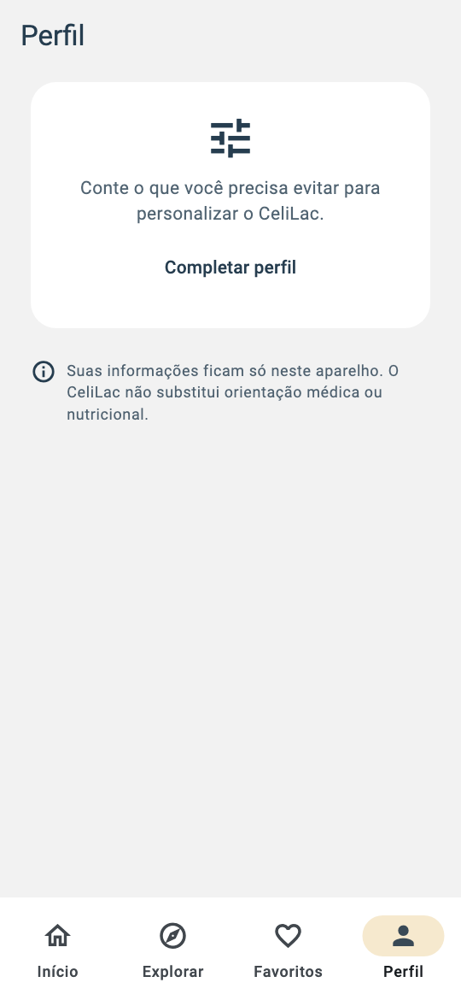
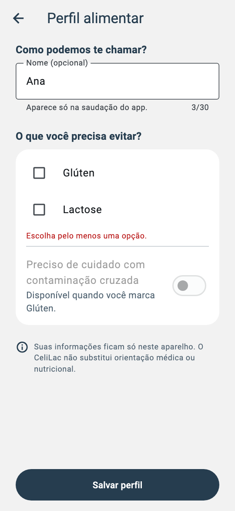
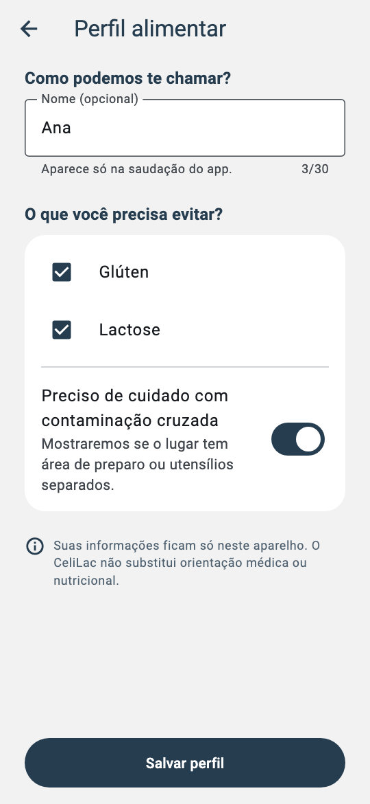
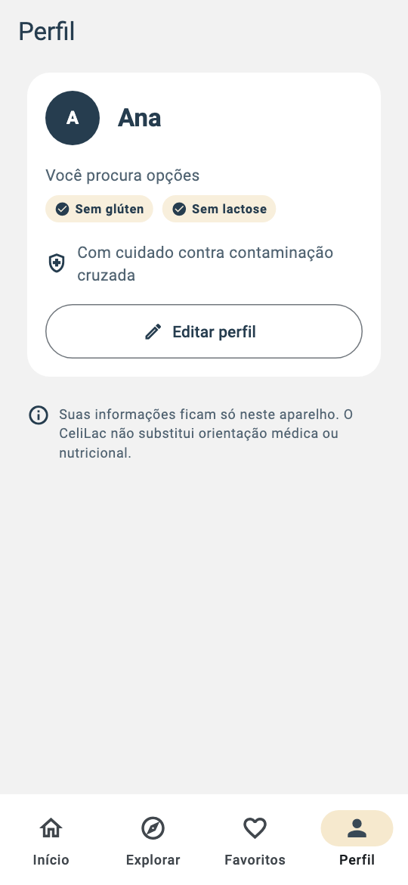
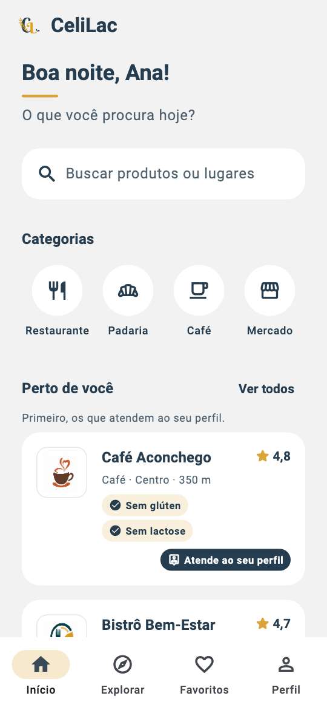
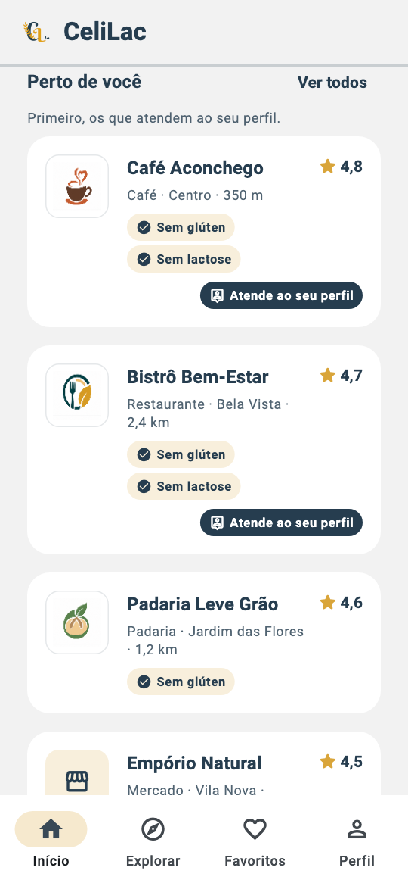
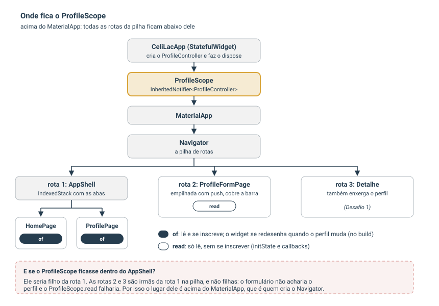
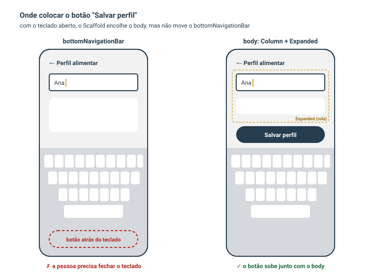

# CeliLac: Perfil Alimentar
## Formulários, persistência em JSON, estado compartilhado entre telas e testes, passo a passo

---

# Como usar este material

Este material continua o **CeliLac: Detalhe do Estabelecimento**. O onboarding do app fez três promessas, e duas delas já tinham onde ser cumpridas:

| Página do onboarding | Promessa | Onde é cumprida |
|---|---|---|
| 1. Descoberta | "Encontre opções adequadas a você" | Home: lista "Perto de você" |
| 2. Informação | "Entenda antes de escolher" | Detalhe do estabelecimento |
| 3. Personalização | "Uma experiência mais relevante" | **este material** |

Até aqui, o cartão "Complete seu perfil alimentar" da Home e a aba **Perfil** respondiam "em breve". Neste material, a pessoa conta ao app o que precisa evitar, e o app **muda o que mostra**:

```text
Splash ──(carrega onboarding + perfil)──► AppShell
                                              │
     Home: cartão "Complete seu perfil" ──push──► ProfileFormPage ──salvar──► volta + "Perfil salvo"
     Aba Perfil: convite ou resumo     ──push──► ProfileFormPage
                                              │
     Ao salvar: a Home e a aba Perfil se atualizam sozinhas
```

Como nos materiais anteriores, cada parte alterna a ideia por trás do código (que vale para qualquer projeto) com o código implementado no CeliLac, e alguns trechos são marcados por um rótulo em negrito:

- **Atenção**: armadilhas comuns.
- **No seu projeto**: o que adaptar para o seu app.
- **Execute**: o momento de rodar o app e verificar o resultado.

Os testes automatizados continuam como conteúdo complementar (Parte 9).

> O CeliLac guarda um perfil alimentar. O seu app pode guardar as preferências de leitura de quem usa um app de livros, o nível de quem usa um app de treinos ou a cidade de quem usa um app de eventos: a estrutura é a mesma. Um **formulário** para editar, um **lugar** para guardar, e **telas** que mudam quando o dado muda.

> Todo o código deste material foi compilado com `flutter analyze` (sem avisos) e validado com 99 testes automatizados (Parte 9), no Flutter 3.47 / Dart 3.13.

## Resultado esperado

| Aba Perfil, ainda vazia | Formulário com erro |
|---|---|
|  |  |

| Formulário preenchido | Aba Perfil com o resumo |
|---|---|
|  |  |

| Home com o nome e sem o cartão de perfil | Lista com quem atende ao perfil primeiro |
|---|---|
|  |  |

---

# Parte 0: Antes do código

## 0.1 Conceito: o que é um perfil (e o que não é)

Um perfil existe para **mudar o que o app mostra**. Cada campo precisa ter um efeito que a pessoa consiga ver; um campo que não muda nada é burocracia, e faz a pessoa desconfiar de para que serve o dado que ela entregou.

| Campo | Efeito visível |
|---|---|
| Nome (opcional) | a saudação da Home: "Boa tarde, Ana!" |
| O que preciso evitar (glúten, lactose) | a lista "Perto de você" mostra **primeiro** quem atende, com o selo "Atende ao seu perfil" |
| Cuidado com contaminação cruzada | guardado agora; usado no detalhe (Desafio 1) e no filtro da aba Explorar (próximo material) |

O próprio cartão da Home já prometia esse comportamento: *"Conte o que você precisa evitar e veja **primeiro** as opções mais adequadas."*

**Não é um cadastro.** Não há e-mail, senha nem servidor: o perfil fica **no aparelho**. A tela diz isso com todas as letras ("Suas informações ficam só neste aparelho"), porque informação sobre saúde é sensível, e quem preenche merece saber para onde ela vai.

**Responsabilidade.** O app não diagnostica nada. A tela traz a frase "O CeliLac não substitui orientação médica ou nutricional.", e os rótulos evitam termos clínicos: "O que você precisa evitar? Glúten", e não "Sou celíaco".

## 0.2 A promessa "Personalização" chega ao fim

| Promessa | Onde este material entrega |
|---|---|
| "Seu perfil alimentar poderá ajudar o CeliLac a apresentar opções mais adequadas" | a lista da Home passa a mostrar primeiro quem atende ao perfil |
| (implícita) o app me conhece | a saudação usa o nome |
| (implícita) o app não me pede de novo o que eu já disse | o cartão "Complete seu perfil" some quando o perfil está completo |

E duas promessas de "em breve" deixam de existir: a do cartão de perfil da Home e a da aba Perfil.

## 0.3 Estrutura e hierarquia do formulário

```text
┌─────────────────────────────────┐
│ ←  Perfil alimentar             │
├─────────────────────────────────┤
│ Como podemos te chamar?         │ ← 1. Opcional, e diz para que serve
│ [ Nome (opcional)            ]  │
│   Aparece só na saudação do app.│
│                                 │
│ O que você precisa evitar?      │ ← 2. Obrigatório: pelo menos um
│ ┌─────────────────────────────┐ │
│ │ [✓] Glúten                  │ │
│ │ [ ] Lactose                 │ │
│ │ (erro aparece aqui)         │ │
│ │ ─────────────────────────── │ │
│ │ Preciso de cuidado com      │ │ ← 3. Depende de "Glúten"
│ │ contaminação cruzada   (◯━) │ │
│ └─────────────────────────────┘ │
│ ⓘ Suas informações ficam só...  │ ← 4. Privacidade e responsabilidade
├─────────────────────────────────┤
│ [        Salvar perfil        ] │ ← 5. Ativo só quando algo mudou
└─────────────────────────────────┘
```

**Por que essa ordem?**

- **O nome primeiro, e opcional.** É o campo mais leve: começar por ele aquece a pessoa para o resto. Por ser opcional, o rótulo diz "(opcional)" e o texto de ajuda diz **para que** ele serve. Ninguém deveria ter de adivinhar se um campo é obrigatório.
- **As restrições no centro, dentro de um cartão.** É a única pergunta obrigatória, e a que muda o app. O cartão agrupa visualmente as opções e o campo que depende delas.
- **O campo dependente logo abaixo de quem ele depende.** "Contaminação cruzada" só faz sentido para quem evita glúten (Parte 5.4). Colocado ao lado de "Glúten", a relação fica visível.
- **O aviso de privacidade antes do botão.** A pessoa lê para onde vai a informação **antes** de decidir salvar.
- **O botão fora da rolagem.** Ele fica sempre visível, inclusive com o teclado aberto (Parte 5.1).

## 0.4 Leitura × edição: duas telas

A aba Perfil **mostra** o perfil; o formulário **edita**. Uma tela só, que fosse ao mesmo tempo resumo e formulário, teria dois problemas: quem só quer conferir o perfil veria campos editáveis e poderia mudar algo sem querer, e o botão "Salvar" ficaria na tela o tempo todo, mesmo sem nada para salvar.

| | Aba Perfil (`ProfilePage`) | Formulário (`ProfileFormPage`) |
|---|---|---|
| para quê | conferir | mudar |
| como abre | toque na aba | `push` a partir da aba **ou** da Home |
| barra de navegação | visível | coberta (como no detalhe) |
| estado próprio | **nenhum** (Parte 6) | o rascunho (Parte 5) |

## 0.5 O que fica de fora (e por quê)

| Tentação | Por que não agora |
|---|---|
| Login, conta e sincronização na nuvem | Exigem servidor, cuidado com a LGPD e recuperação de senha. O perfil local já cumpre a promessa. Fica para o material de Supabase (Parte 10.3). |
| Foto de perfil | Não muda nada no que o app mostra (Parte 0.1). |
| **Esconder** quem não atende ao perfil | Filtrar é papel da aba Explorar, onde a pessoa **escolhe** filtrar. Na Home, **ordenar** mantém tudo à vista e não esconde opções que a pessoa talvez aceite. |
| Muitas restrições (ovo, soja, nozes...) | O domínio (`DietaryOption`) só conhece glúten e lactose. Uma restrição nova precisa entrar primeiro nos **dados** dos estabelecimentos; senão, o app perguntaria algo que não sabe usar. |
| Abrir o formulário ao final do onboarding | O onboarding já é uma barreira antes do app; somar um formulário aumenta o abandono. A Home **convida**, sem obrigar. |
| Aviso de contaminação no detalhe | Fica como desafio (Parte 11), para manter o material focado. |
| Provider, Riverpod ou Bloc | Primeiro entendemos o mecanismo que eles usam por baixo (`InheritedWidget` + `ChangeNotifier`, Parte 4). O pacote vem com os Favoritos. |

## 0.6 Estrutura de pastas

```text
lib/
├── app/
│   ├── celilac_app.dart                         ← (alterado) cria o ProfileController e o ProfileScope
│   └── shell/
│       └── app_shell.dart                       ← (alterado) aba Perfil de verdade
└── features/
    ├── profile/                                 ← nova feature
    │   ├── domain/
    │   │   ├── entities/
    │   │   │   └── dietary_profile.dart         ← novo
    │   │   ├── repositories/
    │   │   │   └── profile_repository.dart      ← novo: o contrato
    │   │   └── profile_match.dart               ← novo: funções puras (atende? ordenar)
    │   ├── data/
    │   │   ├── dietary_profile_json.dart        ← novo: toJson / fromJson
    │   │   └── local_profile_repository.dart    ← novo: SharedPreferencesAsync
    │   └── presentation/
    │       ├── profile_controller.dart          ← novo: ChangeNotifier
    │       ├── profile_scope.dart               ← novo: InheritedNotifier
    │       ├── dietary_option_labels.dart       ← novo: rótulos do perfil
    │       ├── pages/
    │       │   ├── profile_page.dart            ← novo: aba Perfil
    │       │   └── profile_form_page.dart       ← novo: formulário
    │       └── widgets/
    │           ├── restrictions_field.dart      ← novo: FormField<Set<DietaryOption>>
    │           ├── profile_summary_card.dart    ← novo
    │           ├── profile_privacy_note.dart    ← novo
    │           └── discard_changes_dialog.dart  ← novo
    ├── establishments/presentation/widgets/
    │   └── establishment_card.dart              ← (alterado) selo "Atende ao seu perfil"
    ├── home/presentation/
    │   ├── pages/home_page.dart                 ← (alterado) ordena, esconde o cartão, abre o formulário
    │   └── widgets/home_header.dart             ← (alterado) nome na saudação
    ├── onboarding/presentation/onboarding_page.dart  ← (alterado) ilustrações próprias
    └── startup/presentation/splash_page.dart    ← (alterado) carrega o perfil; tokens de espaçamento

assets/images/onboarding/
├── information.png                              ← nova ilustração
└── profile.png                                  ← nova ilustração

test/
├── support/
│   ├── memory_profile_repository.dart           ← novo: repositório em memória
│   └── pump_app.dart                            ← novo: monta a tela com ProfileScope
├── app/
│   └── app_shell_test.dart                      ← novo
├── features/profile/                            ← 9 arquivos novos (Parte 9)
├── features/startup/
│   └── splash_page_test.dart                    ← novo
└── features/home/home_page_test.dart            ← (alterado)
```

**Por que `profile/` é uma feature própria.** O perfil é um **assunto** (a pessoa e as suas necessidades), usado por várias telas: Home e aba Perfil agora; Explorar e Detalhe depois. É a mesma regra que manteve o detalhe dentro de `establishments/` (material anterior, Parte 0.6).

**A direção da dependência.** `profile/domain` importa `DietaryOption` e `Establishment` de `establishments/domain`. O contrário **não** acontece: estabelecimentos não sabem que existe perfil. Quem junta os dois assuntos é a Home, que é uma tela que **reúne** assuntos.

```text
   establishments  ◄──────  profile
         ▲                     ▲
         └───────  home  ──────┘
```

Uma seta só por par de pastas: se `establishments` também importasse `profile`, as duas ficariam presas uma à outra, e nenhuma poderia mudar sem mexer na outra. A Parte 7.3 mostra como o cartão do estabelecimento ganha o selo "Atende ao seu perfil" **sem** importar nada do perfil.

## 0.7 Roteiro

```text
Parte 1  Preparando o terreno   ilustrações (tamanho × peso), pendências, acessibilidade da Home, README
Parte 2  Domínio                DietaryProfile, igualdade por valor, contrato, funções puras
Parte 3  Persistência           JSON, SharedPreferencesAsync, dados corrompidos, ponte para SQLite e Supabase
Parte 4  Estado compartilhado   ChangeNotifier, InheritedNotifier, onde criar, carregar na Splash
Parte 5  O formulário           Form, TextFormField, FormField próprio, campo dependente, salvar, descartar
Parte 6  A aba Perfil           vazio × preenchido, uma tela sem estado próprio
Parte 7  A Home personalizada   saudação, cartão condicional, ordenação, selo
Parte 8  Qualidade              fonte ampliada, teclado, leitor de tela em formulários, áreas de toque
Parte 9  Testes                 repositório em memória, unidade, controller, widget (complementar)
Parte 10 Revisão                decisões, alternativas e próximos passos (SQLite e Supabase)
Parte 11 No seu projeto         roteiro, checklist e desafios
```

---

# Parte 1: Preparando o terreno

Como na Parte 1 do material anterior: antes da feature nova, arrumar o que ela vai tocar. **Rode `flutter test` antes e depois** de cada passo; nada de comportamento muda aqui.

## 1.1 Ilustrações do onboarding

No material de Splash e Onboarding (Parte 5.4), as três páginas usavam temporariamente a mesma imagem, `discovery.png`. A página 3 é justamente a promessa que este material cumpre, então a ilustração dela precisa existir.

As duas imagens que faltavam foram geradas com os prompts do **Apêndice A**, anexando a `discovery.png` como **referência de estilo**, para que as três pareçam feitas pela mesma mão:

| `information.png`: "Entenda antes de escolher" | `profile.png`: "Uma experiência mais relevante" |
|---|---|
|  |  |

Depois de salvas em `assets/images/onboarding/` (pasta já declarada no `pubspec.yaml`), basta trocar o caminho das páginas 2 e 3:

`lib/features/onboarding/presentation/onboarding_page.dart`

```dart
    OnboardingItem(
      title: 'Entenda antes de escolher',
      description:
          'Consulte informações alimentares e conheça '
          'melhor as opções disponíveis.',
      imagePath: 'assets/images/onboarding/information.png',
    ),
    OnboardingItem(
      title: 'Uma experiência mais relevante',
      description:
          'Seu perfil alimentar poderá ajudar o CeliLac '
          'a apresentar opções mais adequadas.',
      imagePath: 'assets/images/onboarding/profile.png',
    ),
```

Cada imagem gerada tinha **1254 × 1254 px** e cerca de **1 MB**. Três delas somariam 3 MB a mais no app. Antes de resolver o peso, é preciso entender uma confusão comum.

### 1.1.1 Conceito: tamanho em pixels × peso do arquivo

Uma imagem tem **duas** medidas diferentes:

| Medida | O que é | Exemplo | Afeta |
|---|---|---|---|
| **Dimensões** | quantos pixels a imagem tem | 1254 × 1254 px | a **nitidez** na tela |
| **Peso** | quantos bytes o arquivo ocupa | 1 MB | o tamanho do app para baixar e instalar |

Quando o arquivo está pesado, a tentação é **diminuir as dimensões**. O peso cai, mas a imagem passa a ter menos pixels do que a tela precisa, e o Flutter é obrigado a **esticá-la**: as bordas ficam borradas. O caminho certo é **diminuir as cores** e manter as dimensões.

### 1.1.2 Quantos pixels a tela precisa?

O Flutter mede o layout em **dp** (*density-independent pixels*, pixels independentes de densidade). Cada aparelho tem uma **densidade** (`devicePixelRatio`): quantos pixels físicos existem em cada dp.

```text
pixels necessários = largura na tela (dp) × densidade do aparelho
```

A ilustração do onboarding ocupa a largura da tela menos as margens. Medimos com um teste de widget (`tester.getSize`) em quatro tamanhos de aparelho:

| Aparelho | Largura na tela | Densidade | Pixels necessários |
|---|---|---|---|
| Android pequeno (360×640) | 153 dp | 2x | 306 px |
| Android comum (Pixel) | 348 dp | 2,625x | 914 px |
| iPhone 15 | 329 dp | 3x | 987 px |
| iPhone Pro Max | 366 dp | 3x | 1098 px |

No Android pequeno a ilustração fica menor porque a **altura** da tela a limita (`Flexible` + `AspectRatio(1)`).

**Conclusão:** a imagem precisa de cerca de **1100 px** para ficar nítida em todos. Os originais de **1254 px** atendem com folga.

> **O que aconteceu no projeto da aula:** as imagens foram primeiro reduzidas para 314 px (cerca de 90 KB) e depois para 627 px (cerca de 300 KB). Num iPhone, a imagem era esticada 3,1 e 1,6 vezes, e ficava borrada nos dois casos. O problema só foi resolvido voltando aos originais de 1254 px e comprimindo as **cores**.

### 1.1.3 Conceito: quantização de cores

Um PNG comum (**RGBA de 32 bits**) pode usar até 16 milhões de cores, e cada pixel guarda a sua cor completa. Uma ilustração plana como as do CeliLac usa **poucas** cores: navy, dourado, alguns cinzas e branco. Quase toda essa capacidade é desperdício.

A **quantização** escolhe uma **paleta** de no máximo 256 cores que representa bem a imagem. Cada pixel passa a guardar só o **número** da cor na paleta (1 byte, em vez de 4). A transparência continua funcionando, porque a paleta guarda também a transparência de cada cor.

| | Antes | Depois |
|---|---|---|
| Formato | RGBA, 32 bits por pixel | paleta (*colormap*), 8 bits por pixel |
| Dimensões | 1254 × 1254 | 1254 × 1254 (iguais) |
| Cores possíveis | ~16 milhões | até 256 |

A ferramenta usada é o **`pngquant`**, gratuita e de linha de comando.

### 1.1.4 Execute: comprimindo as ilustrações

Na pasta do projeto, no macOS com Homebrew:

```bash
# 1. Instalar (uma vez só)
brew install pngquant

# 2. Guardar uma cópia dos originais FORA do projeto
mkdir -p ~/celilac_originais
cp assets/images/onboarding/*.png ~/celilac_originais/

# 3. Comprimir no lugar, mantendo as dimensões
pngquant --quality=70-90 --speed 1 --strip --ext .png --force assets/images/onboarding/*.png

# 4. Conferir dimensões e peso
file assets/images/onboarding/*.png
ls -lh assets/images/onboarding/
```

> **No Windows:** baixe o `pngquant.exe` em pngquant.org (ou `winget install pngquant`) e rode o passo 3 no PowerShell, com a barra invertida no caminho. **No Linux:** `sudo apt install pngquant`.

| Opção | Significado |
|---|---|
| `--quality=70-90` | busca qualidade 90 e aceita no mínimo 70. Se precisar ficar abaixo de 70 para caber em 256 cores, o `pngquant` **não altera** o arquivo e avisa |
| `--speed 1` | o modo mais lento e mais caprichado. Para poucas imagens, leva segundos |
| `--strip` | remove metadados (data, programa que gerou a imagem), que não servem para o app |
| `--ext .png --force` | grava por cima do próprio arquivo. Por isso a cópia do passo 2 |

**Resultado no CeliLac:**

| Arquivo | Antes | Depois | Redução |
|---|---|---|---|
| `discovery.png` | 1.023 KB | 235 KB | 77% |
| `information.png` | 1.080 KB | 222 KB | 79% |
| `profile.png` | 1.003 KB | 219 KB | 78% |
| **Total** | **3,1 MB** | **676 KB** | **78%** |

O comando `file` confirma: as três continuam com `1254 x 1254` e passaram de `8-bit/color RGBA` para `8-bit colormap` (a paleta).

### 1.1.5 Conferindo a qualidade

Compressão com perda exige **olhar**:

1. Abra cada imagem e a cópia em `~/celilac_originais/` lado a lado, com zoom de 200%.
2. Observe as bordas do ramo dourado e as sombras cinza do chão: são os pontos onde a falta de cores aparece primeiro, como **faixas** (*banding*) em vez de transição suave.
3. Se aparecerem faixas, restaure o original e comprima de novo com mais qualidade: `--quality=80-95`.
4. Rode o app com **reinício completo** (`flutter run` de novo, ou `R` maiúsculo no terminal). O *hot reload* **não** recarrega assets.

> **Atenção:** nunca comprima uma imagem que já foi comprimida. Cada rodada perde um pouco mais. Comprima sempre **a partir do original**, e guarde o original fora do projeto (ou no Git, antes da compressão).

### 1.1.6 Peso do arquivo × memória do aparelho

A compressão diminui o **arquivo** (o app fica menor para baixar), mas **não** a memória usada para mostrar a imagem. Para desenhar, o Flutter **descompacta** cada imagem em RGBA:

```text
1254 × 1254 pixels × 4 bytes = cerca de 6 MB de memória por ilustração
```

No onboarding isso não preocupa: são três imagens, uma por vez. Numa **lista** com dezenas de fotos, o caminho é decodificar a imagem no tamanho em que ela aparece, com `cacheWidth`/`ResizeImage`, como na Parte 5 do material de Detalhe do Estabelecimento.

> **Alternativa: variantes por densidade.** O Flutter também aceita pastas `2.0x/` e `3.0x/` ao lado do asset (`assets/images/onboarding/2.0x/discovery.png`) e escolhe a variante certa para cada aparelho. Vale a pena quando a diferença entre as versões é grande. Para três ilustrações de cerca de 220 KB, um arquivo só é mais simples.

### Conceitos

- **Dimensões × peso:** nitidez depende das dimensões; tamanho do app depende do peso.
- **dp e `devicePixelRatio`:** pixels necessários = largura em dp × densidade.
- **Quantização:** troca milhões de cores possíveis por uma paleta de até 256; perde pouco em ilustrações planas e mais em fotos (para fotos, prefira JPEG ou WebP).
- **Compressão com perda:** sempre a partir do original, sempre conferida a olho.
- **Arquivo × memória:** o arquivo comprimido é descompactado em RGBA na hora de desenhar.

**No seu projeto:** meça quanto a imagem ocupa na tela (em dp) no maior aparelho que você quer atender; multiplique por 3 para ter a largura mínima em pixels; comprima as cores com `pngquant` (ilustrações) ou converta para JPEG/WebP (fotos); confira com zoom e no aparelho.

## 1.2 Pendências herdadas

A Parte 4 vai mexer na `SplashPage`. É o momento de resolver as pendências que os materiais anteriores deixaram registradas para "quando mexer nesses arquivos":

| Pendência | Onde | O que foi feito |
|---|---|---|
| texto `navy` a 70% | descrições do onboarding, frase da Splash | subiu para **80%**, como o resto do app (contraste: material da Home, Parte 1.5) |
| espaçamentos fora da grade (`12`, `40`, `10`) | `splash_page.dart`, `onboarding_page.dart` | trocados pelos tokens `AppSpacing` |
| splash nativa com `color_dark`, mas app só claro | `flutter_native_splash.yaml` | **mantida**: só faz sentido mudar quando existir `AppTheme.dark` |

A troca pelos tokens muda o visual um pouco, e isso é esperado: a grade de 8 dp (material da Home, Parte 1.2) pede escolhas.

| Onde | Antes | Depois |
|---|---|---|
| onboarding: imagem → título | 40 | `AppSpacing.xl` (32) |
| onboarding: título → traço dourado | 12 | `AppSpacing.md` (16) |
| Splash: traço dourado → frase | 12 | `AppSpacing.sm` (8) |
| Splash: barra de progresso → versão | 40 | `AppSpacing.xl` (32) |
| Splash: texto → barra | 10 | `AppSpacing.sm` (8) |

**Execute:** abra o app depois de desinstalá-lo (para ver o onboarding de novo) e confira se os espaços continuam equilibrados.

## 1.3 Acessibilidade permanente da Home

O material anterior deixou uma pendência: as regras de acessibilidade eram teste permanente **do detalhe**, mas não da Home. A Parte 7 deste material vai mudar a Home (cartão que some, selo novo no cartão). O teste precisa existir **antes**, para pegar qualquer regressão:

`test/features/home/home_page_test.dart`

```dart
  testWidgets('segue as regras de acessibilidade', (tester) async {
    final handle = tester.ensureSemantics();
    final repo = StubEstablishmentRepository(
      nearbyResults: [
        () async => [testCafe],
      ],
    );
    await _pumpHome(tester, repo);
    await tester.pumpAndSettle();

    await expectLater(tester, meetsGuideline(androidTapTargetGuideline));
    await expectLater(tester, meetsGuideline(iOSTapTargetGuideline));
    await expectLater(tester, meetsGuideline(labeledTapTargetGuideline));
    await expectLater(tester, meetsGuideline(textContrastGuideline));
    handle.dispose();
  });
```

A Home passou nas quatro regras sem nenhum ajuste. Na Parte 9.4, esse teste passa a rodar **com e sem** perfil.

## 1.4 README do projeto

O `README.md` ainda era o texto padrão do `flutter create` ("A new Flutter project."). Um projeto que outras pessoas vão ler precisa de um README que responda a três perguntas: **o que é**, **como rodar** e **onde está o resto**. O do CeliLac passou a ter:

- uma frase sobre o app;
- os comandos `flutter pub get`, `flutter run`, `flutter analyze` e `flutter test`, com a versão do Flutter usada;
- a tabela dos materiais em `docs/tutorials/`, na ordem de leitura;
- a organização das pastas (`app/`, `features/<feature>/domain|data|presentation`).

**No seu projeto:** abra o seu README como se você fosse um colega que acabou de clonar o repositório. Ele sabe rodar o app sem perguntar nada a você?

---

# Parte 2: Domínio: o que é um perfil

## 2.1 Conceito: "evitar glúten" e "oferecer sem glúten" são o mesmo dado

O estabelecimento já tem um conjunto de opções alimentares: `Set<DietaryOption>`, com `glutenFree` ("Sem glúten") e `lactoseFree` ("Sem lactose"). A primeira ideia para o perfil seria um enum novo, algo como `Restriction.gluten` e `Restriction.lactose`. Mas repare:

```text
Estabelecimento                       Pessoa
"ofereço opções sem glúten"   ◄────►  "preciso evitar glúten"
DietaryOption.glutenFree              DietaryOption.glutenFree
```

É o **mesmo conceito**, visto de dois lados. Reaproveitando o `DietaryOption`, a pergunta "este lugar atende a esta pessoa?" vira uma comparação direta entre dois conjuntos do mesmo tipo (Parte 2.4). Com dois enums, seria preciso uma tabela de conversão, e uma opção nova poderia ser lembrada em um e esquecida no outro.

**O texto muda; o dado não.** No formulário, a pessoa marca "Glúten" (o que ela **evita**); no cartão do estabelecimento, aparece "Sem glúten" (o que ele **oferece**). Esses rótulos são **apresentação**, e ficam fora do enum (Parte 5.3).

## 2.2 O modelo `DietaryProfile`

`lib/features/profile/domain/entities/dietary_profile.dart`

```dart
import '../../../establishments/domain/entities/dietary_option.dart';

class DietaryProfile {
  const DietaryProfile({
    this.name,
    this.restrictions = const {},
    this.needsCrossContactCare = false,
  });

  static const DietaryProfile empty = DietaryProfile();

  final String? name;
  final Set<DietaryOption> restrictions;
  final bool needsCrossContactCare;

  bool get isComplete => restrictions.isNotEmpty;

  DietaryProfile copyWith({
    String? name,
    bool clearName = false,
    Set<DietaryOption>? restrictions,
    bool? needsCrossContactCare,
  }) {
    return DietaryProfile(
      name: clearName ? null : (name ?? this.name),
      restrictions: restrictions ?? this.restrictions,
      needsCrossContactCare:
          needsCrossContactCare ?? this.needsCrossContactCare,
    );
  }

  @override
  bool operator ==(Object other) {
    return other is DietaryProfile &&
        other.name == name &&
        other.restrictions.length == restrictions.length &&
        other.restrictions.containsAll(restrictions) &&
        other.needsCrossContactCare == needsCrossContactCare;
  }

  @override
  int get hashCode => Object.hash(
    name,
    Object.hashAllUnordered(restrictions),
    needsCrossContactCare,
  );
}
```

### Conceitos

**Todos os parâmetros têm valor padrão.** `DietaryProfile()` é um perfil válido: sem nome, sem restrições, sem cuidado extra. É exatamente o perfil de quem ainda não preencheu nada, e ganha um nome: `DietaryProfile.empty`.

**`static const DietaryProfile empty`.** Um único objeto, criado em tempo de compilação, compartilhado por todo o app. Escrever `DietaryProfile.empty` é mais claro do que `const DietaryProfile()`: diz **o que** o objeto significa, e não só como ele é feito. Esse padrão tem nome: ***Null Object*** (Parte 2.3).

**`isComplete` é regra de negócio.** "Um perfil está completo quando diz o que a pessoa evita." O nome é opcional, e o cuidado com contaminação é um detalhe; o que muda o app são as restrições. Essa regra fica no domínio, e não espalhada pelas telas: a Home (cartão de perfil), a aba Perfil (convite ou resumo) e o formulário (validação) perguntam a mesma coisa ao mesmo lugar.

**`copyWith`: um objeto novo com alguns campos trocados.** O `DietaryProfile` é **imutável** (todos os campos são `final`). Para "mudar" o perfil, cria-se outro, igual ao anterior em tudo, menos no que mudou: `perfil.copyWith(needsCrossContactCare: true)`. O padrão é o mesmo do `copyWith` do `ThemeData` e do `TextStyle`, que já usamos nos materiais anteriores.

**O problema clássico do `copyWith`: como apagar um campo opcional?** No `copyWith`, `name: null` significa "**não mudei** o nome" (é o valor padrão do parâmetro). Então como dizer "**apague** o nome"? Há duas soluções comuns:

| Solução | Como fica a chamada | Escolhida? |
|---|---|---|
| um parâmetro a mais | `perfil.copyWith(clearName: true)` | **sim**: lê-se como uma frase |
| uma função que devolve o valor | `perfil.copyWith(name: () => null)` | não: funciona, mas exige explicar funções como valor só para isso |

**Igualdade por valor: `==` e `hashCode`.** Por padrão, dois objetos do Dart só são iguais se forem **o mesmo objeto** (igualdade por **identidade**). Para o perfil, queremos igualdade por **valor**: dois perfis com o mesmo nome, as mesmas restrições e o mesmo cuidado são **o mesmo perfil**. Isso vai permitir que o botão "Salvar" fique ativo **só quando algo mudou** (Parte 5.6): basta comparar o rascunho com o original.

- **`other is DietaryProfile &&`**: só compara com outro perfil. Depois do `is`, o Dart já trata `other` como `DietaryProfile` (promoção de tipo).
- **Comparar dois `Set`.** O `==` de um `Set` também é por identidade. Dois conjuntos são iguais quando têm o mesmo tamanho **e** um contém todos os elementos do outro: `length == length && containsAll(...)`. A ordem dos elementos não importa, como deve ser em um conjunto.
- **`hashCode` precisa concordar com o `==`.** A regra do Dart: se `a == b`, então `a.hashCode == b.hashCode`. Coleções como `Set` e `Map` usam o `hashCode` para achar elementos; se a regra for quebrada, um perfil "igual" pode não ser encontrado. `Object.hash` combina os campos, e `Object.hashAllUnordered` calcula o *hash* do conjunto **sem depender da ordem**, como o `==`.

> **Atenção:** sobrescreveu o `==`, sobrescreva o `hashCode`. O analisador avisa quando só um dos dois existe.

> **Para investigar:** pacotes como `equatable` e `freezed` geram `==`, `hashCode` e `copyWith` automaticamente. Eles valem a pena quando há muitos modelos; aqui, escrever à mão uma vez ensina o que eles fazem por baixo.

**A regra "contaminação só com glúten" não está aqui.** Os cuidados com contaminação cruzada do app (`SafetyPractice`) falam de "itens sem glúten". O modelo **não** impede `needsCrossContactCare: true` sem glúten; quem garante a regra é o formulário (Parte 5.4). Por quê? Porque o modelo também é usado para **ler** dados antigos ou de outra fonte, e um construtor que lançasse erro por isso derrubaria o app na leitura.

## 2.3 O contrato

`lib/features/profile/domain/repositories/profile_repository.dart`

```dart
import '../entities/dietary_profile.dart';

abstract interface class ProfileRepository {
  Future<DietaryProfile> load();

  Future<void> save(DietaryProfile profile);
}
```

### Conceitos

**Mesmo padrão do `EstablishmentRepository`.** A tela depende do **contrato**; quem guarda de verdade é uma implementação, escolhida em um lugar só (Parte 4.4). É o que vai permitir trocar o `SharedPreferences` por SQLite ou Supabase sem mexer em nenhuma tela (Parte 3.5).

**`load` nunca devolve `null`.** Compare com o `fetchDetails` do material anterior:

| | `fetchDetails(id)` | `load()` |
|---|---|---|
| "não há dado" significa | o lugar **deixou de existir**: uma situação anormal | a pessoa **ainda não preencheu**: a situação normal de quem acabou de instalar |
| como o contrato informa | `null` | `DietaryProfile.empty` |
| o que a tela faz | mostra "não está mais disponível" + Voltar | mostra o convite "Completar perfil" |

Quando a ausência é um caso **especial**, `null` obriga quem chama a tratá-lo. Quando a ausência é o caso **comum**, um objeto vazio que se comporta normalmente (*Null Object*) evita `if (perfil != null)` espalhado pelo app: `DietaryProfile.empty.isComplete` simplesmente devolve `false`.

## 2.4 Funções puras: "este lugar atende ao meu perfil?"

`lib/features/profile/domain/profile_match.dart`

```dart
import '../../establishments/domain/entities/establishment.dart';
import 'entities/dietary_profile.dart';

bool meetsProfile(Establishment establishment, DietaryProfile profile) {
  return profile.isComplete &&
      establishment.dietaryOptions.containsAll(profile.restrictions);
}

List<Establishment> sortByProfile(
  List<Establishment> establishments,
  DietaryProfile profile,
) {
  // List.sort não é estável: dois filtros preservam a ordem por distância.
  return [
    ...establishments.where((e) => meetsProfile(e, profile)),
    ...establishments.where((e) => !meetsProfile(e, profile)),
  ];
}
```

### Conceitos

**`containsAll`: o lugar oferece tudo o que a pessoa evita?** Quem evita glúten **e** lactose só é atendido por um lugar que ofereça as duas opções. Um lugar que oferece mais do que a pessoa precisa também atende.

| Perfil evita | Lugar oferece | Atende? |
|---|---|---|
| glúten | sem glúten | sim |
| glúten | sem glúten, sem lactose | sim |
| glúten, lactose | sem glúten | **não** |
| lactose | sem glúten | não |
| (nada: perfil vazio) | qualquer coisa | **não** |

**Perfil vazio: ninguém atende.** Matematicamente, todo conjunto contém o conjunto vazio, então `containsAll({})` seria `true` para **todos** os lugares, e todos ganhariam o selo "Atende ao seu perfil". Um selo que aparece em tudo não diz nada. Por isso a regra começa com `profile.isComplete &&`.

**`sortByProfile` devolve uma lista nova.** A lista recebida (que veio do repositório, ordenada por distância) **não é alterada**. Funções que não mexem no que recebem são mais fáceis de entender e de testar: o resultado depende só dos argumentos (função **pura**, como a `greetingFor` da Home).

**Por que não `List.sort`?** A ideia natural seria ordenar com um comparador "quem atende vem antes". O problema: o `sort` do Dart **não é estável**. Um algoritmo de ordenação é **estável** quando elementos "empatados" mantêm a ordem em que estavam. Para o `sort`, todos os lugares que atendem estão empatados, e ele pode embaralhá-los, perdendo a ordem por distância. Dois `where` concatenados são estáveis por natureza (cada um percorre a lista na ordem original) e se leem como a regra: "primeiro os que atendem, depois os outros".

```text
entrada (por distância):  Café(350 m, G+L)  Padaria(1,2 km, G)  Bistrô(2,4 km, G+L)  Empório(3,1 km, L)
perfil evita G + L
saída:                    Café  Bistrô  │  Padaria  Empório
                          (atendem, por distância) │ (não atendem, por distância)
```

**Por que no domínio do perfil?** "Atender a um perfil" é regra sobre **perfis**. Por isso `profile/domain` importa `Establishment`, e não o contrário (Parte 0.6).

**Execute:** rode `flutter analyze`. Ainda não há tela nova, mas o domínio já compila, e nenhum arquivo dele importa `package:flutter/...`. Confira com:

```bash
grep -rn "package:flutter" lib/features/profile/domain || echo "domínio sem Flutter"
```

---

# Parte 3: Persistência: o perfil sobrevive ao fechar o app

## 3.1 Conceito: do objeto ao texto, e de volta

O perfil precisa continuar lá quando o app é fechado e aberto de novo. O `SharedPreferences`, que o material de Splash usou para lembrar que o onboarding foi concluído, guarda **valores simples**: texto, número, booleano, lista de textos. Um `DietaryProfile` não é nenhum deles.

Há duas formas de guardá-lo:

| Forma | Como fica | Problema |
|---|---|---|
| uma chave por campo | `profile_name`, `profile_restrictions`, `profile_cross_contact` | três gravações: se o app fechar no meio, fica um perfil **meio salvo** |
| **um texto JSON em uma chave** | `dietary_profile` = `{"name":"Ana", ...}` | nenhum para o nosso caso |

A escolha é o **JSON** (*JavaScript Object Notation*), o formato de texto que praticamente toda API usa para trocar dados. As vantagens:

- a gravação é **atômica**: ou o perfil inteiro foi salvo, ou nada foi;
- converter objeto ↔ JSON é exatamente o que será preciso quando o app conversar com uma API (Parte 3.5).

O caminho completo:

```text
DietaryProfile ──toJson──► Map<String, Object?> ──jsonEncode──► String ──► SharedPreferences
DietaryProfile ◄─fromJson─ Map<String, Object?> ◄─jsonDecode─── String ◄── SharedPreferences
```

## 3.2 A conversão: `dietary_profile_json.dart`

`lib/features/profile/data/dietary_profile_json.dart`

```dart
import '../../establishments/domain/entities/dietary_option.dart';
import '../domain/entities/dietary_profile.dart';

// Chaves em snake_case: os mesmos nomes servirão de colunas no banco.
extension DietaryProfileJson on DietaryProfile {
  Map<String, Object?> toJson() => {
    'name': name,
    'restrictions': [for (final option in restrictions) option.name],
    'needs_cross_contact_care': needsCrossContactCare,
  };
}

DietaryProfile dietaryProfileFromJson(Map<String, Object?> json) {
  final options = DietaryOption.values.asNameMap();

  return DietaryProfile(
    name: switch (json['name']) {
      final String name when name.trim().isNotEmpty => name,
      _ => null,
    },
    restrictions: {
      if (json['restrictions'] case final List<Object?> values)
        for (final value in values) ?options[value],
    },
    needsCrossContactCare: json['needs_cross_contact_care'] == true,
  );
}
```

Um perfil vira este JSON:

```json
{
  "name": "Ana",
  "restrictions": ["glutenFree", "lactoseFree"],
  "needs_cross_contact_care": true
}
```

### Conceitos

**Por que fora do domínio (`data/`)?** O formato de gravação é um detalhe de **infraestrutura**. O domínio diz o que é um perfil; a camada `data` diz como ele é guardado. Se amanhã o formato mudar, o `DietaryProfile` não muda.

**`extension ... on DietaryProfile`.** Uma *extension* acrescenta métodos a uma classe **sem mexer no arquivo dela**. Assim, quem importa `dietary_profile_json.dart` pode escrever `perfil.toJson()`, e o domínio continua sem saber que JSON existe. Já a leitura é uma **função** (`dietaryProfileFromJson`), porque uma extension não pode acrescentar construtores.

**`Map<String, Object?>`.** É o formato que o `jsonDecode` produz: chaves de texto e valores de qualquer tipo, inclusive `null`. `Object?` (e não `dynamic`) obriga o código a **verificar** o tipo antes de usar o valor, que é exatamente o que a leitura tolerante faz.

**Enums gravados pelo nome (`.name`), e não pela posição (`.index`).** `DietaryOption.glutenFree.name` é o texto `"glutenFree"`; `.index` seria o número `0`. Se um dia alguém reordenar o enum (pondo `lactoseFree` primeiro), o `0` gravado no aparelho passaria a significar **outra** opção, sem nenhum erro. O nome continua significando a mesma coisa.

**Chaves em `snake_case`.** No Dart, os campos usam `camelCase` (`needsCrossContactCare`). Em bancos de dados SQL, a convenção é `snake_case` (`needs_cross_contact_care`). Usando os nomes do banco no JSON desde já, o **mesmo** `dietaryProfileFromJson` vai ler uma linha de uma tabela do Supabase, que chega como um `Map` com os nomes das colunas (Parte 3.5).

**Leitura tolerante: o JSON pode vir errado.** O texto gravado no aparelho pode estar incompleto, ser de uma versão antiga do app ou de uma futura. Ler sem conferir derrubaria o app na abertura. Cada campo tem uma estratégia:

| Campo | Recurso do Dart 3 | Se vier errado |
|---|---|---|
| `name` | `switch` com padrão e *guard*: `final String name when name.trim().isNotEmpty => name` | qualquer coisa que não seja um texto com conteúdo vira `null` |
| `restrictions` | `if (json['restrictions'] case final List<Object?> values)` | se não for uma lista, o conjunto fica vazio |
| cada restrição | `asNameMap()` + elemento nulo-ciente `?options[value]` | um nome desconhecido (`"eggFree"`, `42`, `null`) é **ignorado** |
| `needs_cross_contact_care` | `== true` | qualquer coisa que não seja o booleano `true` vira `false` |

- **`asNameMap()`** devolve um `Map` do nome para o valor: `{'glutenFree': DietaryOption.glutenFree, 'lactoseFree': DietaryOption.lactoseFree}`. Buscar um nome que não existe devolve `null`, sem erro.
- **`?options[value]`** (Dart 3.8) é um **elemento nulo-ciente**: dentro de um literal de coleção, o `?` antes de uma expressão quer dizer "acrescente o valor, **se ele não for `null`**". É uma forma curta de `if (options[value] case final option?) option`; o analisador sugere a forma curta (`use_null_aware_elements`).

**`switch` como expressão, com *guard*.** `switch (valor) { padrão when condição => resultado, _ => outro }` testa os padrões em ordem. `final String name` só casa se o valor **for** um `String` (e já o guarda em `name`); `when ...` acrescenta uma condição; `_` casa com qualquer coisa.

## 3.3 O repositório local

`lib/features/profile/data/local_profile_repository.dart`

```dart
import 'dart:convert';

import 'package:shared_preferences/shared_preferences.dart';

import '../domain/entities/dietary_profile.dart';
import '../domain/repositories/profile_repository.dart';
import 'dietary_profile_json.dart';

class LocalProfileRepository implements ProfileRepository {
  LocalProfileRepository({SharedPreferencesAsync? preferences})
    : _preferences = preferences ?? SharedPreferencesAsync();

  static const String _key = 'dietary_profile';
  static const int _schemaVersion = 1;

  final SharedPreferencesAsync _preferences;

  @override
  Future<DietaryProfile> load() async {
    final stored = await _preferences.getString(_key);
    if (stored == null) {
      return DietaryProfile.empty;
    }

    try {
      if (jsonDecode(stored) case final Map<String, Object?> json) {
        return dietaryProfileFromJson(json);
      }
    } on FormatException {
      // Texto corrompido: segue com o perfil vazio, sem apagar o que há.
    }
    return DietaryProfile.empty;
  }

  @override
  Future<void> save(DietaryProfile profile) async {
    final json = {'schema_version': _schemaVersion, ...profile.toJson()};
    await _preferences.setString(_key, jsonEncode(json));
  }
}
```

### Conceitos

**O mesmo padrão do `OnboardingStorage`.** O construtor aceita um `SharedPreferencesAsync` opcional; sem ele, cria o padrão. Os testes usam isso para trocar o armazenamento do aparelho por um em memória (Parte 9.2).

**Os três caminhos do `load`:**

| O que há no aparelho | Resultado |
|---|---|
| nada (`getString` devolve `null`) | `DietaryProfile.empty`: a pessoa ainda não preencheu |
| um JSON de objeto válido | o perfil lido |
| texto que não é JSON (`FormatException`) **ou** JSON que não é objeto (`[1, 2]`) | `DietaryProfile.empty`, **sem apagar** o texto gravado |

**Por que não apagar o texto corrompido?** Se o problema estiver no código de **leitura** (um *bug* numa versão do app), apagar destruiria um perfil que a próxima versão, já corrigida, conseguiria ler. Seguir com o perfil vazio deixa o app funcionando, e o dado continua lá até a pessoa salvar de novo.

**`if (jsonDecode(stored) case final Map<String, Object?> json)`.** O `jsonDecode` devolve `dynamic`: pode ser um mapa, uma lista, um número. O `if-case` testa o tipo e já dá nome ao valor, num passo só.

**`schema_version`: a versão do formato.** O arquivo gravado é:

```json
{"schema_version":1,"name":"Ana","restrictions":["glutenFree"],"needs_cross_contact_care":true}
```

Hoje, ninguém lê a versão. Ela está ali para o dia em que o formato mudar: a versão 2 do app vai poder perguntar "este texto foi gravado pela versão 1?" e convertê-lo (uma **migração**, Desafio 4). Sem esse número, seria preciso adivinhar a versão pelo conteúdo.

**Por que a versão fica no repositório, e não no `toJson`?** A versão é um detalhe do **armazenamento local**. Uma tabela no banco não teria essa coluna, e o `toJson` precisa servir para os dois (Parte 3.5). O `...profile.toJson()` (*spread*) copia as chaves do perfil para dentro do mapa que já tem a versão. E o `fromJson` simplesmente ignora as chaves que não conhece.

**Erros do armazenamento não são engolidos aqui.** Se o próprio `getString` ou `setString` falhar (armazenamento cheio, por exemplo), a exceção **sobe**. Quem decide o que mostrar é o controller e a tela (Partes 4.2 e 5.6). O repositório só trata o que é responsabilidade dele: o formato do texto.

## 3.4 Execute

Ainda não há tela para salvar um perfil (ela vem na Parte 5). Para ver a persistência funcionando agora, a Parte 9.2 tem os testes do repositório, que gravam, "fecham o app" (criando um repositório novo) e leem de volta. Rode:

```bash
flutter test test/features/profile/local_profile_repository_test.dart
```

## 3.5 Ponte para os próximos materiais: SQLite e Supabase

O perfil fica no `SharedPreferences` porque é **um registro só**, lido inteiro e gravado inteiro. Esse armazenamento deixa de bastar quando os dados viram **coleções** que precisam de consultas, ou quando precisam ser **compartilhados** entre aparelhos.

| Armazenamento | Serve para | No CeliLac |
|---|---|---|
| `SharedPreferences` | poucos valores simples, lidos inteiros | onboarding concluído, perfil |
| SQLite (`sqflite` ou `drift`) | coleções, consultas, ordenação, relações, funcionar *offline* | **Favoritos**: uma lista que cresce, ordenada por data, consultada por `id` ("este lugar é favorito?") |
| Supabase (Postgres + API + autenticação) | dados compartilhados entre aparelhos e pessoas | **estabelecimentos reais**, no lugar do `FakeEstablishmentRepository`; o perfil numa tabela, depois do login |

O contrato `ProfileRepository` é o que torna a troca barata:

```text
                        ProfileRepository (contrato, no domínio)
                       /              |                 \
LocalProfileRepository   SqliteProfileRepository   SupabaseProfileRepository
 (SharedPreferences,      (material de SQLite)      (material de Supabase)
  este material)
```

Trocar de implementação muda **uma linha**, no lugar onde o repositório é criado (Parte 4.4). Nenhuma tela muda. Três decisões deste material foram tomadas pensando nisso:

| Decisão | Por que ajuda depois |
|---|---|
| chaves do JSON em `snake_case` | são os nomes das colunas: uma linha da tabela `profiles` do Supabase (`name text`, `restrictions text[]`, `needs_cross_contact_care boolean`) é lida pelo mesmo `dietaryProfileFromJson` |
| `schema_version` fora do `toJson` | o mesmo `toJson` serve para gravar no aparelho e para enviar à API |
| `load` nunca devolve `null` | uma pessoa recém-cadastrada, sem linha na tabela, recebe `DietaryProfile.empty`, como hoje |

> **No seu projeto:** antes de escolher onde guardar um dado, responda: é **um** valor ou uma **coleção**? Precisa de **consulta** ("os favoritos de março") ou é lido inteiro? Precisa estar em **outro aparelho**? As respostas apontam para `SharedPreferences`, SQLite ou um servidor.

---

# Parte 4: Estado compartilhado: várias telas, um perfil

## 4.1 Conceito: o problema

Até aqui, todo estado do app morava **dentro** de uma tela: o `Future` da lista na Home, o índice da aba no `AppShell`, o detalhe carregado na tela de detalhe. Quando o estado muda, o `setState` redesenha **aquela** tela, e só ela.

O perfil é diferente. Ele é **lido** por três lugares e **escrito** por um:

```text
                 ┌─────────── lê: nome, cartão, ordem da lista ───── HomePage
                 │
   o perfil ─────┼─────────── lê: convite ou resumo ──────────────── ProfilePage (aba)
                 │
                 └─────────── lê e ESCREVE ─────────────────────────── ProfileFormPage
```

E há um detalhe importante: a Home e a aba Perfil ficam **vivas ao mesmo tempo**, dentro do `IndexedStack` do `AppShell` (material da Home, Parte 3.4). Quando o formulário salva, as duas já foram construídas e não vão "perguntar de novo" sozinhas.

Três tentativas, da pior para a melhor:

| Tentativa | Como seria | Problema |
|---|---|---|
| `setState` no formulário | o formulário guarda o perfil no próprio `State` | o `State` do formulário é destruído ao fechar a tela, e a Home nunca fica sabendo |
| passar o perfil e *callbacks* pelos construtores | `AppShell` guarda o perfil e repassa `onProfileChanged` para a Home, para a aba, para o formulário... | cada tela no meio do caminho carrega parâmetros que não usa; uma tela nova exige mudar várias outras |
| **um objeto observável, acima de todos** | um `ProfileController` guarda o perfil e **avisa** quem estiver ouvindo; um `ProfileScope` o torna acessível a qualquer widget abaixo dele | nenhum |

A terceira é o que fazem os pacotes de gerência de estado (Provider, Riverpod, Bloc). Aqui vamos construí-la só com o que o Flutter já tem, para entender o mecanismo antes de usar um pacote.

## 4.2 O objeto que avisa: `ProfileController`

`lib/features/profile/presentation/profile_controller.dart`

```dart
import 'package:flutter/foundation.dart';

import '../domain/entities/dietary_profile.dart';
import '../domain/repositories/profile_repository.dart';

class ProfileController extends ChangeNotifier {
  ProfileController(this._repository);

  final ProfileRepository _repository;

  DietaryProfile _profile = DietaryProfile.empty;
  bool _isLoaded = false;
  Future<void>? _loading;

  DietaryProfile get profile => _profile;
  bool get isLoaded => _isLoaded;

  Future<void> load() => _loading ??= _load();

  Future<void> _load() async {
    try {
      _profile = await _repository.load();
    } catch (error) {
      // O perfil melhora o app, mas não pode impedir que ele abra.
      debugPrint('Não foi possível carregar o perfil: $error');
    }
    _isLoaded = true;
    notifyListeners();
  }

  Future<void> save(DietaryProfile profile) async {
    await _repository.save(profile);
    _profile = profile;
    _isLoaded = true;
    notifyListeners();
  }
}
```

### Conceitos

**`ChangeNotifier`: um objeto que avisa quando muda.** É uma classe do próprio Flutter (`package:flutter/foundation.dart`). Quem quer ser avisado chama `addListener(funcao)`; quando o objeto muda, ele chama `notifyListeners()`, e todas as funções registradas são executadas. É o mesmo mecanismo que já usamos sem perceber: `TextEditingController`, `ScrollController` e `AnimationController` são todos "objetos que avisam".

**Campos privados, *getters* públicos.** `_profile` e `_isLoaded` só mudam **dentro** do controller. As telas leem por `profile` e `isLoaded`, mas não conseguem escrever `controller.profile = ...` por fora. Toda mudança passa por `load` ou `save`, que sempre chamam `notifyListeners()`. Se uma tela pudesse trocar o perfil diretamente, ninguém seria avisado.

**`isLoaded`: três estados, e não dois.** Antes de o carregamento terminar, o perfil é `empty`, mas isso **não** quer dizer "a pessoa não preencheu". Sem o `isLoaded`, a aba Perfil mostraria por um instante o convite "Completar perfil" para quem já tem perfil. A aba usa o `isLoaded` para mostrar um indicador de carregamento nesse intervalo (Parte 6).

**`load() => _loading ??= _load()`: carregar uma vez só.** O operador `??=` atribui **só se** a variável ainda for `null`. Na primeira chamada, `_loading` recebe o `Future` do carregamento; nas seguintes, devolve **o mesmo `Future`**. Assim, se a Splash e uma tela chamarem `load()` ao mesmo tempo, as duas esperam a mesma leitura, e o repositório é consultado uma vez só. O teste da Parte 9.3 confere isso.

**Falha na leitura: tratada aqui, e não na Splash.** Se o armazenamento falhar, o controller segue com o perfil vazio, marca `isLoaded = true` e avisa. Por que aqui? Se a Splash tratasse o erro, o `isLoaded` ficaria `false` para sempre, e a aba Perfil mostraria um indicador de carregamento eterno. O `debugPrint` registra o erro no console durante o desenvolvimento, sem aparecer para a pessoa.

**`save`: grava primeiro, avisa depois.** A ordem importa:

```text
1. await _repository.save(profile)   ← se falhar, a exceção sobe AQUI
2. _profile = profile                ←   e estas linhas não executam:
3. notifyListeners()                 ←   o app continua igual ao que está gravado
```

Se a gravação falhar, nada muda na memória, e a exceção chega ao formulário, que mostra "Não foi possível salvar" (Parte 5.6). A alternativa, chamada **atualização otimista**, faria o contrário: mudaria a tela na hora e gravaria depois, desfazendo se falhasse. Ela vale a pena quando a gravação é lenta (pela rede); para uma gravação local, que leva milissegundos, a ordem segura é mais simples.

**`package:flutter/foundation.dart`, e não `material.dart`.** O controller não desenha nada. Importar só o `foundation` deixa claro que ele é lógica, e não tela.

## 4.3 O acesso de qualquer lugar: `ProfileScope`

O controller existe, mas como uma tela lá embaixo na árvore o encontra, sem receber pelo construtor? O Flutter tem um mecanismo para isso: o **`InheritedWidget`**, um widget que os descendentes podem **procurar** pelo tipo. É assim que `Theme.of(context)` e `MediaQuery.of(context)` funcionam: o `MaterialApp` coloca um `Theme` lá em cima, e qualquer widget o encontra.

O `InheritedNotifier` é a versão que guarda um objeto que avisa (um `Listenable`) e **redesenha os dependentes** quando ele avisa.

`lib/features/profile/presentation/profile_scope.dart`

```dart
import 'package:flutter/widgets.dart';

import 'profile_controller.dart';

class ProfileScope extends InheritedNotifier<ProfileController> {
  const ProfileScope({
    super.key,
    required ProfileController controller,
    required super.child,
  }) : super(notifier: controller);

  /// Lê e se inscreve: quem chama é reconstruído quando o perfil muda.
  /// Use no `build`.
  static ProfileController of(BuildContext context) {
    final scope = context.dependOnInheritedWidgetOfExactType<ProfileScope>();
    assert(scope != null, 'Nenhum ProfileScope acima deste widget.');
    return scope!.notifier!;
  }

  /// Só lê, sem se inscrever. Use em callbacks e no `initState`.
  static ProfileController read(BuildContext context) {
    final scope = context.getInheritedWidgetOfExactType<ProfileScope>();
    assert(scope != null, 'Nenhum ProfileScope acima deste widget.');
    return scope!.notifier!;
  }
}
```

### Conceitos

**Duas formas de ler: `of` e `read`.**

| | `ProfileScope.of(context)` | `ProfileScope.read(context)` |
|---|---|---|
| por baixo | `dependOnInheritedWidgetOfExactType` | `getInheritedWidgetOfExactType` |
| o widget se **inscreve**? | sim: é redesenhado quando o perfil muda | não |
| onde usar | no `build`, para **mostrar** o perfil | no `initState` e em *callbacks* (`onPressed`), para **agir** |
| exemplo | a Home mostra o nome | o formulário copia o perfil ao abrir; o botão "Salvar" chama `save` |

> **Atenção:** usar `of` dentro de um `onPressed` funciona, mas inscreve o widget à toa: ele passa a ser redesenhado a cada mudança, sem precisar. E o Flutter **proíbe** `dependOnInheritedWidgetOfExactType` no `initState`; nesse lugar, só o `read` serve.

**O `assert` com mensagem em português.** Se alguém usar o `ProfileScope` numa tela que não está abaixo dele (por exemplo, num teste que esqueceu de montá-lo), o erro diz exatamente o que falta, em vez de um `Null check operator used on a null value`. Os `assert` só rodam em modo de desenvolvimento.

**`package:flutter/widgets.dart`.** O `ProfileScope` não usa nada do Material, então importa só a camada de widgets.

**A ponte para o Provider.** Quando os Favoritos chegarem, o pacote `provider` vai oferecer `context.watch<ProfileController>()` e `context.read<ProfileController>()`. São exatamente o `of` e o `read` que acabamos de escrever. O pacote poupa o código repetido, mas a ideia já é conhecida.

## 4.4 Onde criar: acima do `MaterialApp`

O `ProfileScope` precisa estar **acima** de todas as telas que leem o perfil. Mas acima de onde, exatamente?



O ponto-chave é o `Navigator`, que o `MaterialApp` cria. As rotas empilhadas com `push` (o formulário, o detalhe) são **irmãs** do `AppShell` na pilha, e não filhas dele. Um `ProfileScope` colocado dentro do `AppShell` seria visto pela Home e pela aba Perfil, mas **não** pelo formulário. Por isso o lugar dele é **acima do `MaterialApp`**.

`lib/app/celilac_app.dart`

```dart
import 'package:flutter/material.dart';
import 'package:flutter_localizations/flutter_localizations.dart';

import '../features/profile/data/local_profile_repository.dart';
import '../features/profile/domain/repositories/profile_repository.dart';
import '../features/profile/presentation/profile_controller.dart';
import '../features/profile/presentation/profile_scope.dart';
import '../features/startup/presentation/splash_page.dart';
import 'theme/app_theme.dart';

class CeliLacApp extends StatefulWidget {
  const CeliLacApp({super.key, this.profileRepository});

  final ProfileRepository? profileRepository;

  @override
  State<CeliLacApp> createState() => _CeliLacAppState();
}

class _CeliLacAppState extends State<CeliLacApp> {
  late final ProfileController _profileController;

  @override
  void initState() {
    super.initState();
    _profileController = ProfileController(
      widget.profileRepository ?? LocalProfileRepository(),
    );
  }

  @override
  void dispose() {
    _profileController.dispose();
    super.dispose();
  }

  @override
  Widget build(BuildContext context) {
    // Acima do MaterialApp: as rotas empilhadas também enxergam o perfil.
    return ProfileScope(
      controller: _profileController,
      child: MaterialApp(
        title: 'CeliLac',
        debugShowCheckedModeBanner: false,
        theme: AppTheme.light,
        locale: const Locale('pt', 'BR'),
        supportedLocales: const [Locale('pt', 'BR')],
        localizationsDelegates: GlobalMaterialLocalizations.delegates,
        home: const SplashPage(),
      ),
    );
  }
}
```

### Conceitos

**Por que `StatefulWidget`?** O controller precisa ser criado **uma vez** e destruído quando o app termina. Num `StatelessWidget`, um `ProfileController(...)` dentro do `build` seria recriado a cada redesenho, e o perfil carregado se perderia. O `initState` cria, o `dispose` libera: é o mesmo ciclo de vida dos `AnimationController` da Splash.

**`late final`.** O controller é atribuído no `initState`, e não na declaração, porque precisa do `widget.profileRepository`, que só existe depois de o `State` ser ligado ao widget.

**A raiz de composição.** `widget.profileRepository ?? LocalProfileRepository()` é o **único** lugar do app que escolhe a implementação do repositório. No app de verdade, `main.dart` chama `CeliLacApp()` sem argumento, e o perfil vai para o `SharedPreferences`. Nos testes, `CeliLacApp(profileRepository: MemoryProfileRepository())` troca a implementação sem mexer em mais nada (Parte 9.5). Quando chegar o SQLite ou o Supabase, é **esta** linha que muda.

## 4.5 Carregar na Splash

A Splash já dizia "Carregando suas preferências" na barra de progresso, mas era só um texto: nada era carregado. Agora passa a ser verdade.

`lib/features/startup/presentation/splash_page.dart` (trecho)

```dart
  Future<void> _initialize() async {
    // Começa já, em paralelo com as animações: a Splash não fica mais longa.
    final profileLoad = ProfileScope.read(context).load();

    await _introController.forward();
    if (!mounted) {
      return;
    }

    await _progressController.forward();
    if (!mounted) {
      return;
    }

    final (completed, _) = await (
      OnboardingStorage().isCompleted(),
      profileLoad,
    ).wait;
    if (!mounted) {
      return;
    }

    _goTo(completed ? const AppShell() : const OnboardingPage());
  }
```

### Conceitos

**Começar cedo, esperar tarde.** `ProfileScope.read(context).load()` **inicia** o carregamento e guarda o `Future` em `profileLoad`, sem `await`. Enquanto as animações rodam, a leitura acontece em paralelo. Só no final o código espera pelo resultado. Como a leitura local leva milissegundos e as animações levam segundos, a Splash não fica nem um pouco mais longa.

**`read` antes do primeiro `await`.** O `_initialize` é chamado pelo `initState`; nesse ponto, o `context` é válido e o `read` funciona (o `of`, não: Parte 4.3). Depois de um `await`, o widget poderia ter saído da árvore, e por isso o código confere `mounted`, como já fazia.

**`.wait` de um *record*: esperar dois `Future` de tipos diferentes.** O Dart 3 permite agrupar valores entre parênteses, num ***record***: `(a, b)`. Um *record* de `Future` tem o método `.wait`, que espera todos **em paralelo** e devolve um *record* com os resultados, cada um com o seu tipo:

```dart
// Com Future.wait: uma lista sem tipo definido, acesso por posição
final results = await Future.wait([OnboardingStorage().isCompleted(), profileLoad]);
final completed = results[0] as bool;

// Com o .wait de um record: cada posição mantém o seu tipo
final (completed, _) = await (OnboardingStorage().isCompleted(), profileLoad).wait;
```

O `final (completed, _)` **desestrutura** o resultado: o primeiro valor (um `bool`) vai para `completed`, e o segundo (o `void` do `load`) é descartado com `_`.

**A falha do perfil não trava a Splash.** O `load` nunca lança erro (Parte 4.2): se a leitura falhar, o app abre com o perfil vazio. O perfil **melhora** o app, mas não é condição para usá-lo.

### Um defeito que o teste encontrou

Ao escrever o teste da Splash (Parte 9.5), apareceu um erro que não tinha relação com o perfil:

```text
A RenderFlex overflowed by 67 pixels on the right.
```

A linha "Carregando suas preferências ......... 42%" da barra de progresso tem largura fixa de 280 dp. A fonte dos testes é mais larga que a real, e o texto não cabia. No aparelho, o mesmo acontece com a **fonte ampliada** nas configurações de acessibilidade. A correção é a de sempre (material do Detalhe, Parte 7.2): um `Flexible` no texto que pode crescer.

```dart
              Row(
                mainAxisAlignment: MainAxisAlignment.spaceBetween,
                children: [
                  // Flexible: com fonte ampliada, o texto quebra em vez de
                  // empurrar a porcentagem para fora da tela.
                  Flexible(
                    child: AnimatedSwitcher(
                      duration: const Duration(milliseconds: 300),
                      child: Text(
                        _statusFor(progress),
                        key: ValueKey(_statusFor(progress)),
                        style: textTheme.bodySmall?.copyWith(
                          color: AppColors.navy.withValues(alpha: 0.6),
                        ),
                      ),
                    ),
                  ),
                  const SizedBox(width: AppSpacing.sm),
                  Text(
                    '${(progress * 100).round()}%',
```

É um bom exemplo de por que testes automáticos valem a pena: o teste foi escrito para verificar o perfil, e encontrou um problema de acessibilidade que ninguém estava procurando.

**Execute:** rode o app. Nada muda na tela ainda, mas o perfil já é carregado na Splash. Para conferir, coloque temporariamente um `debugPrint('perfil: ${ProfileScope.read(context).profile.isComplete}');` logo antes do `_goTo` e veja o console.

---

# Parte 5: O formulário

## 5.0 Conceito: um formulário bom é um formulário curto

Cada campo de um formulário é uma pergunta, e cada pergunta custa atenção. Antes de escrever código, três regras guiaram este formulário:

1. **Pergunte só o que muda o app** (Parte 0.1). Três campos, e só um obrigatório.
2. **Diga o que é opcional e para que serve.** "Nome (opcional)" e "Aparece só na saudação do app."
3. **Não mostre erro antes da hora.** Ninguém gosta de abrir uma tela já cheia de vermelho. O erro aparece quando a pessoa tenta salvar, e some assim que ela corrige (Parte 5.6).

Como na Parte 4 do material anterior, a tela é construída passo a passo, e cada passo roda e mostra algo. O arquivo completo está na Parte 5.8.

## 5.1 Passo 1: o esqueleto, o rascunho e o botão

`lib/features/profile/presentation/pages/profile_form_page.dart` (primeira versão)

```dart
class ProfileFormPage extends StatefulWidget {
  const ProfileFormPage({super.key});

  // Um só lugar sabe como abrir o formulário: aba Perfil e Home usam este.
  static Route<void> route() {
    return MaterialPageRoute<void>(builder: (_) => const ProfileFormPage());
  }

  @override
  State<ProfileFormPage> createState() => _ProfileFormPageState();
}

class _ProfileFormPageState extends State<ProfileFormPage> {
  final _formKey = GlobalKey<FormState>();
  late final DietaryProfile _original;
  late DietaryProfile _draft;
  late final TextEditingController _nameController;

  @override
  void initState() {
    super.initState();
    _original = ProfileScope.read(context).profile;
    _draft = _original;
    _nameController = TextEditingController(text: _original.name ?? '');
  }

  @override
  void dispose() {
    _nameController.dispose();
    super.dispose();
  }

  bool get _hasChanges => _draft != _original;

  @override
  Widget build(BuildContext context) {
    final horizontalPadding = AppLayout.horizontalPadding(
      MediaQuery.sizeOf(context).width,
    );

    return Scaffold(
      appBar: AppBar(title: const Text('Perfil alimentar')),
      // O botão fica fora da rolagem, logo acima do teclado quando ele abre.
      body: Column(
        children: [
          Expanded(
            child: Form(
              key: _formKey,
              child: SingleChildScrollView(
                padding: EdgeInsets.fromLTRB(
                  horizontalPadding,
                  AppSpacing.sm,
                  horizontalPadding,
                  AppSpacing.lg,
                ),
                child: const Column(
                  crossAxisAlignment: CrossAxisAlignment.stretch,
                  children: [
                    // os campos entram nos próximos passos
                  ],
                ),
              ),
            ),
          ),
          _buildSaveButton(horizontalPadding),
        ],
      ),
    );
  }

  Widget _buildSaveButton(double horizontalPadding) {
    return SafeArea(
      top: false,
      child: Padding(
        padding: EdgeInsets.fromLTRB(
          horizontalPadding,
          AppSpacing.sm,
          horizontalPadding,
          AppSpacing.md,
        ),
        child: FilledButton(
          onPressed: _hasChanges ? () {} : null,
          // fromHeight: largura infinita, então o botão ocupa a linha toda,
          // como o "Próximo" do onboarding.
          style: FilledButton.styleFrom(minimumSize: const Size.fromHeight(48)),
          child: const Text('Salvar perfil'),
        ),
      ),
    );
  }
}
```

### Conceitos

**O rascunho (`_draft`) × o perfil salvo (`_original`).** Ao abrir, o formulário **copia** o perfil atual (com `read`, porque estamos no `initState`: Parte 4.3). Daí em diante, cada toque muda só o **rascunho**, que mora no `State` da tela. O controller, e portanto a Home e a aba, **não** são tocados até o "Salvar". Se a pessoa desistir, nada precisa ser desfeito: basta fechar a tela.

```text
ProfileController.profile ──copia no initState──► _original ═══ _draft
                                                                  │ a pessoa edita
                                                                  ▼
ProfileController.save(_draft) ◄──────── "Salvar" ────────── _draft (mudado)
```

**`_hasChanges => _draft != _original`.** Aqui a igualdade por valor da Parte 2.2 paga o investimento. Marcar "Lactose" e desmarcar de novo produz um rascunho **igual** ao original, e o botão volta a ficar desativado, sem nenhuma variável `bool _dirty` para manter em dia.

**`onPressed: null` desativa o botão.** Um botão desativado não reage ao toque, aparece em cinza e é anunciado pelo leitor de tela como "desabilitado". É a forma do Material de dizer "ainda não há o que fazer aqui".

**`static Route<void> route()`: um só lugar sabe como abrir a tela.** O formulário é aberto pela aba Perfil e pelo cartão da Home. Se cada uma escrevesse o seu `MaterialPageRoute(builder: ...)`, uma mudança (uma transição diferente, um parâmetro novo) precisaria ser feita nos dois lugares. Com o método estático, as duas escrevem `Navigator.of(context).push(ProfileFormPage.route())`.

**`GlobalKey<FormState>`: a chave que dá acesso ao formulário.** O widget `Form` agrupa os campos; a chave permite, de fora, pedir `_formKey.currentState!.validate()` (todos os campos se validam de uma vez) no passo 6.

**O botão fora da área que rola.** Esta é uma decisão de layout com uma razão bem concreta:



Quando o teclado abre, o `Scaffold` **encolhe** o `body` (é o `resizeToAvoidBottomInset`, ligado por padrão), mas o `bottomNavigationBar` **não** se move: ele fica **atrás** do teclado. Com o botão no `bottomNavigationBar`, a pessoa precisaria fechar o teclado para salvar. Colocando o botão **dentro** do `body`, numa `Column` com a área de rolagem em um `Expanded`, o botão sobe junto com o `body` e fica logo acima do teclado.

| Peça | Papel |
|---|---|
| `Column` | empilha a área de rolagem e o botão |
| `Expanded` | dá à área de rolagem **todo** o espaço que sobra |
| `SingleChildScrollView` | rola os campos quando não cabem |
| `SafeArea(top: false)` | afasta o botão da barra de gestos do iPhone e do Android (só embaixo) |
| `Size.fromHeight(48)` | altura de 48 dp e largura **infinita**: o botão ocupa a linha toda |

> **Atenção:** a primeira versão deste botão usava `minimumSize: Size(0, 48)`, e ele aparecia **estreito e centralizado**. Dentro de uma `Column`, um filho recebe a largura que **pede**, e um botão pede só a largura do texto. `Size.fromHeight(48)` pede largura infinita, limitada pela `Column`. O defeito não aparecia em nenhum teste: foi visto nas capturas de tela deste material. Olhar a tela de verdade continua sendo indispensável.

## 5.2 Passo 2: o nome

```dart
  void _onNameChanged(String text) {
    final name = text.trim();
    setState(() {
      _draft = name.isEmpty
          ? _draft.copyWith(clearName: true)
          : _draft.copyWith(name: name);
    });
  }

  String? _validateName(String? value) {
    final name = value?.trim() ?? '';
    if (name.isNotEmpty && name.length < 2) {
      return 'Use pelo menos 2 letras.';
    }
    return null;
  }

  Widget _buildNameField() {
    return TextFormField(
      controller: _nameController,
      decoration: const InputDecoration(
        labelText: 'Nome (opcional)',
        helperText: 'Aparece só na saudação do app.',
        filled: true,
        fillColor: Colors.white,
        border: OutlineInputBorder(),
      ),
      textCapitalization: TextCapitalization.words,
      textInputAction: TextInputAction.done,
      autofillHints: const [AutofillHints.givenName],
      maxLength: 30,
      validator: _validateName,
      onChanged: _onNameChanged,
      onFieldSubmitted: (_) => FocusScope.of(context).unfocus(),
    );
  }
```

E, na `Column` do passo 1:

```dart
                    const SectionHeader(title: 'Como podemos te chamar?'),
                    const SizedBox(height: AppSpacing.sm),
                    _buildNameField(),
```

### Conceitos

**`TextFormField` = `TextField` + validação.** É um campo de texto que sabe participar de um `Form`: quando o `Form` valida, ele chama o `validator` e mostra a mensagem devolvida embaixo do campo, em vermelho. Devolver `null` quer dizer "está válido".

**O rascunho é sempre normalizado.** O `onChanged` já tira os espaços (`trim`) e transforma "nada digitado" em `clearName: true`. Assim, digitar "Ana " sobre um perfil "Ana" produz um rascunho **igual** ao original, e o "Salvar" não acende por causa de um espaço.

**O validador aceita vazio.** O campo é opcional: vazio é válido. Só um nome de **uma** letra é recusado, porque provavelmente é um toque acidental.

**`labelText`, e não só `hintText`.** O *hint* é o texto cinza dentro do campo vazio, e **some** quando a pessoa começa a digitar; alguns leitores de tela nem o anunciam. O *label* fica sempre visível (sobe para a borda quando o campo tem conteúdo) e é o nome do campo para o leitor de tela. O `helperText` explica, embaixo, para que o campo serve.

**As opções do teclado:**

| Propriedade | Efeito |
|---|---|
| `textCapitalization: words` | o teclado começa cada palavra com maiúscula ("Ana Maria") |
| `textInputAction: done` | a tecla de ação do teclado vira "Concluir" (✓), e não "Próximo" |
| `onFieldSubmitted` + `unfocus` | ao tocar em "Concluir", o teclado fecha |
| `autofillHints: [givenName]` | o sistema pode sugerir o primeiro nome da pessoa |
| `maxLength: 30` | limita o tamanho e mostra o contador "3/30" |

**`filled` com fundo branco.** O fundo da tela é `#F2F2F2`. Um campo transparente, só com a borda, ficaria apagado; o branco o destaca, como os cartões.

## 5.3 Passo 3: as restrições, um campo de formulário próprio

As restrições são um **grupo** de caixas de seleção com **uma** regra: pelo menos uma marcada. Seria possível validar "por fora" (um `if` no botão "Salvar"), mas aí o erro não apareceria junto com o do nome, e o `Form` não saberia dele. A solução é criar um **campo de formulário** próprio, que entra no `validate()` como o `TextFormField`.

Primeiro, os rótulos. O enum diz "Sem glúten" (o lado do estabelecimento); o formulário precisa de "Glúten" (o lado de quem evita). Esses textos são apresentação, e ficam numa *extension* da camada `presentation`:

`lib/features/profile/presentation/dietary_option_labels.dart`

```dart
import '../../establishments/domain/entities/dietary_option.dart';

// No perfil, a mesma opção é lida pelo lado de quem evita:
// o estabelecimento oferece "Sem glúten"; a pessoa evita "Glúten".
extension DietaryOptionProfileLabel on DietaryOption {
  String get avoidLabel => switch (this) {
    DietaryOption.glutenFree => 'Glúten',
    DietaryOption.lactoseFree => 'Lactose',
  };
}
```

`lib/features/profile/presentation/widgets/restrictions_field.dart`

```dart
import 'package:flutter/material.dart';

import '../../../../app/theme/app_spacing.dart';
import '../../../establishments/domain/entities/dietary_option.dart';
import '../dietary_option_labels.dart';

class RestrictionsField extends FormField<Set<DietaryOption>> {
  RestrictionsField({
    super.key,
    required Set<DietaryOption> super.initialValue,
    required ValueChanged<Set<DietaryOption>> onChanged,
  }) : super(
         validator: (value) => (value == null || value.isEmpty)
             ? 'Escolha pelo menos uma opção.'
             : null,
         builder: (state) {
           final selected = state.value ?? const <DietaryOption>{};
           final error = state.errorText;

           return Column(
             crossAxisAlignment: CrossAxisAlignment.stretch,
             children: [
               for (final option in DietaryOption.values)
                 CheckboxListTile(
                   value: selected.contains(option),
                   title: Text(option.avoidLabel),
                   controlAffinity: ListTileControlAffinity.leading,
                   contentPadding: EdgeInsets.zero,
                   onChanged: (checked) {
                     final next = {...selected};
                     if (checked ?? false) {
                       next.add(option);
                     } else {
                       next.remove(option);
                     }
                     state.didChange(next);
                     onChanged(next);
                   },
                 ),
               if (error != null)
                 Padding(
                   padding: const EdgeInsets.only(top: AppSpacing.xs),
                   // liveRegion: o leitor de tela anuncia o erro quando ele
                   // aparece, sem a pessoa precisar procurá-lo.
                   child: Semantics(
                     liveRegion: true,
                     child: Text(
                       error,
                       style: Theme.of(state.context).textTheme.bodySmall
                           ?.copyWith(
                             color: Theme.of(state.context).colorScheme.error,
                           ),
                     ),
                   ),
                 ),
             ],
           );
         },
       );
}
```

### Conceitos

**`switch` exaustivo na *extension*.** O `switch (this)` lista **todos** os valores do enum, sem `default`. Se um dia alguém acrescentar `DietaryOption.eggFree`, o compilador acusa: "The type 'DietaryOption' is not exhaustively matched". O rótulo novo não tem como ser esquecido.

**`FormField<T>`: o campo de formulário genérico.** O `TextFormField` é um `FormField<String>`. Aqui criamos um `FormField<Set<DietaryOption>>`: o **valor** do campo é o conjunto de opções marcadas. Por herdar de `FormField`, ele ganha de graça o que o `Form` espera de um campo: `validator`, `initialValue` e participação no `validate()`.

**O `builder` e o `FormFieldState`.** O `FormField` não desenha nada sozinho: ele chama o `builder` com um `state`, que guarda:

| `state.` | O que é |
|---|---|
| `value` | o valor atual do campo (o conjunto marcado) |
| `didChange(novo)` | muda o valor e redesenha o campo (e revalida, se for o caso) |
| `errorText` | a mensagem do `validator` depois de uma validação, ou `null` |
| `context` | o `BuildContext` do campo, para pegar o `Theme` |

**`{...selected}`: uma cópia, e não o mesmo conjunto.** O conjunto atual não é alterado; o toque produz um conjunto **novo**. Se o mesmo `Set` fosse modificado, o rascunho e o original poderiam acabar apontando para o mesmo objeto, e a comparação `_draft != _original` deixaria de funcionar.

**`initialValue` e `onChanged`.** O valor inicial vem do perfil original; o `onChanged` avisa a página a cada mudança, para ela atualizar o rascunho (o `Form` guarda o valor do campo, mas a página precisa dele para o `_hasChanges` e para a regra do passo 4).

**`super.initialValue` com tipo.** `required Set<DietaryOption> super.initialValue` repassa o parâmetro para o construtor do `FormField` e, de quebra, o torna **obrigatório** e **não nulo** (no `FormField` ele é opcional).

**`CheckboxListTile`: a linha inteira é tocável.** Em vez de uma caixa de 18 dp sozinha, a linha toda (caixa + texto) responde ao toque, com 48 dp de altura. `controlAffinity: leading` põe a caixa à esquerda, que é onde o olho procura numa lista de opções.

**`Semantics(liveRegion: true)`: o erro é anunciado.** Quem usa leitor de tela ouve o que está **em foco**. Uma mensagem de erro que aparece em outro ponto da tela passaria despercebida. Uma *live region* é anunciada automaticamente quando aparece ou muda.

**A cor do erro vem do tema.** `colorScheme.error` é o vermelho do Material, calculado para ter contraste com o fundo. Uma cor escrita à mão poderia não ter.

Na página, o campo entra num cartão, logo abaixo do segundo título:

```dart
  void _onRestrictionsChanged(Set<DietaryOption> restrictions) {
    setState(() {
      _draft = _draft.copyWith(restrictions: restrictions);
    });
  }
```

```dart
                    const SizedBox(height: AppSpacing.lg),
                    const SectionHeader(title: 'O que você precisa evitar?'),
                    const SizedBox(height: AppSpacing.sm),
                    Card(
                      child: Padding(
                        padding: const EdgeInsets.symmetric(
                          horizontal: AppSpacing.md,
                          vertical: AppSpacing.sm,
                        ),
                        child: RestrictionsField(
                          initialValue: _original.restrictions,
                          onChanged: _onRestrictionsChanged,
                        ),
                      ),
                    ),
```

**Execute:** marque e desmarque as opções. O botão "Salvar perfil" acende e apaga conforme o rascunho difere ou não do original.

## 5.4 Passo 4: um campo que depende de outro

"Preciso de cuidado com contaminação cruzada" só faz sentido para quem evita **glúten**: os cuidados que o app conhece (`SafetyPractice`) falam de "itens sem glúten". Então:

- sem "Glúten" marcado, o interruptor fica **desativado**;
- desmarcar "Glúten" **desliga** o interruptor.

```dart
  bool get _avoidsGluten =>
      _draft.restrictions.contains(DietaryOption.glutenFree);

  void _onRestrictionsChanged(Set<DietaryOption> restrictions) {
    setState(() {
      _draft = _draft.copyWith(
        restrictions: restrictions,
        // Sem glúten marcado, o cuidado com contaminação não se aplica.
        needsCrossContactCare:
            restrictions.contains(DietaryOption.glutenFree) &&
            _draft.needsCrossContactCare,
      );
    });
  }

  void _onCrossContactChanged(bool value) {
    setState(() {
      _draft = _draft.copyWith(needsCrossContactCare: value);
    });
  }

  Widget _buildCrossContactSwitch() {
    return SwitchListTile(
      value: _draft.needsCrossContactCare,
      onChanged: _avoidsGluten ? _onCrossContactChanged : null,
      contentPadding: EdgeInsets.zero,
      title: const Text('Preciso de cuidado com contaminação cruzada'),
      // Um controle desabilitado precisa dizer por quê, e essa explicação
      // não pode ficar no cinza claro de "desabilitado": ela é para ser lida.
      subtitle: _avoidsGluten
          ? const Text(
              'Mostraremos se o lugar tem área de preparo '
              'ou utensílios separados.',
            )
          : Text(
              'Disponível quando você marca Glúten.',
              style: TextStyle(color: AppColors.navy.withValues(alpha: 0.8)),
            ),
    );
  }
```

E o cartão do passo 3 passa a ter uma `Column` com o campo, um divisor e o interruptor:

```dart
                        child: Column(
                          crossAxisAlignment: CrossAxisAlignment.stretch,
                          children: [
                            RestrictionsField(
                              initialValue: _original.restrictions,
                              onChanged: _onRestrictionsChanged,
                            ),
                            const Divider(),
                            _buildCrossContactSwitch(),
                          ],
                        ),
```

### Conceitos

**A regra num `copyWith` só.** `needsCrossContactCare: temGluten && valorAnterior`: se "Glúten" continua marcado, o interruptor mantém o que estava; se não, vira `false`. Restrições e cuidado mudam **juntos**, no mesmo `setState`, e o rascunho nunca passa por um estado inválido.

**`onChanged: null` desativa o interruptor**, como no botão do passo 1.

**Um controle desativado precisa dizer por quê.** Um interruptor cinza, sem explicação, parece quebrado. O subtítulo muda conforme o estado: ativo, ele diz **o que** o cuidado faz; desativado, diz **como** ativá-lo.

**A explicação não pode ficar apagada.** O `SwitchListTile` desativado pinta título e subtítulo no cinza claro do Material (38% de opacidade). Para o título, tudo bem: as diretrizes de contraste (WCAG) dispensam componentes **inativos**. Mas o subtítulo, neste estado, é uma **instrução**, e instrução precisa ser lida. Um `style` com cor própria no `Text` tem prioridade sobre o estilo padrão do `ListTile`, e o subtítulo fica no `navy` a 80%, como os outros textos secundários do app (compare nas imagens da Parte "Resultado esperado").

**Por que a regra fica aqui, e não no `DietaryProfile`?** Parte 2.2: o modelo também é usado para ler dados, e não deve lançar erro. Quem impede o estado inválido é quem **cria** os dados: o formulário.

## 5.5 Passo 5: privacidade e responsabilidade

`lib/features/profile/presentation/widgets/profile_privacy_note.dart`

```dart
import 'package:flutter/material.dart';

import '../../../../app/theme/app_colors.dart';
import '../../../../app/theme/app_spacing.dart';

class ProfilePrivacyNote extends StatelessWidget {
  const ProfilePrivacyNote({super.key});

  @override
  Widget build(BuildContext context) {
    final style = Theme.of(context).textTheme.bodySmall
        ?.copyWith(color: AppColors.navy.withValues(alpha: 0.8), height: 1.4);

    return MergeSemantics(
      child: Row(
        crossAxisAlignment: CrossAxisAlignment.start,
        children: [
          const Icon(Icons.info_outline, size: 20, color: AppColors.navy),
          const SizedBox(width: AppSpacing.sm),
          Expanded(
            child: Text(
              'Suas informações ficam só neste aparelho. '
              'O CeliLac não substitui orientação médica ou nutricional.',
              style: style,
            ),
          ),
        ],
      ),
    );
  }
}
```

Na página, depois do cartão:

```dart
                    const SizedBox(height: AppSpacing.lg),
                    const ProfilePrivacyNote(),
```

### Conceitos

**Texto, e não diálogo.** É **informação**, e não uma decisão que a pessoa precise tomar. Um diálogo "Aceito" interromperia o preenchimento por algo que só precisa ser lido.

**Um widget próprio** porque aparece em duas telas: o formulário e a aba Perfil (Parte 6).

**`MergeSemantics` + ícone alinhado ao topo**: o leitor de tela lê as duas frases de uma vez, e o ícone acompanha a primeira linha quando o texto quebra (o mesmo padrão dos cuidados no detalhe).

## 5.6 Passo 6: salvar

```dart
  bool _submitted = false;
  bool _isSaving = false;

  Future<void> _save() async {
    if (_isSaving) {
      return;
    }
    setState(() => _submitted = true);
    if (!_formKey.currentState!.validate()) {
      return;
    }

    setState(() => _isSaving = true);
    final messenger = ScaffoldMessenger.of(context);
    final controller = ProfileScope.read(context);

    try {
      await controller.save(_draft);
    } catch (_) {
      if (!mounted) {
        return;
      }
      setState(() => _isSaving = false);
      messenger
        ..hideCurrentSnackBar()
        ..showSnackBar(
          const SnackBar(
            content: Text('Não foi possível salvar. Tente novamente.'),
          ),
        );
      return;
    }

    if (!mounted) {
      return;
    }
    messenger
      ..hideCurrentSnackBar()
      ..showSnackBar(const SnackBar(content: Text('Perfil salvo')));
    Navigator.of(context).pop();
  }
```

O `Form` ganha o modo de validação, e o botão passa a chamar `_save` e a mostrar o progresso:

```dart
            child: Form(
              key: _formKey,
              autovalidateMode: _submitted
                  ? AutovalidateMode.onUserInteraction
                  : AutovalidateMode.disabled,
```

```dart
        child: FilledButton(
          onPressed: _hasChanges && !_isSaving ? _save : null,
          style: FilledButton.styleFrom(minimumSize: const Size.fromHeight(48)),
          child: _isSaving
              ? const SizedBox.square(
                  dimension: 20,
                  child: CircularProgressIndicator(
                    strokeWidth: 2,
                    semanticsLabel: 'Salvando',
                  ),
                )
              : const Text('Salvar perfil'),
        ),
```

### Conceitos

**A sequência do salvar:**

```text
toque ─► já está salvando? sai ─► valida tudo ─► algum erro? mostra e sai
                                                        │ tudo certo
                                                        ▼
         botão mostra "Salvando" ─► controller.save(_draft)
                                        │ deu certo                │ falhou
                                        ▼                          ▼
                       "Perfil salvo" + fecha a tela    "Não foi possível salvar"
                                                         tela continua, com o rascunho
```

**`validate()` valida todos os campos de uma vez**: o nome (`TextFormField`) e as restrições (`RestrictionsField`), porque os dois são `FormField` dentro do mesmo `Form`. Devolve `true` só se **todos** os validadores devolverem `null`.

**Quando mostrar o erro: `autovalidateMode`.**

| Momento | `_submitted` | Modo | Efeito |
|---|---|---|---|
| a tela abre | `false` | `disabled` | nenhum erro, mesmo com o formulário vazio |
| primeiro "Salvar" | vira `true` | `onUserInteraction` | `validate()` mostra os erros |
| a pessoa corrige | `true` | `onUserInteraction` | cada campo se revalida ao mudar: o erro **some** sozinho |

**Proteção contra toque duplo.** `if (_isSaving) return;` e o botão desativado durante a gravação impedem que dois toques rápidos gravem duas vezes (o mesmo cuidado do botão "Começar" do onboarding, material de Splash, Parte 6.3).

**Pegar o que precisa do `context` antes do `await`.** `ScaffoldMessenger.of(context)` e `ProfileScope.read(context)` são lidos **antes** do `await controller.save(...)`. Depois do `await`, a tela pode ter sido fechada, e o `context` não vale mais. O `mounted` é conferido antes de qualquer `setState` ou `Navigator` (material do Detalhe, Parte 6.6).

**A `SnackBar` aparece na tela de baixo.** "Perfil salvo" é mostrada e, logo em seguida, a tela fecha. Mesmo assim a mensagem aparece, agora sobre a Home ou a aba Perfil. Por quê? O `ScaffoldMessenger` pertence ao `MaterialApp`, e não à rota: ele mostra a mensagem no `Scaffold` que estiver visível.

**Falha: a tela continua aberta.** Se a gravação falhar, o rascunho não se perde, o botão volta a ficar ativo e a pessoa pode tentar de novo. O `catch (_)` não precisa do erro em si: a mensagem para a pessoa é a mesma, qualquer que seja a causa.

**O indicador no lugar do texto.** Durante a gravação, um `CircularProgressIndicator` pequeno substitui "Salvar perfil". O `semanticsLabel: 'Salvando'` faz o leitor de tela anunciar o que está acontecendo, em vez de um botão sem nome.

## 5.7 Passo 7: não perder alterações sem querer

Se a pessoa mudou algo e toca em voltar, o rascunho seria perdido em silêncio. O formulário passa a perguntar.

`lib/features/profile/presentation/widgets/discard_changes_dialog.dart`

```dart
import 'package:flutter/material.dart';

/// Devolve `true` quando a pessoa escolhe descartar as alterações.
Future<bool> confirmDiscardChanges(BuildContext context) async {
  final discard = await showDialog<bool>(
    context: context,
    builder: (context) => AlertDialog(
      title: const Text('Descartar alterações?'),
      content: const Text('As mudanças no seu perfil ainda não foram salvas.'),
      actions: [
        TextButton(
          onPressed: () => Navigator.of(context).pop(false),
          child: const Text('Continuar editando'),
        ),
        TextButton(
          onPressed: () => Navigator.of(context).pop(true),
          child: const Text('Descartar'),
        ),
      ],
    ),
  );
  // Tocar fora do diálogo devolve null: na dúvida, não se perde nada.
  return discard ?? false;
}
```

Na página, o `Scaffold` é envolvido por um `PopScope`:

```dart
  Future<void> _onPopInvoked(bool didPop, Object? result) async {
    if (didPop) {
      return;
    }
    final discard = await confirmDiscardChanges(context);
    if (discard && mounted) {
      Navigator.of(context).pop();
    }
  }
```

```dart
    return PopScope(
      canPop: !_hasChanges,
      onPopInvokedWithResult: _onPopInvoked,
      child: Scaffold(
        // ...
      ),
    );
```

### Conceitos

**`showDialog<bool>`: um diálogo que devolve um valor.** O diálogo é uma rota como outra qualquer. `Navigator.of(context).pop(true)` fecha o diálogo **e entrega** `true` para quem fez `await showDialog(...)`. Se a pessoa tocar fora do diálogo ou usar o voltar, ele fecha sem valor, e o resultado é `null`; o `?? false` trata isso como "não descartar". Na dúvida, nada se perde.

**Os botões do diálogo.** As duas ações dizem **o que acontece** ("Continuar editando", "Descartar"), e não "Sim" e "Não", que obrigariam a pessoa a reler a pergunta. A ação destrutiva fica **à direita**, a posição de confirmação do Material.

**`PopScope`: o mesmo widget do `AppShell`, outro uso.** No material da Home (Parte 3.4), o `PopScope` fazia o "voltar" de outra aba levar para o Início. Aqui:

| `_hasChanges` | `canPop` | Ao voltar |
|---|---|---|
| `false` | `true` | a tela fecha direto (`didPop == true`, e o `_onPopInvoked` não faz nada) |
| `true` | `false` | a tela **não** fecha; o `_onPopInvoked` recebe `didPop == false` e abre o diálogo |

O `PopScope` intercepta os **três** jeitos de voltar: a seta da `AppBar`, o botão voltar do Android e o gesto de arrastar da borda no iPhone.

**`pop` × `maybePop`: por que salvar fecha a tela sem perguntar.** A seta da `AppBar` e o voltar do sistema chamam `Navigator.maybePop`, que **consulta** o `PopScope`. Já o `Navigator.of(context).pop()` do `_save` (e o do `_onPopInvoked`, depois do "Descartar") fecha a tela **direto**, sem consultar. Por isso, depois de salvar, a tela fecha mesmo com o rascunho diferente do `_original`.

## 5.8 O arquivo completo

`lib/features/profile/presentation/pages/profile_form_page.dart`

```dart
import 'package:flutter/material.dart';

import '../../../../app/common/widgets/section_header.dart';
import '../../../../app/theme/app_colors.dart';
import '../../../../app/theme/app_layout.dart';
import '../../../../app/theme/app_spacing.dart';
import '../../../establishments/domain/entities/dietary_option.dart';
import '../../domain/entities/dietary_profile.dart';
import '../profile_scope.dart';
import '../widgets/discard_changes_dialog.dart';
import '../widgets/profile_privacy_note.dart';
import '../widgets/restrictions_field.dart';

class ProfileFormPage extends StatefulWidget {
  const ProfileFormPage({super.key});

  // Um só lugar sabe como abrir o formulário: aba Perfil e Home usam este.
  static Route<void> route() {
    return MaterialPageRoute<void>(builder: (_) => const ProfileFormPage());
  }

  @override
  State<ProfileFormPage> createState() => _ProfileFormPageState();
}

class _ProfileFormPageState extends State<ProfileFormPage> {
  final _formKey = GlobalKey<FormState>();
  late final DietaryProfile _original;
  late DietaryProfile _draft;
  late final TextEditingController _nameController;
  bool _submitted = false;
  bool _isSaving = false;

  @override
  void initState() {
    super.initState();
    _original = ProfileScope.read(context).profile;
    _draft = _original;
    _nameController = TextEditingController(text: _original.name ?? '');
  }

  @override
  void dispose() {
    _nameController.dispose();
    super.dispose();
  }

  bool get _hasChanges => _draft != _original;

  bool get _avoidsGluten =>
      _draft.restrictions.contains(DietaryOption.glutenFree);

  void _onNameChanged(String text) {
    final name = text.trim();
    setState(() {
      _draft = name.isEmpty
          ? _draft.copyWith(clearName: true)
          : _draft.copyWith(name: name);
    });
  }

  void _onRestrictionsChanged(Set<DietaryOption> restrictions) {
    setState(() {
      _draft = _draft.copyWith(
        restrictions: restrictions,
        // Sem glúten marcado, o cuidado com contaminação não se aplica.
        needsCrossContactCare:
            restrictions.contains(DietaryOption.glutenFree) &&
            _draft.needsCrossContactCare,
      );
    });
  }

  void _onCrossContactChanged(bool value) {
    setState(() {
      _draft = _draft.copyWith(needsCrossContactCare: value);
    });
  }

  Future<void> _save() async {
    if (_isSaving) {
      return;
    }
    setState(() => _submitted = true);
    if (!_formKey.currentState!.validate()) {
      return;
    }

    setState(() => _isSaving = true);
    final messenger = ScaffoldMessenger.of(context);
    final controller = ProfileScope.read(context);

    try {
      await controller.save(_draft);
    } catch (_) {
      if (!mounted) {
        return;
      }
      setState(() => _isSaving = false);
      messenger
        ..hideCurrentSnackBar()
        ..showSnackBar(
          const SnackBar(
            content: Text('Não foi possível salvar. Tente novamente.'),
          ),
        );
      return;
    }

    if (!mounted) {
      return;
    }
    messenger
      ..hideCurrentSnackBar()
      ..showSnackBar(const SnackBar(content: Text('Perfil salvo')));
    Navigator.of(context).pop();
  }

  Future<void> _onPopInvoked(bool didPop, Object? result) async {
    if (didPop) {
      return;
    }
    final discard = await confirmDiscardChanges(context);
    if (discard && mounted) {
      Navigator.of(context).pop();
    }
  }

  String? _validateName(String? value) {
    final name = value?.trim() ?? '';
    if (name.isNotEmpty && name.length < 2) {
      return 'Use pelo menos 2 letras.';
    }
    return null;
  }

  @override
  Widget build(BuildContext context) {
    final horizontalPadding = AppLayout.horizontalPadding(
      MediaQuery.sizeOf(context).width,
    );

    return PopScope(
      canPop: !_hasChanges,
      onPopInvokedWithResult: _onPopInvoked,
      child: Scaffold(
        appBar: AppBar(title: const Text('Perfil alimentar')),
        // O botão fica fora da rolagem, logo acima do teclado quando ele abre.
        body: Column(
          children: [
            Expanded(
              child: Form(
                key: _formKey,
                autovalidateMode: _submitted
                    ? AutovalidateMode.onUserInteraction
                    : AutovalidateMode.disabled,
                child: SingleChildScrollView(
                  padding: EdgeInsets.fromLTRB(
                    horizontalPadding,
                    AppSpacing.sm,
                    horizontalPadding,
                    AppSpacing.lg,
                  ),
                  child: Column(
                    crossAxisAlignment: CrossAxisAlignment.stretch,
                    children: [
                      const SectionHeader(title: 'Como podemos te chamar?'),
                      const SizedBox(height: AppSpacing.sm),
                      _buildNameField(),
                      const SizedBox(height: AppSpacing.lg),
                      const SectionHeader(title: 'O que você precisa evitar?'),
                      const SizedBox(height: AppSpacing.sm),
                      Card(
                        child: Padding(
                          padding: const EdgeInsets.symmetric(
                            horizontal: AppSpacing.md,
                            vertical: AppSpacing.sm,
                          ),
                          child: Column(
                            crossAxisAlignment: CrossAxisAlignment.stretch,
                            children: [
                              RestrictionsField(
                                initialValue: _original.restrictions,
                                onChanged: _onRestrictionsChanged,
                              ),
                              const Divider(),
                              _buildCrossContactSwitch(),
                            ],
                          ),
                        ),
                      ),
                      const SizedBox(height: AppSpacing.lg),
                      const ProfilePrivacyNote(),
                    ],
                  ),
                ),
              ),
            ),
            _buildSaveButton(horizontalPadding),
          ],
        ),
      ),
    );
  }

  Widget _buildNameField() {
    return TextFormField(
      controller: _nameController,
      decoration: const InputDecoration(
        labelText: 'Nome (opcional)',
        helperText: 'Aparece só na saudação do app.',
        filled: true,
        fillColor: Colors.white,
        border: OutlineInputBorder(),
      ),
      textCapitalization: TextCapitalization.words,
      textInputAction: TextInputAction.done,
      autofillHints: const [AutofillHints.givenName],
      maxLength: 30,
      validator: _validateName,
      onChanged: _onNameChanged,
      onFieldSubmitted: (_) => FocusScope.of(context).unfocus(),
    );
  }

  Widget _buildCrossContactSwitch() {
    return SwitchListTile(
      value: _draft.needsCrossContactCare,
      onChanged: _avoidsGluten ? _onCrossContactChanged : null,
      contentPadding: EdgeInsets.zero,
      title: const Text('Preciso de cuidado com contaminação cruzada'),
      // Um controle desabilitado precisa dizer por quê, e essa explicação
      // não pode ficar no cinza claro de "desabilitado": ela é para ser lida.
      subtitle: _avoidsGluten
          ? const Text(
              'Mostraremos se o lugar tem área de preparo '
              'ou utensílios separados.',
            )
          : Text(
              'Disponível quando você marca Glúten.',
              style: TextStyle(color: AppColors.navy.withValues(alpha: 0.8)),
            ),
    );
  }

  Widget _buildSaveButton(double horizontalPadding) {
    return SafeArea(
      top: false,
      child: Padding(
        padding: EdgeInsets.fromLTRB(
          horizontalPadding,
          AppSpacing.sm,
          horizontalPadding,
          AppSpacing.md,
        ),
        child: FilledButton(
          onPressed: _hasChanges && !_isSaving ? _save : null,
          // fromHeight: largura infinita, então o botão ocupa a linha toda,
          // como o "Próximo" do onboarding.
          style: FilledButton.styleFrom(minimumSize: const Size.fromHeight(48)),
          child: _isSaving
              ? const SizedBox.square(
                  dimension: 20,
                  child: CircularProgressIndicator(
                    strokeWidth: 2,
                    semanticsLabel: 'Salvando',
                  ),
                )
              : const Text('Salvar perfil'),
        ),
      ),
    );
  }
}
```

**Execute:** o formulário ainda não é aberto por nenhuma tela (isso vem nas Partes 6 e 7). Para vê-lo agora, troque temporariamente o `home:` do `MaterialApp` por `const ProfileFormPage()` e rode o app. Volte o `home:` para `const SplashPage()` depois.

---

# Parte 6: A aba Perfil

## 6.1 Conceito: uma tela sem estado próprio

A aba Perfil tem três aparências: carregando, vazia (convite) e preenchida (resumo). Pela experiência dos materiais anteriores, a primeira ideia seria um `StatefulWidget` com um `setState` para cada mudança. Mas o que decide a aparência é **o perfil**, e o perfil já mora no controller. A aba só precisa **ler** o perfil e se **inscrever** para ser avisada:

```dart
final controller = ProfileScope.of(context);   // lê e se inscreve
```

Quando o formulário salva, o controller avisa, o `ProfileScope` redesenha quem se inscreveu, e a aba aparece com o resumo. Sem `StatefulWidget`, sem `setState`. **O estado mora no controller; a tela só o desenha.**

## 6.2 O resumo: `ProfileSummaryCard`

`lib/features/profile/presentation/widgets/profile_summary_card.dart`

```dart
import 'package:flutter/material.dart';

import '../../../../app/theme/app_colors.dart';
import '../../../../app/theme/app_spacing.dart';
import '../../../establishments/domain/entities/dietary_option.dart';
import '../../../establishments/presentation/widgets/dietary_badge.dart';
import '../../domain/entities/dietary_profile.dart';

class ProfileSummaryCard extends StatelessWidget {
  const ProfileSummaryCard({
    super.key,
    required this.profile,
    required this.onEdit,
  });

  final DietaryProfile profile;
  final VoidCallback onEdit;

  @override
  Widget build(BuildContext context) {
    final textTheme = Theme.of(context).textTheme;
    final name = profile.name;
    final secondaryStyle = textTheme.bodyMedium?.copyWith(
      color: AppColors.navy.withValues(alpha: 0.8),
    );

    return Card(
      child: Padding(
        padding: const EdgeInsets.all(AppSpacing.md),
        child: Column(
          crossAxisAlignment: CrossAxisAlignment.start,
          children: [
            Row(
              children: [
                ExcludeSemantics(
                  child: CircleAvatar(
                    radius: 24,
                    backgroundColor: AppColors.navy,
                    foregroundColor: Colors.white,
                    child: name == null
                        ? const Icon(Icons.person_outline)
                        : Text(
                            name.characters.first.toUpperCase(),
                            style: const TextStyle(fontWeight: FontWeight.bold),
                          ),
                  ),
                ),
                const SizedBox(width: AppSpacing.md),
                Expanded(
                  child: Semantics(
                    header: true,
                    child: Text(
                      name ?? 'Seu perfil',
                      style: textTheme.titleLarge?.copyWith(
                        color: AppColors.navy,
                        fontWeight: FontWeight.bold,
                      ),
                    ),
                  ),
                ),
              ],
            ),
            const SizedBox(height: AppSpacing.md),
            Text('Você procura opções', style: secondaryStyle),
            const SizedBox(height: AppSpacing.sm),
            // O mesmo selo dos cartões: a pessoa reconhece o que combina.
            Wrap(
              spacing: AppSpacing.sm,
              runSpacing: AppSpacing.sm,
              children: [
                for (final option in DietaryOption.values)
                  if (profile.restrictions.contains(option))
                    DietaryBadge(option: option),
              ],
            ),
            if (profile.needsCrossContactCare) ...[
              const SizedBox(height: AppSpacing.md),
              MergeSemantics(
                child: Row(
                  children: [
                    const Icon(
                      Icons.health_and_safety_outlined,
                      size: 20,
                      color: AppColors.navy,
                    ),
                    const SizedBox(width: AppSpacing.sm),
                    Expanded(
                      child: Text(
                        'Com cuidado contra contaminação cruzada',
                        style: secondaryStyle,
                      ),
                    ),
                  ],
                ),
              ),
            ],
            const SizedBox(height: AppSpacing.md),
            SizedBox(
              width: double.infinity,
              child: OutlinedButton.icon(
                onPressed: onEdit,
                style: OutlinedButton.styleFrom(minimumSize: const Size(0, 48)),
                icon: const Icon(Icons.edit_outlined),
                label: const Text('Editar perfil'),
              ),
            ),
          ],
        ),
      ),
    );
  }
}
```

### Conceitos

**O mesmo selo dos cartões.** O resumo reaproveita o `DietaryBadge` da Home: "Sem glúten", "Sem lactose". É uma decisão de design: o selo do perfil é **igual** ao selo do estabelecimento, e a pessoa reconhece de relance quais lugares combinam com ela. No formulário, ela marcou o que **evita** ("Glúten"); no resumo, ela vê o que **procura** ("Sem glúten").

**Selos na ordem do enum, e não na ordem do `Set`.** Um `Set` do Dart mantém a ordem em que os elementos foram **inseridos**. Quem marcou "Lactose" antes de "Glúten" teria os selos invertidos em relação aos cartões. Percorrer `DietaryOption.values` e mostrar só os que estão no perfil garante sempre a mesma ordem.

**`name.characters.first`, e não `name[0]`.** O `name[0]` pega a primeira **unidade de código** do texto, e não necessariamente a primeira **letra**. Um nome que comece com emoji ou com um acento escrito em duas partes (letra + acento combinante) teria só metade do caractere no avatar. O `characters` (do pacote `characters`, que o Flutter já exporta) percorre o texto como uma pessoa o leria.

**O avatar fora da semântica.** A inicial "A" seria anunciada como "A", ao lado de "Ana". O `ExcludeSemantics` tira o avatar do leitor de tela, e o nome, marcado com `header: true`, é anunciado como título do cartão.

**O que o cartão não sabe.** O cartão recebe o perfil e um `onEdit`, e não importa nem o controller nem o formulário. Quem decide o que "editar" faz é a página. Assim, o cartão pode ser testado e reaproveitado sozinho.

## 6.3 A página: `ProfilePage`

`lib/features/profile/presentation/pages/profile_page.dart`

```dart
import 'package:flutter/material.dart';

import '../../../../app/common/widgets/status_message.dart';
import '../../../../app/theme/app_layout.dart';
import '../../../../app/theme/app_spacing.dart';
import '../profile_scope.dart';
import '../widgets/profile_privacy_note.dart';
import '../widgets/profile_summary_card.dart';
import 'profile_form_page.dart';

class ProfilePage extends StatelessWidget {
  const ProfilePage({super.key});

  void _openForm(BuildContext context) {
    Navigator.of(context).push(ProfileFormPage.route());
  }

  @override
  Widget build(BuildContext context) {
    // of: a aba é reconstruída sempre que o perfil muda.
    final controller = ProfileScope.of(context);
    final profile = controller.profile;
    final horizontalPadding = AppLayout.horizontalPadding(
      MediaQuery.sizeOf(context).width,
    );

    return Scaffold(
      appBar: AppBar(title: const Text('Perfil')),
      body: !controller.isLoaded
          ? const Center(child: CircularProgressIndicator())
          : SingleChildScrollView(
              padding: EdgeInsets.fromLTRB(
                horizontalPadding,
                AppSpacing.sm,
                horizontalPadding,
                AppSpacing.xl,
              ),
              child: Column(
                crossAxisAlignment: CrossAxisAlignment.stretch,
                children: [
                  if (profile.isComplete)
                    ProfileSummaryCard(
                      profile: profile,
                      onEdit: () => _openForm(context),
                    )
                  else
                    StatusMessage(
                      icon: Icons.tune,
                      message:
                          'Conte o que você precisa evitar '
                          'para personalizar o CeliLac.',
                      actionLabel: 'Completar perfil',
                      onAction: () => _openForm(context),
                    ),
                  const SizedBox(height: AppSpacing.lg),
                  const ProfilePrivacyNote(),
                ],
              ),
            ),
    );
  }
}
```

E a aba deixa de ser "em breve":

`lib/app/shell/app_shell.dart` (trecho)

```dart
  static const List<Widget> _tabs = [
    HomePage(repository: FakeEstablishmentRepository()),
    ComingSoonView(title: 'Explorar', icon: Icons.explore_outlined),
    ComingSoonView(title: 'Favoritos', icon: Icons.favorite_outline),
    ProfilePage(),
  ];
```

### Conceitos

**Os três estados, decididos pelo controller:**

| `isLoaded` | `isComplete` | A aba mostra |
|---|---|---|
| `false` | (ainda não se sabe) | indicador de carregamento |
| `true` | `false` | `StatusMessage` com "Completar perfil" |
| `true` | `true` | `ProfileSummaryCard` |

Na prática, o primeiro estado quase nunca aparece: a Splash já carregou o perfil (Parte 4.5). Ele existe para o caso raro e para os testes que montam a aba sozinha.

**Reaproveitar o `StatusMessage`.** O componente de "lista vazia" e "erro" da Home (material do Detalhe, Parte 1.4) serve também para o convite: ícone, mensagem e uma ação. É o terceiro uso do mesmo componente.

**Um `Scaffold` dentro do `Scaffold` do shell.** A aba tem a própria `AppBar` ("Perfil"). `Scaffold`s aninhados são normais no Flutter: o de fora tem a barra de navegação; o de dentro, o título da aba. A Home usa `SliverAppBar` porque a barra dela rola junto com o conteúdo.

**A lista de abas continua `const`.** A `ProfilePage` não recebe nada pelo construtor: ela busca o perfil no `ProfileScope`. Por isso `ProfilePage()` pode ser `const`, como as outras abas.

> **Para investigar:** o Flutter tem também o `ListenableBuilder`, que redesenha só um pedaço da tela quando um `Listenable` avisa:
>
> ```dart
> ListenableBuilder(
>   listenable: controller,
>   builder: (context, _) => Text(controller.profile.name ?? ''),
> )
> ```
>
> Ele é útil quando só uma parte pequena de uma tela grande depende do dado. Aqui, a tela inteira depende do perfil, e o `ProfileScope.of` no `build` é mais simples.

**Execute:** rode o app, toque na aba **Perfil** e em **Completar perfil**. Preencha, salve, e veja a aba trocar o convite pelo resumo sozinha. Feche o app por completo, abra de novo: o perfil continua lá.

---

# Parte 7: A Home personalizada

Agora o perfil muda o que a Home mostra, cumprindo a promessa do cartão: *"Conte o que você precisa evitar e veja primeiro as opções mais adequadas."*

## 7.1 A saudação com o nome

`lib/features/home/presentation/widgets/home_header.dart` (trecho)

```dart
class HomeHeader extends StatelessWidget {
  const HomeHeader({super.key, required this.greeting, this.name});

  final String greeting;
  final String? name;

  @override
  Widget build(BuildContext context) {
    final textTheme = Theme.of(context).textTheme;

    return Column(
      crossAxisAlignment: CrossAxisAlignment.start,
      children: [
        Text(
          name == null ? '$greeting!' : '$greeting, $name!',
```

O material da Home (Parte 8) tinha deixado registrado: "`HomeHeader(name: ...)`, quando o perfil existir". O parâmetro é opcional: sem nome, a saudação continua "Boa tarde!".

## 7.2 A Home lê o perfil

`lib/features/home/presentation/pages/home_page.dart` (trechos)

```dart
  void _openProfileForm() {
    Navigator.of(context).push(ProfileFormPage.route());
  }
```

```dart
  @override
  Widget build(BuildContext context) {
    final horizontalPadding = AppLayout.horizontalPadding(
      MediaQuery.sizeOf(context).width,
    );
    // of: a Home se redesenha quando o perfil é salvo em outra tela.
    final profile = ProfileScope.of(context).profile;
```

```dart
                HomeHeader(
                  greeting: greetingFor(DateTime.now()),
                  name: profile.name,
                ),
                const SizedBox(height: AppSpacing.lg),
                SearchEntry(onTap: () => _showComingSoon('A busca')),
                // O espaço some junto com o cartão, sem buraco na tela.
                if (!profile.isComplete) ...[
                  const SizedBox(height: AppSpacing.lg),
                  ProfilePromptCard(onPressed: _openProfileForm),
                ],
                const SizedBox(height: AppSpacing.xl),
                const SectionHeader(title: 'Categorias'),
```

```dart
                SectionHeader(
                  title: 'Perto de você',
                  actionLabel: 'Ver todos',
                  onAction: () => _showComingSoon('A lista completa'),
                ),
                if (profile.isComplete)
                  Text(
                    'Primeiro, os que atendem ao seu perfil.',
                    style: Theme.of(context).textTheme.bodySmall?.copyWith(
                      color: AppColors.navy.withValues(alpha: 0.8),
                    ),
                  ),
                const SizedBox(height: AppSpacing.sm),
```

### Conceitos

**O cartão de perfil sai de cena.** Com o perfil completo, o convite "Complete seu perfil alimentar" não tem mais o que pedir. Mantê-lo seria repetir uma pergunta já respondida. O botão "Completar perfil", que antes mostrava "em breve", agora abre o formulário com o mesmo `ProfileFormPage.route()` da aba Perfil.

**O espaço vai junto com o cartão.** Um erro comum é esconder o widget e esquecer o `SizedBox` de antes ou de depois: sobra um **buraco** na tela. Aqui o espaço e o cartão estão no **mesmo** `if (...) ...[ ... ]` (*collection if* com *spread*), então somem juntos.

**A frase que explica a ordem.** Com perfil, a lista deixa de estar só por distância. Sem aviso, a pessoa veria um lugar a 2,4 km antes de um a 1,2 km e acharia que a lista está errada. "Primeiro, os que atendem ao seu perfil." explica a regra em uma linha.

## 7.3 A lista: quem atende vem primeiro

`lib/features/home/presentation/pages/home_page.dart` (trecho do `_buildNearby`)

```dart
  Widget _buildNearby(DietaryProfile profile) {
    return FutureBuilder<List<Establishment>>(
      future: _nearbyFuture,
      builder: (context, snapshot) {
        // ... carregando, erro: como antes ...

        // Só a ordem muda com o perfil: os dados são os mesmos, sem nova
        // busca no repositório.
        final establishments = sortByProfile(
          snapshot.data ?? const <Establishment>[],
          profile,
        );

        if (establishments.isEmpty) {
          // ... vazio: como antes ...
        }

        return SliverList.separated(
          itemCount: establishments.length,
          itemBuilder: (context, index) {
            final establishment = establishments[index];
            return EstablishmentCard(
              establishment: establishment,
              matchesProfile: meetsProfile(establishment, profile),
              onTap: () => _openDetails(establishment),
            );
          },
          separatorBuilder: (_, _) => const SizedBox(height: AppSpacing.md),
        );
      },
    );
  }
```

### Conceitos

**Ordenar no `builder`, e não buscar de novo.** Quando o perfil muda, a Home é redesenhada (`ProfileScope.of`). O `FutureBuilder` recebe **o mesmo** `_nearbyFuture` (criado no `initState`, a regra do material da Home, Parte 5.6), então **não** busca os estabelecimentos de novo: os dados são os mesmos, só a **ordem** muda. `sortByProfile` é um **dado derivado**: calculado a partir de dois dados que já existem (a lista e o perfil), sempre que um deles muda.

**`meetsProfile` para cada cartão.** A mesma função pura decide a ordem e o selo, e os dois nunca discordam.

## 7.4 O selo "Atende ao seu perfil"

O cartão do estabelecimento precisa mostrar o selo. Mas há uma regra da Parte 0.6: `establishments` **não importa** `profile`. Como o cartão mostra algo sobre o perfil sem conhecer o perfil?

**Quem decide × quem mostra.** O cartão não decide se o lugar atende: ele recebe a resposta pronta, um `bool`. Quem calcula é a Home, que conhece os dois assuntos.

`lib/features/establishments/presentation/widgets/establishment_card.dart` (trechos)

```dart
class EstablishmentCard extends StatelessWidget {
  const EstablishmentCard({
    super.key,
    required this.establishment,
    required this.onTap,
    this.matchesProfile = false,
  });

  final Establishment establishment;
  final VoidCallback onTap;

  /// Quem decide é a tela que usa o cartão: estabelecimentos não conhecem
  /// o perfil.
  final bool matchesProfile;
```

```dart
          child: Padding(
            padding: const EdgeInsets.all(AppSpacing.md),
            child: Column(
              crossAxisAlignment: CrossAxisAlignment.end,
              children: [
                Row(
                  crossAxisAlignment: CrossAxisAlignment.start,
                  children: [
                    // logo, textos e selos, nota: como antes
                  ],
                ),
                // Abaixo da linha toda, à direita: alinhado com a nota.
                if (matchesProfile) ...[
                  const SizedBox(height: AppSpacing.sm),
                  const _ProfileMatchBadge(),
                ],
              ],
            ),
          ),
```

```dart
class _ProfileMatchBadge extends StatelessWidget {
  const _ProfileMatchBadge();

  @override
  Widget build(BuildContext context) {
    // Navy cheio, diferente dos selos dourados: é sobre a pessoa, não
    // sobre o lugar. Ícone e texto, para não depender só da cor.
    return Container(
      padding: const EdgeInsets.symmetric(
        horizontal: AppSpacing.sm,
        vertical: AppSpacing.xs,
      ),
      decoration: BoxDecoration(
        color: AppColors.navy,
        borderRadius: BorderRadius.circular(AppRadius.pill),
      ),
      child: Row(
        mainAxisSize: MainAxisSize.min,
        children: [
          const Icon(Icons.person_pin_outlined, size: 14, color: Colors.white),
          const SizedBox(width: AppSpacing.xs),
          Flexible(
            child: Text(
              'Atende ao seu perfil',
              style: Theme.of(context).textTheme.labelSmall
                  ?.copyWith(color: Colors.white, fontWeight: FontWeight.w600),
            ),
          ),
        ],
      ),
    );
  }
}
```

### Conceitos

**`matchesProfile = false` por padrão.** Quem não sabe nada de perfil (um teste antigo, uma tela futura) usa o cartão como antes, sem mudar nada.

**Um selo diferente dos outros.** Os selos dourados ("Sem glúten") falam do **lugar**. O selo navy fala da **pessoa**: "este lugar serve para **você**". Cor e ícone diferentes evitam que os dois sejam confundidos. E há **texto**, além da cor: quem não distingue cores, ou usa leitor de tela, recebe a mesma informação. O selo está dentro do `MergeSemantics` do cartão, então o leitor de tela o lê junto com o nome e os outros selos.

**Widget privado (`_ProfileMatchBadge`).** O sublinhado torna a classe visível só neste arquivo. O selo só faz sentido dentro do cartão, então ninguém mais precisa vê-lo.

**Onde colocar o selo: a estrutura decide o alinhamento.** A primeira versão colocava o selo na coluna de textos, embaixo dos selos dourados, à esquerda. No teste no aparelho, ficou melhor **à direita**, alinhado com a nota (★). Mas a coluna de textos **termina antes** da nota:

```text
┌─────────────────────────────────────────┐
│ [logo] │ Café Aconchego        │ ★ 4,8  │
│        │ Café · Centro · 350 m │        │
│        │ (Sem glúten)          │        │
│        │        [Atende...] ◄──┼── à direita da coluna: ainda longe da borda
└─────────────────────────────────────────┘
```

Alinhar à direita **dentro** da coluna deixaria o selo solto no meio do cartão. A solução foi mudar a **estrutura**: o conteúdo do cartão virou uma `Column`, com a linha de antes em cima e o selo embaixo, e `crossAxisAlignment: CrossAxisAlignment.end` alinha o selo com a borda direita, na mesma vertical da nota:

```text
┌─────────────────────────────────────────┐
│ [logo]  Café Aconchego          ★ 4,8   │  ← Row (como antes)
│         Café · Centro · 350 m           │
│         (Sem glúten) (Sem lactose)      │
│                  [Atende ao seu perfil] │  ← embaixo, à direita
└─────────────────────────────────────────┘
```

O que dá para alinhar com o quê depende de **quem está dentro de quem**: dois widgets só se alinham por uma borda se estiverem dentro do mesmo pai que tem aquela borda.

**Execute:**

1. Sem perfil: a Home mostra o cartão de perfil, a lista por distância e nenhum selo navy.
2. Toque em **Completar perfil** (no cartão da Home), marque **Glúten** e **Lactose**, escreva um nome e salve.
3. De volta à Home: a saudação tem o nome, o cartão de perfil sumiu, a frase "Primeiro, os que atendem ao seu perfil." aparece, e a ordem é **Café Aconchego, Bistrô Bem-Estar** (os dois com o selo) e depois Padaria Leve Grão e Empório Natural.
4. Puxe a lista para atualizar: a ordem continua a mesma.

---

# Parte 8: Qualidade: formulários para todo mundo

Os materiais anteriores explicaram responsividade, fonte ampliada, leitor de tela e áreas de toque. Aqui aplicamos as mesmas verificações às telas novas, com atenção ao que um **formulário** tem de diferente: teclado, validação e controles que mudam de estado.

## 8.1 Responsividade

O formulário e a aba Perfil usam o mesmo `AppLayout.horizontalPadding` da Home e do detalhe: em telas largas, o conteúdo fica limitado a 600 dp e centralizado. O botão "Salvar perfil" usa a mesma margem, então fica alinhado com os campos.

## 8.2 Fonte ampliada

Testamos o formulário, a aba Perfil e a Home (agora com o selo navy, que deixa o cartão mais alto) com fonte a **200%** em uma tela de **320 × 640 dp**. Resultado: **nenhum *overflow***. As decisões que garantiram isso:

| Decisão | Onde | Efeito |
|---|---|---|
| `SingleChildScrollView` dentro de um `Expanded` | formulário | os campos rolam; o botão fica sempre visível embaixo |
| `CheckboxListTile` e `SwitchListTile` | formulário | título e subtítulo quebram linha dentro do item |
| `Expanded` no texto, ícone alinhado ao topo | aviso de privacidade, cuidado no resumo | o texto quebra e o ícone acompanha a primeira linha |
| `Wrap` nos selos | resumo | "Sem glúten" e "Sem lactose" vão para a linha de baixo se não couberem lado a lado |
| `Flexible` no texto do selo navy | cartão | o texto quebra dentro do selo |
| `Flexible` no status da Splash | Splash | o defeito encontrado na Parte 4.5 |

## 8.3 Teclado

| Comportamento | Como |
|---|---|
| o campo de nome rola para a vista quando o teclado abre | padrão do `TextFormField` dentro de um `SingleChildScrollView` |
| o botão "Salvar perfil" fica acima do teclado | botão no `body`, fora da rolagem (Parte 5.1) |
| "Concluir" no teclado fecha o teclado | `textInputAction: done` + `onFieldSubmitted` com `unfocus` |
| o teclado começa com maiúscula | `textCapitalization: words` |

## 8.4 Leitor de tela

Esta é a lista do que o leitor de tela anuncia no formulário, **na ordem** em que a pessoa percorre a tela deslizando o dedo. Ela foi gerada pelo próprio Flutter, a partir da árvore de semântica (`tester.semantics.simulatedAccessibilityTraversal()`), depois de a pessoa digitar "Ana" e tentar salvar sem marcar nenhuma opção:

```text
Voltar                                       [botão]
Perfil alimentar                             [cabeçalho]
Como podemos te chamar?                      [cabeçalho]
Nome (opcional), Ana                         [campo de texto]
Aparece só na saudação do app.
27 caracteres restantes
O que você precisa evitar?                   [cabeçalho]
Escolha pelo menos uma opção.                [anunciado ao aparecer]
Glúten                                       [desmarcado]
Lactose                                      [desmarcado]
Preciso de cuidado com contaminação cruzada,
  Disponível quando você marca Glúten.       [desligado] [desabilitado]
Suas informações ficam só neste aparelho.
  O CeliLac não substitui orientação médica ou nutricional.
Salvar perfil                                [botão]
```

O que cada decisão das Partes 5 e 6 garantiu:

| Recurso | Onde | A pessoa ouve / pode |
|---|---|---|
| `SectionHeader` | títulos do formulário | **pular** de pergunta em pergunta, navegando por cabeçalhos |
| `labelText` | campo de nome | o nome do campo e o valor: "Nome (opcional), Ana" |
| `helperText` + `maxLength` | campo de nome | para que serve o campo e quantos caracteres restam |
| `Semantics(liveRegion: true)` | erro das restrições | o erro é **anunciado sozinho** quando aparece |
| `CheckboxListTile` | restrições | "Glúten, desmarcado": nome e estado juntos |
| subtítulo que muda | interruptor desativado | **por que** ele está desativado, e como ativá-lo |
| `MergeSemantics` | aviso de privacidade | as duas frases de uma vez |
| `semanticsLabel: 'Salvando'` | botão durante a gravação | o que está acontecendo, em vez de um botão sem nome |
| `ExcludeSemantics` | avatar do resumo | o nome, sem a inicial repetida antes dele |
| selo com texto | cartão da Home | "Atende ao seu perfil", e não uma cor |

**Execute:** com o TalkBack (Android) ou o VoiceOver (iPhone) ligado, abra o formulário e percorra a tela deslizando para a direita. Confira se:

- os três títulos são anunciados como cabeçalhos;
- o interruptor desativado diz "Disponível quando você marca Glúten";
- ao tocar duas vezes em "Salvar perfil" sem nenhuma opção marcada, o erro "Escolha pelo menos uma opção." é **anunciado**, sem você precisar procurá-lo;
- depois de salvar, "Perfil salvo" é anunciado.

> A lista acima mostra **o que** está na árvore de semântica. Só um teste com o leitor de tela de verdade mostra **como** é usar a tela: o ritmo, a clareza das frases, se a ordem faz sentido. Os dois se completam.

## 8.5 Áreas de toque

`CheckboxListTile` e `SwitchListTile` têm 48 dp de altura, e a linha **inteira** é tocável, e não só a caixa ou o interruptor. O botão "Salvar perfil" tem `minimumSize` de 48 dp. As regras `androidTapTargetGuideline` e `iOSTapTargetGuideline` confirmam isso nos testes da Parte 9.4.

## 8.6 Contraste

Todos os textos novos passam no `textContrastGuideline`. Dois casos merecem atenção:

- **O selo "Atende ao seu perfil"**: texto branco sobre o `navy` cheio, com contraste bem acima de 4,5:1.
- **O interruptor desativado**: o título fica no cinza claro padrão do Material. As diretrizes de contraste dispensam componentes **inativos**, mas o subtítulo, que explica como ativá-lo, recebeu cor própria para continuar legível (Parte 5.4).

---

# Parte 9: Testes automatizados (conteúdo complementar)

> **Conteúdo complementar, para investigação.** Esta parte **não é necessária** para o perfil funcionar. Ela mostra como testar um repositório sem aparelho, um objeto que avisa, um formulário com validação e a integração entre duas telas.

## 9.1 Duas peças de apoio

**Um repositório em memória.** Os testes não devem gravar no aparelho de verdade, e precisam simular **falhas**. Como o `StubEstablishmentRepository` do material anterior, ele fica em `test/support/`:

`test/support/memory_profile_repository.dart`

```dart
import 'package:celilac/features/profile/domain/entities/dietary_profile.dart';
import 'package:celilac/features/profile/domain/repositories/profile_repository.dart';

class MemoryProfileRepository implements ProfileRepository {
  MemoryProfileRepository({
    this.stored = DietaryProfile.empty,
    this.failOnLoad = false,
    this.failOnSave = false,
  });

  DietaryProfile stored;
  bool failOnLoad;
  bool failOnSave;
  int loadCalls = 0;
  int saveCalls = 0;

  @override
  Future<DietaryProfile> load() async {
    loadCalls++;
    if (failOnLoad) {
      throw Exception('falha ao ler');
    }
    return stored;
  }

  @override
  Future<void> save(DietaryProfile profile) async {
    saveCalls++;
    if (failOnSave) {
      throw Exception('falha ao gravar');
    }
    stored = profile;
  }
}
```

**Montar uma tela como o app monta.** Toda tela que lê o perfil precisa de um `ProfileScope` acima dela, e a maioria precisa do tema, do português e de um tamanho de tela. Repetir isso em cada teste seria cansativo e fácil de errar:

`test/support/pump_app.dart`

```dart
import 'package:celilac/app/theme/app_theme.dart';
import 'package:celilac/features/profile/domain/repositories/profile_repository.dart';
import 'package:celilac/features/profile/presentation/profile_controller.dart';
import 'package:celilac/features/profile/presentation/profile_scope.dart';
import 'package:flutter/material.dart';
import 'package:flutter_localizations/flutter_localizations.dart';
import 'package:flutter_test/flutter_test.dart';

import 'memory_profile_repository.dart';

/// Monta [home] como o app monta: tema, português e o perfil já carregado.
Future<ProfileController> pumpWithProfile(
  WidgetTester tester,
  Widget home, {
  ProfileRepository? repository,
  Size size = const Size(360, 800),
  double textScale = 1,
}) async {
  tester.view.physicalSize = size * 3;
  tester.view.devicePixelRatio = 3;
  addTearDown(tester.view.reset);

  final controller = ProfileController(repository ?? MemoryProfileRepository());
  addTearDown(controller.dispose);
  await controller.load();

  await tester.pumpWidget(
    ProfileScope(
      controller: controller,
      child: MaterialApp(
        theme: AppTheme.light,
        locale: const Locale('pt', 'BR'),
        supportedLocales: const [Locale('pt', 'BR')],
        localizationsDelegates: GlobalMaterialLocalizations.delegates,
        builder: (context, child) => MediaQuery(
          data: MediaQuery.of(context)
              .copyWith(textScaler: TextScaler.linear(textScale)),
          child: child!,
        ),
        home: home,
      ),
    ),
  );
  return controller;
}

/// Uma tela mínima com um botão que empilha [page], para testar o voltar.
class PushButtonHost extends StatelessWidget {
  const PushButtonHost({super.key, required this.page});

  final Widget page;

  @override
  Widget build(BuildContext context) {
    return Scaffold(
      body: Center(
        child: TextButton(
          onPressed: () =>
              Navigator.of(context)
                  .push(MaterialPageRoute<void>(builder: (_) => page)),
          child: const Text('Abrir'),
        ),
      ),
    );
  }
}
```

### Conceitos

**`addTearDown`: limpeza garantida.** O controller é descartado e o tamanho da tela é restaurado **depois** do teste, mesmo que ele falhe no meio.

**O perfil já carregado.** `await controller.load()` antes do `pumpWidget`: a tela começa no estado normal do app (depois da Splash), e não no indicador de carregamento.

**`PushButtonHost`: para testar o "voltar".** O formulário precisa de uma tela **embaixo** dele para que o voltar faça sentido. Essa tela mínima tem só um botão "Abrir" que empilha a página testada.

## 9.2 Testes de unidade

**O domínio** (`dietary_profile_test.dart`, `profile_match_test.dart`): `isComplete`; igualdade com conjuntos em ordens diferentes; `copyWith` que apaga o nome; ordenação estável. Um exemplo:

`test/features/profile/profile_match_test.dart` (trecho)

```dart
    test('quem atende vem primeiro, cada grupo na ordem de distância', () {
      expect(sortByProfile(_nearby, _gluten), [
        _glutenOnly,
        _both,
        _lactoseOnly,
        _none,
      ]);
      expect(sortByProfile(_nearby, _glutenAndLactose), [
        _both,
        _glutenOnly,
        _lactoseOnly,
        _none,
      ]);
    });

    test('não altera a lista recebida', () {
      final original = List.of(_nearby);
      final sorted = sortByProfile(_nearby, _glutenAndLactose);

      expect(_nearby, original);
      expect(identical(sorted, _nearby), isFalse);
    });
```

> **Atenção: `const` engana o teste de igualdade.** No teste "mesmos valores, objetos diferentes: iguais", os dois perfis são criados com `final`, e **não** `const`. Objetos `const` com os mesmos valores são **canonicalizados** pelo compilador: viram **o mesmo objeto**. Com `const`, `a == b` seria verdade mesmo **sem** o `operator ==` da Parte 2.2, e o teste não provaria nada. O teste confere isso explicitamente: `expect(identical(a, b), isFalse)`.

**A conversão JSON** (`dietary_profile_json_test.dart`): ida e volta; restrição desconhecida ignorada; campos ausentes; tipos errados. E um teste especial:

```dart
  test('lê o formato gravado pela versão 1 do app', () {
    // Fixo de propósito: se este teste quebrar, perfis de usuários reais
    // deixariam de ser lidos depois de uma atualização.
    const version1 = {
      'schema_version': 1,
      'name': 'Ana',
      'restrictions': ['glutenFree'],
      'needs_cross_contact_care': true,
    };

    expect(
      dietaryProfileFromJson(version1),
      const DietaryProfile(
        name: 'Ana',
        restrictions: {DietaryOption.glutenFree},
        needsCrossContactCare: true,
      ),
    );
  });
```

Um teste de "ida e volta" (`fromJson(toJson(x)) == x`) passa mesmo se alguém renomear uma chave nos **dois** lados. Mas os perfis já gravados nos aparelhos usam o nome **antigo**, e deixariam de ser lidos. O JSON fixo, escrito à mão, protege os dados de quem já usa o app.

**O repositório, sem aparelho** (`local_profile_repository_test.dart`). O pacote `shared_preferences_platform_interface` tem um armazenamento em memória, feito para testes. Ele entra como dependência só de desenvolvimento:

```bash
flutter pub add --dev shared_preferences_platform_interface
```

```dart
  setUp(() {
    // Troca o armazenamento do aparelho por um mapa em memória.
    SharedPreferencesAsyncPlatform.instance =
        InMemorySharedPreferencesAsync.empty();
  });

  test('o que foi salvo é lido de volta', () async {
    await LocalProfileRepository().save(_ana);

    // Um repositório novo, como depois de fechar e abrir o app.
    expect(await LocalProfileRepository().load(), _ana);
  });

  test('texto corrompido devolve o perfil vazio, sem apagar', () async {
    final preferences = SharedPreferencesAsync();
    await preferences.setString('dietary_profile', '{isto não é json');

    expect(await LocalProfileRepository().load(), DietaryProfile.empty);
    expect(await preferences.getString('dietary_profile'), '{isto não é json');
  });
```

## 9.3 O controller e o `ProfileScope`

`test/features/profile/profile_controller_test.dart` (trechos)

```dart
    test('chamar duas vezes lê o repositório uma vez só', () async {
      final repository = MemoryProfileRepository(stored: _ana);
      final controller = ProfileController(repository);

      // Ao mesmo tempo (Splash e uma tela, por exemplo) e depois de pronto.
      await Future.wait([controller.load(), controller.load()]);
      await controller.load();

      expect(repository.loadCalls, 1);
    });

    test('falha na gravação: repassa o erro e nada muda', () async {
      final repository = MemoryProfileRepository(failOnSave: true);
      final controller = ProfileController(repository);
      await controller.load();
      var notifications = 0;
      controller.addListener(() => notifications++);

      await expectLater(controller.save(_ana), throwsException);

      expect(controller.profile, DietaryProfile.empty);
      expect(repository.stored, DietaryProfile.empty);
      expect(notifications, 0);
    });
```

**Contar avisos.** `addListener(() => notifications++)` registra um ouvinte que só conta. É assim que se testa um `ChangeNotifier`: "avisou uma vez?", "não avisou nada?".

**`of` × `read`, provado** (`profile_scope_test.dart`). Um widget de teste conta quantas vezes o seu `build` roda. Com `of`, salvar o perfil faz o `build` rodar de novo (2 vezes); com `read`, não (1 vez). O `save` roda dentro de `tester.runAsync`, porque o controller espera um `Future` de verdade.

## 9.4 Testes de widget

**O formulário** (`profile_form_page_test.dart`, 12 testes):

| Teste | O que garante |
|---|---|
| abre preenchido com o perfil atual | o rascunho começa igual ao perfil |
| "Salvar" só fica ativo quando algo muda | inclusive volta a desativar quando a mudança é desfeita |
| exige pelo menos uma restrição | o erro aparece, nada é gravado, e o erro some ao corrigir |
| recusa nome com uma letra só | o validador do nome |
| contaminação cruzada depende de glúten | desativado sem glúten; desmarcar glúten desliga |
| salva, fecha e confirma | nome normalizado (`'  Bia  '` vira `'Bia'`), tela fechada, "Perfil salvo" |
| falha ao salvar mantém a tela e o rascunho | a mensagem de erro e o botão de novo ativo |
| voltar sem alterações fecha direto | nenhum diálogo |
| voltar com alterações pergunta antes de descartar | "Continuar editando" mantém; "Descartar" fecha sem gravar |
| fonte a 200% em 320 × 640 | nenhum *overflow* |
| acessibilidade com perfil vazio e preenchido | as quatro regras, com o interruptor desativado e ativo |

> **Atenção: `tester.pageBack()` procura a dica em inglês.** Ele encontra o botão de voltar pela dica "Back". Com o app em português, a dica é "Voltar", e o `pageBack` falha. Use o toque pela dica, que de quebra confere a tradução:
>
> ```dart
> // O app está em português: tester.pageBack() procura a dica "Back".
> Future<void> _back(WidgetTester tester) async {
>   await tester.tap(find.byTooltip('Voltar'));
>   await tester.pumpAndSettle();
> }
> ```

**A aba Perfil** (`profile_page_test.dart`, 8 testes), incluindo:

```dart
  testWidgets('completar o perfil troca o convite pelo resumo', (tester) async {
    final repository = MemoryProfileRepository();
    await pumpWithProfile(tester, const ProfilePage(), repository: repository);

    await _tapVisible(tester, find.text('Completar perfil'));
    expect(find.byType(ProfileFormPage), findsOne);

    await _tapVisible(tester, find.widgetWithText(CheckboxListTile, 'Glúten'));
    await _tapVisible(tester, find.text('Salvar perfil'));

    expect(find.byType(ProfileFormPage), findsNothing);
    expect(find.text('Sem glúten'), findsOne);
    expect(find.text('Editar perfil'), findsOne);
    // A aba se atualizou pelo ProfileScope, sem ler o repositório de novo.
    expect(repository.loadCalls, 1);
  });
```

**A Home** (`home_page_test.dart`, reescrito com `pumpWithProfile`, 13 testes). Os mais importantes:

- **com perfil, quem atende vem primeiro, com o selo**: a ordem é conferida pela **posição vertical** de cada nome na tela (`tester.getTopLeft(find.text(...)).dy`);
- **salvar o perfil reordena a lista sem buscar de novo** (teste de integração): abrir o formulário pelo cartão da Home, marcar "Lactose", salvar, e conferir que o cartão sumiu, a lista foi reordenada, o selo apareceu e `repo.nearbyCalls` continua `1`.

> **Atenção: `ensureVisible` só encontra o que já foi construído.** A lista da Home é um `SliverList`, que constrói os cartões **conforme a rolagem** (material da Home, Parte 4.1). Com o cartão de perfil na tela, o segundo estabelecimento ficava abaixo da área construída, e o teste falhava com `Bad state: No element`. A solução é rolar até o item **existir**:
>
> ```dart
> // A lista é construída sob demanda: rolar até o último cartão existir.
> await tester.scrollUntilVisible(find.text('Empório Teste'), 200);
> ```

## 9.5 O app inteiro: a Splash carrega o perfil

`test/features/startup/splash_page_test.dart` monta o **app de verdade** (`CeliLacApp`), com dois substitutos: o repositório de perfil em memória (pela raiz de composição, Parte 4.4) e o `SharedPreferences` em memória já com o onboarding concluído:

```dart
void _onboarding({required bool completed}) {
  SharedPreferencesAsyncPlatform.instance =
      InMemorySharedPreferencesAsync.withData({
        if (completed) 'onboarding_completed': true,
      });
}
```

```dart
  testWidgets('carrega o perfil durante a Splash e abre o app', (tester) async {
    _onboarding(completed: true);
    final repository = MemoryProfileRepository(stored: _ana);

    await tester.pumpWidget(CeliLacApp(profileRepository: repository));
    expect(find.byType(SplashPage), findsOne);
    expect(repository.loadCalls, 1);

    // Animação de entrada + barra de progresso + dados falsos da Home.
    await tester.pumpAndSettle(const Duration(milliseconds: 100));

    expect(find.byType(AppShell), findsOne);
    final context = tester.element(find.byType(AppShell));
    expect(ProfileScope.read(context).profile, _ana);
    expect(repository.loadCalls, 1);

    // Deixa terminar o atraso simulado do FakeEstablishmentRepository.
    await tester.pumpAndSettle(const Duration(seconds: 1));
  });
```

`expect(repository.loadCalls, 1)` logo depois do `pumpWidget` prova que o carregamento começa **junto** com a Splash, e não no fim dela. E foi este teste que encontrou o texto transbordando na barra de progresso (Parte 4.5).

> **Atenção: "A Timer is still pending even after the widget tree was disposed".** O `FakeEstablishmentRepository` espera 800 ms antes de devolver a lista. Se o teste termina antes disso, o Flutter acusa um temporizador pendente. O último `pumpAndSettle` deixa esse tempo passar.

## 9.6 Rodando os testes

```bash
flutter test
```

```text
00:02 +99: All tests passed!
```

São 99 testes: 31 dos materiais anteriores e 68 deste material, que acrescentou ou alterou estes arquivos:

```text
test/support/memory_profile_repository.dart        apoio
test/support/pump_app.dart                         apoio
test/features/profile/dietary_profile_test.dart          10
test/features/profile/profile_match_test.dart             7
test/features/profile/dietary_profile_json_test.dart      7
test/features/profile/local_profile_repository_test.dart  6
test/features/profile/profile_controller_test.dart        6
test/features/profile/profile_scope_test.dart             2
test/features/profile/profile_form_page_test.dart        12
test/features/profile/profile_page_test.dart              8
test/features/startup/splash_page_test.dart               2
test/app/app_shell_test.dart                              1
test/features/home/home_page_test.dart                   13 (eram 6)
```

### Para investigar

- **Testes de *golden*.** As capturas de tela deste material foram geradas por um teste que monta cada tela com as fontes reais e salva a imagem. O Flutter tem um recurso para transformar isso em teste: `matchesGoldenFile` compara a tela com uma imagem aprovada e acusa qualquer diferença de pixel. Pesquise como ele funciona e por que as imagens de referência costumam ser geradas sempre no mesmo sistema operacional.
- **Um relógio injetável.** A saudação da Home usa `DateTime.now()`, por isso o teste confere só `', Ana!'`, e não "Boa tarde, Ana!". Como permitir que o teste informe a hora?

---

# Parte 10: Revisão: decisões, alternativas e próximos passos

## 10.1 Decisões e alternativas

| Decisão | Alternativa | Quando mudar |
|---|---|---|
| reaproveitar `DietaryOption` no perfil | um enum próprio de restrições | quando o perfil tiver restrições que os estabelecimentos não informam |
| `==`, `hashCode` e `copyWith` escritos à mão | `equatable` ou `freezed` | quando houver muitos modelos imutáveis |
| `clearName: true` no `copyWith` | `name: () => null` | se vários campos opcionais precisarem ser apagados |
| `load` devolve `DietaryProfile.empty` | `Future<DietaryProfile?>` | se "sem perfil" virar uma situação excepcional (ex.: conta obrigatória) |
| JSON em uma chave do `SharedPreferences` | uma chave por campo; SQLite | quando houver coleções e consultas (Favoritos, material de SQLite) |
| perfil só no aparelho | tabela `profiles` no Supabase | com login, no material de Supabase (o mesmo `fromJson` lê a linha) |
| `ChangeNotifier` + `InheritedNotifier` | Provider, Riverpod, Bloc | com os Favoritos, quando houver vários estados compartilhados |
| `ProfileScope` acima do `MaterialApp` | um *scope* por rota | nunca para dados globais: as rotas empilhadas deixariam de vê-lo |
| salvar e depois avisar | atualização otimista | quando a gravação for lenta (rede) e a falha for rara |
| formulário em tela própria, com `push` | edição na própria aba | se o perfil tiver um campo só, editável no lugar |
| ordenar a lista da Home | filtrar | na aba Explorar, onde a pessoa escolhe filtrar |
| `bool matchesProfile` no cartão | o cartão consulta o perfil sozinho | nunca: `establishments` passaria a depender de `profile` |
| botão "Salvar" no `body` | `bottomNavigationBar` | nunca em formulário com teclado |

## 10.2 Pendências

### Pendências dos materiais anteriores resolvidas aqui

- [x] Ilustrações próprias nas páginas 2 e 3 do onboarding (Splash, Parte 5.4)
- [x] `navy` a 70% nas descrições e espaçamentos fora da grade (herdadas)
- [x] Acessibilidade como teste permanente da Home (Detalhe, Parte 9)
- [x] `HomeHeader(name: ...)` (Home, Parte 8)
- [x] Desafio 2 da Home: esconder o cartão de perfil
- [x] "Em breve" do perfil na Home e na aba Perfil
- [x] (encontrada no caminho) o texto de status da Splash transbordava com fonte ampliada
- [x] (encontrada no caminho) os links de imagem do material da Home apontavam para `../docs/home/`, um caminho de antes de os tutoriais irem para `docs/tutorials/`

### Pendências que continuam

- Splash nativa com `color_dark`, mas app só com tema claro: fica até existir `AppTheme.dark`.
- "Ver todos", busca e categorias continuam "em breve" (aba Explorar).
- Horários que atravessam a meia-noite (Detalhe, Parte 2.2).
- O `needsCrossContactCare` é guardado, mas ainda não muda nenhuma tela (Desafio 1).

## 10.3 Próximos passos: SQLite e Supabase

A Parte 3.5 mostrou por que o perfil fica no `SharedPreferences` e onde os próximos armazenamentos entram. A sequência sugerida aproveita o que já existe:

1. **SQLite com os Favoritos.** O caso que o `SharedPreferences` resolve mal: uma lista que cresce, consultada por `id` e ordenada por data. Conteúdo: tabela e `CREATE TABLE`; migração de versão do banco (a mesma ideia do `schema_version`, Parte 3.3); `bool` guardado como `INTEGER` 0/1; um `FavoritesRepository` com contrato; testes com banco em memória. E o mesmo favorito aparece em três lugares (Home, Detalhe e aba Favoritos): é o momento de trocar o `ProfileScope` escrito à mão pelo pacote `provider`, que faz o mesmo com menos código.
2. **Supabase com os estabelecimentos.** Um `SupabaseEstablishmentRepository implements EstablishmentRepository` substitui o `FakeEstablishmentRepository` **sem mudar nenhuma tela**. Os erros de rede reais caem nos estados de erro que a Home e o Detalhe **já** tratam. Depois, com login, o perfil vai para uma tabela `profiles`, lida pelo mesmo `dietaryProfileFromJson`.

---

# Parte 11: Aplicando no seu projeto

## Roteiro

1. **Efeitos:** liste os dados que o seu app poderia pedir à pessoa e, para cada um, o **efeito visível** que ele teria (Parte 0.1). Corte os que não mudam nada.
2. **Esboço:** desenhe o formulário no papel. O obrigatório no centro, os opcionais marcados como opcionais, os dependentes ao lado de quem eles dependem (Parte 0.3).
3. **Leitura × edição:** decida se a edição merece uma tela própria (Parte 0.4).
4. **Domínio:** o modelo imutável, com valores padrão, um objeto "vazio" com nome, `copyWith`, `==` e `hashCode` (Parte 2.2). As regras ("está completo?", "atende?") como funções puras (Parte 2.4).
5. **Contrato:** `load` e `save`; decida se "não há dado" é `null` ou um objeto vazio (Parte 2.3).
6. **Persistência:** `toJson` / `fromJson` na camada `data`, tolerantes a dados errados, com enums pelo nome e uma versão do formato (Parte 3).
7. **Estado compartilhado:** um `ChangeNotifier` com campos privados; um `InheritedNotifier` com `of` e `read`, **acima do `MaterialApp`**; criado num `StatefulWidget` na raiz, com `dispose` (Parte 4).
8. **Carregar cedo:** inicie a leitura na Splash, em paralelo com as animações (Parte 4.5).
9. **Formulário:** rascunho × original; `FormField` próprio para grupos; erro só depois da primeira tentativa; botão fora da rolagem; proteção contra toque duplo; `PopScope` com diálogo para alterações não salvas (Parte 5).
10. **Telas que leem:** `of` no `build`, sem `setState` (Partes 6 e 7).
11. **Qualidade:** fonte a 200%, teclado, leitor de tela, áreas de toque (Parte 8).
12. **Testes (complementar):** repositório em memória, um JSON fixo da versão 1, contagem de avisos do controller, formulário completo e um teste de integração entre duas telas (Parte 9).

## Checklist final

- [ ] Todo campo do formulário tem um efeito visível no app
- [ ] Campos opcionais dizem "(opcional)" e para que servem
- [ ] O modelo é imutável, com `copyWith`, `==` e `hashCode` coerentes
- [ ] Domínio sem `import 'package:flutter/...'`
- [ ] A conversão JSON fica na camada `data`, e não no domínio
- [ ] Enums gravados pelo **nome**, e não pela posição
- [ ] Dados corrompidos ou de outra versão não derrubam o app
- [ ] Um teste com o JSON da versão 1 escrito à mão
- [ ] O controller só muda por métodos que chamam `notifyListeners()`
- [ ] Gravação primeiro, aviso depois (ou atualização otimista com desfazer)
- [ ] O *scope* fica acima do `MaterialApp`; `of` no `build`, `read` em *callbacks* e no `initState`
- [ ] O controller é criado no `initState` e liberado no `dispose`
- [ ] O formulário edita um **rascunho**; nada muda no app antes do "Salvar"
- [ ] "Salvar" desativado quando não há mudanças
- [ ] Erros só depois da primeira tentativa, e somem ao corrigir
- [ ] Erro de grupo anunciado ao leitor de tela (`liveRegion`)
- [ ] Controle desativado explica por quê, em texto legível
- [ ] Botão de salvar visível com o teclado aberto
- [ ] `context` usado depois de `await` só com `mounted` conferido
- [ ] Voltar com alterações pergunta antes de descartar
- [ ] Sem espaço órfão quando um elemento some
- [ ] Mudança de perfil reordena sem buscar os dados de novo
- [ ] Sem *overflow* com fonte a 200% em tela pequena
- [ ] `flutter analyze` sem avisos
- [ ] (complementar) `flutter test` passando

## Desafios

1. **O perfil no detalhe.** Com `needsCrossContactCare` ligado, mostre no detalhe do estabelecimento um aviso quando o lugar **não** informa `separateKitchen` nem `exclusiveUtensils`. Onde fica a função pura que decide isso? A tela de detalhe está em `establishments/`: como ela recebe o perfil **sem** que `establishments` passe a importar `profile`? (Dica: lembre-se de quem decide e quem mostra, Parte 7.4.)
2. **Apagar o perfil.** Um botão "Apagar perfil" na aba Perfil, com confirmação. O que o contrato precisa ganhar? Depois de apagar, o que a Home mostra?
3. **Desfazer.** Depois de salvar, a `SnackBar` "Perfil salvo" oferece a ação "Desfazer" (`SnackBarAction`). O que o controller precisa guardar para isso? Escreva primeiro o teste.
4. **Migração de versão.** Imagine que a versão 2 do app renomeou `needs_cross_contact_care` para `cross_contact_care`. Escreva a migração no `LocalProfileRepository` (lendo o `schema_version`) e um teste com o JSON da versão 1 que continua passando.
5. **Primeiro nome na saudação.** Quem escreve "Ana Maria Souza" recebe "Boa tarde, Ana Maria Souza!". Mostre só o primeiro nome. Onde fica essa regra, e como testá-la?
6. **Perfil ao fim do onboarding (discussão).** A Parte 0.5 decidiu **não** pedir o perfil no fim do onboarding. Que dados de uso diriam se essa decisão estava certa? Como medir sem coletar nada sensível?

---

# Apêndice A: Prompts para gerar as ilustrações

### Especificação

- **Referência obrigatória:** anexe a `assets/images/onboarding/discovery.png` ao gerador de imagens (ou use `--sref` no Midjourney). É ela que define o estilo da série.
- **Formato:** PNG com fundo **transparente**, quadrado (1:1), com pelo menos **1100 px** de lado (Parte 1.1.2). As do CeliLac têm 1254 × 1254 px.
- **Peso:** comprima com `pngquant` depois de aprovar a imagem (Parte 1.1.4).
- **Estilo da série:** vetor plano, formas arredondadas, contorno navy grosso e uniforme, preenchimentos chapados em dourado, cinza-claro no fundo e branco; um ramo dourado de folhas grande no canto superior direito; selos circulares dourados com check branco; sombra de chão cinza, elíptica e suave.

> Os prompts estão em inglês porque os geradores de imagem costumam seguir melhor as instruções nessa língua.
>
> **No seu projeto:** troque os códigos de cor pelos da sua marca, o ramo dourado pelo elemento do seu logo e a cena pela mensagem de cada página.

### `information.png`: "Entenda antes de escolher"

```text
Use the attached image as a strict style reference: same flat vector style,
same thick uniform deep navy outline, same flat fills, same level of detail,
same composition density. The new image must look like part of the same series.

Strict color palette: deep navy blue (#263D4F), warm golden yellow (#D9A53A),
light warm gray (#E6E6E6 to #F2F2F2) and white only.

Scene: a large food package (a box or pouch, like the ones in the reference)
turned slightly to show its back label, where the label is represented only by
abstract horizontal lines of different lengths, nothing readable. A large navy
magnifying glass with a golden ring at the handle (same design as in the
reference) is held over the label, enlarging two of those lines. Beside the
package, a navy clipboard with three short abstract checklist rows, each with
a round golden badge containing a white check mark (same badge style as in the
reference). In the soft light-gray background, a simplified café counter or
shelf silhouette, like the light-gray buildings in the reference.
A large, elegant golden leaf branch decorates the top right corner,
identical in style to the reference.
A soft light-gray elliptical ground shadow under the objects.

Meaning: reading and understanding food information before choosing.
Calm, trustworthy and informative mood.

Composition: subject centered, generous empty space around it,
transparent background, square 1:1.
Do not include: any readable text, letters, numbers, logos, real brands,
bread, wheat ears or grain, prohibition or warning signs, photorealism,
gradients, background fill.
```

### `profile.png`: "Uma experiência mais relevante"

```text
Use the attached image as a strict style reference: same flat vector style,
same thick uniform deep navy outline, same flat fills, same level of detail,
same composition density. The new image must look like part of the same series.

Strict color palette: deep navy blue (#263D4F), warm golden yellow (#D9A53A),
light warm gray (#E6E6E6 to #F2F2F2) and white only.

Scene: a large rounded smartphone outline in navy, standing upright, showing
a simple profile screen: a round avatar silhouette at the top, and below it
two rows with toggle switches (the first switched on in golden yellow, the
second switched off in light gray) next to short abstract lines instead of
text. Floating beside the phone, two of the same round golden badges with a
white check mark used in the reference, a small golden heart and two small
sparkles. At the bottom right, two small food packages like the ones in the
reference, one with a golden check badge, suggesting that suitable options
are shown first. In the soft light-gray background, rounded abstract shapes
and simplified trees like in the reference.
A large, elegant golden leaf branch decorates the top right corner,
identical in style to the reference.
A soft light-gray elliptical ground shadow under the objects.

Meaning: a personalized experience that adapts to each person's dietary needs.
Warm, personal and caring mood.

Composition: subject centered, generous empty space around it,
transparent background, square 1:1.
Do not include: any readable text, letters, numbers, logos, real brands,
bread, wheat ears or grain, prohibition or warning signs, a real person's face,
photorealism, gradients, background fill.
```

### Se as imagens saírem inconsistentes

Na mesma conversa, depois de aprovar a primeira:

```text
Keep exactly the same illustration style, outline thickness, color palette,
golden leaf branch and badge design as the reference image, so the three
images look like one series. Only change the scene.
```

Se o fundo vier branco em vez de transparente, remova o fundo e confira as bordas sobre um fundo escuro antes de usar.

---

# Apêndice: Solução de problemas

| Mensagem | Causa provável | Correção |
|---|---|---|
| a imagem do onboarding aparece borrada | a imagem foi reduzida em **dimensões** | Parte 1.1: volte ao original e reduza as **cores** |
| a imagem nova não aparece depois de trocada | *hot reload* não recarrega assets | Parte 1.1.5: reinício completo |
| o `pngquant` avisa que a qualidade ficaria baixa, e o arquivo não muda | a imagem precisaria ficar abaixo do mínimo de qualidade | baixe o mínimo (`--quality=60-90`) ou deixe esta imagem sem comprimir |
| `Nenhum ProfileScope acima deste widget.` | a tela foi montada sem `ProfileScope` acima (comum em testes) | Parte 4.4 no app; `pumpWithProfile` nos testes (Parte 9.1) |
| `dependOnInheritedWidgetOfExactType<ProfileScope>() ... was called before ... initState() completed` | `ProfileScope.of` usado no `initState` | Parte 4.3: use `ProfileScope.read` |
| a Home não muda depois de salvar o perfil | a Home leu o perfil com `read`, e não se inscreveu | Parte 7.2: use `ProfileScope.of` no `build` |
| a lista da Home pisca "carregando" ao salvar o perfil | o `Future` da lista é criado no `build` | Home, Parte 5.6: crie o `Future` no `initState` |
| `A ProfileController was used after being disposed` | controller criado no `build` ou descartado cedo demais | Parte 4.4: crie no `initState`, libere no `dispose` |
| o botão "Salvar perfil" fica atrás do teclado | botão no `bottomNavigationBar` | Parte 5.1: botão no `body`, fora da rolagem |
| o botão "Salvar perfil" fica estreito e centralizado | `minimumSize: Size(0, 48)` dentro de uma `Column` | Parte 5.1: `Size.fromHeight(48)` |
| o erro "Escolha pelo menos uma opção." aparece ao abrir a tela | `autovalidateMode` ligado desde o início | Parte 5.6: comece com `disabled` |
| o "Salvar" acende quando a pessoa digita um espaço | rascunho não normalizado | Parte 5.2: `trim` no `onChanged` |
| o "Salvar" não apaga ao desfazer uma mudança | `==` do modelo por identidade, ou o mesmo `Set` modificado | Partes 2.2 e 5.3: `==` por valor e `{...selected}` |
| `Don't use 'BuildContext's across async gaps` | `context` usado depois do `await controller.save` | Parte 5.6: pegue o `ScaffoldMessenger` antes e confira `mounted` |
| voltar com alterações fecha a tela sem perguntar | `PopScope` ausente ou `canPop` sempre `true` | Parte 5.7 |
| o selo "Atende ao seu perfil" aparece em todos os cartões | perfil vazio tratado como "atende a tudo" | Parte 2.4: `profile.isComplete &&` |
| a ordem por distância se perde dentro do grupo | ordenação com `List.sort` | Parte 2.4: dois `where` |
| `Bad state: No element` num teste da Home | `ensureVisible` num cartão ainda não construído | Parte 9.4: `scrollUntilVisible` |
| `tester.pageBack()` falha com o app em português | ele procura a dica "Back" | Parte 9.4: `tap(find.byTooltip('Voltar'))` |
| `A Timer is still pending even after the widget tree was disposed` | o atraso do repositório falso não terminou | Parte 9.5: `pumpAndSettle` com um tempo no fim |

---

# Apêndice: Glossário

| Termo | Significado |
|---|---|
| **Dimensões × peso** | Quantos pixels uma imagem tem × quantos bytes o arquivo ocupa |
| **dp** | Unidade de medida do layout, independente da densidade da tela |
| **`devicePixelRatio`** | Quantos pixels físicos existem em cada dp do aparelho |
| **Quantização de cores** | Troca das cores de uma imagem por uma paleta de até 256, reduzindo o arquivo |
| **`pngquant`** | Ferramenta de linha de comando que faz a quantização de PNGs |
| **Imutável** | Objeto cujos campos não mudam depois de criado; "mudar" é criar outro (`copyWith`) |
| **`copyWith`** | Método que cria uma cópia do objeto com alguns campos trocados |
| **Igualdade por valor × por identidade** | Dois objetos iguais porque têm os mesmos dados × porque são o mesmo objeto |
| **`hashCode`** | Número que resume um objeto; deve ser igual para objetos iguais |
| **Canonicalização** | O compilador transforma objetos `const` iguais em um objeto só |
| ***Null Object*** | Um objeto "vazio" que se comporta normalmente, no lugar de `null` (`DietaryProfile.empty`) |
| **Função pura** | Função cujo resultado depende só dos argumentos, e que não altera nada fora dela |
| **Ordenação estável** | Ordenação que mantém a ordem original dos elementos empatados |
| **JSON** | Formato de texto para dados estruturados, usado por quase todas as APIs |
| **`jsonEncode` / `jsonDecode`** | Converter `Map`/`List` em texto JSON, e de volta |
| ***Extension*** | Métodos acrescentados a uma classe sem mexer no arquivo dela |
| **`asNameMap()`** | Mapa do nome de cada valor de um enum para o valor |
| **Elemento nulo-ciente (`?valor`)** | Dentro de uma coleção, acrescenta o valor só se ele não for `null` |
| **Padrão com *guard* (`when`)** | Em um `switch` ou `if-case`, uma condição extra para o padrão casar |
| **`snake_case` × `camelCase`** | `nome_com_sublinhado` (bancos de dados) × `nomeComMaiuscula` (Dart) |
| **`schema_version`** | Número da versão do formato dos dados gravados, para migrações futuras |
| **Migração** | Conversão de dados gravados num formato antigo para o formato novo |
| **Atômico** | Que acontece por inteiro ou não acontece; nunca pela metade |
| **`ChangeNotifier`** | Objeto que avisa seus ouvintes (`notifyListeners`) quando muda |
| **`InheritedWidget` / `InheritedNotifier`** | Widget que os descendentes encontram pelo tipo; a versão *Notifier* redesenha quem depende dele quando o objeto avisa |
| **`of` × `read`** | Ler e se inscrever (redesenha ao mudar) × só ler |
| **Raiz de composição** | O único lugar do app que escolhe as implementações concretas (`LocalProfileRepository`) |
| **Atualização otimista** | Mudar a tela antes de a gravação terminar, desfazendo se ela falhar |
| ***Record*** | Valores agrupados entre parênteses, cada um com o seu tipo: `(bool, int)` |
| **Desestruturação** | Separar as partes de um *record* em variáveis: `final (a, b) = ...` |
| **Rascunho** | A cópia do dado que o formulário edita, antes de salvar |
| **`Form` / `FormField<T>`** | O agrupador de campos / um campo que sabe se validar dentro do `Form` |
| **`FormFieldState`** | O estado de um campo de formulário: `value`, `didChange`, `errorText` |
| **`AutovalidateMode`** | Quando o formulário mostra erros: nunca, sempre, ou depois que a pessoa interage |
| **`GlobalKey<FormState>`** | A chave que dá acesso ao `Form` de fora (`validate()`) |
| ***Live region*** | Área cujo conteúdo o leitor de tela anuncia sozinho quando muda |
| **`PopScope`** | Widget que pode impedir ou interceptar o "voltar" |
| **`pop` × `maybePop`** | Fechar a rota direto × fechar só se o `PopScope` permitir |
| **`resizeToAvoidBottomInset`** | O `Scaffold` encolhe o `body` quando o teclado abre |
| **Dado derivado** | Valor calculado a partir de outros dados, sempre que eles mudam (a lista ordenada) |
| **`scrollUntilVisible`** | Em teste, rola uma lista até um item ser construído e ficar visível |
| **Teste de *golden*** | Teste que compara a tela com uma imagem aprovada |
