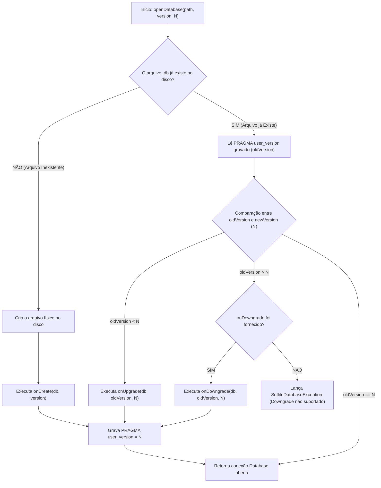

# Etapa 5 — Evolução do Banco e Migração de Esquema (`version` e `onUpgrade`)

## Introdução: O que este documento propõe e resolve?

### 1. O Problema Real que Estamos Enfrentando
Nas quatro primeiras etapas do nosso laboratório, construímos uma base de software sólida:
- Na **Etapa 1**, unificamos o estado compartilhado com `ChangeNotifier` e `provider`.
- Na **Etapa 2**, desacoplamos a regra de negócio com o contrato `FavoritesRepository` e o fluxo assíncrono seguro.
- Na **Etapa 3**, implementamos o armazenamento relacional no disco do aparelho usando o banco embutido **SQLite (`sqflite`)**, protegendo consultas contra *SQL Injection*.
- Na **Etapa 4**, construímos uma camada isolada de tradução bidirecional (*Data Mapper*) para tipos compostos (`enum`, `Set<Enum>`, `DateTime`, `double`), protegendo o app contra discrepâncias numéricas e valores desconhecidos.

Até este momento, estávamos trabalhando com a **versão 1** do nosso banco de dados relacional. Toda vez que precisávamos alterar algo no DDL (`CREATE TABLE`), simplesmente apagávamos o aplicativo do emulador ou limpávamos os dados de armazenamento para que o banco fosse recriado do zero.

Agora, imagine o cenário real de um produto em produção:
> **O aplicativo CeliLac já foi lançado nas lojas (Google Play e App Store).**
> Mais de 50.000 pessoas com doença celíaca ou intolerância severa à lactose utilizam o app diariamente. Cada uma delas possui dezenas de restaurantes, padarias e confeitarias artesanais cuidadosamente favoritados ao longo de meses de uso.
> 
> A equipe de design e produto solicita uma melhoria visual importante: **cada estabelecimento agora exibirá o logotipo ou fotografia da sua fachada (`logoSource`)** no cartão da listagem e na tela de detalhes.

Como desenvolvedor, a primeira reação ingênua costuma ser:
1. Adicionar o atributo `final String? logoSource;` na classe `Establishment`.
2. Adicionar `'logo_source': logoSource` no mapeador `toRow`.
3. Abrir o arquivo `sqlite_favorites_repository.dart` e adicionar a coluna `logo_source TEXT` dentro da instrução `CREATE TABLE` do método `createSchema`.
4. Compilar e rodar a nova versão do aplicativo no celular de um usuário que já tinha o app instalado.

O resultado dessa abordagem ingênua é catastrófico:
```text
════════ Exception caught by widgets library ═══════════════════════════════════
Unhandled Exception: DatabaseException(no such column: logo_source (code 1 SQLITE_ERROR): 
while executing, 'INSERT OR REPLACE INTO favorites (id, name, category, neighborhood, 
distance_in_km, rating, dietary_options, logo_source, saved_at) VALUES (?, ?, ?, ?, ?, ?, ?, ?, ?)')
════════════════════════════════════════════════════════════════════════════════
```

**Por que o aplicativo quebrou?**
Porque no SQLite, o método `onCreate` é executado **apenas uma única vez na vida útil do banco**: no momento exato em que o arquivo binário `.db` é fisicamente criado no sistema de arquivos do aparelho. Quando o usuário atualiza o aplicativo pela loja, o arquivo `.db` já existe no disco. O SQLite simplesmente abre o arquivo existente, ignora completamente a nova instrução `CREATE TABLE`, e o banco permanece na estrutura antiga da versão 1! Quando o código do Dart tenta inserir a nova coluna `logo_source`, o motor do SQLite rejeita a operação com erro de coluna inexistente.

Diante desse erro, programadores sem base sólida recorrem ao pior antipadrão possível:
- Executam `DROP TABLE IF EXISTS favorites` para forçar a recriação da tabela; ou
- Pedem para o usuário desinstalar e reinstalar o aplicativo.

Em um ambiente profissional, **apagar os dados do usuário é inaceitável**. Isso destrói o histórico pessoal do cliente, arruína a reputação do produto e gera uma avalanche de avaliações de 1 estrela nas lojas de aplicativos.

---

### 2. O que esta Etapa 5 Propõe e Resolve
Este documento propõe o domínio completo do **Ciclo de Vida de Versões e Migração Incremental de Esquema de Banco de Dados (*Schema Migration*)**, resolvendo quatro problemas fundamentais de Engenharia de Dados e Manutenibilidade em aplicações Flutter:

1. **Domínio do Ciclo de Vida do Banco (`onCreate`, `onUpgrade`, `onDowngrade`):** Compreendemos como o SQLite utiliza a diretiva interna `PRAGMA user_version` gravada no cabeçalho binário do arquivo `.db` para detectar automaticamente quando o aplicativo foi atualizado com uma versão de esquema superior (`oldVersion < newVersion`).
2. **Evolução Segura com `ALTER TABLE ... ADD COLUMN`:** Aprendemos a aplicar modificações estruturais no banco sem descartar nenhuma linha existente, compreendendo as regras e limitações formais do comando `ALTER TABLE` no motor do SQLite (obrigatoriedade de colunas adicionadas serem anuláveis ou possuírem valor `DEFAULT`).
3. **Arquitetura de Migrações Incrementais em Cadeia (`if (oldVersion < N)` vs. `switch`):** Estruturamos o método `upgradeSchema` utilizando blocos condicionais progressivos. Essa arquitetura garante que se um usuário passar muito tempo sem atualizar o app — saltando, por exemplo, diretamente da versão 1 para a versão 3 —, todas as migrações intermediárias (1→2 e 2→3) sejam aplicadas de forma sequencial e idempotente, sem quebrar o banco.
4. **Garantia de Paridade entre Usuários Novos e Usuários Antigos:** Mantemos a instrução de `createSchema` sempre sincronizada com o estado mais moderno do banco (para que usuários recém-chegados não precisem rodar migrações desnecessárias), enquanto o `upgradeSchema` reconduz os usuários antigos até o estado atual com integridade total.
5. **Testabilidade Automatizada de Migrações sem Emulador com `sqflite_common_ffi`:** Construímos um teste de unidade automatizado que simula com 100% de fidelidade a abertura de um banco antigo na versão 1, a inserção de registros legados, a execução da migração para a versão 2 e a confirmação de que os dados antigos foram preservados intactos enquanto novos campos puderam ser gravados.

---

### 3. Por que Dominar Migrações Antes do `MultiProvider` (Etapa 6)?
Na **Etapa 6**, nosso aplicativo passará a gerenciar múltiplos estados globais independentes em paralelo (o catálogo de favoritos do `FavoritesController` e as preferências de segurança alimentar do `ProfileController`), disparando inicializações concorrentes com `(loadA, loadB).wait`.

Se o nosso banco de dados não possuir um controle de versão resiliente e previsível, eventuais falhas de esquema durante a carga inicial farão com que a inicialização concorrente falhe silenciosamente ou trave a tela de abertura (*SplashPage*). Dominar a persistência evolutiva agora garante que nossos repositórios sejam rochas inabaláveis antes de escalarmos a gerência de estado.

---

## Visão Geral do Roteiro de Aula

| Momento | Tempo estimado | O que acontece na aula |
|---|---|---|
| **0. Arquitetura de Pastas e Cenário Inicial** | 10 min | Revisamos a estrutura do projeto, inspecionamos o arquivo binário `.db` da versão 1 e identificamos os artefatos que receberão o novo atributo `logoSource`. |
| **1. O Problema (A Dor Provocada ao Vivo)** | 15 min | Simulamos ao vivo o erro que ocorre em produção: adicionamos a coluna no Dart sem atualizar a versão do banco e assistimos ao crash fatal `DatabaseException(no such column: logo_source)`. |
| **2. O Conceito (Fundamentação Teórica e Técnica)** | 25 min | Fundamentamos o cabeçalho binário do SQLite, o `PRAGMA user_version`, a máquina de estados do `openDatabase`, as limitações do `ALTER TABLE` e o padrão de migrações em cadeia (`if (oldVersion < N)`). |
| **3. A Prática (Implementação Passo a Passo)** | 30 min | Atualizamos a entidade `Establishment`, ajustamos o mapeador com *pattern matching* do Dart 3, elevamos para `schemaVersion = 2`, escrevemos `upgradeSchema` e renderizamos os logos no `EstablishmentCard`. |
| **4. Verificação, Teste Automatizado e Ponte com o CeliLac** | 20 min | Executamos o teste automatizado de migração com `sqflite_common_ffi`, validamos a atualização sem perda de dados no emulador e mapeamos o código com o projeto oficial do **CeliLac**. |

---

## 0. Arquitetura de Pastas e Cenário Inicial

Nesta etapa, não precisamos criar novos diretórios. Vamos trabalhar diretamente na evolução cirúrgica das camadas de **Domínio**, **Dados** e **Apresentação**, além de criar o teste de migração dedicado em `test/`.

### 0.1 Árvore de arquivos impactados nesta Etapa 5

```text
celilac/ (ou lab_favoritos/)
├── lib/
│   ├── app/
│   │   ├── lab_app.dart
│   │   └── lab_shell.dart
│   └── features/
│       ├── establishments/
│       │   ├── domain/
│       │   │   └── entities/
│       │   │       ├── dietary_option.dart
│       │   │       ├── establishment.dart                     # ✏️ Recebe 'final String? logoSource'
│       │   │       └── establishment_category.dart
│       │   └── presentation/
│       │       └── widgets/
│       │           ├── establishment_card.dart                # ✏️ Renderiza logotipo / fallback
│       │           └── favorite_button.dart
│       └── favorites/
│           ├── data/
│           │   ├── favorite_establishment_row.dart            # ✏️ Mapeia 'logo_source' com segurança
│           │   └── sqlite_favorites_repository.dart           # ✏️ schemaVersion = 2 + upgradeSchema
│           ├── domain/
│           │   └── repositories/
│           │       └── favorites_repository.dart
│           └── presentation/
│               ├── favorites_controller.dart
│               └── pages/
│                   └── favorites_page.dart
└── test/
    └── features/
        └── favorites/
            └── sqlite_favorites_repository_test.dart          # ✏️ Teste de migração v1 -> v2 com FFI
```

---

## 1. O Problema (A Dor Provocada ao Vivo)

Para compreender por que o controle de versão de banco de dados é um dos pilares mais críticos da engenharia de software móvel, vamos reproduzir exatamente o erro que desenvolvedores desavisados cometem ao publicar atualizações na loja.

### 1.1 Cenário de Partida: O Banco na Versão 1
Na Etapa 4, nosso repositório SQLite foi configurado com a versão 1:

```dart
// lib/features/favorites/data/sqlite_favorites_repository.dart (Versão 1 legada)
class SqliteFavoritesRepository implements FavoritesRepository {
  static const String tableName = 'favorites';
  static const String databaseFileName = 'celilac_favorites.db';
  static const int schemaVersion = 1; // 👈 Versão 1 inicial

  static Future<Database> _openDefaultDatabase() async {
    final directory = await getDatabasesPath();
    final path = p.join(directory, databaseFileName);
    return openDatabase(
      path,
      version: schemaVersion,
      onCreate: createSchema,
    );
  }

  static Future<void> createSchema(Database db, int version) async {
    await db.execute('''
      CREATE TABLE $tableName (
        id TEXT PRIMARY KEY,
        name TEXT NOT NULL,
        category TEXT NOT NULL,
        neighborhood TEXT NOT NULL,
        distance_in_km REAL NOT NULL,
        rating REAL NOT NULL,
        dietary_options TEXT NOT NULL,
        saved_at INTEGER NOT NULL
      )
    ''');
  }
  // ...
}
```

Imagine que o aluno executou o aplicativo no emulador, navegou pela lista e favoritou dois estabelecimentos:
1. **Padaria Trigo Zero** (salva com sucesso no banco `.db`).
2. **Empório Sem Glúten** (salvo com sucesso no banco `.db`).

Os dados agora estão gravados fisicamente no arquivo SQLite do emulador.

---

### 1.2 O Erro Cometido em Sala: Adicionando a Coluna sem Migração

Agora o professor ou o aluno recebe o novo requisito: *"Os estabelecimentos precisam ter logotipos opcionais"*.

O desenvolvedor faz as seguintes alterações no código:

1. Na entidade `Establishment`, adiciona `this.logoSource`:
   ```dart
   class Establishment {
     final String id;
     final String name;
     final EstablishmentCategory category;
     final String neighborhood;
     final double distanceInKm;
     final double rating;
     final Set<DietaryOption> dietaryOptions;
     final String? logoSource; // 👈 Novo campo opcional
     // ...
   }
   ```

2. No mapeador `favorite_establishment_row.dart`, adiciona o campo ao mapa gerado:
   ```dart
   extension FavoriteEstablishmentRow on Establishment {
     Map<String, Object?> toRow({required DateTime savedAt}) => {
       'id': id,
       'name': name,
       'category': category.name,
       'neighborhood': neighborhood,
       'distance_in_km': distanceInKm,
       'rating': rating,
       'dietary_options': [for (final o in dietaryOptions) o.name].join(','),
       'logo_source': logoSource, // 👈 Enviando a nova chave para o SQLite
       'saved_at': savedAt.millisecondsSinceEpoch,
     };
   }
   ```

3. Em `sqlite_favorites_repository.dart`, atualiza a instrução `CREATE TABLE`:
   ```dart
   static Future<void> createSchema(Database db, int version) async {
     await db.execute('''
       CREATE TABLE $tableName (
         id TEXT PRIMARY KEY,
         name TEXT NOT NULL,
         category TEXT NOT NULL,
         neighborhood TEXT NOT NULL,
         distance_in_km REAL NOT NULL,
         rating REAL NOT NULL,
         dietary_options TEXT NOT NULL,
         logo_source TEXT,          -- 👈 Adicionou a coluna aqui
         saved_at INTEGER NOT NULL
       )
     ''');
   }
   ```

Note com atenção: **o desenvolvedor esqueceu de alterar a constante `schemaVersion = 1` e não configurou o callback `onUpgrade`!**

---

### 1.3 A Execução do Desastre
O desenvolvedor faz *Hot Restart* ou recompila o aplicativo no emulador onde o app já estava instalado.

1. O aplicativo abre normalmente. A aba Início carrega a lista da memória.
2. O usuário toca no botão de coração de um novo estabelecimento (ex.: **Café Aconchego**).
3. O método `add` do repositório é acionado:
   ```dart
   await db.insert(tableName, establishment.toRow(...));
   ```
4. **O aplicativo trava ou explode no console com a seguinte exceção fatal:**

```text
════════ Exception caught by gesture ═══════════════════════════════════════════
[ERROR:flutter/runtime/dart_vm_initializer.cc] Unhandled Exception: 
DatabaseException(table favorites has no column named logo_source (code 1 SQLITE_ERROR): 
while executing, 'INSERT OR REPLACE INTO favorites (id, name, category, neighborhood, 
distance_in_km, rating, dietary_options, logo_source, saved_at) VALUES (?, ?, ?, ?, ?, ?, ?, ?, ?)')
#0   wrapDatabaseException (package:sqflite/src/exception_impl.dart:11)
#1   SqfliteDatabaseMixin.insert (package:sqflite_common/src/database_mixin.dart:366)
#2   SqliteFavoritesRepository.add (sqlite_favorites_repository.dart:83)
#3   FavoritesController.toggle (favorites_controller.dart:58)
════════════════════════════════════════════════════════════════════════════════
```

---

### 1.4 Diagnóstico da Falha: Por que `createSchema` foi Ignorado?

Pergunte aos alunos: *"Se nós colocamos `logo_source TEXT` dentro do `CREATE TABLE`, por que o SQLite disse que a coluna não existe?"*

A resposta reside no funcionamento interno do SQLite e do pacote `sqflite`:
- O arquivo `celilac_favorites.db` já existia no disco local do aparelho, criado na aula anterior.
- Quando o método `openDatabase(...)` foi chamado, ele verificou se o arquivo físico existia.
- **Como o arquivo já existia**, o SQLite ignorou completamente o callback `onCreate`.
- O SQLite então leu a versão gravada no cabeçalho do arquivo existente: **versão 1**.
- Em seguida, comparou com a versão solicitada no parâmetro `version`: **versão 1**.
- Como `versão_arquivo (1) == versão_solicitada (1)`, o SQLite concluiu: *"O banco já está perfeitamente atualizado!"* e entregou a conexão aberta com a tabela antiga de 8 colunas.
- Quando o Dart tentou gravar um mapa com 9 colunas (`logo_source`), o SQLite rejeitou a gravação porque aquela coluna física não existe na tabela existente.

---

## 2. O Conceito (Fundamentação Teórica e Técnica)

Para resolver esse problema de forma definitiva e elegante, precisamos dominar os mecanismos de controle de versão nativos do SQLite e a API de ciclo de vida do `sqflite`.

### 2.1 A Estrutura Binária do SQLite e o `PRAGMA user_version`

O SQLite é um banco de dados autossuficiente armazenado em um único arquivo de disco. Nos primeiros 100 bytes desse arquivo reside o **cabeçalho binário do banco (*Database File Header*)**.

Entre os bytes 60 e 63 desse cabeçalho, o SQLite reserva um número inteiro de 4 bytes (32 bits) para uso exclusivo da aplicação chamado **`user_version`**.

Você pode inspecionar ou alterar esse valor a qualquer momento executando comandos PRAGMA:

```sql
-- Consulta a versão gravada atualmente no cabeçalho do arquivo
PRAGMA user_version;

-- Altera a versão gravada no cabeçalho para 2
PRAGMA user_version = 2;
```

O pacote `sqflite` do Flutter utiliza exatamente essa diretiva interna para gerenciar o ciclo de vida do esquema sem que precisemos manipular números mágicos manualmente.

---

### 2.2 A Máquina de Estados do `openDatabase`

Quando chamamos `openDatabase(path, version: N, onCreate: ..., onUpgrade: ..., onDowngrade: ...)`, o motor executa o seguinte algoritmo determinístico:



Esse fluxo revela três regras essenciais de engenharia:
1. **`onCreate`** é invocado **apenas quando o arquivo é criado do zero**. Se o banco já existir, ele nunca mais rodará.
2. **`onUpgrade`** é invocado **somente quando `newVersion > oldVersion`**.
3. A atualização do `PRAGMA user_version = newVersion` só é confirmada no cabeçalho se o callback `onUpgrade` terminar com sucesso (sem lançar exceções). Se uma instrução SQL dentro do `onUpgrade` falhar, a transação é desfeita e a versão antiga é preservada, evitando que o banco fique em um estado corrompido intermediário.

---

### 2.3 O Comando `ALTER TABLE ... ADD COLUMN` e as Limitações do SQLite

Para evoluir a tabela sem destruir seus registros, utilizamos a instrução SQL padrão de alteração estrutural:

```sql
ALTER TABLE favorites ADD COLUMN logo_source TEXT;
```

No entanto, o motor do SQLite possui peculiaridades e restrições históricas em relação a bancos cliente/servidor tradicionais (como PostgreSQL ou SQL Server). No SQLite, o comando `ALTER TABLE` possui regras estritas:

| Operação no SQLite | Suportada diretamente via `ALTER TABLE`? | Observações Críticas |
|---|:---:|---|
| **`ADD COLUMN`** (Adicionar nova coluna) | **SIM** | A coluna **DEVE** ser anulável (`NULL`) ou ter uma cláusula `DEFAULT` com valor constante. Não pode ser declarada como `PRIMARY KEY` ou `UNIQUE`. |
| **`RENAME TABLE`** (Renomear tabela) | **SIM** | Atualiza automaticamente gatilhos e índices associados. |
| **`RENAME COLUMN`** (Renomear coluna) | **SIM** *(SQLite 3.25.0+)* | Disponível em versões modernas do motor. |
| **`DROP COLUMN`** (Remover coluna) | **SIM** *(SQLite 3.35.0+)* | Introduzido recentemente (2021). Em versões antigas de Android (engines antigas de fábrica), essa operação falhava. |
| **Alterar o tipo de uma coluna existente** | **NÃO** | O SQLite não suporta alterar o tipo formal de uma coluna existente via `ALTER TABLE`. Se necessário, deve-se criar uma tabela temporária, copiar os dados e renomear. |

Como o nosso objetivo nesta etapa é adicionar o campo opcional `logoSource` (`String?`), a sintaxe `ALTER TABLE favorites ADD COLUMN logo_source TEXT;` é **100% suportada, atômica, rápida e segura em todos os aparelhos Android e iOS**.

---

### 2.4 Arquitetura de Migrações Incrementais em Cadeia: Por que `if` e Não `switch`?

Uma dúvida clássica dos alunos ao implementar `onUpgrade(db, oldVersion, newVersion)` é qual estrutura de controle utilizar no código Dart.

Muitos desenvolvedores pensam inicialmente em usar um `switch (oldVersion)`:

```dart
// ❌ ARQUITETURA FRÁGIL COM SWITCH:
static Future<void> upgradeSchema(Database db, int oldVersion, int newVersion) async {
  switch (oldVersion) {
    case 1:
      await db.execute('ALTER TABLE favorites ADD COLUMN logo_source TEXT');
      break;
    case 2:
      await db.execute('ALTER TABLE favorites ADD COLUMN notes TEXT');
      break;
  }
}
```

**Por que o `switch` acima é uma armadilha fatal?**
Considere o seguinte caso real:
1. Maria instalou o aplicativo na **versão 1**.
2. O aplicativo foi atualizado na loja para a versão 2 (adicionando `logo_source`). Maria estava sem internet móvel e **não atualizou o app**.
3. Meses depois, a equipe lançou a versão 3 do app (adicionando a coluna `notes`).
4. Maria finalmente entra em uma rede Wi-Fi e atualiza o aplicativo diretamente da **versão 1 para a versão 3**.
5. Quando o app abrir, `oldVersion` será `1` e `newVersion` será `3`.
6. O `switch (oldVersion)` entrará no `case 1`, executará a adição de `logo_source` e encontrará o `break;`!
7. **Resultado:** a migração para a versão 3 foi ignorada! A coluna `notes` não foi criada e o app de Maria quebrará ao tentar acessar as anotações.

#### O Padrão Correto: Cadeia Progressiva de `if (oldVersion < N)`

A forma padrão, elegante e à prova de falhas adotada na indústria e no **CeliLac** consiste em encadear blocos condicionais comparando se a versão antiga é estritamente menor que a versão do degrau:

```dart
// ✅ PADRÃO OFICIAL: CADEIA PROGRESSIVA INCREMENTAL
static Future<void> upgradeSchema(
  Database db,
  int oldVersion,
  int newVersion,
) async {
  // Degrau 1 -> 2: Adiciona a coluna de logotipo
  if (oldVersion < 2) {
    await db.execute(
      'ALTER TABLE $tableName ADD COLUMN logo_source TEXT',
    );
  }

  // Degrau 2 -> 3: Adiciona futuras colunas (exemplo didático)
  if (oldVersion < 3) {
    // await db.execute('ALTER TABLE $tableName ADD COLUMN notes TEXT');
  }
}
```

Analise o comportamento com o mesmo exemplo de Maria (saltando da `v1` para a `v3`):
1. `oldVersion = 1`, `newVersion = 3`.
2. Primeiro teste: `oldVersion < 2` (`1 < 2`) → **Verdadeiro!** Executa a migração da v2 (`ADD COLUMN logo_source`).
3. Segundo teste: `oldVersion < 3` (`1 < 3`) → **Verdadeiro!** Executa a migração da v3 (`ADD COLUMN notes`).
4. Todas as migrações necessárias foram executadas em ordem estrita e os dados de Maria foram preservados com sucesso absoluto.

E se o usuário já estiver na versão 2 atualizando para a versão 3?
1. `oldVersion = 2`, `newVersion = 3`.
2. Primeiro teste: `oldVersion < 2` (`2 < 2`) → **Falso!** Pula a migração 1→2 (não tenta adicionar `logo_source` novamente, o que daria erro de coluna duplicada).
3. Segundo teste: `oldVersion < 3` (`2 < 3`) → **Verdadeiro!** Executa apenas a migração necessária para a v3.

---

### 2.5 A Regra de Ouro da Paridade: `onCreate` Cria o Presente; `onUpgrade` Traz o Passado

Uma falha conceitual muito comum em projetos iniciantes é manter a instrução `createSchema` congelada no passado e delegar todas as novas colunas exclusivamente ao `onUpgrade`.

Isso cria uma assimetria perigosa:
- Se um usuário novo baixa o app hoje (na versão 2), ele não deve executar o `CREATE TABLE` antigo da versão 1 e imediatamente sofrer uma migração para a versão 2!
- Em vez disso, o `createSchema` deve **sempre criar a tabela já no seu formato mais moderno e consolidado** (`schemaVersion = 2`).

```text
┌────────────────────────────────────────────────────────────────────────┐
│                        REGRA DE OURO DA PARIDADE                       │
├────────────────────────────────────────────────────────────────────────┤
│ 1. Usuário Novo:                                                       │
│    O banco ainda não existe. O `onCreate` roda uma única vez e cria a  │
│    tabela completa com todas as 9 colunas da versão 2.                 │
│                                                                        │
│ 2. Usuário Antigo:                                                     │
│    O banco já existe com 8 colunas (v1). O `onCreate` é ignorado e o   │
│    `onUpgrade` roda o `ALTER TABLE` adicionando a 9ª coluna.           │
│                                                                        │
│ 3. Ponto de Chegada Comum:                                             │
│    Ambos os usuários terminam exatamente com o mesmo esquema!          │
└────────────────────────────────────────────────────────────────────────┘
```

---

## 3. A Prática (Implementação Passo a Passo por Arquivo)

Agora vamos aplicar as alterações em cada arquivo do projeto, seguindo rigorosamente a arquitetura em camadas e o isolamento de responsabilidades.

---

### Passo 3.1 — Atualizar a Entidade de Domínio (`Establishment`)

Abra o arquivo `lib/features/establishments/domain/entities/establishment.dart`.
Adicionamos o atributo opcional `logoSource` e atualizamos o construtor `const`:

```dart
// lib/features/establishments/domain/entities/establishment.dart
import 'dietary_option.dart';
import 'establishment_category.dart';

class Establishment {
  const Establishment({
    required this.id,
    required this.name,
    required this.category,
    required this.neighborhood,
    required this.distanceInKm,
    required this.rating,
    this.dietaryOptions = const <DietaryOption>{},
    this.logoSource, // 👈 Novo atributo opcional
  });

  final String id;
  final String name;
  final EstablishmentCategory category;
  final String neighborhood;
  final double distanceInKm;
  final double rating;
  final Set<DietaryOption> dietaryOptions;
  final String? logoSource; // 👈 Caminho de asset ou URL do logotipo

  @override
  bool operator ==(Object other) =>
      identical(this, other) ||
      other is Establishment &&
          runtimeType == other.runtimeType &&
          id == other.id;

  @override
  int get hashCode => id.hashCode;
}
```

> **Nota de Arquitetura:** A entidade de domínio permanece 100% pura! Ela não conhece tabelas, SQL, SQLite ou serializações. Ela simplesmente reflete a realidade do negócio: um estabelecimento pode ou não possuir uma imagem de logotipo.

---

### Passo 3.2 — Atualizar o Mapeador de Dados (`favorite_establishment_row.dart`)

Abra `lib/features/favorites/data/favorite_establishment_row.dart`.
Precisamos garantir:
1. Na serialização (`toRow`): incluir `'logo_source': logoSource`.
2. Na desserialização (`establishmentFromRow`): ler `'logo_source'` com tolerância total a nulos, strings vazias ou espaços em branco usando o *pattern matching* moderno do Dart 3 (`switch` expression).

```dart
// lib/features/favorites/data/favorite_establishment_row.dart
import '../../establishments/domain/entities/dietary_option.dart';
import '../../establishments/domain/entities/establishment.dart';
import '../../establishments/domain/entities/establishment_category.dart';

extension FavoriteEstablishmentRow on Establishment {
  Map<String, Object?> toRow({required DateTime savedAt}) => {
    'id': id,
    'name': name,
    'category': category.name,
    'neighborhood': neighborhood,
    'distance_in_km': distanceInKm,
    'rating': rating,
    'dietary_options': [
      for (final option in dietaryOptions) option.name,
    ].join(','),
    'logo_source': logoSource, // 👈 Persiste o logo (pode ser null)
    'saved_at': savedAt.millisecondsSinceEpoch,
  };
}

Establishment establishmentFromRow(Map<String, Object?> row) {
  final categories = EstablishmentCategory.values.asNameMap();
  final options = DietaryOption.values.asNameMap();

  return Establishment(
    id: row['id'] as String,
    name: row['name'] as String,
    category: categories[row['category']] ?? EstablishmentCategory.restaurant,
    neighborhood: row['neighborhood'] as String,
    // Defesa numérica universal contra SQLite int vs double:
    distanceInKm: (row['distance_in_km'] as num).toDouble(),
    rating: (row['rating'] as num).toDouble(),
    dietaryOptions: {
      if (row['dietary_options'] case final String raw when raw.isNotEmpty)
        for (final name in raw.split(',')) ?options[name],
    },
    // Leitura resiliente de logoSource com pattern matching:
    logoSource: switch (row['logo_source']) {
      final String source when source.trim().isNotEmpty => source,
      _ => null,
    },
  );
}
```

---

### Passo 3.3 — Atualizar o Repositório SQLite (`sqlite_favorites_repository.dart`)

Abra `lib/features/favorites/data/sqlite_favorites_repository.dart`.
Aqui aplicamos as quatro decisões fundamentais de migração:
1. Subir a versão: `static const int schemaVersion = 2;`.
2. Conectar o callback `onUpgrade: upgradeSchema` no método de abertura `openDatabase(...)`.
3. Atualizar o `createSchema` para criar a tabela completa da versão 2 (com `logo_source TEXT`).
4. Implementar o método estático `upgradeSchema` com a cadeia `if (oldVersion < 2)`.

```dart
// lib/features/favorites/data/sqlite_favorites_repository.dart
import 'package:path/path.dart' as p;
import 'package:sqflite/sqflite.dart';

import '../../establishments/domain/entities/establishment.dart';
import '../domain/repositories/favorites_repository.dart';
import 'favorite_establishment_row.dart';

class SqliteFavoritesRepository implements FavoritesRepository {
  SqliteFavoritesRepository({Future<Database> Function()? openDatabase})
      : _openDatabase = openDatabase ?? _openDefaultDatabase;

  static const String tableName = 'favorites';
  static const String databaseFileName = 'celilac_favorites.db';
  
  // 1. Elevamos a versão de esquema para 2:
  static const int schemaVersion = 2;

  final Future<Database> Function() _openDatabase;
  Future<Database>? _database;

  Future<Database> get _db => _database ??= _openDatabase();

  static Future<Database> _openDefaultDatabase() async {
    final directory = await getDatabasesPath();
    final path = p.join(directory, databaseFileName);
    
    return openDatabase(
      path,
      version: schemaVersion,
      onCreate: createSchema,
      onUpgrade: upgradeSchema, // 👈 Registrado no ciclo de vida do SQLite
    );
  }

  /// Chamado apenas quando o banco NÃO existe (usuário novo).
  /// Cria a tabela diretamente no estado atual mais moderno (v2).
  static Future<void> createSchema(Database db, int version) async {
    await db.execute('''
      CREATE TABLE $tableName (
        id TEXT PRIMARY KEY,
        name TEXT NOT NULL,
        category TEXT NOT NULL,
        neighborhood TEXT NOT NULL,
        distance_in_km REAL NOT NULL,
        rating REAL NOT NULL,
        dietary_options TEXT NOT NULL,
        logo_source TEXT,
        saved_at INTEGER NOT NULL
      )
    ''');
  }

  /// Chamado quando o banco já existe com uma versão menor (oldVersion < newVersion).
  /// Aplica alterações estruturais em cadeia sem perder dados já gravados.
  static Future<void> upgradeSchema(
    Database db,
    int oldVersion,
    int newVersion,
  ) async {
    if (oldVersion < 2) {
      await db.execute(
        'ALTER TABLE $tableName ADD COLUMN logo_source TEXT',
      );
    }
  }

  @override
  Future<List<Establishment>> loadAll() async {
    final db = await _db;
    final rows = await db.query(tableName, orderBy: 'saved_at DESC');
    return [for (final row in rows) establishmentFromRow(row)];
  }

  @override
  Future<bool> isFavorite(String establishmentId) async {
    final db = await _db;
    final rows = await db.query(
      tableName,
      columns: ['id'],
      where: 'id = ?',
      whereArgs: [establishmentId],
      limit: 1,
    );
    return rows.isNotEmpty;
  }

  @override
  Future<void> add(Establishment establishment, {DateTime? savedAt}) async {
    final db = await _db;
    await db.insert(
      tableName,
      establishment.toRow(savedAt: savedAt ?? DateTime.now()),
      conflictAlgorithm: ConflictAlgorithm.replace,
    );
  }

  @override
  Future<void> remove(String establishmentId) async {
    final db = await _db;
    await db.delete(
      tableName,
      where: 'id = ?',
      whereArgs: [establishmentId],
    );
  }

  Future<void> close() async {
    final db = _database;
    _database = null;
    if (db != null) {
      await (await db).close();
    }
  }
}
```

---

### Passo 3.4 — Renderizar o Logotipo no `EstablishmentCard` com Fallback Acessível

Abra `lib/features/establishments/presentation/widgets/establishment_card.dart`.
Agora que a entidade possui `logoSource`, vamos atualizar o visual do cartão para exibir:
1. Uma miniatura do logotipo (se `establishment.logoSource != null`).
2. Um ícone de categoria elegante com fundo suave (caso `establishment.logoSource == null`).

```dart
// Trecho relevante de lib/features/establishments/presentation/widgets/establishment_card.dart
Widget _buildLeadingIcon(BuildContext context) {
  final logo = establishment.logoSource;

  if (logo != null && logo.isNotEmpty) {
    return ClipRRect(
      borderRadius: BorderRadius.circular(8),
      child: Image.asset(
        logo,
        width: 48,
        height: 48,
        fit: BoxFit.cover,
        errorBuilder: (context, error, stackTrace) => _buildCategoryFallback(context),
      ),
    );
  }

  return _buildCategoryFallback(context);
}

Widget _buildCategoryFallback(BuildContext context) {
  final icon = switch (establishment.category) {
    EstablishmentCategory.restaurant => Icons.restaurant,
    EstablishmentCategory.bakery => Icons.bakery_dining,
    EstablishmentCategory.cafe => Icons.local_cafe,
    EstablishmentCategory.market => Icons.storefront,
  };

  return Container(
    width: 48,
    height: 48,
    decoration: BoxDecoration(
      color: Theme.of(context).colorScheme.primaryContainer,
      borderRadius: BorderRadius.circular(8),
    ),
    child: Icon(
      icon,
      color: Theme.of(context).colorScheme.onPrimaryContainer,
    ),
  );
}
```

---

## 4. Verificação, Teste Automatizado e Ponte com o CeliLac

A grande questão de engenharia ao lidar com migrações de banco é: **como podemos ter 100% de certeza de que a migração funciona sem precisar instalar versões antigas em múltiplos celulares reais?**

A resposta está na criação de um **teste de unidade automatizado com SQLite em memória via FFI**.

---

### 4.1 Teste Automatizado de Migração com `sqflite_common_ffi`

Graças ao pacote `sqflite_common_ffi`, podemos abrir bancos SQLite reais em memória RAM durante os testes do Flutter no computador (`flutter test`).

Abra o arquivo `test/features/favorites/sqlite_favorites_repository_test.dart` e examine o teste dedicado de migração da versão 1 para a versão 2:

```dart
// test/features/favorites/sqlite_favorites_repository_test.dart
import 'package:celilac/features/establishments/domain/entities/dietary_option.dart';
import 'package:celilac/features/establishments/domain/entities/establishment.dart';
import 'package:celilac/features/establishments/domain/entities/establishment_category.dart';
import 'package:celilac/features/favorites/data/sqlite_favorites_repository.dart';
import 'package:flutter_test/flutter_test.dart';
import 'package:sqflite_common_ffi/sqflite_ffi.dart';

const _cafe = Establishment(
  id: '1',
  name: 'Café Aconchego',
  category: EstablishmentCategory.cafe,
  neighborhood: 'Centro',
  distanceInKm: 0.35,
  rating: 4.8,
  dietaryOptions: {DietaryOption.glutenFree, DietaryOption.lactoseFree},
  logoSource: 'assets/images/establishments/cafe_aconchego_logo.png', // 👈 Possui logo
);

void main() {
  setUpAll(sqfliteFfiInit);

  test('migra da versão 1 para a 2 preservando os dados já salvos', () async {
    // 1. Criamos deliberadamente um banco legado na VERSÃO 1
    // (com a tabela antiga de 8 colunas, sem logo_source):
    final v1Db = await databaseFactoryFfi.openDatabase(
      inMemoryDatabasePath,
      options: OpenDatabaseOptions(
        version: 1,
        singleInstance: false,
        onCreate: (db, _) async {
          await db.execute('''
            CREATE TABLE ${SqliteFavoritesRepository.tableName} (
              id TEXT PRIMARY KEY,
              name TEXT NOT NULL,
              category TEXT NOT NULL,
              neighborhood TEXT NOT NULL,
              distance_in_km REAL NOT NULL,
              rating REAL NOT NULL,
              dietary_options TEXT NOT NULL,
              saved_at INTEGER NOT NULL
            )
          ''');
        },
      ),
    );
    addTearDown(v1Db.close);

    // 2. Inserimos um registro típico da época da versão 1:
    await v1Db.insert(SqliteFavoritesRepository.tableName, {
      'id': '2',
      'name': 'Padaria Leve Grão',
      'category': 'bakery',
      'neighborhood': 'Jardim das Flores',
      'distance_in_km': 1.2,
      'rating': 4.6,
      'dietary_options': 'glutenFree',
      'saved_at': 1000,
    });

    // 3. Executamos explicitamente a nossa função de migração:
    await SqliteFavoritesRepository.upgradeSchema(v1Db, 1, 2);

    // 4. Instanciamos o repositório moderno apontando para esse banco migrado:
    final migratedRepo = SqliteFavoritesRepository(
      openDatabase: () async => v1Db,
    );

    // 5. Inserimos um novo estabelecimento moderno da versão 2 (com logoSource):
    await migratedRepo.add(_cafe, savedAt: DateTime.utc(2026, 11, 4, 12));

    // 6. Consultamos todos os registros salvos:
    final all = await migratedRepo.loadAll();

    // 7. VALIDAÇÕES CRÍTICAS DE ENGENHARIA:
    // Deve conter ambos os registros (ordem decrescente de salvamento):
    expect(all.map((e) => e.id).toList(), ['1', '2']);
    
    // O novo registro (v2) deve ter mantido o logoSource:
    expect(all.first.logoSource, _cafe.logoSource);
    
    // O registro antigo (v1) deve ter sido preservado com logoSource nulo, sem quebrar!
    expect(all.last.logoSource, isNull);
    expect(all.last.name, 'Padaria Leve Grão');
  });
}
```

Execute o teste no terminal do seu computador:

```bash
flutter test test/features/favorites/sqlite_favorites_repository_test.dart
```

Saída esperada:
```text
00:01 +5: All tests passed!
```

---

### 4.2 Roteiro de Verificação ao Vivo no Emulador

Convide os estudantes a validarem a migração visualmente em seus próprios aparelhos ou emuladores:

1. **Estado Inicial:** No emulador que já possuía o banco da Etapa 4 instalado, abra o app. Observe os favoritos salvos anteriormente.
2. **Aplicação do Código Novo:** Com o repositório agora configurado com `schemaVersion = 2` e `onUpgrade`, faça um *Hot Restart* (`R` no terminal).
3. **Observação do Log:** O SQLite detecta que o banco local era versão 1 e que o app agora exige versão 2. O método `upgradeSchema` executa silenciosamente o `ALTER TABLE ... ADD COLUMN logo_source TEXT;`.
4. **Validação da Preservação:** Abra a aba **Favoritos**. Os estabelecimentos que você havia favoritado na aula anterior continuam exatamente lá, sem que nenhuma linha tenha se perdido! Eles exibem o ícone padrão de contingência (*fallback*).
5. **Validação da Nova Funcionalidade:** Vá até a aba **Início** e favorite o **Café Aconchego** (que possui logotipo cadastrado). Retorne à aba **Favoritos**: o Café Aconchego aparece no topo exibindo com sucesso a imagem da sua logo!

---

### 4.3 Experimento de Falha Controlada: A Armadilha de `oldVersion == 1`

Para consolidar por que devemos usar `if (oldVersion < 2)` em vez de `if (oldVersion == 1)`, faça a seguinte demonstração:

Pergunte à turma: *"O que aconteceria se escrevêssemos `if (oldVersion == 1)`?"*
- Para o salto de 1 para 2, funcionaria.
- Mas quando o app alcançar a versão 3 (com `schemaVersion = 3`), se um usuário estiver na versão 1 e fizer a migração, o teste `oldVersion == 2` falhará e a migração intermediária nunca acontecerá!
- Reafirme: **migrações de banco em produção devem ser sempre formuladas como degraus cumulativos: `if (oldVersion < N)`.**

---

### 4.4 Ponte Direta com o CeliLac

Veja como os componentes que trabalhamos nesta etapa se integram perfeitamente no projeto oficial de produção do **CeliLac**:

| Artefato no Laboratório (Etapa 5) | Arquivo no CeliLac Oficial | Papel na Engenharia do CeliLac |
|---|---|---|
| `schemaVersion = 2` e `upgradeSchema` | [`lib/features/favorites/data/sqlite_favorites_repository.dart`](file:///Users/evertoncoimbradearaujo/Documents/GitHub/dm/2026_2S/celilac/lib/features/favorites/data/sqlite_favorites_repository.dart#L14-L58) | Gerencia a versão do esquema e aplica `ALTER TABLE` para inclusão de `logo_source`. |
| Mapeamento de `logo_source` com pattern matching | [`lib/features/favorites/data/favorite_establishment_row.dart`](file:///Users/evertoncoimbradearaujo/Documents/GitHub/dm/2026_2S/celilac/lib/features/favorites/data/favorite_establishment_row.dart#L16-L41) | Serializa `'logo_source'` e faz fallback resiliente para nulo caso venha em branco. |
| Atributo `logoSource` | [`lib/features/establishments/domain/entities/establishment.dart`](file:///Users/evertoncoimbradearaujo/Documents/GitHub/dm/2026_2S/celilac/lib/features/establishments/domain/entities/establishment.dart#L1-L25) | Entidade de domínio pura, enriquecida com suporte a imagem de logotipo. |
| Teste automatizado de migração | [`test/features/favorites/sqlite_favorites_repository_test.dart`](file:///Users/evertoncoimbradearaujo/Documents/GitHub/dm/2026_2S/celilac/test/features/favorites/sqlite_favorites_repository_test.dart#L91-L137) | Valida a transição de esquema v1→v2 garantindo zero perda de dados. |

---

### 4.5 Gancho para a Etapa 6: Escala de Estado com `MultiProvider` e Inicialização Paralela

Encerre a aula com a provocação que estabelece o desafio da **Etapa 6**:

*"Agora nosso banco de dados é um motor maduro e à prova de falhas: persiste tipos ricos, protege contra SQL Injection e evolui seu esquema de versão em versão sem perder um único dado do usuário.*
*Mas o aplicativo CeliLac não vive apenas de favoritos. O usuário também precisa configurar o seu **Perfil de Segurança Alimentar (`ProfileController`)**: se ele tem restrição a Glúten, Lactose ou ambos.*
*Como fazer com que uma mesma tela (`HomePage` ou `FavoritesPage`) escute simultaneamente o `ProfileController` e o `FavoritesController` para destacar com selos visuais apenas os restaurantes seguros para o usuário da vez?*
*Como evitar a pirâmide de `ChangeNotifierProvider` aninhados na raiz do app?*
*E como inicializar múltiplos bancos de dados em paralelo na abertura do app usando `(loadProfile, loadFavorites).wait` sem travar a tela de Splash?"*

Na **Etapa 6**, responderemos a essas perguntas dominando o **`MultiProvider`** e a **Inicialização Concorrente de Estados**!

