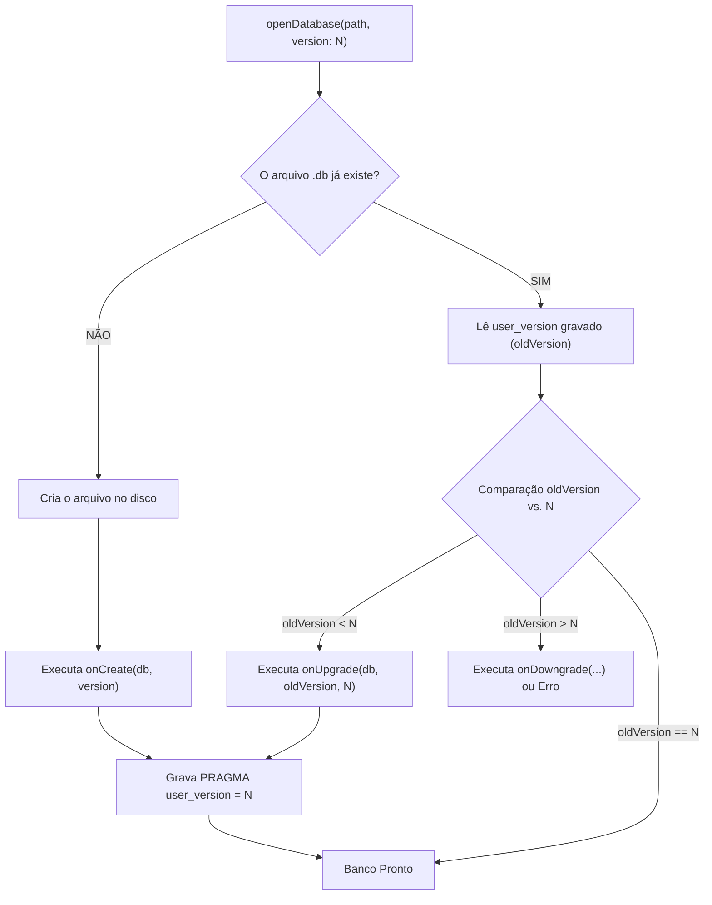

# Etapa 5 — Evolução do Banco e Migração de Esquema (`version` e `onUpgrade`)
## Da Quebra de Esquema em Produção à Migração Incremental sem Perda de Dados

> **Instrução para o Gamma:** Cada seção separada por `---` corresponde a um slide. O foco está na progressão **Problema → Dor Arquitetural → Fundamentação → Como Resolver**, utilizando diagramas visuais, tabelas comparativas e trechos mínimos de código.

---

## Slide 1 — Capa

### Etapa 5: Evolução do Banco e Migração de Esquema (`version` e `onUpgrade`)
**Como atualizar a estrutura do SQLite em produção sem perder nenhum dado dos usuários**

- **Contexto:** Laboratório Sequencial CeliLac (Etapa 5 de 7)
- **Foco da aula:**
  1. Sentir a dor do erro `no such column: logo_source` em apps já instalados
  2. Compreender a anatomia do arquivo binário SQLite e o `PRAGMA user_version`
  3. Diferenciar o momento de execução de `onCreate` vs. `onUpgrade`
  4. Implementar migrações seguras com `ALTER TABLE ... ADD COLUMN` e cadeia de `if (oldVersion < N)`
  5. Testar migrações de forma 100% automatizada com `sqflite_common_ffi`

---

## Slide 2 — O Cenário de Produto: O App Já Está na Loja!

### O que acontece quando o requisito muda após o lançamento?

Nas etapas anteriores, criamos nosso banco relacional na **versão 1** e salvamos favoritos reais no disco.

Agora imagine o cenário do mundo real:
- O **CeliLac** já está publicado na Google Play e na App Store com milhares de usuários ativos.
- Cada usuário já possui dezenas de restaurantes e confeitarias celíacas salvos no aparelho.
- A equipe de produto lança um novo requisito visual:
  > *"A partir de agora, cada estabelecimento exibirá o logotipo da sua marca (`logoSource` / `logo_source`)."*

Como atualizar o banco no celular desses milhares de usuários sem apagar os favoritos de ninguém?

---

## Slide 3 — A Tentativa Ingênua (E o Crash Provocado ao Vivo)

### O que o desenvolvedor desavisado faz?

1. Adiciona o atributo `final String? logoSource;` na entidade `Establishment`.
2. Adiciona `'logo_source': logoSource` no mapeador `toRow()`.
3. Adiciona a coluna `logo_source TEXT` no `CREATE TABLE` do `createSchema`.
4. Roda o aplicativo atualizado no emulador onde o app já estava instalado.

### O resultado ao tocar no botão de favoritar:

```text
Unhandled Exception: DatabaseException(table favorites has no column named logo_source):
while executing, 'INSERT OR REPLACE INTO favorites (..., logo_source, ...) VALUES (...)'
```

> **A pergunta de 1 milhão de dólares:**
> *"Se nós colocamos `logo_source TEXT` dentro do `CREATE TABLE`, por que o SQLite disse que a coluna não existe?"*

---

## Slide 4 — O Diagnóstico: Por que o SQLite Ignorou o `CREATE TABLE`?

### A regra de ouro do `onCreate`:

O método `onCreate` do `sqflite` é executado **exclusivamente quando o arquivo binário `.db` não existe no disco** (primeira execução após a instalação).

```text
┌────────────────────────────────────────────────────────────────────────┐
│                        O QUE ACONTECE NO DISCO                         │
├────────────────────────────────────────────────────────────────────────┤
│ 1. Usuário abre a versão atualizada do app.                            │
│ 2. O arquivo `celilac_favorites.db` JÁ EXISTE no disco local.          │
│ 3. O SQLite abre o arquivo existente e IGNORA o `onCreate`.            │
│ 4. A tabela continua com as 8 colunas antigas da versão 1.             │
│ 5. O Dart tenta inserir a 9ª coluna (`logo_source`) → CRASH FATAL!     │
└────────────────────────────────────────────────────────────────────────┘
```

O SQLite é um banco de dados embutido em arquivo: ele não reescreve suas tabelas automaticamente apenas porque o código-fonte mudou.

---

## Slide 5 — O Antipadrão Inaceitável: `DROP TABLE` e "Desinstalar o App"

### O que tutoriais amadores sugerem vs. o mundo profissional:

| Solução Proposta | O que acontece | Viabilidade em Produção |
|---|---|:---:|
| **"Desinstale o app do emulador"** | Apaga o arquivo `.db` e força o `onCreate` a rodar do zero. | ❌ **PROIBIDO:** você não pode pedir para 50.000 clientes desinstalarem o app e perderem seus dados. |
| **`DROP TABLE IF EXISTS favorites`** | Descarta a tabela antiga e recria vazia. | ❌ **INACEITÁVEL:** apaga instantaneamente o histórico pessoal do usuário. |
| **Migração Incremental (`onUpgrade`)** | Adiciona apenas a nova coluna mantendo todos os dados intactos. | ✅ **PADRÃO PROFISSIONAL:** atualização transparente e segura. |

> *"Em engenharia de software profissional, os dados do usuário são sagrados. Destruir dados por preguiça de escrever migração destrói a reputação do produto."*

---

## Slide 6 — A Mágica por Baixo dos Panos: `PRAGMA user_version`

### Onde o SQLite guarda a versão do banco?

Nos primeiros 100 bytes do arquivo binário `.db` reside o cabeçalho do SQLite. Entre os bytes 60 e 63, existe um número inteiro de 32 bits chamado **`user_version`**.

Podemos inspecionar ou alterar esse valor via comandos SQL:

```sql
-- Consulta a versão gravada no cabeçalho:
PRAGMA user_version;

-- Altera a versão no cabeçalho do arquivo para 2:
PRAGMA user_version = 2;
```

O parâmetro `version` do `openDatabase` utiliza exatamente essa diretiva interna para comparar a versão do código com a versão gravada no disco.

---

## Slide 7 — A Máquina de Estados do `openDatabase`

### Como o `sqflite` decide qual callback executar:



- **`onCreate`:** roda 1 vez na vida (quando o arquivo é recém-criado).
- **`onUpgrade`:** roda sempre que o app atualiza para uma versão maior (`oldVersion < newVersion`).
- Se o `onUpgrade` lançar qualquer erro, a transação aborta e o banco não é atualizado para o número novo, evitando corrupção.

---

## Slide 8 — O Comando `ALTER TABLE ... ADD COLUMN` no SQLite

### Como adicionar a coluna sem tocar nos registros existentes:

```sql
ALTER TABLE favorites ADD COLUMN logo_source TEXT;
```

### Regras estritas do SQLite que você precisa conhecer:
1. **Nulabilidade:** a nova coluna **deve** aceitar valores nulos (`NULL`) ou definir um valor padrão constante (`DEFAULT 'valor'`).
2. **Sem Primary Key:** não é permitido adicionar uma coluna com restrição `PRIMARY KEY` ou `UNIQUE` via `ALTER TABLE`.
3. **Desempenho:** o `ALTER TABLE ... ADD COLUMN` no SQLite é instantâneo ($O(1)$) porque ele apenas atualiza o esquema interno; as linhas antigas continuam ocupando o mesmo espaço no disco com valor nulo implícito.

Como `logo_source` é opcional (`String?`), o comando acima é perfeito e 100% seguro!

---

## Slide 9 — A Armadilha do `switch` vs. Cadeia de `if (oldVersion < N)`

### Por que NUNCA usar `switch` em migrações de banco?

```dart
// ❌ ARMADILHA: Usuário que saltar da v1 direto para a v3 quebrará!
switch (oldVersion) {
  case 1:
    await db.execute('ALTER TABLE favorites ADD COLUMN logo_source TEXT');
    break; // ⚠️ Pára aqui! Nunca executará a v3 para quem estava na v1!
  case 2:
    await db.execute('ALTER TABLE favorites ADD COLUMN notes TEXT');
    break;
}
```

### A Solução da Indústria: Blocos `if` Progressivos

```dart
// ✅ CORRETO: Executa todos os degraus necessários cumulativamente
static Future<void> upgradeSchema(Database db, int oldVersion, int newVersion) async {
  if (oldVersion < 2) {
    await db.execute('ALTER TABLE $tableName ADD COLUMN logo_source TEXT');
  }
  if (oldVersion < 3) {
    // await db.execute('ALTER TABLE $tableName ADD COLUMN notes TEXT');
  }
}
```

Se o usuário estiver na `v1` e for para a `v3`:
- `1 < 2` é verdadeiro → roda migração da v2.
- `1 < 3` é verdadeiro → roda migração da v3.
Ambas rodam em sequência perfeita!

---

## Slide 10 — A Regra de Ouro da Paridade

### Usuários Novos vs. Usuários Antigos

```text
  USUÁRIO NOVO (Baixou o app hoje)
  Arquivo .db NÃO existe
       │
       ▼
  Executa `onCreate` (com tabela completa v2 já contendo `logo_source`)
       │
       ▼
  Banco pronto na Versão 2! 🏁

  ──────────────────────────────────────────────────────────────────────

  USUÁRIO ANTIGO (Já tinha o app instalado na v1)
  Arquivo .db JÁ existe com 8 colunas
       │
       ▼
  Ignora `onCreate` e executa `onUpgrade` (executa `ALTER TABLE ADD COLUMN logo_source`)
       │
       ▼
  Banco pronto na Versão 2! 🏁
```

> **Princípio:** O `onCreate` cria o presente; o `onUpgrade` conduz o passado até o presente. Ao final, todos os aparelhos ficam rigorosamente idênticos.

---

## Slide 11 — Prática: A Entidade `Establishment` Ganha `logoSource`

### `lib/features/establishments/domain/entities/establishment.dart`

```dart
class Establishment {
  const Establishment({
    required this.id,
    required this.name,
    required this.category,
    required this.neighborhood,
    required this.distanceInKm,
    required this.rating,
    this.dietaryOptions = const <DietaryOption>{},
    this.logoSource, // 👈 Novo atributo opcional
  });

  final String id;
  final String name;
  final EstablishmentCategory category;
  final String neighborhood;
  final double distanceInKm;
  final double rating;
  final Set<DietaryOption> dietaryOptions;
  final String? logoSource; // 👈 Caminho de asset ou URL
  // ...
}
```

Domínio permanece limpo e desacoplado de qualquer tecnologia de banco.

---

## Slide 12 — Prática: O Mapeador de Dados com Pattern Matching

### `lib/features/favorites/data/favorite_establishment_row.dart`

```dart
extension FavoriteEstablishmentRow on Establishment {
  Map<String, Object?> toRow({required DateTime savedAt}) => {
    // ... campos anteriores ...
    'logo_source': logoSource, // 👈 Persiste no SQLite
    'saved_at': savedAt.millisecondsSinceEpoch,
  };
}

Establishment establishmentFromRow(Map<String, Object?> row) {
  // ...
  return Establishment(
    // ... campos anteriores com defesas numéricas ...
    // Leitura resiliente com switch pattern matching do Dart 3:
    logoSource: switch (row['logo_source']) {
      final String source when source.trim().isNotEmpty => source,
      _ => null,
    },
  );
}
```

Se o banco trouxer `null`, string vazia ou espaços, fazemos *fallback* seguro para `null`.

---

## Slide 13 — Prática: Elevando a Versão e Configurando `openDatabase`

### `lib/features/favorites/data/sqlite_favorites_repository.dart`

```dart
class SqliteFavoritesRepository implements FavoritesRepository {
  static const String tableName = 'favorites';
  static const String databaseFileName = 'celilac_favorites.db';
  
  // 1. Elevamos a versão de esquema para 2:
  static const int schemaVersion = 2;

  static Future<Database> _openDefaultDatabase() async {
    final directory = await getDatabasesPath();
    final path = p.join(directory, databaseFileName);
    
    return openDatabase(
      path,
      version: schemaVersion,
      onCreate: createSchema,
      onUpgrade: upgradeSchema, // 👈 Registrado no ciclo de vida
    );
  }
  // ...
}
```

---

## Slide 14 — Prática: Implementando `createSchema` e `upgradeSchema`

### Sincronizando o presente e acolhendo o passado:

```dart
// 1. Para usuários novos: cria a tabela diretamente com 9 colunas
static Future<void> createSchema(Database db, int version) async {
  await db.execute('''
    CREATE TABLE $tableName (
      id TEXT PRIMARY KEY,
      name TEXT NOT NULL,
      category TEXT NOT NULL,
      neighborhood TEXT NOT NULL,
      distance_in_km REAL NOT NULL,
      rating REAL NOT NULL,
      dietary_options TEXT NOT NULL,
      logo_source TEXT,          -- 👈 Presente na v2
      saved_at INTEGER NOT NULL
    )
  ''');
}

// 2. Para usuários antigos: aplica ALTER TABLE sem perder dados
static Future<void> upgradeSchema(Database db, int oldVersion, int newVersion) async {
  if (oldVersion < 2) {
    await db.execute(
      'ALTER TABLE $tableName ADD COLUMN logo_source TEXT',
    );
  }
}
```

---

## Slide 15 — Prática: Renderizando o Logo com Fallback Acessível

### `lib/features/establishments/presentation/widgets/establishment_card.dart`

```dart
Widget _buildLeadingIcon(BuildContext context) {
  final logo = establishment.logoSource;

  // 1. Se tem logoSource, exibe a imagem:
  if (logo != null && logo.isNotEmpty) {
    return ClipRRect(
      borderRadius: BorderRadius.circular(8),
      child: Image.asset(
        logo,
        width: 48,
        height: 48,
        fit: BoxFit.cover,
        errorBuilder: (_, __, ___) => _buildCategoryFallback(context),
      ),
    );
  }

  // 2. Caso contrário (ou em favoritos antigos da v1), exibe o ícone da categoria:
  return _buildCategoryFallback(context);
}
```

Os itens favoritados na v1 não quebram a interface: eles ganham um ícone elegante de contingência!

---

## Slide 16 — Como Testar Migrações Sem Emulador?

### O Desafio de Qualidade:
Como garantir que a migração de 1→2 funciona antes de subir a versão para a loja, sem precisar manter múltiplos aparelhos físicos com versões antigas?

### A Solução: `sqflite_common_ffi` em Testes de Unidade
- O pacote `sqflite_common_ffi` permite executar instâncias reais do SQLite em memória (`inMemoryDatabasePath`) no macOS, Linux ou Windows durante o `flutter test`.
- Podemos simular a linha do tempo com 100% de controle:
  1. Abrir um banco configurado na **versão 1**.
  2. Gravar dados típicos da versão 1.
  3. Executar o `upgradeSchema(db, 1, 2)`.
  4. Verificar se a estrutura foi atualizada e os dados antigos continuam intactos!

---

## Slide 17 — O Teste Automatizado de Migração na Prática

### `test/features/favorites/sqlite_favorites_repository_test.dart`

```dart
test('migra da versão 1 para a 2 preservando os dados já salvos', () async {
  // 1. Cria deliberadamente um banco antigo na versão 1:
  final v1Db = await databaseFactoryFfi.openDatabase(
    inMemoryDatabasePath,
    options: OpenDatabaseOptions(
      version: 1,
      onCreate: (db, _) async => db.execute('CREATE TABLE favorites (... 8 colunas ...)'),
    ),
  );

  // 2. Salva um favorito típico da v1:
  await v1Db.insert('favorites', {'id': '2', 'name': 'Padaria Leve Grão', ...});

  // 3. Executa a migração para a versão 2:
  await SqliteFavoritesRepository.upgradeSchema(v1Db, 1, 2);

  // 4. Salva um novo favorito moderno na v2 (com logo):
  final repo = SqliteFavoritesRepository(openDatabase: () async => v1Db);
  await repo.add(_cafeWithLogo);

  // 5. Verifica preservação total dos dados:
  final all = await repo.loadAll();
  expect(all.map((e) => e.id).toList(), ['1', '2']);
  expect(all.first.logoSource, isNotNull); // Novo registro tem logo
  expect(all.last.logoSource, isNull);     // Registro antigo preservado sem erro!
});
```

---

## Slide 18 — Verificação Visual no Emulador

### Roteiro de Demonstração em Sala:

1. **Estado Inicial:** Abra o app no emulador com favoritos já cadastrados na Etapa 4.
2. **Atualização do Código:** Aplique o `schemaVersion = 2` e o `onUpgrade` e faça *Hot Restart* (`R`).
3. **Observação do Ciclo de Vida:** O SQLite percebe que `user_version` era 1 e aplica o `ALTER TABLE` em milissegundos.
4. **Verificação dos Favoritos Antigos:** Abra a aba **Favoritos** → os restaurantes antigos estão todos lá com o ícone de fallback!
5. **Verificação do Novo Recurso:** Favorite um estabelecimento com logotipo (ex.: **Café Aconchego**) → o logotipo aparece imediatamente na lista!

Zero perda de dados, zero telas travadas, 100% de estabilidade.

---

## Slide 19 — Ponte com o Projeto CeliLac

### Onde cada conceito reside na base de código oficial:

| Conceito da Etapa 5 | Arquivo no CeliLac | Papel na Engenharia do App |
|---|---|---|
| `schemaVersion = 2` | [`sqlite_favorites_repository.dart`](file:///Users/evertoncoimbradearaujo/Documents/GitHub/dm/2026_2S/celilac/lib/features/favorites/data/sqlite_favorites_repository.dart#L14) | Declaração oficial da versão atual do esquema. |
| `upgradeSchema` | [`sqlite_favorites_repository.dart`](file:///Users/evertoncoimbradearaujo/Documents/GitHub/dm/2026_2S/celilac/lib/features/favorites/data/sqlite_favorites_repository.dart#L48-L58) | Aplicação incremental de `ALTER TABLE` em blocos `if`. |
| Desserialização tolerante | [`favorite_establishment_row.dart`](file:///Users/evertoncoimbradearaujo/Documents/GitHub/dm/2026_2S/celilac/lib/features/favorites/data/favorite_establishment_row.dart#L37-L40) | Switch expression para `logo_source` com contingência nula. |
| Teste automatizado de migração | [`sqlite_favorites_repository_test.dart`](file:///Users/evertoncoimbradearaujo/Documents/GitHub/dm/2026_2S/celilac/test/features/favorites/sqlite_favorites_repository_test.dart#L91-L137) | Garantia contínua em CI de que nenhuma migração quebra dados legados. |

---

## Slide 20 — Conclusão e Próximos Passos

### O que conquistamos na Etapa 5:
- Compreendemos o ciclo de vida do arquivo SQLite e do `PRAGMA user_version`.
- Provamos por que `onCreate` não roda em bancos existentes e eliminamos antipadrões como `DROP TABLE`.
- Implementamos `ALTER TABLE ... ADD COLUMN` e a arquitetura progressiva com `if (oldVersion < N)`.
- Validamos a migração com testes unitários em memória via `sqflite_common_ffi`.

---

### O Gancho para a Etapa 6:
*"Agora nossa persistência é profissional e evolutiva. Mas o app precisa gerenciar um segundo estado global: o **Perfil do Usuário (`ProfileController`)**.*
*Como consumir múltiplos controladores na mesma tela (`context.watch<ProfileController>()` + `context.watch<FavoritesController>()`) sem criar pirâmides de widgets?*
*E como inicializar ambos os bancos em paralelo na abertura do app com `(loadProfile, loadFavorites).wait`?"*

**Nos vemos na Etapa 6 — Escala de Estado com `MultiProvider` e Inicialização Paralela!**

