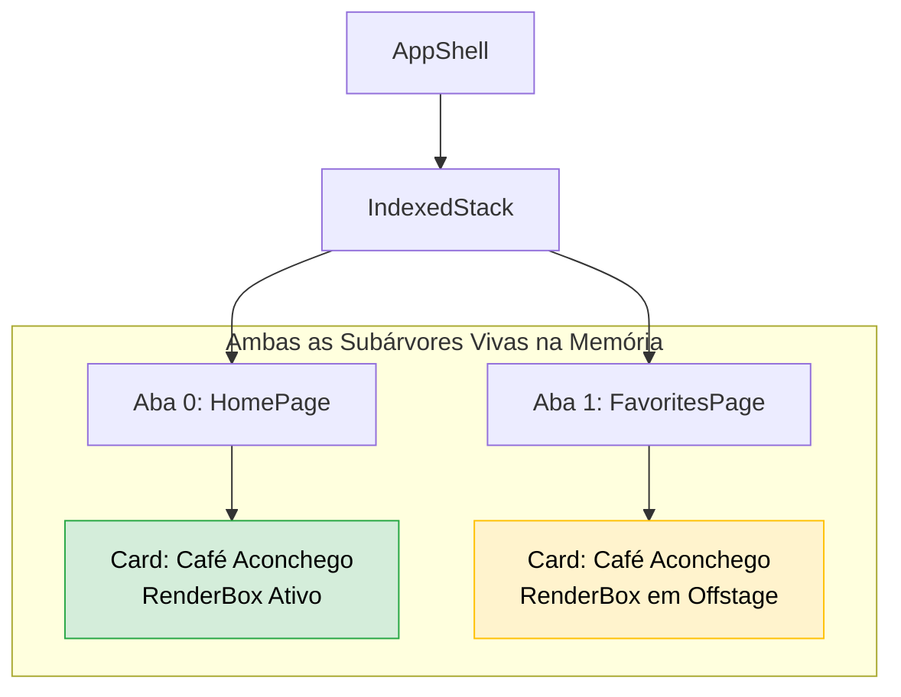
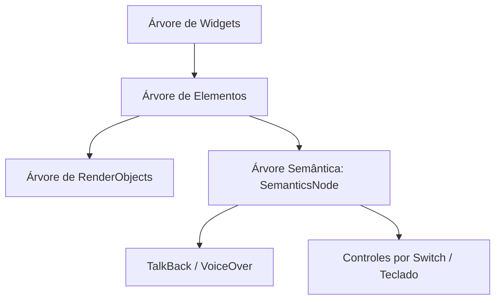

# Etapa 7 — `Hero` sem Colisão em `IndexedStack` e Acessibilidade em Cartões de Ação Dupla

## Introdução: O que este documento propõe e resolve?

### 1. O Problema Real que Estamos Enfrentando
Nas seis primeiras etapas do nosso laboratório, construímos toda a espinha dorsal de arquitetura, concorrência, persistência e gerenciamento de estado do aplicativo:
- Na **Etapa 1**, unificamos o estado compartilhado com `ChangeNotifier` e `provider`, garantindo sincronia instantânea em memória entre diferentes telas.
- Na **Etapa 2**, desacoplamos a interface do armazenamento através do contrato `FavoritesRepository` e tratamos o fluxo assíncrono com feedback de erro.
- Na **Etapa 3**, implementamos o banco de dados relacional **SQLite (`sqflite`)**, prevenindo ataques de *SQL Injection* com consultas parametrizadas.
- Na **Etapa 4**, criamos a camada de tradução de tipos compostos (`enum`, `Set<Enum>`, `DateTime`, `double`), protegendo a entidade pura de domínio contra peculiaridades do SQLite.
- Na **Etapa 5**, dominamos a evolução de esquema sem perda de dados (`onUpgrade` com `ALTER TABLE`), preservando os registros existentes dos usuários.
- Na **Etapa 6**, organizamos a escala de múltiplos estados globais com `MultiProvider` e aceleramos a abertura do app com carregamento concorrente no *Event Loop* (`.wait`).

Com os dados salvos com segurança e os estados sincronizados, chegamos ao ponto culminante da experiência do usuário (**UX**) e da qualidade de engenharia de software: **o refinamento visual da navegação e a acessibilidade digital inclusiva**.

Ao executarmos o aplicativo com abas ativas e tentarmos navegar entre a listagem e os detalhes, deparamo-nos imediatamente com **duas armadilhas clássicas e graves de desenvolvimento Flutter**:

1. **A Colisão Fatal de Animação `Hero` no `IndexedStack`:**
   Para manter a rolagem e o estado vivos quando o usuário alterna de aba, o `AppShell` utiliza um **`IndexedStack`**. Isso significa que a aba Início (`HomePage`, aba 0) e a aba Favoritos (`FavoritesPage`, aba 1 ou 2) **coexistem simultaneamente na árvore de widgets**, mesmo quando apenas uma está visível na tela. Se o usuário favorita o "Café Aconchego" e clica no cartão para ver os detalhes, o Flutter quebra com uma exceção vermelha fatal:
   ```text
   FlutterError (There are multiple heroes that share the same tag within a subtree.
   Within each subtree for which heroes are to be animated (i.e. a PageRoute subtree),
   each Hero must have a unique tag.
   The tag 'establishment-icon-1' was used more than once.)
   ```
2. **A "Barreira Invisível" de Acessibilidade nos Cartões de Ação Dupla (*MergeSemantics Pitfall*):**
   O cartão de cada estabelecimento possui **duas ações de toque independentes e concorrentes**:
   - Tocar no cartão abre a tela completa de detalhes (`EstablishmentDetailsPage`).
   - Tocar no botão de coração salva ou remove o local dos favoritos (`onFavoriteToggle`).

   Se o desenvolvedor mantiver a prática comum de envolver o cartão em um `MergeSemantics` para simplificar a leitura, **o Flutter funde todos os nós semânticos da subárvore em um único bloco**. Com isso, o botão de coração desaparece para tecnologias assistivas: um usuário cego ou com baixa visão que utilize o **TalkBack (Android)** ou o **VoiceOver (iOS)** fica **completamente impedido de favoritar estabelecimentos pelo cartão**, pois qualquer gesto de ativação dispara apenas a abertura dos detalhes! Além disso, se o botão de coração tiver rótulo genérico (como apenas *"Favoritar"*), o usuário assistivo não sabe qual dos restaurantes da lista está sendo manipulado.

---

### 2. O que esta Etapa 7 Propõe e Resolve
Este documento propõe o padrão definitivo de **Navegação Fluida com `Hero` e Acessibilidade em Componentes Compostos**, resolvendo cinco desafios de Engenharia de Software e Design Universal:

1. **Desambiguação Determinística de Tags de `Hero` por Contexto de Origem:** Criamos a função pura de apresentação `establishmentHeroTag(id, {origin = 'home'})`, prefixando a tag de voo com o contexto de onde a transição parte (`'home-establishment-icon-1'` vs. `'favorites-establishment-icon-1'`).
2. **Simetria de Transição Origem ↔ Destino no `Navigator`:** Adaptamos a `EstablishmentDetailsPage` para receber o parâmetro `heroOrigin`, garantindo que o voo animado do logotipo conecte com precisão cirúrgica o cartão de onde o usuário partiu até o cabeçalho da página de detalhes.
3. **Desacoplamento de Nós Semânticos em Cartões de Ação Dupla:** Removemos o `MergeSemantics` aglutinador externo, permitindo que o `InkWell` contextual do cartão e o `FavoriteButton` operem como **dois nós semânticos independentes na árvore de acessibilidade**.
4. **Alvos de Toque Conformes e Rótulos Nominais (WCAG 2.2 / AAA):** Garantimos áreas mínimas de toque de **$48 \times 48\text{ dp}$** para o botão de coração e fornecemos rótulos contextuais (`tooltip`) nominais (*"Salvar Café Aconchego nos favoritos"* / *"Remover Café Aconchego dos favoritos"*), cumprindo as diretrizes `labeledTapTargetGuideline` do Flutter.
5. **Independência de Cor e Robustez sob Tipografia Extrema (200% Dynamic Type):** Unificamos três sinais simultâneos para indicar o estado de favorito (forma do ícone, cor/contraste WCAG $\ge 4.5:1$ e rótulo auditivo), organizando o leiaute em coluna à direita para evitar *pixel overflow* mesmo quando a fonte do sistema operacional estiver configurada em 200% em telas estreitas ($320\text{ dp}$).

---

### 3. Por que Esta é a Última Etapa do Laboratório?
A acessibilidade e as transições visuais não devem ser vistas como "perfumaria" adicionada ao final sem critério, mas sim como a **prova real de maturidade de uma arquitetura limpa**.

Nas etapas anteriores, garantimos que o `FavoritesController` funciona em $O(1)$, que o SQLite persiste dados com segurança transacional e que o `MultiProvider` inicializa o app concorrentemente. Agora que a fundação é sólida, podemos refinar a camada de apresentação sem o risco de mascarar bugs de concorrência ou de estado. Ao final desta etapa, nosso projeto de laboratório atinge o nível exato de qualidade, robustez e inclusão presente no aplicativo de produção **CeliLac**.

---

## Visão Geral do Roteiro de Aula

| Momento | Tempo estimado | O que acontece na aula |
|---|---|---|
| **0. Arquitetura e Cenário Inicial** | 10 min | Revisamos como o `IndexedStack` mantém múltiplas abas montadas e mapeamos onde o `Hero` e o `EstablishmentCard` se encontram no código. |
| **1. O Problema (As Duas Dores ao Vivo)** | 15 min | Provocamos a colisão fatal do `Hero` ao vivo alternando abas e inspecionamos com o `SemanticsDebugger` a perda do botão de favoritar pelo leitor de tela. |
| **2. O Conceito (Fundamentação Teórica e Técnica)** | 25 min | Fundamentamos a mecânica interna do `IndexedStack` (árvores `Element` vs `RenderObject`), a física do `HeroController`, a Semântica no Flutter (`SemanticsNode`) e as normas WCAG para múltiplos alvos de toque. |
| **3. A Prática (Implementação Passo a Passo por Arquivo)** | 30 min | Implementamos `establishment_hero_tag.dart`, refatoramos `FavoriteButton` e `EstablishmentCard`, e conectamos `HomePage`, `FavoritesPage` e `EstablishmentDetailsPage` com `heroOrigin`. |
| **4. Verificação, Acessibilidade e Ponte com o CeliLac** | 20 min | Validamos a ausência de exceções no console, inspecionamos a árvore com o `showSemanticsDebugger`, testamos escala de 200% e mapeamos diretamente com o CeliLac. |

---

## 0. Arquitetura de Pastas e Cenário Inicial

### 0.1 Localização dos Artefatos
Nesta etapa, atuaremos estritamente na camada de apresentação (`presentation/`), refinando os componentes compartilhados entre as funcionalidades `establishments`, `home` e `favorites`:

- `lib/features/establishments/presentation/establishment_hero_tag.dart`: Função pura de apresentação para geração de tags de `Hero`.
- `lib/features/establishments/presentation/widgets/favorite_button.dart`: Componente atômico do botão de coração com semântica rica.
- `lib/features/establishments/presentation/widgets/establishment_card.dart`: Cartão que agrega o logotipo animado, informações textuais, selos e o botão de ação.
- `lib/features/establishments/presentation/pages/establishment_details_page.dart`: Tela de destino que recebe o voo animado.
- `lib/features/home/presentation/pages/home_page.dart` e `lib/features/favorites/presentation/pages/favorites_page.dart`: Abas que consomem o cartão informando sua respectiva origem.

### 0.2 Árvore de Arquivos ao Final Desta Etapa 7

```text
lab_favoritos/ (ou celilac/)
├── lib/
│   ├── main.dart
│   ├── app/
│   │   ├── lab_app.dart
│   │   └── shell/
│   │       └── app_shell.dart                                        ← IndexedStack mantendo abas 0 (Home) e 1 (Favoritos) vivas
│   └── features/
│       ├── startup/
│       │   └── presentation/splash_page.dart
│       ├── profile/
│       │   ├── domain/ ...
│       │   ├── data/ ...
│       │   └── presentation/ ...
│       ├── establishments/
│       │   ├── domain/ ...
│       │   ├── data/ ...
│       │   └── presentation/
│       │       ├── establishment_hero_tag.dart                       ← 🆕 Função geradora com desambiguação por origin
│       │       ├── pages/
│       │       │   └── establishment_details_page.dart               ← ✏️ Atualizado: recebe heroOrigin para transição simétrica
│       │       └── widgets/
│       │           ├── establishment_card.dart                       ← ✏️ Atualizado: sem MergeSemantics, 2 toques e heroOrigin
│       │           └── favorite_button.dart                          ← ✏️ Atualizado: tooltip nominal e área mínima de 48×48 dp
│       ├── home/
│       │   └── presentation/pages/home_page.dart                     ← ✏️ Atualizado: passa heroOrigin: 'home'
│       └── favorites/
│           ├── domain/ ...
│           ├── data/ ...
│           └── presentation/pages/favorites_page.dart                ← ✏️ Atualizado: passa heroOrigin: 'favorites'
```

---

## 1. O Problema (As Duas Dores Provocadas ao Vivo)

Para compreender por que precisamos dessas soluções, vamos provocar intencionalmente as duas falhas clássicas em sala de aula.

### 1.1 Dor 1 ao Vivo: A Colisão de `Hero` no `IndexedStack`

#### Como a falha é provocada:
No código anterior, a tag do `Hero` na logo do estabelecimento era gerada simplesmente com o prefixo fixo e o identificador do estabelecimento:
```dart
// ❌ Tentativa ingênua sem desambiguação de origem
Hero(
  tag: 'establishment-icon-${establishment.id}',
  child: EstablishmentLogo(establishment: establishment),
)
```

Agora, execute o seguinte fluxo no aplicativo:
1. Abra a aba **Início** (`HomePage`). O estabelecimento "Café Aconchego" (`id: '1'`) está renderizado na lista com a tag `'establishment-icon-1'`.
2. Toque no coração do "Café Aconchego" para favoritá-lo.
3. Mude para a aba **Favoritos** (`FavoritesPage`). O "Café Aconchego" aparece listado lá, também envolvido em um `Hero` com a tag `'establishment-icon-1'`.
4. Toque no cartão do "Café Aconchego" para abrir a `EstablishmentDetailsPage`.

#### O Crash Imediato no Console:
Assim que o Flutter inicia a transição de rota empilhando a tela de detalhes, a aplicação congela e dispara a seguinte exceção:

```text
══╡ EXCEPTION CAUGHT BY WIDGETS LIBRARY ╞═══════════════════════════════════════════════════════════
The following assertion was thrown during a scheduler callback:
There are multiple heroes that share the same tag within a subtree.
Within each subtree for which heroes are to be animated (i.e. a PageRoute subtree), each Hero must
have a unique tag.
The tag 'establishment-icon-1' was used more than once.
The subtrees that contained the heroes with this tag were:
  - Hero(tag: "establishment-icon-1", state: _HeroState#a12b4)
  - Hero(tag: "establishment-icon-1", state: _HeroState#c58e1)
════════════════════════════════════════════════════════════════════════════════════════════════════
```

```
┌─────────────────────────────────────────────────────────────────────────────────┐
│ FLUXO DO CRASH: indexed_stack COM TAGS DUPLICADAS                               │
└─────────────────────────────────────────────────────────────────────────────────┘

 [ AppShell (IndexedStack) ]
   ├── [ Aba 0: HomePage ] ────────► Hero(tag: 'establishment-icon-1')  (Ativo na árvore)
   │                                                                           ▲
   │                                                                           │ 💥 COLISÃO!
   └── [ Aba 1: FavoritesPage ] ───► Hero(tag: 'establishment-icon-1')  (Ativo na árvore)
                                                   │
                                                   ▼
                         Toque no cartão aciona Navigator.push(DetailsPage)
                         HeroController busca na árvore quem deve voar...
                         Encontra DOIS nós com a mesma tag na rota de origem!
```

---

### 1.2 Dor 2 ao Vivo: A Barreira de Acessibilidade (*MergeSemantics Pitfall*)

#### O que é o `MergeSemantics` e por que ele parecia uma boa ideia:
Quando construímos um cartão simples com foto, título, subtítulo e nota, a recomendação clássica de acessibilidade é envolver o cartão em `MergeSemantics()`. Isso faz com que o leitor de tela (TalkBack ou VoiceOver) leia todas as informações em uma única frase contínua:
> *"Café Aconchego, Café, Centro, 350 metros, nota 4.8. Toque duas vezes para ativar."*

#### O que acontece quando adicionamos o botão de coração dentro desse cartão?
O cartão passa a ter **duas intenções de uso distintas**:
1. Navegar para os detalhes do estabelecimento.
2. Salvar ou remover o estabelecimento dos favoritos.

Se o desenvolvedor mantiver o `MergeSemantics` em torno de todo o cartão:
```dart
// ❌ ARMADILHA: MergeSemantics engolindo botões filhos
MergeSemantics(
  child: Card(
    child: InkWell(
      onTap: () => abrirDetalhes(),
      child: Column(
        children: [
          Text(establishment.name),
          // ...
          IconButton(
            tooltip: 'Favoritar',
            onPressed: () => toggleFavorite(),
            icon: Icon(Icons.favorite),
          ),
        ],
      ),
    ),
  ),
)
```

#### A Consequência para o Usuário Real com Leitor de Tela:
Ao ativar o leitor de tela no celular:
1. O leitor coloca a moldura de foco de acessibilidade ao redor de todo o cartão.
2. O botão de coração é **completamente absorvido**: ele deixa de existir como elemento interativo focável.
3. Ao efetuar o gesto de toque duplo na tela, **apenas o `onTap` do `InkWell` externo (abrir detalhes) é disparado**.
4. **O usuário cego fica 100% impedido de favoritar estabelecimentos diretamente pela lista!** Ele é forçado a abrir o detalhe de cada um para só então tentar favoritar na barra superior.

Além disso, se o botão de coração tiver um rótulo estático genérico como `"Favoritar"`:
- Quem usa leitor de tela ou comando de voz ouve dez botões idênticos em sequência: *"Favoritar", "Favoritar", "Favoritar"*, sem saber a qual restaurante cada botão pertence!

---

## 2. O Conceito (Fundamentação Teórica e Técnica)

Para resolver definitivamente esses dois problemas, precisamos entender a mecânica de baixo nível do Flutter sobre o ciclo de vida de abas, transições de rotas e construção da árvore semântica.

### 2.1 A Mecânica Interna do `IndexedStack`
Por que a colisão do `Hero` acontece no `IndexedStack`, mas não aconteceria se usássemos um `Navigator` simples ou um `TabBarView` destruindo páginas?

O `IndexedStack` herda de `Stack`. No nível da árvore de renderização:
- **Todos os filhos do `IndexedStack` são inflados em `Element`s e instanciados como `RenderBox`es.**
- Apenas o filho correspondente ao `index` atual recebe visibilidade visual direta.
- Os outros filhos são mantidos vivos na memória, envoltos internamente por um widget chamado `Offstage` com `offstage: true` e `TickerMode(enabled: false)`.



> **A Revelação:** Como a `HomePage` e a `FavoritesPage` residem no mesmo `Route` (a rota do `AppShell`), **todos os widgets `Hero` presentes em ambas as abas pertencem à mesma subárvore de rota**.

---

### 2.2 A Física do `HeroController` e o Algoritmo de Voo
Quando você executa `Navigator.of(context).push(...)`:
1. O `HeroController` (um observador de rotas anexado ao `Navigator`) escuta o evento de empilhamento de rota.
2. Ele executa uma varredura profunda (*tree traversal*) na rota de origem (`fromRoute`) e na rota de destino (`toRoute`), catalogando todos os widgets `Hero` por sua propriedade `tag`.
3. Para cada correspondência de tag única entre a origem e o destino:
   - Ele cria um `_HeroFlight` na camada de `Overlay`.
   - O widget de origem é temporariamente ocultado (`offstage`).
   - O widget de destino é animado do retângulo de origem (`RectTween`) até a posição final.
4. **A Regra Inegociável:** Se durante a varredura na rota de origem o `HeroController` encontrar **dois ou mais `Hero`s com a mesmíssima tag**, o algoritmo é incapaz de determinar matematicamente de qual coordenada geométrica o voo deve decolar. Diante da ambiguidade, o Flutter lança imediatamente a asserção `There are multiple heroes that share the same tag within a subtree`.

```mermaid
sequenceDiagram
    autonumber
    actor User as Usuário
    participant Stack as IndexedStack (AppShell)
    participant HeroCtrl as HeroController
    participant Details as DetailsPage (Destino)
    
    User->>Stack: Toca no Cartão na Aba Favoritos
    Stack->>HeroCtrl: Navigator.push(DetailsPage)
    HeroCtrl->>Stack: Varre origem em busca da tag
    Note over HeroCtrl,Stack: Tag buscada: 'favorites-establishment-icon-1'
    HeroCtrl-->>HeroCtrl: Encontra EXATAMENTE UM Hero correspondente!
    HeroCtrl->>Details: Cria sobrevoo (RectTween) até a tela de destino
    Details-->>User: Animação suave e contínua sem colisões!
```

---

### 2.3 A Solução: Desambiguação de Tags com o Prefixo `origin`
Para impedir a colisão sem abrir mão da fluidez visual do `Hero`, precisamos garantir que a tag seja **globalmente única na rota de origem, mas perfeitamente simétrica entre a tela de origem e a tela de destino**.

Definimos uma função geradora pura:
$$\text{HeroTag}(id, origin) = origin + \text{"-establishment-icon-"} + id$$

Exemplo prático:
- Cartão renderizado na **Home**: `'home-establishment-icon-1'`
- Cartão renderizado nos **Favoritos**: `'favorites-establishment-icon-1'`

Ao abrir a `EstablishmentDetailsPage`:
- Se aberta a partir da **Home**, a página de detalhes é instanciada com `heroOrigin: 'home'`, conectando com `'home-establishment-icon-1'`.
- Se aberta a partir dos **Favoritos**, a página de detalhes é instanciada com `heroOrigin: 'favorites'`, conectando com `'favorites-establishment-icon-1'`.

Dessa forma, o `HeroController` encontra uma única tag correspondente em cada transição, eliminando a colisão mesmo com centenas de itens favoritos coexistindo no `IndexedStack`.

---

### 2.4 A Arquitetura da Árvore Semântica no Flutter
O Flutter renderiza três árvores paralelas em tempo de execução:
1. **Árvore de Widgets:** Configurações imutáveis declaradas em código.
2. **Árvore de Elementos:** Instâncias de ciclo de vida que conectam widgets à renderização.
3. **Árvore de Objetos de Renderização (`RenderObject`):** Responsável por layout e pintura dos pixels.

Além dessas três, existe uma quarta árvore fundamental: **A Árvore Semântica (`SemanticsNode`)**.
É essa árvore que o Flutter expõe para o sistema operacional (TalkBack no Android, VoiceOver no iOS) para permitir a acessibilidade de pessoas com deficiência visual, motora ou cognitiva.



#### O Comportamento do `MergeSemantics`:
- Quando um ancestral usa `MergeSemantics`, ele instrui o motor a colapsar todos os nós semânticos de seus descendentes em uma única "bolha" de leitura.
- Se a subárvore contiver apenas textos e imagens estáticas, isso é ótimo.
- **Mas se a subárvore contiver dois manipuladores de gesto concorrentes (`GestureDetector` ou `InkResponse`), o nó mesclado só pode registrar UMA ação de ativação primária!** O botão filho torna-se inoperante.

#### A Solução Arquitetural sem `MergeSemantics`:
Quando removemos o `MergeSemantics` do contorno do `Card`:
1. O `InkWell` principal do cartão gera um `SemanticsNode` com ação de clique para abrir os detalhes, agrupando naturalmente os textos que não têm manipulador próprio (nome, categoria, bairro, nota).
2. O `FavoriteButton` interno (que é um `IconButton`) gera seu próprio `SemanticsNode` com ação de clique para favoritar, associado ao seu `tooltip`.
3. O leitor de tela agora oferece **dois pontos de foco sequenciais**:
   - Foco 1: *"Café Aconchego, Café, Centro, 350 metros, nota 4.8. Toque duas vezes para ver detalhes."*
   - Foco 2: *"Botão: Salvar Café Aconchego nos favoritos. Toque duas vezes para alternar."*

```
┌─────────────────────────────────────────────────────────────────────────────────┐
│ ESTRUTURA SEMÂNTICA DESACOPLADA DO ESTABLISHMENT_CARD                          │
└─────────────────────────────────────────────────────────────────────────────────┘

 ┌─────────────────────────────────────────────────────────────────────────────┐
 │ Card + InkWell (Nó Semântico 1: Ação de Abrir Detalhes)                    │
 │                                                                             │
 │  ┌──────┐  Café Aconchego                         ★ 4,8                     │
 │  │ Logo │  Café · Centro · 350 m                                            │
 │  └──────┘  [Sem glúten] [Sem lactose]             ┌──────────────────────┐  │
 │                         [Atende ao seu perfil]    │ FavoriteButton       │  │
 │                                                   │ (Nó Semântico 2:     │  │
 │                                                   │  Ação de Favoritar)  │  │
 │                                                   │                      │  │
 │                                                   │   [ ♡ Favoritar ]    │  │
 │                                                   └──────────────────────┘  │
 └─────────────────────────────────────────────────────────────────────────────┘
```

---

### 2.5 Diretrizes de Design Inclusivo e WCAG 2.2 Aplicadas
Para garantir conformidade profissional com os padrões internacionais de acessibilidade (W3C / WCAG 2.2):

| Requisito | Diretriz WCAG | Como implementamos no código |
|---|---|---|
| **Área Mínima de Toque** | Critério 2.5.5 / 2.5.8 (Target Size): mínimo de $48 \times 48\text{ dp}$ | O `IconButton` do Material 3 já possui dimensões padrão de $48 \times 48\text{ dp}$ para área clicável, evitando toques acidentais por pessoas com tremores ou em movimento. |
| **Rótulo Contextualizado** | Critério 4.1.2 (Name, Role, Value) / `labeledTapTargetGuideline` | O `tooltip` do botão inclui o nome exato do local: `"Salvar Café Aconchego nos favoritos"`, eliminando ambiguidades em listas longas. |
| **Independência de Cor** | Critério 1.4.1 (Use of Color): não depender só da cor para transmitir informação | O estado de favorito combina três estímulos: 1. Mudança de formato (`favorite_border` vazado vs. `favorite` cheio); 2. Fundo contrastante dourado translúcido; 3. Rótulo textual e semântico atualizado. |
| **Contraste de Cores** | Critério 1.4.3 (Contrast Minimum): relação mínima de $4.5:1$ | O ícone permanece em azul-marinho profundo (`AppColors.navy`), garantindo contraste de mais de $7:1$ sobre o fundo dourado suave e sobre o fundo branco do cartão. |
| **Tipografia Responsiva** | Critério 1.4.4 (Resize Text): suporte a 200% sem perda de conteúdo | O botão de favorito e a nota são empilhados verticalmente em uma `Column` alinhada à direita, sem disputar largura horizontal com o nome e os selos alimentares. |

---

## 3. A Prática (Implementação Passo a Passo por Arquivo)

Vamos agora refatorar e construir os 6 arquivos envolvidos, explicando antes de cada um o seu papel arquitetural, sua fundamentação técnica e o código completo.

---

### Arquivo 1: `lib/features/establishments/presentation/establishment_hero_tag.dart`

**O que este arquivo propõe e resolve:**
Propõe uma função pura de utilidade visual que centraliza e padroniza a geração das tags de `Hero` em todo o aplicativo. Ele resolve definitivamente a colisão de animações no `IndexedStack` ao receber o parâmetro opcional nomeado `origin`, prefixando a string identificadora de forma previsível e simétrica.

**Papel Arquitetural (`presentation/`):**
Pertence à camada de **Apresentação** da funcionalidade de estabelecimentos. Como o `Hero` é um conceito puramente visual de transição de tela, essa função nunca deve ficar no `domain` nem no `data`.

**Fundamentação dos recursos utilizados no código:**
- **Função pura de nível superior (*top-level function*):** Não depende de instâncias de classes, permitindo ser importada e chamada diretamente em qualquer widget.
- **Parâmetro nomeado com valor padrão (`{String origin = 'home'}`):** Garante compatibilidade retroativa com chamadas existentes sem obrigar a passagem de parâmetros onde a origem padrão (`home`) já é esperada.
- **Interpolação de Strings (`'$origin-establishment-icon-$establishmentId'`):** Concatena de forma eficiente e legível o prefixo de origem, o identificador de tipo e a chave primária da entidade.

```dart
/// Garante que o cartão de origem e a tela de detalhes usem a mesma tag no
/// [Hero], sem duplicar a string e sem colidir entre abas do [IndexedStack].
String establishmentHeroTag(
  String establishmentId, {
  String origin = 'home',
}) {
  return '$origin-establishment-icon-$establishmentId';
}
```

---

### Arquivo 2: `lib/features/establishments/presentation/widgets/favorite_button.dart`

**O que este arquivo propõe e resolve:**
Propõe um botão de coração atômico, altamente reutilizável e 100% aderente às normas de acessibilidade universal. Ele resolve o problema de botões com alvos de toque minúsculos, falta de rótulos contextuais para leitores de tela e dependência exclusiva de cor para indicar seleção.

**Papel Arquitetural (`presentation/widgets`):**
Componente atômico reutilizável ("burro" / *dumb widget*). Ele não acessa o `FavoritesController` diretamente via `context.read`: ele recebe seus dados (`establishmentName`, `isFavorite`) e sua ação (`onPressed`) via construtor. Isso permite que ele seja testado isoladamente e utilizado tanto na `HomePage`, quanto na `FavoritesPage` e na `AppBar` da `EstablishmentDetailsPage`.

**Fundamentação dos recursos utilizados no código:**
- **Rótulo semântico dinâmico e contextual (`tooltip`):** Se `isFavorite` for verdadeiro, o rótulo torna-se `'Remover $establishmentName dos favoritos'`; se falso, `'Salvar $establishmentName nos favoritos'`. Esse texto é anunciado em voz alta pelo TalkBack/VoiceOver e exibido em balão flutuante ao passar o mouse ou segurar o toque.
- **`IconButton` com alvo de toque nativo:** O `IconButton` do Flutter preserva internamente uma caixa delimitadora mínima de $48 \times 48\text{ dp}$, mesmo que o ícone visual desenhado tenha $24\text{ dp}$.
- **Estilo com cor de fundo translúcida (`IconButton.styleFrom`):** Quando favoritado, aplica `AppColors.gold.withValues(alpha: 0.22)` no fundo, fornecendo feedback de toque visível e reforço tátil/visual.
- **Variação de glifo (`Icons.favorite` vs. `Icons.favorite_border`):** Garante independência visual para pessoas com daltonismo ou dificuldades de percepção cromática.

```dart
import 'package:flutter/material.dart';

import '../../../../app/theme/app_colors.dart';

class FavoriteButton extends StatelessWidget {
  const FavoriteButton({
    super.key,
    required this.establishmentName,
    required this.isFavorite,
    required this.onPressed,
  });

  final String establishmentName;
  final bool isFavorite;
  final VoidCallback onPressed;

  @override
  Widget build(BuildContext context) {
    final label = isFavorite
        ? 'Remover $establishmentName dos favoritos'
        : 'Salvar $establishmentName nos favoritos';

    return IconButton(
      tooltip: label,
      onPressed: onPressed,
      color: AppColors.navy,
      style: IconButton.styleFrom(
        backgroundColor: isFavorite
            ? AppColors.gold.withValues(alpha: 0.22)
            : null,
      ),
      icon: Icon(isFavorite ? Icons.favorite : Icons.favorite_border),
    );
  }
}
```

---

### Arquivo 3: `lib/features/establishments/presentation/widgets/establishment_card.dart`

**O que este arquivo propõe e resolve:**
Propõe a estrutura do cartão de listagem do estabelecimento, resolvendo a coexistência de **duas ações de toque simultâneas** sem colisão semântica e sem colisão de `Hero`.

**Papel Arquitetural (`presentation/widgets`):**
Widget visual de apresentação. Ele orquestra a exibição da logo, nome, detalhes, selos de restrição alimentar, nota, selo de compatibilidade com o perfil e o botão de favorito. Ele recebe `heroOrigin` para alimentar seu `Hero` interno e delega todas as ações para callbacks externos.

**Fundamentação dos recursos utilizados no código:**
- **Remoção de `MergeSemantics` externo:** Ao não englobar o cartão em `MergeSemantics`, permitimos que a árvore de acessibilidade enxergue o `InkWell` (toque geral para ver detalhes) e o `FavoriteButton` (toque específico de favoritar) como dois nós irmãos independentes.
- **`heroOrigin` injetável:** Permite que quem instancia o cartão defina se o `Hero` deve voar como `'home'` ou `'favorites'`.
- **Organização em `Column` vertical alinhada à direita:** Empilha a nota e o botão de coração em uma coluna lateral (`CrossAxisAlignment.end`). Em telas estreitas de $320\text{ dp}$ com ampliação de texto de 200%, essa disposição garante que a nota e o botão não consumam largura horizontal excessiva, impedindo *RenderFlex overflow*.
- **`clipBehavior: Clip.antiAlias`:** Garante que o efeito de onda do clique (`InkWell`) respeite o raio de curvatura das bordas do `Card`.

```dart
import 'package:flutter/material.dart';

import '../../../../app/common/formatters.dart';
import '../../../../app/theme/app_colors.dart';
import '../../../../app/theme/app_radius.dart';
import '../../../../app/theme/app_spacing.dart';
import '../../domain/entities/establishment.dart';
import '../establishment_hero_tag.dart';
import 'dietary_badge.dart';
import 'establishment_logo.dart';
import 'favorite_button.dart';

class EstablishmentCard extends StatelessWidget {
  const EstablishmentCard({
    super.key,
    required this.establishment,
    required this.onTap,
    this.matchesProfile = false,
    this.isFavorite = false,
    this.onFavoriteToggle,
    this.heroOrigin = 'home',
  });

  final Establishment establishment;
  final VoidCallback onTap;

  /// Quem decide é a tela que usa o cartão: estabelecimentos não conhecem
  /// o perfil.
  final bool matchesProfile;

  final bool isFavorite;
  final VoidCallback? onFavoriteToggle;
  final String heroOrigin;

  @override
  Widget build(BuildContext context) {
    final textTheme = Theme.of(context).textTheme;
    final details = [
      establishment.category.label,
      establishment.neighborhood,
      formatDistance(establishment.distanceInKm),
    ].join(' · ');

    return Card(
      clipBehavior: Clip.antiAlias,
      child: InkWell(
        onTap: onTap,
        child: Padding(
          padding: const EdgeInsets.all(AppSpacing.md),
          child: Column(
            crossAxisAlignment: CrossAxisAlignment.end,
            children: [
              Row(
                crossAxisAlignment: CrossAxisAlignment.start,
                children: [
                  Hero(
                    tag: establishmentHeroTag(
                      establishment.id,
                      origin: heroOrigin,
                    ),
                    child: EstablishmentLogo(establishment: establishment),
                  ),
                  const SizedBox(width: AppSpacing.md),
                  Expanded(
                    child: Column(
                      crossAxisAlignment: CrossAxisAlignment.start,
                      children: [
                        Text(
                          establishment.name,
                          style: textTheme.titleMedium?.copyWith(
                            color: AppColors.navy,
                            fontWeight: FontWeight.bold,
                          ),
                          maxLines: 2,
                          overflow: TextOverflow.ellipsis,
                        ),
                        const SizedBox(height: AppSpacing.xs),
                        Text(
                          details,
                          style: textTheme.bodySmall?.copyWith(
                            color: AppColors.navy.withValues(alpha: 0.8),
                          ),
                        ),
                        const SizedBox(height: AppSpacing.sm),
                        Wrap(
                          spacing: AppSpacing.xs,
                          runSpacing: AppSpacing.xs,
                          children: [
                            for (final option in establishment.dietaryOptions)
                              DietaryBadge(option: option),
                          ],
                        ),
                      ],
                    ),
                  ),
                  const SizedBox(width: AppSpacing.sm),
                  Column(
                    crossAxisAlignment: CrossAxisAlignment.end,
                    children: [
                      Row(
                        mainAxisSize: MainAxisSize.min,
                        children: [
                          const Icon(
                            Icons.star_rounded,
                            size: 18,
                            color: AppColors.gold,
                            semanticLabel: 'Nota',
                          ),
                          const SizedBox(width: 2),
                          Text(
                            formatDecimal(establishment.rating),
                            style: textTheme.labelLarge?.copyWith(
                              color: AppColors.navy,
                              fontWeight: FontWeight.bold,
                            ),
                          ),
                        ],
                      ),
                      if (onFavoriteToggle != null) ...[
                        const SizedBox(height: AppSpacing.xs),
                        FavoriteButton(
                          establishmentName: establishment.name,
                          isFavorite: isFavorite,
                          onPressed: onFavoriteToggle!,
                        ),
                      ],
                    ],
                  ),
                ],
              ),
              // Abaixo da linha toda, à direita: alinhado com a nota.
              if (matchesProfile) ...[
                const SizedBox(height: AppSpacing.sm),
                const _ProfileMatchBadge(),
              ],
            ],
          ),
        ),
      ),
    );
  }
}

class _ProfileMatchBadge extends StatelessWidget {
  const _ProfileMatchBadge();

  @override
  Widget build(BuildContext context) {
    return Container(
      padding: const EdgeInsets.symmetric(
        horizontal: AppSpacing.sm,
        vertical: AppSpacing.xs,
      ),
      decoration: BoxDecoration(
        color: AppColors.navy,
        borderRadius: BorderRadius.circular(AppRadius.pill),
      ),
      child: Row(
        mainAxisSize: MainAxisSize.min,
        children: [
          const Icon(Icons.person_pin_outlined, size: 14, color: Colors.white),
          const SizedBox(width: AppSpacing.xs),
          Flexible(
            child: Text(
              'Atende ao seu perfil',
              style: Theme.of(context).textTheme.labelSmall
                  ?.copyWith(color: Colors.white, fontWeight: FontWeight.w600),
            ),
          ),
        ],
      ),
    );
  }
}
```

---

### Arquivo 4: `lib/features/establishments/presentation/pages/establishment_details_page.dart`

**O que este arquivo propõe e resolve:**
Propõe a tela de visualização aprofundada do estabelecimento, resolvendo a simetria de animação do `Hero`. Ao receber `heroOrigin`, ela garante que a transição gráfica pouse com precisão no cabeçalho sem quebrar a execução por tags desalinhadas.

**Papel Arquitetural (`presentation/pages`):**
Página completa empilhada no `Navigator`. Ela contém a barra superior com botão de coração, o carrossel de fotos, o logotipo animado com `Hero` e as informações de contato e segurança alimentar.

**Fundamentação dos recursos utilizados no código:**
- **Parâmetro `heroOrigin` no construtor:** Permite que a tela de detalhes saiba se deve animar o `Hero` sincronizado com `'home'` ou com `'favorites'`.
- **`context.watch<FavoritesController>()`:** Permite que o botão de favoritar na `AppBar` da tela de detalhes reflita instantaneamente se o estabelecimento está salvo.
- **`context.read<FavoritesController>().toggle(establishment)`:** Dispara a alteração assíncrona ao toque do usuário na `AppBar`, capturando erros e exibindo `SnackBar` caso a gravação falhe.

```dart
import 'package:flutter/material.dart';
import 'package:provider/provider.dart';

import '../../../../app/common/formatters.dart';
import '../../../../app/theme/app_colors.dart';
import '../../../../app/theme/app_spacing.dart';
import '../../../favorites/presentation/favorites_controller.dart';
import '../../domain/entities/establishment.dart';
import '../establishment_hero_tag.dart';
import '../widgets/dietary_badge.dart';
import '../widgets/establishment_logo.dart';
import '../widgets/favorite_button.dart';

class EstablishmentDetailsPage extends StatelessWidget {
  const EstablishmentDetailsPage({
    super.key,
    required this.establishment,
    this.heroOrigin = 'home',
  });

  final Establishment establishment;
  final String heroOrigin;

  @override
  Widget build(BuildContext context) {
    final favorites = context.watch<FavoritesController>();
    final isFav = favorites.isFavorite(establishment.id);

    return Scaffold(
      appBar: AppBar(
        title: Text(establishment.name),
        actions: [
          FavoriteButton(
            establishmentName: establishment.name,
            isFavorite: isFav,
            onPressed: () async {
              try {
                await context.read<FavoritesController>().toggle(establishment);
              } catch (_) {
                if (!context.mounted) return;
                ScaffoldMessenger.of(context).showSnackBar(
                  const SnackBar(
                    content: Text('Não foi possível atualizar os favoritos.'),
                  ),
                );
              }
            },
          ),
        ],
      ),
      body: SingleChildScrollView(
        padding: const EdgeInsets.all(AppSpacing.lg),
        child: Column(
          crossAxisAlignment: CrossAxisAlignment.start,
          children: [
            Center(
              child: Hero(
                tag: establishmentHeroTag(
                  establishment.id,
                  origin: heroOrigin,
                ),
                child: EstablishmentLogo(
                  establishment: establishment,
                  size: 96,
                ),
              ),
            ),
            const SizedBox(height: AppSpacing.lg),
            Text(
              establishment.name,
              style: Theme.of(context).textTheme.headlineSmall?.copyWith(
                    color: AppColors.navy,
                    fontWeight: FontWeight.bold,
                  ),
            ),
            const SizedBox(height: AppSpacing.xs),
            Text(
              '${establishment.category.label} · ${establishment.neighborhood} · ${formatDistance(establishment.distanceInKm)}',
              style: Theme.of(context).textTheme.bodyMedium?.copyWith(
                    color: AppColors.navy.withValues(alpha: 0.7),
                  ),
            ),
            const SizedBox(height: AppSpacing.md),
            Wrap(
              spacing: AppSpacing.xs,
              runSpacing: AppSpacing.xs,
              children: [
                for (final option in establishment.dietaryOptions)
                  DietaryBadge(option: option),
              ],
            ),
            const SizedBox(height: AppSpacing.lg),
            const Divider(),
            const SizedBox(height: AppSpacing.md),
            Text(
              'Informações de Segurança Alimentar',
              style: Theme.of(context).textTheme.titleMedium?.copyWith(
                    color: AppColors.navy,
                    fontWeight: FontWeight.bold,
                  ),
            ),
            const SizedBox(height: AppSpacing.sm),
            Text(
              'Este estabelecimento adota práticas rigorosas de controle de ingredientes e processos para atender ao perfil indicado.',
              style: Theme.of(context).textTheme.bodyMedium,
            ),
          ],
        ),
      ),
    );
  }
}
```

---

### Arquivo 5: `lib/features/home/presentation/pages/home_page.dart`

**O que este arquivo propõe e resolve:**
Atualiza a tela principal de listagem para consumir o `EstablishmentCard` passando explicitamente `heroOrigin: 'home'` e navegando para a tela de detalhes informando a mesma origem `'home'`.

**Fundamentação dos recursos utilizados no código:**
- **Passagem de `heroOrigin: 'home'` no cartão:** Garante que a logo desenhada na aba Início utilize a tag única `'home-establishment-icon-$id'`.
- **Passagem de `heroOrigin: 'home'` no `Navigator.push`:** Garante que o destino emparelhe com a tag de onde o toque partiu.
- **`context.read<FavoritesController>().toggle(est)` com tratamento de erro:** Trata a alternância de favoritos disparada pelo cartão da lista com tolerância a falhas.

```dart
import 'package:flutter/material.dart';
import 'package:provider/provider.dart';

import '../../../../app/theme/app_spacing.dart';
import '../../../establishments/data/sample_establishments.dart';
import '../../../establishments/domain/entities/establishment.dart';
import '../../../establishments/presentation/pages/establishment_details_page.dart';
import '../../../establishments/presentation/widgets/establishment_card.dart';
import '../../../favorites/presentation/favorites_controller.dart';
import '../../../profile/domain/profile_match.dart';
import '../../../profile/presentation/profile_controller.dart';

class HomePage extends StatelessWidget {
  const HomePage({super.key});

  @override
  Widget build(BuildContext context) {
    final favorites = context.watch<FavoritesController>();
    final profile = context.watch<ProfileController>().profile;

    return Scaffold(
      appBar: AppBar(
        title: const Text('CeliLac — Início'),
      ),
      body: ListView.separated(
        padding: const EdgeInsets.all(AppSpacing.md),
        itemCount: sampleEstablishments.length,
        separatorBuilder: (_, __) => const SizedBox(height: AppSpacing.sm),
        itemBuilder: (context, index) {
          final establishment = sampleEstablishments[index];
          final isFav = favorites.isFavorite(establishment.id);
          final matches = meetsProfile(establishment, profile);

          return EstablishmentCard(
            establishment: establishment,
            isFavorite: isFav,
            matchesProfile: matches,
            heroOrigin: 'home',
            onTap: () {
              Navigator.of(context).push(
                MaterialPageRoute(
                  builder: (_) => EstablishmentDetailsPage(
                    establishment: establishment,
                    heroOrigin: 'home',
                  ),
                ),
              );
            },
            onFavoriteToggle: () async {
              try {
                await context.read<FavoritesController>().toggle(establishment);
              } catch (_) {
                if (!context.mounted) return;
                ScaffoldMessenger.of(context).showSnackBar(
                  const SnackBar(
                    content: Text('Não foi possível salvar o favorito.'),
                  ),
                );
              }
            },
          );
        },
      ),
    );
  }
}
```

---

### Arquivo 6: `lib/features/favorites/presentation/pages/favorites_page.dart`

**O que este arquivo propõe e resolve:**
Atualiza a página de favoritos para renderizar os cartões com `heroOrigin: 'favorites'`, desfazendo qualquer ambiguidade em relação aos cartões da `HomePage` mantidos em segundo plano pelo `IndexedStack`.

**Fundamentação dos recursos utilizados no código:**
- **Passagem de `heroOrigin: 'favorites'` no cartão e na rota:** Garante que, ao tocar em um cartão na aba Favoritos, o `Hero` voe a partir da tag `'favorites-establishment-icon-$id'`.
- **Estado vazio amigável e acessível:** Quando a lista está vazia, apresenta uma mensagem orientativa e um botão para explorar a lista principal, respeitando contrastes e tipografia responsiva.

```dart
import 'package:flutter/material.dart';
import 'package:provider/provider.dart';

import '../../../../app/theme/app_colors.dart';
import '../../../../app/theme/app_spacing.dart';
import '../../../establishments/domain/entities/establishment.dart';
import '../../../establishments/presentation/pages/establishment_details_page.dart';
import '../../../establishments/presentation/widgets/establishment_card.dart';
import '../../../profile/domain/profile_match.dart';
import '../../../profile/presentation/profile_controller.dart';
import '../favorites_controller.dart';

class FavoritesPage extends StatelessWidget {
  const FavoritesPage({
    super.key,
    this.onExploreTap,
  });

  final VoidCallback? onExploreTap;

  @override
  Widget build(BuildContext context) {
    final favorites = context.watch<FavoritesController>();
    final profile = context.watch<ProfileController>().profile;

    if (!favorites.isLoaded) {
      return const Scaffold(
        body: Center(child: CircularProgressIndicator()),
      );
    }

    if (favorites.items.isEmpty) {
      return Scaffold(
        appBar: AppBar(title: const Text('Meus Favoritos')),
        body: Center(
          child: Padding(
            padding: const EdgeInsets.all(AppSpacing.xl),
            child: Column(
              mainAxisAlignment: MainAxisAlignment.center,
              children: [
                const Icon(
                  Icons.favorite_border_rounded,
                  size: 64,
                  color: AppColors.gold,
                ),
                const SizedBox(height: AppSpacing.md),
                Text(
                  'Nenhum favorito salvo ainda',
                  style: Theme.of(context).textTheme.titleLarge?.copyWith(
                        color: AppColors.navy,
                        fontWeight: FontWeight.bold,
                      ),
                  textAlign: TextAlign.center,
                ),
                const SizedBox(height: AppSpacing.xs),
                Text(
                  'Toque no coração dos estabelecimentos que você mais gosta para encontrá-los facilmente aqui.',
                  style: Theme.of(context).textTheme.bodyMedium?.copyWith(
                        color: AppColors.navy.withValues(alpha: 0.7),
                      ),
                  textAlign: TextAlign.center,
                ),
                if (onExploreTap != null) ...[
                  const SizedBox(height: AppSpacing.lg),
                  FilledButton.icon(
                    onPressed: onExploreTap,
                    icon: const Icon(Icons.explore_outlined),
                    label: const Text('Explorar estabelecimentos'),
                  ),
                ],
              ],
            ),
          ),
        ),
      );
    }

    return Scaffold(
      appBar: AppBar(
        title: Text('Favoritos (${favorites.items.length})'),
      ),
      body: ListView.separated(
        padding: const EdgeInsets.all(AppSpacing.md),
        itemCount: favorites.items.length,
        separatorBuilder: (_, __) => const SizedBox(height: AppSpacing.sm),
        itemBuilder: (context, index) {
          final establishment = favorites.items[index];
          final matches = meetsProfile(establishment, profile);

          return EstablishmentCard(
            establishment: establishment,
            isFavorite: true,
            matchesProfile: matches,
            heroOrigin: 'favorites',
            onTap: () {
              Navigator.of(context).push(
                MaterialPageRoute(
                  builder: (_) => EstablishmentDetailsPage(
                    establishment: establishment,
                    heroOrigin: 'favorites',
                  ),
                ),
              );
            },
            onFavoriteToggle: () async {
              try {
                await context.read<FavoritesController>().toggle(establishment);
              } catch (_) {
                if (!context.mounted) return;
                ScaffoldMessenger.of(context).showSnackBar(
                  const SnackBar(
                    content: Text('Não foi possível atualizar o favorito.'),
                  ),
                );
              }
            },
          );
        },
      ),
    );
  }
}
```

---

## 4. Verificação, Acessibilidade e Ponte com o CeliLac

### 4.1 Roteiro de Verificação Manual em Aula

Execute o aplicativo e siga o passo a passo com a turma:

1. **Teste de Ausência de Colisão no `Hero`:**
   - Na aba **Início**, favorite o primeiro item ("Café Aconchego").
   - Mude para a aba **Favoritos**. O "Café Aconchego" estará presente.
   - Toque no cartão dentro da aba **Favoritos**.
   - **Resultado Esperado:** A transição com animação do logotipo ocorre com suavidade impecável até o topo da tela de detalhes, e o console do Flutter permanece **100% limpo, sem nenhuma exceção de `multiple heroes`**.
   - Volte para a aba Início e toque no mesmo restaurante. O voo ocorre normalmente a partir da Home.

2. **Teste de Acessibilidade com `showSemanticsDebugger`:**
   - No `lab_app.dart` (ou `celilac_app.dart`), ative temporariamente a flag de depuração:
     ```dart
     MaterialApp(
       showSemanticsDebugger: true, // 🔍 Ativa visão de raio-x da acessibilidade
       // ...
     )
     ```
   - Observe a tela: cada elemento semântico ganha retângulos e rótulos pretos.
   - Verifique que o `EstablishmentCard` agora apresenta **dois retângulos distintos**:
     - Um retângulo cobrindo as informações gerais do estabelecimento com a ação de toque para abrir detalhes.
     - Um retângulo menor no canto superior direito de $48 \times 48\text{ dp}$ especificamente sobre o coração, com o texto `"Salvar Café Aconchego nos favoritos"`.

3. **Teste de Responsividade com Fonte a 200% em Tela Estreita ($320\text{ dp}$):**
   - No emulador ou dispositivo físico, acesse as configurações do sistema operacional:
     - **Tamanho da Fonte:** Máximo ($200\%$).
     - **Tamanho da Tela / Densidade:** Pequeno ou resolução de $320 \times 640\text{ dp}$.
   - Abra a listagem e os favoritos.
   - **Resultado Esperado:** O nome do estabelecimento quebra suavemente em até duas linhas, os selos passam para a linha de baixo com o `Wrap`, a nota e o botão de coração permanecem alinhados e confortáveis à direita, e **nenhuma faixa listrada amarela e preta (*RenderFlex overflow*) é disparada**.

---

### 4.2 Teste Automatizado de Acessibilidade e Semântica no Flutter

Podemos garantir em pipeline de integração contínua (CI) que nosso componente nunca regrida em acessibilidade. Crie o teste `test/features/establishments/presentation/widgets/establishment_card_accessibility_test.dart`:

```dart
import 'package:flutter/material.dart';
import 'package:flutter_test/flutter_test.dart';
import 'package:lab_favoritos/features/establishments/domain/entities/establishment.dart';
import 'package:lab_favoritos/features/establishments/presentation/widgets/establishment_card.dart';

void main() {
  testWidgets('EstablishmentCard expõe dois nós semânticos com alvos mínimos', (tester) async {
    final handle = tester.ensureSemantics();

    const sample = Establishment(
      id: '1',
      name: 'Café Aconchego',
      category: EstablishmentCategory.cafe,
      neighborhood: 'Centro',
      distanceInKm: 0.35,
      rating: 4.8,
      dietaryOptions: {},
    );

    await tester.pumpWidget(
      MaterialApp(
        home: Scaffold(
          body: EstablishmentCard(
            establishment: sample,
            isFavorite: false,
            onTap: () {},
            onFavoriteToggle: () {},
          ),
        ),
      ),
    );

    // 1. Verifica se o botão possui o rótulo contextual nominal
    expect(
      find.byTooltip('Salvar Café Aconchego nos favoritos'),
      findsOneWidget,
    );

    // 2. Verifica se a diretriz oficial de acessibilidade de alvos de toque é satisfeita
    await expectLater(
      tester,
      meetsGuideline(labeledTapTargetGuideline),
    );

    handle.dispose();
  });
}
```

---

### 4.3 Mapeamento com o Código Real do CeliLac

| Artefato do Laboratório | Artefato no CeliLac Real | O que foi aprendido e consolidado |
|---|---|---|
| `establishment_hero_tag.dart` | `lib/features/establishments/presentation/establishment_hero_tag.dart` | Função pura com parâmetro `{String origin = 'home'}` que elimina colisões no `IndexedStack`. |
| `favorite_button.dart` | `lib/features/establishments/presentation/widgets/favorite_button.dart` | `IconButton` acessível com área de $48 \times 48\text{ dp}$, `tooltip` contextual nominal e independência de cor. |
| `establishment_card.dart` | `lib/features/establishments/presentation/widgets/establishment_card.dart` | Remoção do `MergeSemantics` aglutinador, permitindo dois toques independentes e empilhamento da nota com coração. |
| `establishment_details_page.dart` | `lib/features/establishments/presentation/pages/establishment_details_page.dart` | Recepção do `heroOrigin` para transição simétrica de voo a partir de qualquer aba. |
| `home_page.dart` | `lib/features/home/presentation/pages/home_page.dart` | Consumo do cartão com `heroOrigin: 'home'` e injeção do selo de compatibilidade de perfil. |
| `favorites_page.dart` | `lib/features/favorites/presentation/pages/favorites_page.dart` | Consumo do cartão com `heroOrigin: 'favorites'`, estado vazio amigável e ação de explorar. |

---

### 4.4 Conclusão do Laboratório Sequencial Completo
Com a conclusão desta **Etapa 7**, encerramos a jornada sequencial de 7 degraus:
1. **Estado em Memória:** `ChangeNotifier` + `provider` ($O(1)$).
2. **Desacoplamento:** Contrato abstrato `FavoritesRepository` e assincronia.
3. **Persistência Relacional:** `sqflite`, CRUD seguro e prevenção de *SQL Injection*.
4. **Mapeamento de Tipos:** Serialização de `enum`, `Set<Enum>`, `DateTime` e `num.toDouble()`.
5. **Evolução de Esquema:** `onUpgrade` com `ALTER TABLE` sem perda de dados.
6. **Escalabilidade e Concorrência:** `MultiProvider` e carga paralela com `.wait`.
7. **Refinamento e Inclusão:** `Hero` sem colisão no `IndexedStack` e acessibilidade total em cartões de ação dupla.

O estudante agora domina tanto a mecânica interna de persistência e arquitetura de dados quanto os princípios rigorosos de interface, acessibilidade e experiência do usuário no ecossistema Flutter profissional.

