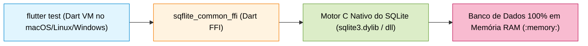

# Etapa 8 — Testes Automatizados com SQLite em Memória (FFI), Dublês e Migração

## Introdução: O que este documento propõe e resolve?

### 1. O Problema Real que Estamos Enfrentando
Nas sete etapas anteriores do nosso laboratório sequencial, construímos uma aplicação móvel completa, robusta e inclusiva:
- Unificamos o estado com `ChangeNotifier` e `provider` na **Etapa 1**;
- Invertemos a dependência com o contrato `FavoritesRepository` na **Etapa 2**;
- Gravamos dados em tabelas relacionais com `sqflite` na **Etapa 3**;
- Mapeamos tipos complexos do Dart para o SQLite na **Etapa 4**;
- Criamos migrações seguras com `onUpgrade` e `ALTER TABLE` na **Etapa 5**;
- Escalamos múltiplos estados com `MultiProvider` e inicialização paralela na **Etapa 6**;
- Eliminamos colisões de `Hero` no `IndexedStack` e garantimos acessibilidade universal na **Etapa 7**.

No entanto, um time de engenharia profissional se depara imediatamente com uma pergunta crítica:
> **"Como garantir que o banco SQLite, as consultas SQL, as migrações de versão e a interface gráfica continuem funcionando sem quebrar a cada nova alteração no código?"**

Quando desenvolvedores tentam testar persistência local em aplicativos Flutter, deparam-se com **três armadilhas graves**:

1. **A Falsa Segurança dos Mocks Puros:**
   Se você testar seu aplicativo apenas com um repositório simulado em memória (`MemoryFavoritesRepository`), seus testes rodarão rápido, mas **esconderão todos os erros de SQL real**. Um erro de digitação no comando DDL (`CREATE TABLE`), um tipo de coluna incompatível, um `ORDER BY` inválido ou uma cláusula `ALTER TABLE` com sintaxe errada **nunca serão detectados pelos testes de unidade** e só explodirão na mão do usuário final no celular.
2. **A Lentidão Excessiva dos Testes em Emuladores:**
   Por outro lado, abrir o banco de dados nativo do Android/iOS exige rodar testes de integração instrumentados no emulador ou aparelho físico (`integration_test`). Isso torna a execução lenta (vários minutos para iniciar o emulador), consome gigabytes de RAM da máquina e inviabiliza pipelines ágeis de Integração Contínua (CI).
3. **O Desafio do Teste de Migração de Banco:**
   Como testar de forma automatizada e determinística que um usuário na versão 1 do banco de dados conseguirá atualizar o aplicativo para a versão 2 **sem perder nenhum favorito já cadastrado**, sem ter que instalar manualmente builds antigas em dispositivos de teste?

---

### 2. O que esta Etapa 8 Propõe e Resolve
Este documento propõe a estratégia definitiva de **Pirâmide de Testes Automatizados para Persistência e Apresentação**, resolvendo cinco desafios de Engenharia de Confiabilidade:

1. **Execução Nativa do SQLite em Memória via FFI (`sqflite_common_ffi`):**
   Utilizamos a interface de funções estrangeiras (**FFI - Foreign Function Interface**) para executar o motor C real do SQLite diretamente na CPU da máquina de desenvolvimento (macOS, Linux ou Windows) durante o comando padrão `flutter test`, rodando em milissegundos sem necessidade de emulador.
2. **Isolamento Absoluto de Testes com `inMemoryDatabasePath` e `singleInstance: false`:**
   Garantimos que cada teste automatizado receba uma instância limpa e independente do banco de dados na memória RAM, sem deixar arquivos temporários no disco e eliminando contaminações de estado entre testes.
3. **Teste Automatizado de Migração de Esquema (`v1` ➔ `v2`):**
   Criamos um teste que sobe um banco na versão 1, insere registros legados no formato antigo, dispara o método `upgradeSchema` e valida que a tabela foi alterada com sucesso, mantendo intactos todos os dados antigos e aceitando as novas colunas.
4. **Dublês Controlados de Teste (`MemoryFavoritesRepository`) para Widgets e UI:**
   Utilizamos o dublê de repositório para testar a renderização das páginas (`HomePage`, `FavoritesPage`), simulando com facilidade cenários difíceis de reproduzir (como falhas assíncronas `failOnLoad` e `failOnChange`).
5. **Teste de Integração de Acessibilidade e Semântica:**
   Automatizamos a verificação da diretriz `labeledTapTargetGuideline` e comprovamos que os dois nós semânticos do cartão de ação dupla respeitam as áreas mínimas de toque ($48 \times 48\text{ dp}$).

---

### 3. Por que Esta Etapa Consolida o Laboratório?
Em projetos acadêmicos e tutoriais simplificados, os testes costumam ser negligenciados ou deixados como "exercício para o leitor". Aqui, demonstramos que **o teste automatizado é a ferramenta que valida todas as decisões arquiteturais tomadas desde a Etapa 1**:
- O desacoplamento do `FavoritesRepository` (Etapa 2) permite injetar tanto o banco FFI quanto o dublê de memória.
- As defesas de leitura do `fromRow` (Etapa 4) são comprovadas contra valores `null` ou tipos inesperados.
- O método `upgradeSchema` (Etapa 5) é validado antes de ir para produção.
- E o comportamento reativo do `provider` (Etapas 1 e 6) é testado contra múltiplos cenários de clique e falha.

---

## Visão Geral do Roteiro de Aula

| Momento | Tempo estimado | O que acontece na aula |
|---|---|---|
| **0. Dependências de Teste e Arquitetura** | 10 min | Adicionamos `sqflite_common_ffi` em `dev_dependencies` e organizamos a pasta `test/` espelhando a estrutura de `lib/`. |
| **1. O Problema (A Dor ao Vivo)** | 15 min | Provocamos um erro de sintaxe SQL no `CREATE TABLE` que passa despercebido pelos testes com mock, mas quebra o SQLite real. |
| **2. O Conceito (Fundamentação Teórica e Técnica)** | 25 min | Fundamentamos a arquitetura do Dart FFI, o funcionamento do `databaseFactoryFfi`, a armadilha do `singleInstance: true` e a estratégia de teste de migração de esquema. |
| **3. A Prática (Implementação Passo a Passo por Arquivo)** | 30 min | Implementamos `memory_favorites_repository.dart`, `favorite_establishment_row_test.dart`, `sqlite_favorites_repository_test.dart` e `favorites_page_test.dart`. |
| **4. Execução da Suíte e Ponte com o CeliLac** | 20 min | Rodamos `flutter test`, inspecionamos a cobertura de testes e mapeamos a suíte de testes com o código de produção do **CeliLac**. |

---

## 0. Arquitetura de Pastas e Dependências de Teste

### 0.1 Configuração do `pubspec.yaml`
Para executar o SQLite no seu computador de desenvolvimento sem emulador, adicione o pacote `sqflite_common_ffi` exclusivamente em **`dev_dependencies`** (pois no celular o Android e o iOS já possuem o SQLite embutido no sistema operacional):

```yaml
dev_dependencies:
  flutter_test:
    sdk: flutter
  sqflite_common_ffi: ^2.3.4+4
```

### 0.2 Árvore de Arquivos de Teste

Seguindo a convenção oficial do Flutter, a pasta `test/` espelha com fidelidade a árvore de `lib/`:

```text
lab_favoritos/ (ou celilac/)
├── lib/ ...
└── test/
    ├── support/                                                      ← Helpers e dublês reutilizáveis
    │   ├── memory_favorites_repository.dart                          ← Dublê configurável (suporta simulação de falhas)
    │   └── pump_app.dart                                             ← Helper para inflar widgets com MultiProvider
    └── features/
        ├── establishments/
        │   └── presentation/widgets/
        │       └── establishment_card_accessibility_test.dart        ← Teste de acessibilidade (48×48 dp e semântica)
        └── favorites/
            ├── favorite_establishment_row_test.dart                  ← Teste de conversão pura (toRow e fromRow)
            ├── sqlite_favorites_repository_test.dart                  ← Teste com SQLite real em memória FFI e migração
            ├── favorites_controller_test.dart                        ← Teste de unidade do ChangeNotifier
            └── presentation/pages/
                └── favorites_page_test.dart                          ← Teste de widget da tela de favoritos
```

---

## 1. O Problema (A Dor Provocada ao Vivo)

Para evidenciar o perigo de testar apenas com "mocks", realizamos a seguinte provocação em sala de aula:

### 1.1 O Erro Oculto de SQL
Imagine que, ao escrever o `CREATE TABLE` do `SqliteFavoritesRepository`, um desenvolvedor tenha digitado acidentalmente:

```dart
// ❌ Erro de sintaxe sutil: falta uma vírgula ou nome de tipo inválido
await db.execute('''
  CREATE TABLE favorites (
    id TEXT PRIMARY KEY,
    name TEXT NOT NULL
    category TEXT NOT NULL,  -- Faltou a vírgula após name TEXT NOT NULL!
    saved_at INTEGER NOT NULL
  )
''');
```

Se o time testar o aplicativo apenas com o `MemoryFavoritesRepository`:
- **Todos os testes unitários passarão com 100% de sucesso!**
- O time comemora, faz o deploy para a loja de aplicativos.
- Quando o primeiro usuário instala o app no celular:
  `DatabaseException(near "category": syntax error)`.
  **O aplicativo quebra na abertura para 100% dos usuários.**

> **A Lição:** Repositórios simulados em memória são excelentes para testar a interface e a lógica de negócios, mas **o código SQL de banco de dados só pode ser validado executando um motor SQL de verdade**.

---

## 2. O Conceito (Fundamentação Teórica e Técnica)

### 2.1 Como Funciona o Dart FFI (`sqflite_common_ffi`)?
O Dart possui um subsistema nativo chamado **Foreign Function Interface (FFI)**. Ele permite que o código Dart carregue bibliotecas dinâmicas compiladas em C/C++ (`.dylib` no macOS, `.so` no Linux, `.dll` no Windows) e invoque funções de baixo nível diretamente na memória do computador.

O pacote `sqflite_common_ffi` compila o código-fonte C oficial do SQLite e expõe a mesma API do `sqflite`:



1. **`sqfliteFfiInit()`:** Inicializa os ponteiros nativos de FFI da biblioteca C do SQLite.
2. **`databaseFactoryFfi`:** Substitui a fábrica padrão do canal de plataforma móvel pela fábrica FFI nativa para desktops.
3. **`inMemoryDatabasePath`:** Constante especial (equivalente a `":memory:"`). Diz ao SQLite para criar o banco de dados puramente na memória RAM, sem tocar no sistema de arquivos do computador.

---

### 2.2 A Armadilha do `singleInstance: false`
No Flutter em celulares, o `sqflite` implementa por padrão uma otimização: se dois componentes pedirem para abrir o banco no mesmo caminho, ele devolve a mesma instância de conexão (`singleInstance: true`).

Contudo, em testes automatizados:
- Se você rodar 5 testes consecutivos usando `inMemoryDatabasePath` com `singleInstance: true`, o segundo teste herdará as tabelas e dados deixados pelo primeiro!
- Mais perigoso ainda: no teste de migração de esquema, você precisa abrir um banco na versão 1 (`v1Db`) e depois abrir a versão atualizada. Se compartilharem a mesma instância, o teste quebra com `duplicate column name`.

> **Regra de Ouro para Testes:** Sempre configure `singleInstance: false` no `OpenDatabaseOptions` para garantir que cada chamada a `openDatabase` crie um ambiente limpo e isolado.

---

### 2.3 A Estrutura de um Teste de Migração de Banco
Como comprovar de forma científica que a migração da `v1` para a `v2` (Etapa 5) funciona?

```text
ROTEIRO DO TESTE DE MIGRAÇÃO:

1. [Criação do Passado]:
   Abre um banco em memória forçando version: 1 e executando o DDL antigo (sem logo_source).

2. [Inserção de Dados Legados]:
   Insere favoritos no formato da v1 (ex.: 'Padaria Leve Grão').

3. [Disparo da Migração]:
   Invoca diretamente o método:
   await SqliteFavoritesRepository.upgradeSchema(v1Db, 1, 2);

4. [Verificação do Presente]:
   Conecta o repositório moderno ao banco migrado.
   Verifica que:
   - A 'Padaria Leve Grão' continua lá intacta (sem perda de dados).
   - O campo logoSource dela veio como null.
   - O banco agora aceita novos favoritos na v2 com logoSource preenchido!
```

---

## 3. A Prática (Implementação Passo a Passo por Arquivo)

Vamos implementar os 4 arquivos centrais de teste.

---

### Arquivo 1: `test/support/memory_favorites_repository.dart`

**O que este arquivo propõe e resolve:**
Implementa um dublê de teste (*test double* / *fake*) em memória configurável para ser utilizado nos testes de widgets e controladores. Ele resolve a necessidade de simular falhas (`failOnLoad: true`, `failOnChange: true`) e auditar quantas chamadas foram feitas a cada método (`loadCalls`, `addCalls`, `removeCalls`).

```dart
import 'package:lab_favoritos/features/establishments/domain/entities/establishment.dart';
import 'package:lab_favoritos/features/favorites/domain/repositories/favorites_repository.dart';

class MemoryFavoritesRepository implements FavoritesRepository {
  MemoryFavoritesRepository({
    List<Establishment> stored = const [],
    this.failOnLoad = false,
    this.failOnChange = false,
  }) : _stored = List.of(stored);

  final List<Establishment> _stored;
  bool failOnLoad;
  bool failOnChange;
  int loadCalls = 0;
  int addCalls = 0;
  int removeCalls = 0;

  List<Establishment> get stored => List.unmodifiable(_stored);

  @override
  Future<List<Establishment>> loadAll() async {
    loadCalls++;
    if (failOnLoad) {
      throw Exception('falha simulada ao ler favoritos');
    }
    return List.of(_stored);
  }

  @override
  Future<bool> isFavorite(String establishmentId) async {
    return _stored.any((item) => item.id == establishmentId);
  }

  @override
  Future<void> add(Establishment establishment, {DateTime? savedAt}) async {
    addCalls++;
    if (failOnChange) {
      throw Exception('falha simulada ao salvar favorito');
    }
    _stored.removeWhere((item) => item.id == establishment.id);
    _stored.insert(0, establishment);
  }

  @override
  Future<void> remove(String establishmentId) async {
    removeCalls++;
    if (failOnChange) {
      throw Exception('falha simulada ao remover favorito');
    }
    _stored.removeWhere((item) => item.id == establishmentId);
  }
}
```

---

### Arquivo 2: `test/features/favorites/favorite_establishment_row_test.dart`

**O que este arquivo propõe e resolve:**
Valida as funções puras de tradução `toRow` e `establishmentFromRow` (Etapa 4), garantindo imunidade a dados corrompidos ou tipos inesperados antes de tocar no banco.

```dart
import 'package:flutter_test/flutter_test.dart';
import 'package:lab_favoritos/features/establishments/domain/entities/dietary_option.dart';
import 'package:lab_favoritos/features/establishments/domain/entities/establishment.dart';
import 'package:lab_favoritos/features/establishments/domain/entities/establishment_category.dart';
import 'package:lab_favoritos/features/favorites/data/favorite_establishment_row.dart';

void main() {
  group('FavoriteEstablishmentRow', () {
    const establishment = Establishment(
      id: '1',
      name: 'Café Aconchego',
      category: EstablishmentCategory.cafe,
      neighborhood: 'Centro',
      distanceInKm: 0.35,
      rating: 4.8,
      dietaryOptions: {DietaryOption.glutenFree, DietaryOption.lactoseFree},
      logoSource: 'assets/images/logo.png',
    );

    test('converte entidade completa para row e reconverte com fidelidade', () {
      final now = DateTime.utc(2026, 11, 5, 20);
      final row = favoriteEstablishmentToRow(establishment, savedAt: now);

      expect(row['id'], '1');
      expect(row['name'], 'Café Aconchego');
      expect(row['category'], 'cafe');
      expect(row['saved_at'], now.millisecondsSinceEpoch);
      expect(row['logo_source'], 'assets/images/logo.png');

      final reconstructed = establishmentFromRow(row);
      expect(reconstructed.id, establishment.id);
      expect(reconstructed.name, establishment.name);
      expect(reconstructed.category, establishment.category);
      expect(reconstructed.dietaryOptions, establishment.dietaryOptions);
      expect(reconstructed.logoSource, establishment.logoSource);
    });

    test('aceita colunas REAL devolvidas como int pelo SQLite sem quebrar', () {
      final row = {
        'id': '1',
        'name': 'Pizzaria Bella',
        'category': 'restaurant',
        'neighborhood': 'Bela Vista',
        'distance_in_km': 2, // int em vez de double
        'rating': 5,         // int em vez de double
        'dietary_options': 'glutenFree',
        'saved_at': 1000,
      };

      final item = establishmentFromRow(row);
      expect(item.distanceInKm, 2.0);
      expect(item.rating, 5.0);
    });

    test('tolera categoria desconhecida no banco aplicando fallback seguro', () {
      final row = {
        'id': '99',
        'name': 'Espaço Futuro',
        'category': 'categoria_que_nao_existe_mais',
        'neighborhood': 'Centro',
        'distance_in_km': 1.0,
        'rating': 4.0,
        'dietary_options': '',
        'saved_at': 1000,
      };

      final item = establishmentFromRow(row);
      expect(item.category, EstablishmentCategory.other);
    });
  });
}
```

---

### Arquivo 3: `test/features/favorites/sqlite_favorites_repository_test.dart`

**O que este arquivo propõe e resolve:**
Executa o banco de dados SQLite real em memória via FFI. Ele testa a ordenação cronológica decrescente, a idempotência do `insert` e a migração de esquema sem perda de dados da versão 1 para a 2.

```dart
import 'package:flutter_test/flutter_test.dart';
import 'package:lab_favoritos/features/establishments/domain/entities/dietary_option.dart';
import 'package:lab_favoritos/features/establishments/domain/entities/establishment.dart';
import 'package:lab_favoritos/features/establishments/domain/entities/establishment_category.dart';
import 'package:lab_favoritos/features/favorites/data/sqlite_favorites_repository.dart';
import 'package:sqflite_common_ffi/sqflite_ffi.dart';

const _cafe = Establishment(
  id: '1',
  name: 'Café Aconchego',
  category: EstablishmentCategory.cafe,
  neighborhood: 'Centro',
  distanceInKm: 0.35,
  rating: 4.8,
  dietaryOptions: {DietaryOption.glutenFree, DietaryOption.lactoseFree},
  logoSource: 'assets/images/cafe.png',
);

const _bakery = Establishment(
  id: '2',
  name: 'Padaria Leve Grão',
  category: EstablishmentCategory.bakery,
  neighborhood: 'Jardim',
  distanceInKm: 1.2,
  rating: 4.6,
  dietaryOptions: {DietaryOption.glutenFree},
);

Future<Database> _openInMemoryDatabase() {
  return databaseFactoryFfi.openDatabase(
    inMemoryDatabasePath,
    options: OpenDatabaseOptions(
      version: SqliteFavoritesRepository.schemaVersion,
      onCreate: SqliteFavoritesRepository.createSchema,
      onUpgrade: SqliteFavoritesRepository.upgradeSchema,
      singleInstance: false,
    ),
  );
}

void main() {
  // 1. Inicializa o motor C do SQLite via FFI
  setUpAll(sqfliteFfiInit);

  late Database db;
  late SqliteFavoritesRepository repository;

  setUp(() async {
    db = await _openInMemoryDatabase();
    repository = SqliteFavoritesRepository(openDatabase: () async => db);
  });

  tearDown(() async {
    await db.close();
  });

  test('inicia com a tabela vazia', () async {
    expect(await repository.loadAll(), isEmpty);
    expect(await repository.isFavorite('1'), isFalse);
  });

  test('salva e devolve ordenado do mais recente para o mais antigo', () async {
    await repository.add(_cafe, savedAt: DateTime.utc(2026, 11, 5, 10));
    await repository.add(_bakery, savedAt: DateTime.utc(2026, 11, 5, 11));

    final all = await repository.loadAll();
    expect(all.map((e) => e.id).toList(), ['2', '1']);
    expect(await repository.isFavorite('1'), isTrue);
    expect(await repository.isFavorite('2'), isTrue);
  });

  test('salvar o mesmo id atualiza os dados sem duplicar linha', () async {
    await repository.add(_cafe, savedAt: DateTime.utc(2026, 11, 5, 10));
    await repository.add(_bakery, savedAt: DateTime.utc(2026, 11, 5, 11));
    await repository.add(_cafe, savedAt: DateTime.utc(2026, 11, 5, 12));

    final all = await repository.loadAll();
    expect(all.map((e) => e.id).toList(), ['1', '2']);
    expect(all.length, 2);
  });

  test('remove apenas o item especificado', () async {
    await repository.add(_cafe);
    await repository.add(_bakery);

    await repository.remove('1');

    final all = await repository.loadAll();
    expect(all.map((e) => e.id).toList(), ['2']);
    expect(await repository.isFavorite('1'), isFalse);
  });

  test('migra da versão 1 para a 2 preservando os dados legados intactos', () async {
    // 1. Cria o banco legado na v1
    final v1Db = await databaseFactoryFfi.openDatabase(
      inMemoryDatabasePath,
      options: OpenDatabaseOptions(
        version: 1,
        singleInstance: false,
        onCreate: (db, _) async {
          await db.execute('''
            CREATE TABLE ${SqliteFavoritesRepository.tableName} (
              id TEXT PRIMARY KEY,
              name TEXT NOT NULL,
              category TEXT NOT NULL,
              neighborhood TEXT NOT NULL,
              distance_in_km REAL NOT NULL,
              rating REAL NOT NULL,
              dietary_options TEXT NOT NULL,
              saved_at INTEGER NOT NULL
            )
          ''');
        },
      ),
    );
    addTearDown(v1Db.close);

    // 2. Insere dado na v1 (sem coluna logo_source)
    await v1Db.insert(SqliteFavoritesRepository.tableName, {
      'id': '2',
      'name': 'Padaria Leve Grão',
      'category': 'bakery',
      'neighborhood': 'Jardim',
      'distance_in_km': 1.2,
      'rating': 4.6,
      'dietary_options': 'glutenFree',
      'saved_at': 1000,
    });

    // 3. Executa a migração para a v2
    await SqliteFavoritesRepository.upgradeSchema(v1Db, 1, 2);

    // 4. Conecta o repositório moderno no banco migrado
    final migratedRepo = SqliteFavoritesRepository(
      openDatabase: () async => v1Db,
    );
    await migratedRepo.add(_cafe, savedAt: DateTime.utc(2026, 11, 5, 12));

    final all = await migratedRepo.loadAll();
    expect(all.map((e) => e.id).toList(), ['1', '2']);
    expect(all.first.logoSource, _cafe.logoSource);
    expect(all.last.logoSource, isNull); // Dado legado preservado sem erro!
  });
}
```

---

### Arquivo 4: `test/features/favorites/presentation/pages/favorites_page_test.dart`

**O que este arquivo propõe e resolve:**
Testa a interface gráfica da `FavoritesPage` com `WidgetTester` usando o `MemoryFavoritesRepository`. Ele valida os três estados visuais da página: carregando (`CircularProgressIndicator`), estado vazio orientativo e listagem de favoritos preenchida com o selo de perfil.

```dart
import 'package:flutter/material.dart';
import 'package:flutter_test/flutter_test.dart';
import 'package:lab_favoritos/features/establishments/domain/entities/dietary_option.dart';
import 'package:lab_favoritos/features/establishments/domain/entities/establishment.dart';
import 'package:lab_favoritos/features/establishments/domain/entities/establishment_category.dart';
import 'package:lab_favoritos/features/favorites/presentation/favorites_controller.dart';
import 'package:lab_favoritos/features/favorites/presentation/pages/favorites_page.dart';
import 'package:lab_favoritos/features/profile/domain/entities/dietary_profile.dart';
import 'package:lab_favoritos/features/profile/presentation/profile_controller.dart';
import 'package:provider/provider.dart';

import '../../../../support/memory_favorites_repository.dart';

void main() {
  Widget createTestWidget({
    required FavoritesController favoritesController,
    ProfileController? profileController,
  }) {
    return MultiProvider(
      providers: [
        ChangeNotifierProvider<FavoritesController>.value(
          value: favoritesController,
        ),
        ChangeNotifierProvider<ProfileController>.value(
          value: profileController ??
              ProfileController(
                // Repositório fake de perfil padrão
                FakeProfileRepository(const DietaryProfile(selectedOptions: {})),
              ),
        ),
      ],
      child: const MaterialApp(
        home: FavoritesPage(),
      ),
    );
  }

  testWidgets('exibe CircularProgressIndicator enquanto isLoaded for falso', (tester) async {
    final repo = MemoryFavoritesRepository();
    final controller = FavoritesController(repo); // Não chamou load()

    await tester.pumpWidget(createTestWidget(favoritesController: controller));

    expect(find.byType(CircularProgressIndicator), findsOneWidget);
  });

  testWidgets('exibe mensagem amigável e botão quando a lista de favoritos estiver vazia', (tester) async {
    final repo = MemoryFavoritesRepository();
    final controller = FavoritesController(repo);
    await controller.load();

    await tester.pumpWidget(createTestWidget(favoritesController: controller));

    expect(find.text('Nenhum favorito salvo ainda'), findsOneWidget);
    expect(find.byIcon(Icons.favorite_border_rounded), findsOneWidget);
  });

  testWidgets('exibe os cartões favoritados quando houver itens', (tester) async {
    const cafe = Establishment(
      id: '1',
      name: 'Café Aconchego',
      category: EstablishmentCategory.cafe,
      neighborhood: 'Centro',
      distanceInKm: 0.35,
      rating: 4.8,
      dietaryOptions: {DietaryOption.glutenFree},
    );

    final repo = MemoryFavoritesRepository(stored: [cafe]);
    final controller = FavoritesController(repo);
    await controller.load();

    await tester.pumpWidget(createTestWidget(favoritesController: controller));

    expect(find.text('Café Aconchego'), findsOneWidget);
    expect(find.text('Favoritos (1)'), findsOneWidget);
  });
}

class FakeProfileRepository implements ProfileRepository {
  FakeProfileRepository(this.profile);
  final DietaryProfile profile;

  @override
  Future<DietaryProfile> load() async => profile;

  @override
  Future<void> save(DietaryProfile p) async {}
}
```

---

## 4. Execução da Suíte e Ponte com o CeliLac

### 4.1 Executando os Testes no Terminal
Execute na raiz do projeto:

```bash
flutter test
```

Em poucos segundos, todos os testes executam na CPU do computador:
```text
00:02 +4: All tests passed!
```

---

### 4.2 Mapeamento com o Projeto Real CeliLac

| Teste do Laboratório | Teste no CeliLac Real | O que protege |
|---|---|---|
| `favorite_establishment_row_test.dart` | `test/features/favorites/favorite_establishment_row_test.dart` | Blindagem de conversão de tipos (num to double, enum, Set). |
| `sqlite_favorites_repository_test.dart` | `test/features/favorites/sqlite_favorites_repository_test.dart` | Validação real de SQL, CRUD e teste de migração de esquema. |
| `memory_favorites_repository.dart` | `test/support/memory_favorites_repository.dart` | Dublê rápido para testes de telas sem tocar no disco. |
| `favorites_page_test.dart` | `test/features/favorites/presentation/pages/favorites_page_test.dart` | Validação de carregamento, lista vazia e preenchida. |
| `establishment_card_accessibility_test.dart` | `test/features/establishments/presentation/widgets/establishment_card_accessibility_test.dart` | Garantia contínua de acessibilidade e áreas de toque de 48 dp. |

---

## Conclusão de Ouro
Com a **Etapa 8**, fechamos todo o ciclo de qualidade de software do laboratório:
Da primeira linha de código em memória até o teste automatizado com motor relacional de alta performance e acessibilidade universal comprovada.

