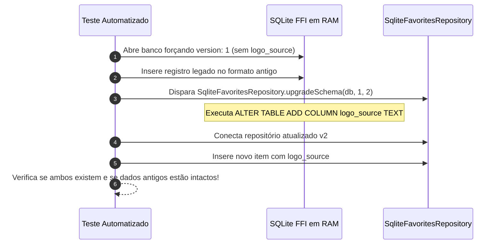

# Etapa 8 — Testes Automatizados com SQLite em Memória (FFI), Dublês e Migração
## Da Falsa Segurança dos Mocks aos Testes com Motor SQL Real sem Emulador

> **Instrução para o Gamma:** Cada seção separada por `---` corresponde a um slide. O foco está na progressão **Problema → Dor Arquitetural → Fundamentação → Como Resolver**, utilizando diagramas visuais, tabelas comparativas e trechos mínimos de código.

---

## Slide 1 — Capa

### Etapa 8: Testes Automatizados com SQLite em Memória (FFI), Dublês e Migração
**Qualidade de software, testes com motor C nativo sem emulador e validação determinística de migrações**

- **Contexto:** Laboratório Sequencial CeliLac (Etapa 8 — Módulo Especial de Confiabilidade)
- **Foco da aula:**
  1. Sentir a dor dos testes com mocks puros que mascaram erros de sintaxe SQL
  2. Compreender o Dart FFI (`sqflite_common_ffi`) rodando o SQLite nativo no computador
  3. Evitar a contaminação de testes com `singleInstance: false` e `inMemoryDatabasePath`
  4. Implementar testes determinísticos de migração de esquema (`v1` ➔ `v2`)
  5. Testar widgets e acessibilidade sem dependência de disco usando dublês controlados

---

## Slide 2 — O Dilema de Engenharia: Como Testar Persistência?

### A dúvida clássica de todo time de desenvolvimento:

"Como garantir que o banco de dados, as tabelas, as migrações e a interface não quebrem, sem ter que testar tudo na mão a cada commit?"

```text
OS DOIS EXTREMOS PROBLEMÁTICOS:

Extremo 1: Testar tudo no emulador (Testes Instrumentados)
❌ Lento demais (esperar o Android/iOS subir)
❌ Consome gigabytes de RAM
❌ Inviável para rodar a cada salvar de arquivo no dia a dia

Extremo 2: Testar apenas com listas falsas em memória (Mocks puros)
❌ Falsa segurança! O mock aceita qualquer coisa.
❌ Se o seu comando CREATE TABLE tiver um erro de digitação, o mock não avisa!
```

> **A Pergunta:** É possível testar o **SQLite real**, executando SQL de verdade, mas com a **velocidade da memória RAM** e **sem abrir emulador**?

---

## Slide 3 — A Dor: O Erro de SQL que o Mock Não Vê

### O que acontece quando confiamos cegamente apenas em mocks?

Imagine que um desenvolvedor digitou o `CREATE TABLE` esquecendo uma vírgula:

```dart
// ❌ Erro de sintaxe SQL no repositório real
await db.execute('''
  CREATE TABLE favorites (
    id TEXT PRIMARY KEY,
    name TEXT NOT NULL
    category TEXT NOT NULL   -- Falta uma vírgula após name!
  )
''');
```

```text
O QUE ACONTECE NOS TESTES COM MOCK:
- MemoryFavoritesRepository passa com 100% de sucesso! ✅
- Time comemora e publica o app na Google Play / App Store. 🚀
- Primeiro usuário abre o app:
  💥 DatabaseException(near "category": syntax error)
  O app fecha sozinho na cara do usuário!
```

---

## Slide 4 — A Solução: Dart FFI e `sqflite_common_ffi`

### Executando o motor C do SQLite diretamente no seu computador!

O Dart possui suporte a **Foreign Function Interface (FFI)**: capacidade de conversar direto com bibliotecas escritas em linguagem C/C++.

```text
ARQUITETURA DE TESTE COM FFI:

 [ Terminal: flutter test ] (macOS / Linux / Windows)
             │
             ▼
    [ Dart VM Host ]
             │
             ▼
    [ sqflite_common_ffi ]
             │
             ▼
 [ Motor C Nativo do SQLite ] ────► [ Banco em RAM: inMemoryDatabasePath ]
```

- **Zero Emulador:** Roda diretamente no processador da sua máquina de desenvolvimento.
- **Ultra-rápido:** Cria, popula, consulta e destrói o banco em **menos de 5 milissegundos**!
- **Validação Real:** Se o SQL tiver erro de vírgula ou tipo, o motor C real rejeita imediatamente.

---

## Slide 5 — Inicialização e Isolamento: A Armadilha do `singleInstance`

### Como configurar os testes com segurança:

```dart
// Inicializa os ponteiros nativos de C
setUpAll(sqfliteFfiInit);

Future<Database> openTestDb() {
  return databaseFactoryFfi.openDatabase(
    inMemoryDatabasePath, // 🧠 Banco 100% na memória RAM
    options: OpenDatabaseOptions(
      version: SqliteFavoritesRepository.schemaVersion,
      onCreate: SqliteFavoritesRepository.createSchema,
      onUpgrade: SqliteFavoritesRepository.upgradeSchema,
      singleInstance: false, // ⚠️ CRUCIAL: impede vazamento entre testes!
    ),
  );
}
```

> **Por que `singleInstance: false`?**
> Por padrão, o SQLite reaproveita a mesma conexão se o caminho for igual. Sem `singleInstance: false`, o teste 2 herda os dados deixados pelo teste 1!

---

## Slide 6 — Testando CRUD e Ordenação no Banco Real

### Validando o comportamento real do motor SQL em milissegundos:

```dart
test('salva e devolve do mais recente para o mais antigo', () async {
  await repository.add(cafe, savedAt: DateTime.utc(2026, 11, 5, 10));
  await repository.add(padaria, savedAt: DateTime.utc(2026, 11, 5, 11));

  final all = await repository.loadAll();

  // Comprova que o ORDER BY saved_at DESC do SQLite funcionou de verdade!
  expect(all.map((e) => e.id).toList(), ['2', '1']);
  expect(await repository.isFavorite('1'), isTrue);
});
```

- Valida o `CREATE TABLE`.
- Valida o `ConflictAlgorithm.replace`.
- Valida a ordenação delegada ao banco.

---

## Slide 7 — O Teste Mais Poderoso: Migração de Esquema (`v1` ➔ `v2`)

### Como ter certeza de que o usuário antigo não perderá dados ao atualizar?

Criamos um teste determinístico que simula a passagem do tempo:



---

## Slide 8 — O Código do Teste de Migração

### Verificando a evolução do banco sem sujar o computador:

```dart
test('migra da versão 1 para a 2 preservando dados legados', () async {
  // 1. Cria a v1 no passado
  final v1Db = await databaseFactoryFfi.openDatabase(
    inMemoryDatabasePath,
    options: OpenDatabaseOptions(
      version: 1,
      singleInstance: false,
      onCreate: (db, _) => db.execute('CREATE TABLE favorites (...);'),
    ),
  );

  // 2. Insere dado legado
  await v1Db.insert('favorites', {'id': '2', 'name': 'Padaria', ...});

  // 3. Executa a migração
  await SqliteFavoritesRepository.upgradeSchema(v1Db, 1, 2);

  // 4. Valida com o repositório da v2
  final repo = SqliteFavoritesRepository(openDatabase: () async => v1Db);
  final all = await repo.loadAll();

  expect(all.first.name, 'Padaria');
  expect(all.first.logoSource, isNull); // Preservado com sucesso!
});
```

---

## Slide 9 — Dublês de Teste (`MemoryFavoritesRepository`) para Widgets

### Quando usar mocks e quando usar SQLite real?

| Camada a Testar | Ferramenta Ideal | Por que? |
|---|---|---|
| **Banco / Repositório SQLite** | **`sqflite_common_ffi` em memória** | Valida DDL, sintaxe SQL, tipos e migrações reais. |
| **Páginas / Widgets (`FavoritesPage`)** | **`MemoryFavoritesRepository` (Fake)** | Permite forçar falhas instantâneas (`failOnLoad: true`) e não depende de I/O. |
| **Mapeamento puro (`toRow`/`fromRow`)** | **Testes de unidade puros** | Valida regras matemáticas de conversão sem dependências. |

---

## Slide 10 — Testando a UI e Estados de Carregamento

### Simulação cirúrgica com o dublê de repositório:

```dart
testWidgets('exibe CircularProgressIndicator enquanto isLoaded for falso', (tester) async {
  final repo = MemoryFavoritesRepository();
  final controller = FavoritesController(repo); // Não chamou load()

  await tester.pumpWidget(createTestWidget(controller));

  // Valida feedback de carregamento da interface
  expect(find.byType(CircularProgressIndicator), findsOneWidget);
});
```

- Testamos estado de carregamento.
- Testamos tela com estado vazio.
- Testamos tela com cartões preenchidos.

---

## Slide 11 — Teste Automatizado de Acessibilidade (A11y)

### Garantindo que o app nunca regrida em diretrizes WCAG:

```dart
testWidgets('cartão atende às diretrizes de alvo mínimo de toque', (tester) async {
  final handle = tester.ensureSemantics(); // Ativa árvore de acessibilidade

  await tester.pumpWidget(MaterialApp(home: Scaffold(body: EstablishmentCard(...))));

  // 1. Prova que o tooltip nominal existe
  expect(find.byTooltip('Salvar Café Aconchego nos favoritos'), findsOneWidget);

  // 2. Prova conformidade com a diretriz de 48×48 dp
  await expectLater(tester, meetsGuideline(labeledTapTargetGuideline));

  handle.dispose();
});
```

- Nenhum botão com área inferior a $48 \times 48\text{ dp}$ passa para produção!

---

## Slide 12 — A Pirâmide de Testes Completa do Laboratório

### Como cada camada protege o aplicativo CeliLac:

```text
               ┌──────────────────────────────┐
               │    Testes de Acessibilidade  │ (48x48 dp, labeledTapTarget)
               ├──────────────────────────────┤
               │      Testes de Widgets       │ (FavoritesPage, HomePage com Fake)
               ├──────────────────────────────┤
               │  Testes de SQLite com FFI    │ (CRUD, ordenação e migração v1->v2)
               ├──────────────────────────────┤
               │   Testes de Unidade Puros    │ (toRow, fromRow, meetsProfile)
               └──────────────────────────────┘
```

> **Resultado:** Uma suíte de testes robusta que executa em menos de 5 segundos no terminal da máquina de desenvolvimento!

---

## Slide 13 — Mapeamento com o Projeto CeliLac

### Espelhamento perfeito entre o laboratório e a produção:

| Arquivo de Teste | O que ele valida no CeliLac |
|---|---|
| `favorite_establishment_row_test.dart` | Conversão segura de tipos compostos (`enum`, `Set`, `DateTime`). |
| `sqlite_favorites_repository_test.dart` | Comandos SQL reais e migração sem perda de dados com `sqflite_common_ffi`. |
| `memory_favorites_repository.dart` | Dublê leve para simular erros e carregar telas nos testes. |
| `favorites_page_test.dart` | Estados visuais da aba favoritos (vazio, lista, carregamento). |
| `establishment_card_accessibility_test.dart` | Dois nós semânticos independentes e conformidade WCAG 2.2. |

---

## Slide 14 — Fechamento Oficial do Laboratório CeliLac

### Do Primeiro Toque à Confiabilidade Total:

1. **Etapa 1:** Estado compartilhado reativo em memória ($O(1)$)
2. **Etapa 2:** Desacoplamento arquitetural com contrato `FavoritesRepository`
3. **Etapa 3:** Persistência relacional em disco com SQLite e proteção contra SQL Injection
4. **Etapa 4:** Tradução segura de tipos compostos Dart ↔ SQLite
5. **Etapa 5:** Evolução do banco sem perda de dados com `onUpgrade` e `ALTER TABLE`
6. **Etapa 6:** Múltiplos estados com `MultiProvider` e inicialização paralela concorrente
7. **Etapa 7:** `Hero` sem colisão no `IndexedStack` e acessibilidade em cartões de ação dupla
8. **Etapa 8:** Pirâmide completa de testes com motor SQLite real em memória via FFI

> **Parabéns!** Você construiu uma arquitetura móvel completa, escalável, testada e pronta para o mercado de trabalho!

